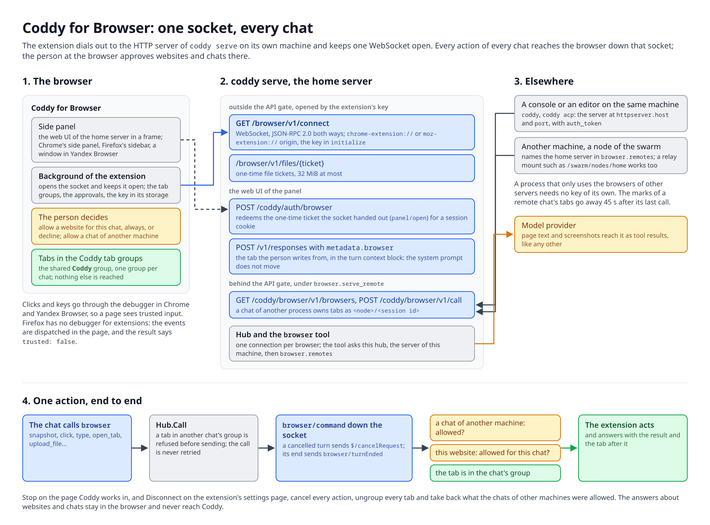
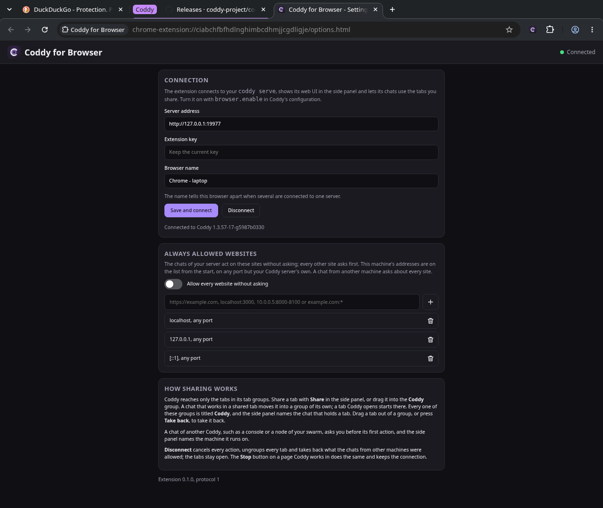
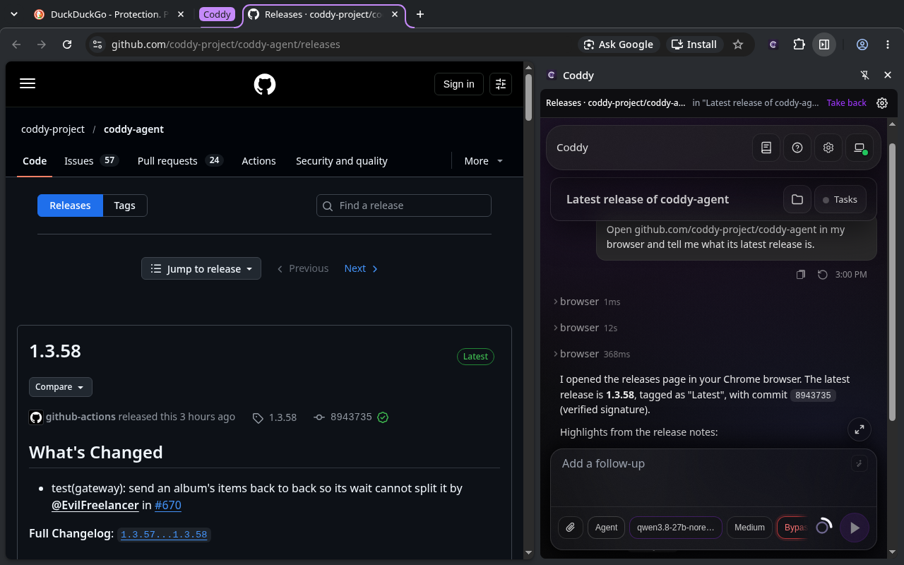
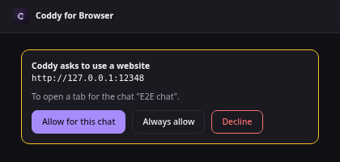
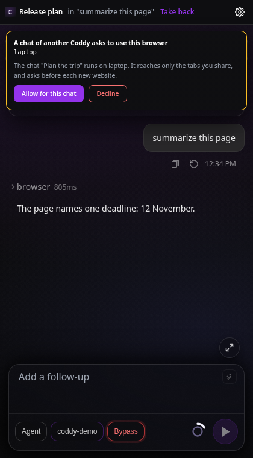

# Coddy for Browser

Coddy for Browser lets the chats of your Coddy work in your own browser - Chrome, Yandex Browser or Firefox: open a
tab, read a page, click, type, take a screenshot, move a file between the page and the workspace. The model runs on your server, and the
[Coddy for Browser](https://github.com/coddy-project/coddy-for-browser) extension carries out its actions in the tabs
you share. The extension's side panel shows the web UI of your Coddy next to the page you look at, and any other
surface can drive the browser too: the web UI, the console, an editor, a Telegram chat, a scheduled job, a node of
your [swarm](../operate/swarm.md) on another machine.

## How it works

The extension connects to the HTTP server of `coddy serve`, its home server, and keeps one WebSocket open. Coddy sends
every action of a chat down that socket as a JSON-RPC request, and the extension answers it. The server never connects
to the browser, so a browser on a laptop behind NAT works the same as one on the server itself. A chat of another Coddy
process - a console or an editor on the same machine, a node of the swarm - reaches the browser through the home
server's HTTP API. The wire is described in [Browser protocol](../reference/browser-protocol.md).



*How the browser, its home server and the chats of other processes connect, and what one action passes through.*

Coddy reaches only the tabs in its tab groups of the browser:

- the shared **Coddy** group holds the tabs you share; any chat may take one;
- every chat that works in the browser has a group of its own. A chat moves a shared tab into its group with its first
  action there, and a tab it opens starts there. Another chat cannot act in that group;
- you take a tab back by dragging it out of a group.

Every one of these groups is titled **Coddy** and coloured purple, so the tabs Coddy reaches stand out in the tab strip.
The side panel names the chat that holds the tab in front of you.

Page contents travel to the model provider your Coddy uses, like any tool result.

## Set up the server

The extension's endpoint and the `browser` tool are a module of the `browser` build tag. The release binaries, the
Docker image and the packages carry it; a binary built without it refuses `browser.enable` and names the tag. The
side panel shows the web UI, so the binary needs the `ui` tag too, which the same builds carry.

Generate a key of at least 32 characters, for example with `openssl rand -hex 32`, keep it in `<home>/.env` as
`CODDY_BROWSER_KEY` and turn the module on in `config.yaml`.

```yaml
browser:
  enable: true
  token: ${CODDY_BROWSER_KEY}
```

The extension connects to the HTTP server (`httpserver.enable`), at the address the web UI has. Save the block from
**Settings** or restart `coddy serve`; a new key disconnects the extensions that held the old one. The `browser` tool
is offered to the chats while `browser.enable` is true.

Run `coddy serve` on the machine of the browser. A server on another machine needs HTTPS in front of it, a reverse
proxy that passes WebSocket upgrades: the extension uses plain HTTP only for `localhost`, `127.0.0.1` and `[::1]`.
A machine that accepts no inbound connection joins your swarm with `swarm.join`, and the other nodes reach its
browser through the relay ([Chats of other Coddy processes](#chats-of-other-coddy-processes)).

The key is independent of `httpserver.auth_token`. It opens the extension's socket and its file transfers, and the
side panel's web UI is signed in with a one-time ticket the socket hands out, so whoever holds the key has the web UI
of the server. Keep it as secret as the HTTP API's token.

## Install the extension

Every [release](https://github.com/coddy-project/coddy-for-browser/releases) of the extension carries its packages,
and every run of its CI keeps them as artifacts:

| Package | Browsers |
| --- | --- |
| `coddy-for-browser-chrome-<version>.zip` | Chrome 116 and later, Yandex Browser and other Chromium browsers |
| `coddy-for-browser-firefox-<version>.xpi` | Firefox 139 and later, signed by Mozilla (in a release that was signed) |
| `coddy-for-browser-firefox-<version>.zip` | Firefox 139 and later, unsigned |

- **Chrome**: unpack the archive into a folder you keep, open `chrome://extensions`, turn on **Developer mode**, press
  **Load unpacked** and choose the folder.
- **Yandex Browser**: the same archive and the same steps, on `browser://extensions`.
- **Firefox**: open the signed `.xpi` in Firefox and confirm the installation. Release Firefox installs only add-ons
  Mozilla signed, so the unsigned archive is loaded as a temporary add-on from `about:debugging#/runtime/this-firefox`
  (**Load Temporary Add-on**), which Firefox removes when it closes; Firefox Developer Edition and Nightly keep it
  installed once `xpinstall.signatures.required` is `false` in `about:config`.

To build it from source instead, run `npm run build` in a checkout of the extension and load `dist/chrome` or
`dist/firefox`. The README of the extension has the details for each browser.

## Connect the browser

The settings page of the extension opens after the install, and later from the settings button of the side panel.
Enter the server address - the address of its web UI, `http://127.0.0.1:12345` for a local server - the key and a name
for this browser, then press **Save and connect**.



*The settings page of Coddy for Browser connected to a local Coddy.*

Several browsers can connect to one server, each under its own name. A chat lists them and selects one; with a single
browser connected, it is used without asking.

## The side panel

The toolbar button of the extension opens its side panel: the web UI of the home server, with everything the web UI
has - the models, attachments, approval modes, history and the questions Coddy asks. Firefox shows it in its sidebar.
Yandex Browser has no side panel for extensions, so there the button opens the same page in a window of its own at
the right edge of the browser's window. The panel signs it in with a
one-time ticket it gets over its socket, so no password is typed there.

*A recording of the side panel in Chrome: asked to search, a chat types into DuckDuckGo, opens the Go release history on go.dev and answers, and the extension asks before each new website. The file is in the repository as [browser-panel.mp4](../assets/video/browser-panel.mp4).*

Before a message is sent, the web UI asks the panel for the tab you look at, and the panel moves that tab into the
chat's tab group. A request about "this page" works on the page in front of you, and a `browser` call of the chat
that names no tab acts on it.



*The side panel in Chrome: the extension's strip shows the current tab and the chat that holds it, the web UI is under it. The tab sits in the purple Coddy group, and the extension's icon in the toolbar opens the panel.*

The strip over the web UI is the extension's own. It names the current tab and whose it is, with **Share** and
**Take back** and a button that opens the extension's settings, and it takes the theme of the web UI. The connection
is shown on the settings page; while there is none, the panel shows a card that leads there instead of the web UI. A
chat of the panel is an ordinary Coddy session, listed in the web UI everywhere. A chat of another environment the web
UI switches to gets no tab: the tab is in the browser of the panel's own server.

Opened on a tab that a chat of the home server holds, the panel shows that chat. A turn that a console, an editor, a
scheduled job or the API started there streams in the panel as in any chat, and the chat's name in the strip shows it
again after you went elsewhere in the web UI. A chat of another Coddy process lives on its own server, so the panel
names it and cannot show it.

A question of the extension - a website, a chat of another machine - comes up at the top of the panel, over the web
UI, and the chat stays in view around it.

## Share a tab

A chat outside the panel reaches a tab you share. Press **Share** in the strip of the side panel, or drag the tab into
the **Coddy** group; **Take back** ungroups it. **Disconnect** on the extension's settings page cancels every action
and ungroups every tab; the tabs stay open. The Stop button on a page Coddy works in does the same and keeps the
connection.

## Work from a chat

Ask for it in words, for example "open the release page of coddy-project/coddy-agent and summarize the latest
release". The chat calls the [`browser`](../reference/tools.md) tool:

- `list` shows the browsers the chat reaches and the tabs it may use, marked `yours` or `busy` (another chat's);
- `select` remembers a browser for the chat when several are connected;
- `open_tab`, `close_tab` and `release` open a tab in the chat's group, close one of its tabs and hand its tabs back
  to the shared group;
- `snapshot` reads a page as text plus up to 500 elements with references, and `screenshot` attaches an image of the
  visible part of the tab for a model that reads images;
- `navigate`, `click`, `type`, `press`, `hover`, `scroll` and `drag` act on the page. In Chrome and Yandex Browser
  clicks and keys go through the browser's debugger, so a page receives them as trusted input, the same as from a
  person. Firefox gives extensions no debugger, so there the extension dispatches the events in the page itself, and
  the result of the call says `"trusted": false`;
- `upload_file` and `download_file` move files between the page and the workspace.

A reference from `snapshot` lasts until the page changes, so the chat reads the page again after a navigation. The
`browser` tool asks for permission like other tools with side effects: the chat confirms each call unless the session
runs in the `bypass` permission mode.

Before the first action on a website, the extension asks you in a window of its own, or in the side panel when it is
open, whether to allow it for this chat, allow it always, or decline. The answer stays in the browser; a page cannot
answer it, and neither can Coddy. The settings page lists the sites allowed always and revokes them.

The list of sites allowed always starts with this machine - `localhost`, `127.0.0.1` and `[::1]`, any port - so a
chat works with a local dev server without a question; revoke an entry on the settings page like any other site.
These entries leave out the Coddy server itself under every local name of its port: its web UI is where a chat's own
requests are approved, so a chat acts there only after you allow that address. A chat of another machine asks about
local pages like any other site.

The settings page also takes addresses before the extension asks about them: an origin (`https://example.com`), one
port of a host (`localhost:3000`), a range of ports (`10.0.0.5:8000-8100`) or every port (`example.com:*`). A switch
there allows every website for the chats of the home server. Neither the switch nor an entry for every port or a
range covers the Coddy server; an entry with its one port does.



*The question the extension asks before Coddy acts on a new website.*

While a chat works in a tab, the tab glows and shows a Stop button, and the title of the chat's group starts with an
hourglass. Both go away when the chat's turn ends.


*A tab while Coddy works in it.*

*A recording of a chat of the web UI, in a window of its own, working in Chrome next to it: the extension asks about the website in a window of its own, the tab opens in the purple Coddy group, and the side panel opened on that tab follows the same chat. The file is in the repository as [browser-remote.mp4](../assets/video/browser-remote.mp4).*

## Chats of other Coddy processes

A browser has one home server, the one its extension connects to. A chat that runs anywhere else reaches it through
that server's HTTP API, `/coddy/browser/v1`, with that server's ordinary API credential. The home server opts in.

```yaml
browser:
  enable: true
  token: ${CODDY_BROWSER_KEY}
  serve_remote: true
```

- **A console or an editor on the same machine.** `coddy` and `coddy acp` read the same `config.yaml` as the
  `coddy serve` beside them, and with `serve_remote` on, their `browser` tool reaches the server at its
  `httpserver.host` and `port` with `httpserver.auth_token`. A server started with other `-H`, `-P` or
  `--auth-token` flags is named in `browser.remotes` instead.
- **Another machine.** List the home server in `browser.remotes` of the process that runs the chat: a name of
  `httpserver.remotes`, or an address. A node of the swarm is reached through the relay's mount of it, and the token
  of the relay's entry in `httpserver.remotes` is used for it, as for [`--remote`](../operate/remote.md).

```yaml
httpserver:
  remotes:
    - name: relay
      url: https://relay.example:8443
      token: ${CODDY_RELAY_TOKEN}
browser:
  enable: true
  remotes:
    - https://relay.example:8443/swarm/nodes/home
```

The machine of the browser runs `coddy serve` with the key, `serve_remote` and `swarm.join` naming it `home`; the
chats of the other machine then list its browser as `<browser id>@home` and select it by that name. A process that
only uses the browsers of other servers needs no key of its own.

The person at the browser decides. The first action of a chat that came through the API asks in the extension, naming
the chat and the machine it runs on: allow this chat, or decline. "Always allow" of a website covers the chats of the
home server only, so a chat from another machine asks about every new website, and the side panel names the machine
next to the chat. Stop and Disconnect take back everything the chats from other machines were allowed.



*A chat running on another machine asks before its first action.*

Whoever holds a credential of the home server's API can already run turns there, through a relay too, so the API
adds no authority beyond what that credential has. The home server cannot see where a remote chat's turn ends: the
working marks of its tabs go away 45 s after its last action.

## Files

`upload_file` reads a file of the workspace (`path`, relative) and sets it on the file input `params.ref` names.
`download_file` fetches `params.url` in the browser, with its cookies, and writes the bytes to a new file of the
workspace; an existing path is refused. A file is at most 32 MiB. A download does not follow redirects, so the chat
passes the final address. The bytes move between the extension and its home server through one-time tickets, never
through a server path the extension names, and a chat of another process carries them inside its call to the home
server.

## Limits

- Chrome, Yandex Browser and Firefox are tested. Other Chromium browsers load the Chrome package;
- the top frame of a page only: elements inside frames are reached through a screenshot and coordinates;
- Chrome and Yandex Browser show their "started debugging this browser" bar while the extension acts; it detaches
  20 s after the last action;
- in Firefox a page can tell Coddy's input from a person's, and a site that checks for it (some editors and sign-in
  forms) ignores it. A step back or forward there moves first, and the next action on the new website asks about it;
- a closed browser, a restarted extension or a lost connection leaves the outcome of an action unknown. Coddy never
  repeats an action by itself; the chat inspects the page first;
- one key for every browser of a server: a holder of the key could connect under the name of another browser;
- the extension does not enter passwords, solve CAPTCHAs or sign in for you.

## Verify a build

```bash
go test -tags=browser ./external/browser/...
go test -tags=http,browser ./external/httpserver -run Browser
```

The tests drive the real endpoint over a real WebSocket with a fake extension (`external/browser/browsertest`).
`features/browser.feature` holds the happy paths of the tool, a chat of another process through the home server's
API among them, and `features/browser_panel.feature` the side panel's web UI on the real agent with a scripted model.
`TestLiveExtension` runs the real extension in a real Chromium against the endpoint and the tool: point
`CODDY_FOR_BROWSER_DIR` at a built checkout of the extension and make Playwright reachable by Node. The extension's
own CI runs its Chrome package in Chromium and its Firefox package in Firefox against a mock of the server.

```bash
CODDY_FOR_BROWSER_DIR=../coddy-for-browser go test -tags=browser ./external/browser/... -run TestLiveExtension -v
```
