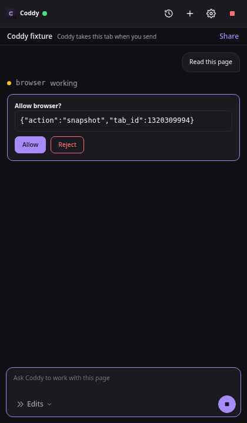
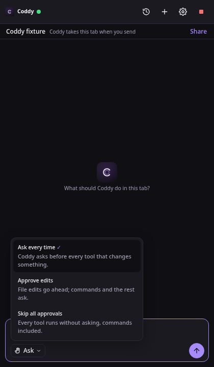

# Coddy for Browser

Coddy for Browser lets the chats of your `coddy serve` work in your own Chrome: open a tab, read a page, click,
type, take a screenshot, move a file between the page and the workspace. The model runs on your server, and the
[Coddy for Browser](https://github.com/coddy-project/coddy-for-browser) extension carries out its actions in the tabs
you share. You can chat with Coddy in the extension's side panel, next to the page you look at, and any other surface
can drive the browser too: the web UI, the console, a Telegram chat, a scheduled job.

## How it works

The extension connects to a listener of `coddy serve` on a port of its own and keeps one WebSocket open. Coddy sends
every action of a chat down that socket as a JSON-RPC request, and the extension answers it; the side panel's chat
travels over the same socket. The server never connects to the browser, so a browser on a laptop behind NAT works the
same as one on the server itself. The wire is described in [Browser protocol](../reference/browser-protocol.md).

```
 chat --> browser tool --> coddy serve listener  <== WebSocket, opened by the extension ==  Coddy for Browser
                           (browser.port, 12348)                                                   |
                                                                                  tabs in the Coddy tab groups
```

Coddy reaches only the tabs in its Chrome tab groups:

- the shared **Coddy** group holds the tabs you share; any chat may take one;
- every chat that works in the browser has a group of its own, titled after the chat. A chat moves a shared tab into
  its group with its first action there, and a tab it opens starts there. Another chat cannot act in that group;
- you take a tab back by dragging it out of a group.

Page contents travel to the model provider your Coddy uses, like any tool result.

## Set up the server

The listener and the `browser` tool are a module of the `browser` build tag. The release binaries, the Docker image
and the packages carry it; a binary built without it refuses `browser.enable` and names the tag.

Generate a key of at least 32 characters, for example with `openssl rand -hex 32`, keep it in `<home>/.env` as
`CODDY_BROWSER_KEY` and turn the listener on in `config.yaml`.

```yaml
browser:
  enable: true
  host: 127.0.0.1
  port: 12348
  token: ${CODDY_BROWSER_KEY}
```

Restart `coddy serve`, or save the block from **Settings**: a new key or address rebuilds the listener in place, and
the extensions reconnect on their own. The `browser` tool is offered to the chats while `browser.enable` is true.

For a browser on another machine, bind the listener to an address that machine reaches and give it `cert_file` and
`key_file`, or put it behind an HTTPS reverse proxy that passes WebSocket upgrades. The extension uses plain HTTP only
for `localhost`, `127.0.0.1` and `[::1]`, and `coddy serve --dry-run` warns about a listener bound off loopback
without TLS.

The key is independent of `httpserver.auth_token` and opens nothing but the extension's socket and its file
transfers. Through the side panel, whoever holds it chats with your Coddy with the tools of any chat and answers its
permission prompts, so keep it as secret as the HTTP API's token.

## Install the extension

Download `coddy-for-browser-<version>.zip` from the
[releases](https://github.com/coddy-project/coddy-for-browser/releases) of the extension and unpack it. In Chrome,
open `chrome://extensions`, turn on **Developer mode**, press **Load unpacked** and choose the unpacked folder. To
build it from source instead, run `npm run build` in a checkout of the extension and load `dist/chrome`.

## Connect the browser

The settings page of the extension opens after the install, and later from **Settings** in its toolbar popup. Enter
the listener address, the key and a name for this browser, then press **Save and connect**.


*The settings page of Coddy for Browser connected to a local listener.*

Several browsers can connect to one server, each under its own name. A chat lists them and selects one; with a single
browser connected, it is used without asking.

## Chat in the side panel

The toolbar button of the extension opens its side panel: a chat with your Coddy, next to the page. The tab you write
from goes into that chat's tab group before the turn starts, so a request about "this page" works on the page in front
of you, and a `browser` call of the chat that names no tab acts on it. The answer streams in, the tool calls show as
rows, and what Coddy asks of you - a permission, a question - comes up as a card in the panel.



*The side panel: the page the chat works on, the request, and Coddy asking before it reads the page.*

The picker under the message field sets when the chat asks before it acts: **Ask every time** (the `ask` permission
mode), **Approve edits** (`accept_edits`) or **Skip all approvals** (`bypass`, after a confirmation). The pick
changes this chat only, never the mode new sessions of the server start in, and the panel keeps it for its next chat.
The website question of the extension comes up in every mode.



*The approval picker under the message field.*

A chat of the panel is an ordinary Coddy session: it is listed in the web UI and can be continued there. The clock
button of the panel lists the chats the panel started, and the plus starts a new one.

## Share a tab

A chat outside the panel reaches a tab you share. Press **Share** in the line of the current tab in the side panel,
or drag the tab into the **Coddy** group; **Take back** ungroups it. The stop button in the panel's header cancels
every action and ungroups every tab; the tabs stay open.

## Work from a chat

Ask for it in words, for example "open the release page of coddy-project/coddy-agent and summarize the latest
release". The chat calls the [`browser`](../reference/tools.md) tool:

- `list` shows the connected browsers and the tabs the chat may reach, marked `yours` or `busy` (another chat's);
- `select` remembers a browser for the chat when several are connected;
- `open_tab`, `close_tab` and `release` open a tab in the chat's group, close one of its tabs and hand its tabs back
  to the shared group;
- `snapshot` reads a page as text plus up to 500 elements with references, and `screenshot` attaches an image of the
  visible part of the tab for a model that reads images;
- `navigate`, `click`, `type`, `press`, `hover`, `scroll` and `drag` act on the page. Clicks and keys go through
  Chrome's debugger, so a page receives them as trusted input, the same as from a person;
- `upload_file` and `download_file` move files between the page and the workspace.

A reference from `snapshot` lasts until the page changes, so the chat reads the page again after a navigation. The
`browser` tool asks for permission like other tools with side effects: the chat confirms each call unless the session
runs in the `bypass` permission mode.

Before the first action on a website, the extension asks you in a window of its own whether to allow it for this
chat, allow it always, or decline. The answer stays in the browser; a page cannot answer it, and neither can Coddy.
The settings page lists the sites allowed always and revokes them.


*The question the extension asks before Coddy acts on a new website.*

While a chat works in a tab, the tab glows and shows a Stop button, and the title of the chat's group starts with an
hourglass. Both go away when the chat's turn ends.


*A tab while Coddy works in it.*

## Files

`upload_file` reads a file of the workspace (`path`, relative) and sets it on the file input `params.ref` names.
`download_file` fetches `params.url` in the browser, with its cookies, and writes the bytes to a new file of the
workspace; an existing path is refused. A file is at most 32 MiB. A download does not follow redirects, so the chat
passes the final address. The bytes move through one-time tickets on the listener, never through a server path the
extension names.

## Limits

- Chrome only. Other Chromium browsers may load the extension, but only Chrome is tested;
- the top frame of a page only: elements inside frames are reached through a screenshot and coordinates;
- Chrome shows its "started debugging this browser" bar while the extension acts; it detaches 20 s after the last
  action;
- a closed browser, a restarted extension or a lost connection leaves the outcome of an action unknown. Coddy never
  repeats an action by itself; the chat inspects the page first;
- the extension does not enter passwords, solve CAPTCHAs or sign in for you.

## Verify a build

```bash
go test -tags=browser ./external/browser/...
```

The tests drive the real listener over a real WebSocket with a fake extension (`external/browser/browsertest`), and
`features/browser.feature` and `features/browser_chat.feature` hold the happy paths, the second on the real agent
with a scripted model. `TestLiveExtension` and `TestLiveExtensionChat` run the real extension in a real Chromium
against the listener, the tool and the side panel's chat: point `CODDY_FOR_BROWSER_DIR` at a built checkout of the
extension and make Playwright reachable by Node.

```bash
CODDY_FOR_BROWSER_DIR=../coddy-for-browser go test -tags=browser ./external/browser/... -run TestLiveExtension -v
```
