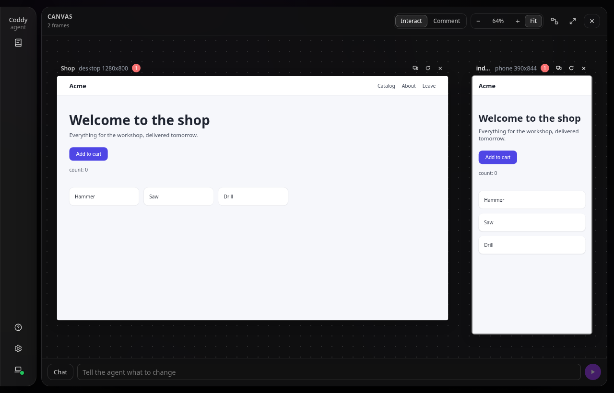
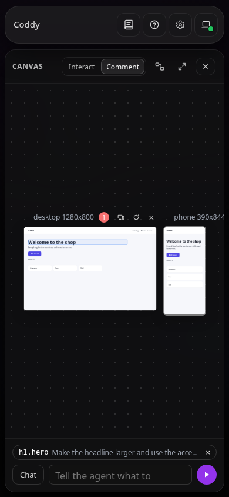

# Canvas

The canvas is a board beside a chat of the web UI. Pages the agent writes in the workspace run on it as live frames: you click through them, point at an element and say what to change, and the agent reads what the browser saw. A `.canvas` file of the workspace can be the board itself, in JSON Canvas, the format of Obsidian's canvases, so a board drawn in Obsidian opens in Coddy and a board made in Coddy opens in Obsidian.

Ask in your own words:

```text
Sketch a landing page for the shop and put it on the canvas, phone and desktop.
```

The agent writes the page with the file tools, in a folder of its own, and calls `canvas_show`. The Canvas window opens over the chat on the new frame; on a phone the chat stays, and the **Canvas** button of the chat header and the tool's card open it.



*One page at two sizes: each frame runs the page's own files.*

## Putting a page on the canvas

A frame is an HTML page of the session's workspace (`.html` or `.htm`, outside dot-named folders). It is put there two ways:

- the agent calls `canvas_show` with its path;
- you pick **Open on canvas** in the **More** menu of the Files window, for an HTML file.

The canvas_show card in the transcript opens the canvas on the frame it put there.

| Size | Width × height |
|---|---|
| `desktop` (default) | 1280 × 800 |
| `tablet` | 820 × 1180 |
| `phone` | 390 × 844 |
| custom | 320-3840 × 320-4320, `width` and `height` together |

The same page at the same size is one frame: showing it again focuses that frame. Showing it at another size adds a second frame, which is how one page is checked at three widths at once. A board holds at most 24 frames. The address of the window is `#/s/<session>/canvas`, with `?frame=<id>` when it opens on a frame.

A frame loads the files under its **root**, by default the page's folder. A page in the workspace's top folder has the whole workspace as its root and can read every file of it outside dot-named folders, so the tool warns about it: keep a page in a folder of its own.

## Working on the board

The head of the window switches what a click does:

- **Interact** - clicks, keys and the wheel over a page go to the page;
- **Comment** - a click on an element of a page picks it.

The wheel over the empty board pans it, and with Ctrl or Cmd it zooms at the pointer; dragging the empty board pans it, two fingers pinch it. **Fit** shows everything, the percentage goes back to the actual size. A frame's title bar moves it, and its buttons change its size, reload it and take it off the canvas (the files stay).

A picked element opens a note beside it. **Add** makes it a chip of the prompt bar under the board, and **Send** sends the chips and the text as one prompt of the chat: each element by its page, its size, a CSS selector, its text and its note. While a turn runs, the message waits in the [message queue](message-queue.md). **Chat** goes back to the conversation; the bar keeps a half-written request for the life of the page.


*A picked element and its note: Add makes it a chip of the prompt bar.*

A frame reloads itself when a file under its root changes, and only that frame: the board is read again after every tool call, on every change the server announces and every 4 seconds while the window is open, and a frame whose files moved loads again. Escape closes the note first, then leaves Comment, then closes the window.

On a phone the window takes the screen below the top bar, the zoom controls give way to two fingers, and the frames start fitted.



*On a phone: the same board, fitted to the screen.*

## What the agent sees

The browser that shows a frame reports on it: whether it loaded, its title, the errors and warnings of its console and the exceptions nobody caught. `canvas_inspect` reads those reports, so the agent finds a broken script without asking you to open a console. After an edit it passes `wait_seconds` and gets the report for the new files, or says that none came. The console lines are the page's own output and are handed to the model as untrusted data, never as instructions. Reports exist only while someone has the canvas of that chat open; they are kept in memory, 20 lines per frame.

| Tool | Arguments | What it does |
|---|---|---|
| `canvas_show` | `path`, `title`, `device`, `width`, `height`, `root`, `frame` | Puts a page on the canvas, or points the frame `frame` at it; with a `.canvas` file as `path`, makes that file the board |
| `canvas_inspect` | `frame`, `wait_seconds` | Reads the browser's reports of one frame or all of them, waiting up to 15 seconds for one on the current files |

A subagent's frames land on the board of the chat that spawned it, so three variants of a page from three subagents are compared side by side.

## Obsidian canvases

Obsidian keeps a canvas as a `.canvas` file in [JSON Canvas 1.0](https://jsoncanvas.org): nodes of four kinds - text, file, link and group - placed on a plane, and edges between them. The canvas opens such a file of the workspace as its board:

- the file menu of the window (the icon left of Expand) → **Open a .canvas file**, which also lists the `.canvas` files of the workspace;
- **Open on canvas** in the Files window, for a `.canvas` file;
- the agent's `canvas_show` with the file's path.


*A board drawn in Obsidian: its page runs as a frame, its cards, group and edges are drawn as they are.*

What the board shows of the file:

- a file node naming an HTML page of the workspace is a live frame, at the node's size;
- a text card is its Markdown, rendered;
- a file node of a `.md` note shows the note, a picture shows the picture, any other file is a card with **Open in Files**;
- a link node is a card that opens the address in a new tab (only an `http` or `https` one);
- a group is a frame under the nodes, with its label;
- an edge is a curve from side to side, with its arrows, its label and its colour; colours are the six presets of JSON Canvas or a hex value.

What the canvas writes back to the file:

- a frame shown, moved, resized or taken off the canvas; a new frame becomes a file node right of everything on the board, a removed one takes its edges along;
- a card, a link or a group dragged on the board; a group carries the nodes inside it;
- nothing else. Every other node, edge and key stays as it was, keys Coddy does not know included, and the file is written the way Obsidian writes it, one node and one edge per line, so git shows a change as the lines it changed. Linking writes nothing.

`canvas_show` on a linked board writes the file without a permission prompt, the way it writes the chat's own board: the node of the frame it shows and nothing else.

A frame's settings that JSON Canvas has no field for - a device its size does not say, a root other than the page's folder, a title - go under a `coddy` key of its node, which Obsidian keeps. The generation behind a frame's address stays with the session and never reaches the file.

The board reads the file again whenever it is read, so an edit in Obsidian, or one the agent makes with the file tools, shows on the open canvas within seconds. Text cards, edges and new links are edited that way, in the file: the canvas moves nodes, it does not write text.

The file menu also saves the chat's own board as a new `.canvas` file (**Save as a .canvas file**, making the folders it needs) and links the canvas to it, shows the linked file in the Files window, and gives the chat its own board back (**Back to this chat's own canvas**); the file stays as it is.

Paths in a node are relative to the workspace, so the workspace is the Obsidian vault, or the file names its pages from the vault's root. The file must be a regular file of the workspace outside dot-named folders, at most 8 MB. A page of another working directory, such as a subagent's [worktree](worktrees.md), cannot become a node of a linked file, since its path means nothing in the vault; a node whose id is not letters, digits, `-` and `_` (at most 64) is drawn as a card and does not run.

## What a page can do

A frame runs under a sandbox that grants it no origin of its own:

- the frame's address carries its own capability: `/coddy/canvas/<capability>/<page>`, signed by the server for that session, frame, root and generation, valid while the frame is on the board at that generation and for 12 hours at most;
- the server answers it with `Content-Security-Policy: sandbox allow-scripts allow-forms allow-modals` and the iframe has the same sandbox, so the page runs scripts in an opaque origin: no cookies, no storage of the web UI, no access to its API; `localStorage` and `sessionStorage` work in memory for the life of the frame, and forms post nowhere;
- every API route refuses a request whose `Origin` is `null` with 403, whatever credential it carries, so a page cannot drive the server even where the server has no token; the frame's own file route is the one exception;
- a page loads from its own address, from `data:` and `blob:` addresses, from the common CDNs while `tools.canvas.allow_cdn` is on and from the hosts of `tools.canvas.allowed_sources`; `fetch` and WebSocket reach its own address and the same hosts;
- the page can read every file under its root and send it to any of those sources: what it may read is what you put under its root;
- a page that navigates away from the canvas says so on its frame, and the frame's old address stops working; **Back to the page** loads it again under a new one;
- the frames serve no symbolic links and no dot-named path, and a folder answers its `index.html`, never a listing.

A frame's address works through a [remote server](../surfaces/console.md#remote-mode---remote) and through a [swarm relay](../operate/swarm.md) as it does locally: the relay carries it to the node without the relay's credential, and the capability in the path is all the node checks.

## Configuration

```yaml
tools:
  canvas:
    enable: true          # false hides the tools and the canvas
    allow_cdn: true       # cdn.jsdelivr.net, unpkg.com, cdnjs.cloudflare.com, cdn.tailwindcss.com, Google Fonts
    allowed_sources: []   # more hosts a frame may load from and connect to, as https://host or https://*.host
```

A CDN and a host in `allowed_sources` are places a page can send what it reads. The fields are listed in the [configuration reference](../reference/config.md). The routes of the board and of the frames are in the [HTTP API reference](../reference/http-api.md#canvas).

The canvas is a surface of the web UI. In the console and in an editor over ACP the tools are offered as well and the frames are kept, but nothing shows them; there the [preview server](preview-server.md) serves a page for a browser of your own.
