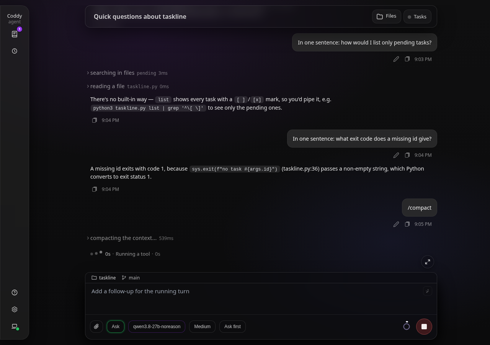
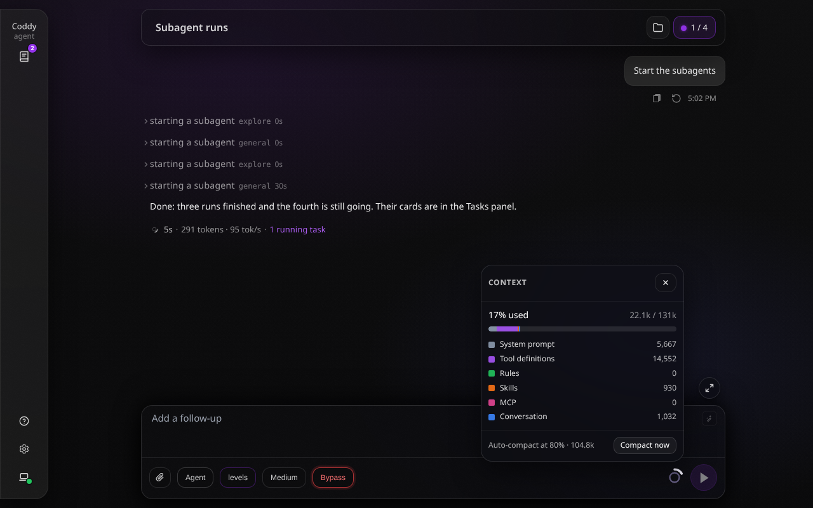
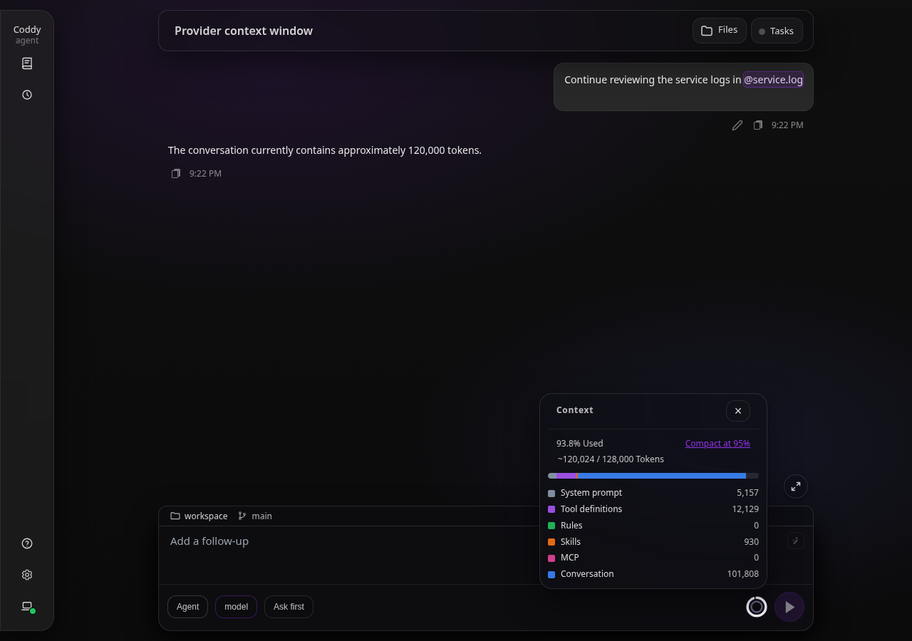
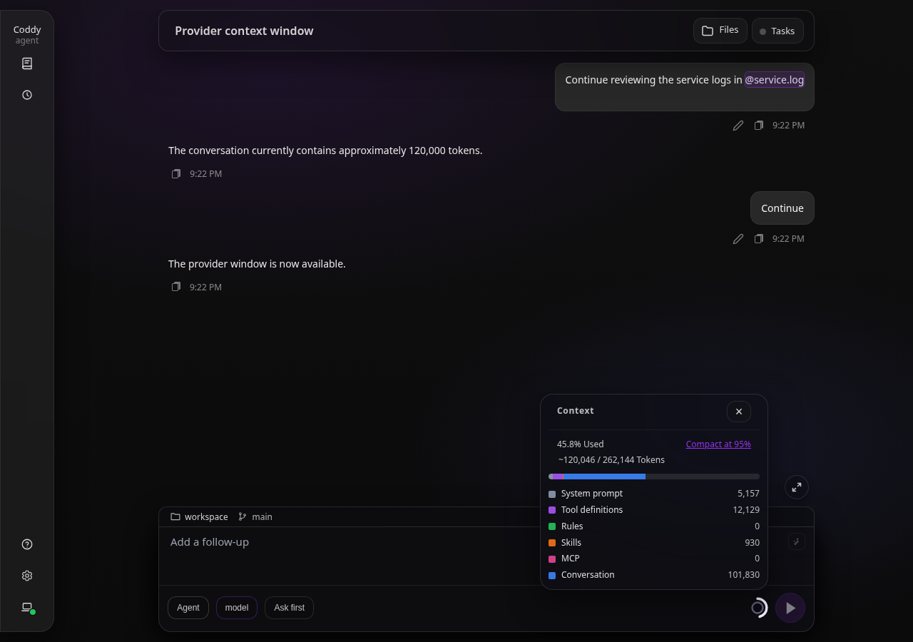

# Context compaction

A model reads a bounded context window, and a working session outgrows it: every exchange, every tool result and every file page stays in the transcript. Compaction keeps long sessions inside the window without losing the record. Older history is folded into a generated summary that the model reads in place of the original rows, the most recent turns stay verbatim, and a second, cheaper mechanism collapses the file pages and search results the model has moved past. Both are projections built when a request goes to the model: the transcript on disk keeps every original message and every full result.

## The /compact command

```text
/compact [-m|--model <id>] [-r|--reasoning <level>] [instructions]
```

The built-in `/compact` runs on every prompt surface - the console, ACP editors, the web UI composer and `POST /v1/responses` - the way `/export` and `/plugin` do: it is recognised before the text becomes a message, without a turn of the main model. It is listed in the command catalog (`GET /coddy/commands`, the ACP `available_commands_update`) only while `compaction.enable` is true. Anything after the command is handed to the summariser as additional instructions, so `/compact focus on the file paths and the failing test` steers what the summary keeps. Ask mode does not restrict it: the command is an operator action, outside the read-only boundary.

`--model <id>` (or `--model=<id>`) names the summariser for that one compaction, whatever `compaction.model` says: `/compact --model hub/qwen3-coder keep the file paths`. The id is a `models[].model` in any letter case, the model name without its provider (`qwen3-coder` for `hub/qwen3-coder`, even beside a longer `hub/qwen3-coder-next`), or a part of one id that matches exactly one configured model - `--model qwen` is enough while a single model has `qwen` in its id. The named model goes to the head of the summariser chain and the configured chain stays behind it, so a provider that is down still falls back as described under [A history larger than one summarization request](#a-history-larger-than-one-summarization-request). A name that matches no model, or more than one, compacts nothing and answers with the configured ids. `--reasoning <level>` (or `--reasoning=<level>`) sets the reasoning level the summary is written at: a level the summariser's model offers - the model `--model` names, else `compaction.model`, else the session's - or `default` for the model's own. Fallback models of the chain that do not offer the level run at their own. `-m` and `-r` are the short spellings: `/compact -m qwen -r high keep the file paths`. Options come first: the first word that is not an option starts the instructions, which may then mention `--model` freely; only `--` words, `-m` and `-r` are options, so instructions written as a list (`- keep the paths`) stay instructions. In the web UI the composer completes the options and their values - the models, and the levels of the model `--model` names - see [the web UI page](../surfaces/web-ui.md#composer-command-options).

A manual compaction is forced. It folds whatever exists: when the configured number of kept turns leaves nothing to summarise, it retries with fewer kept turns, down to none, so even a short conversation compacts. The command text is persisted as a user row so the transcript shows it, and the reply is one line:

```text
Context compacted: 14 message(s) summarized, 6 kept verbatim. Summarizer: hub/qwen3-coder.
Nothing was compacted: unknown model "qwn" (configured: openai/gpt-4o, hub/qwen3-coder). Usage: /compact [-m|--model <id>] [-r|--reasoning <level>] [instructions]. ...
Nothing to compact: there is no earlier conversation to summarize yet, or nothing new since the last compaction.
Compaction is disabled in the configuration (compaction.enable: false).
```

Over HTTP the same action is `POST /coddy/sessions/{id}/compact` with an optional body `{"instructions": "...", "model": "...", "reasoning": "..."}` (`model` is the command's `--model`, `reasoning` its `--reasoning`); it answers with the summary, the message counts and the `model` that wrote it, `400` when compaction is disabled, `model` names no single configured model or `reasoning` is a level the summariser does not offer, `409` while a turn holds the session, while it is being deleted and for a read-only child session ([HTTP API](../reference/http-api.md)). It runs as a turn of the session, so `GET /coddy/events` announces its start and end and a browser tab viewing the session reloads what changed.

## Automatic compaction

The agent compares context usage with the session model's window. After a model call reports `input_tokens`, the next check uses that count plus an estimate of content added since the call. When the provider reports no count, the estimate includes the system prompt, tool definitions and schemas, rules, skills, MCP, message text, tool arguments, reasoning and images. The estimate budgets more room for code and non-ASCII text than the old runes/4 rule. At `compaction.threshold_percent` (80 by default), older history is compacted before the next model call: before the first call of a turn, after a permission answer, between rounds as tool results grow the context, and before the first call to a newly selected model whose window may be smaller ([Session settings](session-settings.md#what-happens-when-you-send-one)). Set `compaction.auto_enable: false` to keep manual compaction while disabling this trigger. Any failure - a summariser error, a hook veto - is logged and the turn continues uncompacted.

### The context window

Every reader resolves the window the same way - the trigger, the `usage_update` behind the console's context percentage, and the `max_context_tokens` of `GET /v1/models` that the web UI draws its context ring against - so what the ring shows is what the trigger measures:

1. the model entry's `max_context_tokens`;
2. the window the provider's model listing reports for the model: `limit.context` (the NeuralDeep hub), `context_length` (OpenRouter), `max_model_len` (vLLM), `max_context_length` (LM Studio), `max_input_tokens` (Anthropic), `max_context_tokens` (another Coddy's `GET /v1/models`) or `context_window` (the Codex catalog, where it is the window Codex itself works with, 272000 for every model it serves today; the larger `max_context_window` next to it is only the ceiling Codex lets its own `model_context_window` setting raise that to, and Coddy does not read it). The listing is read for `neuraldeep`, `devin`, `codex` and `anthropic` providers and for `openai` providers with an explicit `api_base`, never for api.openai.com, whose listing carries no window. It is read when a turn starts, when the model list is served and when a session switches to the model, with a turn waiting at most three seconds for a listing that has never answered - the step after a switch in the middle of a turn waits the same way before it measures - and it is trusted for an hour; a failed read is retried after five minutes, or at the next read once the row signs in or out from Settings;
3. 128000.

Set `max_context_tokens` when the provider reports no window, or a larger one than the deployment actually serves (a local server started with a smaller context).

### Few long turns

Automatic compaction keeps `keep_recent_turns` user turns verbatim when the window holds more than that. When it does not - a session of a few long agent turns, where the context outgrows the window without many prompts - it keeps fewer, down to the prompt being answered, which it never folds.

With only that prompt in the window there is no earlier turn to fold, and a turn that is one prompt followed by dozens of tool steps - many of them parallel `glob`, `grep` or `read` calls returning kilobytes each - can outgrow a small window on its own. At the threshold the trigger then folds the **earlier steps of that turn**. A step is one assistant message with the tool results that follow it, so ten parallel calls are one step and a batch is never cut between its call and its results. The steps before the cut go to the same summariser as any other compaction - the same chain of models, the same passes for a history larger than one request, the same `PreCompact` and `PostCompact` hooks, which see the trigger `auto` - and the latest steps stay verbatim.

The prompt being answered cannot go into the summary: a model that is not told what it was asked answers nothing. The summary row that replaces the steps therefore begins with the prompt, word for word, then a line saying what the text above it is, then the summary:

```text
<the prompt, verbatim>

The text above is the message this turn started with, verbatim. Coddy compacted the conversation before this point, including the earlier steps of the work on it. Summary of the compacted part:

<the summary>
```

The line does not say who wrote that message, because not every turn opens with a prompt you typed: the [session supervisor](session-supervisor.md) starts its goal turns with an instruction of its own, and a finished background task wakes a turn with a notice. Each of them says what it is in its first words, so the line can stay the same for all three.

The row follows the summary rows of earlier compactions, when there are any, and opens what the model reads of the turn, so every later request carries the prompt. A prompt that is itself a pasted log is cut in the middle to a tenth of the window (300 tokens at least), with a marker that says how many characters went; the transcript keeps the whole text, and the pictures attached to the prompt stay on the original message and are not copied onto the row. When the turn is folded again, a new row is added after the first and summarises only the steps since it; the prompt stays at the start of the first row, so the window holds one copy of it. A turn folded so many times that its rows outgrow their share of the window has them merged, and the merged row begins with the prompt in their place ([Summaries form a chain](#summaries-form-a-chain)).

A message you queue while the turn is running is a follow-up to that turn, not a turn of its own, and Coddy marks it so in the transcript (`follow_up` in `messages.json`); a follow-up that a [Stop hook](hooks.md#events) submitted counts as one too. The mark is what tells the prompt being answered from the follow-ups after it, even one that repeats the prompt word for word, and it survives a restart of Coddy. The text at the start of the row is therefore always the message the turn opened with. A follow-up that falls into the folded steps is summarised with them, and one among the latest steps stays where it is, as an ordinary message. The turn's steps are counted from the prompt, and automatic compaction never cuts at a follow-up, so it cannot fold the prompt into a plain summary. A transcript written before the mark existed has none, and its last user message counts as the prompt.

How many steps stay is decided by a budget, with a cap of four steps. The fold aims the next request at half of the share of the window that triggers compaction - 40% of the window at `threshold_percent: 80` - less what every request carries besides the conversation (the system prompt, the tool definitions, the rules), less the summary rows already in the window ([Summaries form a chain](#summaries-form-a-chain)) and less the prompt at the start of the row. The latest steps that fit stay, up to the cap, and the latest step always stays. Without such an aim, a fold that kept four large steps would leave the request over the threshold and fold again at the very next step. The summary itself is not in the budget: the half that the aim leaves free pays for it. A turn with one step has nothing earlier to fold, and the turn logs that once and continues. The fold and the recovery below have no switch of their own: they are part of automatic compaction, and `compaction.auto_enable: false` turns them off with it.

A fold can leave the request over the threshold when what every request carries besides the conversation (the system prompt, the tool definitions, the rules) or the latest step is too large for the window, and the next step would then fold again: a summariser call and a summary of a summary per step. After each automatic fold Coddy therefore estimates the next request, and when it is still at or above the threshold, the turn makes no more automatic folds; the log says so once, with the numbers. The rest of the turn is left to the recovery from a refused request below. The trigger measures the context by the provider's own count of the last request, so this estimate, and the aim of the fold above, are scaled the same way: by how many tokens the provider counted for each one Coddy estimated for that request. A provider that counts denser than the estimate would otherwise see a fold keep steps that land over the real threshold. The remedy for a turn that stops folding is a larger window, a higher `threshold_percent`, or fewer tools and rules.

#### When the provider refuses a request

The threshold is measured against the window Coddy knows. A server can serve less than that window (a local server started with a smaller context), count denser than Coddy's estimate, or receive one step that does not fit the room left. When the provider refuses a request because it does not fit the model's window, the turn does not end there: Coddy compacts the turn and asks the same step again, once.

- It recognises the refusal by the `context_length_exceeded` code, in an answer of any status, and by the wording of OpenAI-compatible servers, Anthropic, llama.cpp, vLLM and Gemini, the wording only in a 400, 404, 413 or 422 answer, or in an error that carries no status at all (a frame inside a stream, a Codex failure event): a rate limit (429) or an outage (5xx) that mentions tokens is not one, and "too many tokens" counts only where a status says the request was refused. A body the OpenAI client drops from its error - vLLM's flat `{"object":"error",...}`, plain text, Codex's `{"detail": ...}` - is read from the response.
- A request that already streamed something to the client is never asked again, whatever it was refused for.
- The fold aims under the limit the refusal revealed, in Coddy's own units: the window, lowered to the limit the provider names, scaled by how much more the provider counted than Coddy estimated, and never above the estimate of the refused request. The aim is the same half of the threshold share of that limit. The floor is no step at all, not one: the request is already over the limit, so even the latest step goes if nothing else fits. The one exception is an answer the output limit cut off that the model is being asked to go on from: its parts and the empty steps after them stay verbatim, because the model goes on from the last word of the text and the answer the turn hands over joins the parts. When the turn holds nothing but that answer, nothing is folded and the refusal ends the turn.
- When the window holds earlier turns and the turn in progress, from its prompt on, fits what is left, Coddy folds the earlier turns the way a regular compaction does, and the prompt stays an ordinary message. Otherwise it folds inside the turn, as above.
- [Result eviction](#result-eviction) starts at once for the rest of that turn, whatever `start_percent` says: the gate protects the provider's prompt cache, and a provider that refused the request has no use for the cache of something it will not read. The next turn starts with the gate back.
- The retry is once per step. A call that succeeds renews it, so two different steps can each be recovered, and the same step refused again ends the turn. The session log gets a notice that says the request was refused and asked again, and the agent log records the sizes (`estimatedTokens`, `providerTokens`, `providerLimit`, `limitTokens`). A Stop during the compaction ends the turn as a stop; a shutdown or a deadline ends it with the refusal's explanation and `(the compaction after the refusal was interrupted: ...)`.

When there is nothing to fold, a hook vetoes the compaction, the summariser fails, the smaller request is refused too, or `compaction.auto_enable` is false, the turn ends with an error that says so, in place of the provider's bare answer:

```text
context window exceeded: the provider refused the request because it does not fit the model's context window (Coddy estimated about 38000 tokens; the window is 49152 tokens; the provider counted 51402 tokens against a limit of 49152); run /compact, start a new session or split the task into smaller steps: provider "local" (http://127.0.0.1:8080/v1): openai stream: ...
```

The message gives Coddy's own estimate of the request and the window it measures against, adds the sizes the provider reported when its answer holds them, and ends with the provider's answer unchanged. After a compaction that did not help, it also says `Coddy compacted this turn and asked again, but the provider refused the smaller request too`. When the provider's limit is below the window Coddy works with, or the window was never set and defaults to 128000, it also tells you to set `models[].max_context_tokens` to the window the server really serves, so that the next compaction starts earlier. The provider's status stays on the error, so the HTTP API answers a client with the same 400 or 404 as before. `/compact` folds the history, the prompt that was being answered included. [Result eviction](#result-eviction) takes the oldest directory listings and web results out of a request once the context reaches `start_percent`, so a long run of `glob` and `print_tree` calls fits a small window for longer (issue #490).

## The model can ask for it

The threshold is a guess made before a call; the model is the one that knows what it just read. A build log it pasted, a file it no longer needs, a search that returned far more than expected - the model sees the context fill and can fold the history itself with the `compact_context` tool, instead of waiting for the trigger or for the operator to type `/compact`:

```json
{"instructions": "keep the file paths and the failing test", "model": "hub/qwen3-coder"}
```

`instructions` is optional and steers the summary exactly as the text after `/compact` does. `model` is optional too and is the command's `--model`: the tool's description lists the configured models, so "compact the context with qwen" in a prompt becomes a call that names that model, and a name that matches nothing comes back as the tool's error with the configured ids, for the model to correct. The assistant message carrying the call itself is never folded, so its result always answers a call the provider can see, even when the model compacts in the first turn of a session. The call behaves like a manual compaction - it folds whatever exists - and the tool answers with the same line the command does, so the model reads back what it did and continues on the shortened history: the loop rebuilds the request from the folded transcript before its next call. When the fold takes the prompt being answered with it - in the first turn of a session, with nothing else to fold - the prompt goes into the summary like everything else: the tool is the model's own choice, and what keeps a long turn's prompt verbatim is the automatic fold inside the turn. The tool is offered in agent and plan mode, and hidden entirely when `compaction.enable` is false. Ask mode does not get it, because every tool offered there is read-only; the operator's `/compact` and the automatic trigger still work in that mode.

## A history larger than one summarization request

Before any of it, the head is deduplicated: a line the conversation already carried verbatim is dropped, keeping the first copy where it stands, and each entry says how many repeats went. A session fills its window by repeating itself - the same build log pasted after every attempt, the same file read a dozen times - and the summariser learns nothing from the second copy while paying for it in full (issue #273). Short lines are left alone: a closing brace and a bare number are structure, and dropping them would mangle the code the summary has to read.

Folding used to be one call: the whole head of the conversation in a single request to the summariser. That holds while the session is near the window it is measured against, and stops holding exactly when compaction matters most. A session that ran far past its window - a model that kept reading large files, an automatic trigger that never fired because the window was unknown - arrives at `/compact` with a history several times the summariser's own window, and the provider refuses the request:

```text
compaction LLM call: 400 Bad Request: this model's maximum context length is exceeded
```

That left the session stuck: too large to send, and the only thing that could shrink it was the call that would not go out.

A summariser that refuses is not the end of it either. `compaction.fallback_models` lists the models tried, in order, when the one before them fails, and the session's own model is the last resort whether or not it is listed - so a `compaction.model` pointing at a deployment that is down, overloaded or gone no longer leaves a full session with no way out (issue #247).

Such a history is now folded in passes. Each pass carries the summary of everything folded so far plus the next run of transcript, both sized against the summariser's own context window (`compaction.model`'s, when it names another model), and answers with one summary covering both. The last pass's answer is what goes into the transcript, so a compaction that took seven calls leaves the session looking exactly like one that took a single call. A pass the provider refuses as too large is retried with half of its transcript, at most three times per summariser. A single entry too large even on its own is sent with its middle elided, head and tail kept - the fold makes progress rather than stopping on the one message it exists to fold away. A 400 or a 413 that no phrase recognises is cut once before the pass moves on, because a server worded in a way Coddy has not seen must not leave a full session with no way out. Any other refusal - a rejected key, an outage, a limit - is not about size and fails the same way at half the size, so the pass goes to the next summariser of the chain at once. Passes are sized with the estimate the automatic trigger uses (three ASCII characters to a token, one token for every other character), and each retry is logged at warn level as `compaction pass refused as too large` (`compaction pass refused with a status that can mean too large` for the single cut of an unrecognised refusal) with the tokens the fold estimated and the tokens the provider reported, which tells a window set too high from an estimate that fell short. `POST /coddy/sessions/{id}/compact` reports the passes as `steps`.

## What the session shows while it runs

Every compaction, whichever way it started, draws the row a tool call draws: announced as `compact_context` when it begins, updated with the pass it is on while a multi-pass fold runs (`compacting context: pass 3 of 7`), and closed with what it folded. Before this the session simply went quiet for as long as the summariser took, which a fold of several calls over a large history makes hard to sit through.


*`/compact` sent from the composer: the row says the context is being compacted while the summarizer writes, under the turns it is about to fold. Captured from the running UI.*

The row a compaction draws for itself is live: it reaches whoever is watching the session - the composer that sent `/compact`, a second browser tab, a console on `--remote` - and what stays in the transcript afterwards is the compaction summary row. A compaction the model asked for is different, because there the row already exists: the `compact_context` call reuses it, so the passes appear under the call that ordered them, and it stays in the transcript like any other tool call.

## What is kept and what is summarised

The boundary is the `keep_recent_turns`-th most recent user message (2 by default). Everything from that message on - the user turns, the replies and the tool activity after each - stays verbatim. Everything before it is sent to the summariser as a flattened transcript, tool calls rendered as labelled lines, and is replaced in the model's view by one summary row inserted at the boundary. A summary written earlier is not summarised again ([Summaries form a chain](#summaries-form-a-chain)). `keep_recent_turns: 0` summarises the whole window. When the window holds only the turn being answered, the boundary is a step of that turn instead, as [Few long turns](#few-long-turns) describes. The automatic boundary is always a user turn that began before the prompt being answered: a message you queued during the turn is part of it, and compaction does not cut there.

The summary is requested from `compaction.model` when set, otherwise from the session's model, with a fixed system prompt that asks, in order, for the user's goals and constraints, the decisions taken and the approaches rejected, the state of the work, the exact paths, names, commands and values that matter, and the open questions and next steps. The result-eviction projection below is applied to the history first, so a page, search or listing the model had already moved past is not summarised in full.

The project rules a tool result or a message carried are not summarised: a rule the summary folds away comes back with the next tool call or mention that touches a matching path, and one the kept tail still carries comes again only if its file has changed. A row written inside a turn repeats the prompt as it was sent, so a rule that a mention attached to the prompt counts as delivered and is not attached a second time; when the cap on the prompt cut such a rule through, the next match attaches it whole. A compaction is also the moment the standing rules are read again - the `AGENTS.md` and `DESIGN.md` pairs, the rules that always apply and the files of `instructions.files` - so an edit made to them during the session reaches the next system prompt ([Rules and the prompt cache](rules.md#rules-and-the-prompt-cache)).

### Summaries form a chain

A compaction folds only what came after the last summary row and adds its row after it; the rows written before stay exactly as they were. The model reads them all, oldest first, then the turns kept verbatim. The summariser reads the earlier rows too, in a section of their own ahead of the transcript, as context it must not repeat, and their size comes off what one summarization request may carry. They take at most half of it: when they do not fit, the oldest of them are left out of that request, and the chain itself stays as it is.

Retelling the previous summary at every compaction, as Coddy did before, wore away the details of the earliest turns, one retelling after another, and changed the opening of every request, so the provider's prompt cache was lost from the first message on. With the chain, the requests between two compactions open with the same bytes up to the end of the last summary row, and a compaction only adds after it.

The chain grows by a row per compaction. When its rows take more than a third of the session model's context window, the earliest ones are merged: the summariser retells them as one row that starts the chain anew, inserted right after the last row it replaces, and as many rows go as bring the chain down to half of that share, the merged row counted as long as the longest row it retells; the summariser is asked for no longer a row than that. The distance between the two is what keeps a merge rare, because a merge does change the opening of the request. The row just written is never merged. The rows of the turn being answered go last, only when the earlier ones are not enough - one long turn folded again and again - and the merged row then begins with the turn's prompt, the way the turn's first row did, so the window still holds one copy of it. A merge that fails leaves the chain as it was; the compaction itself is done, and its outcome says so. A `/compact` with nothing said since the last one has nothing to fold and does not retell the chain.

A session compacted before the chain existed has one summary row at the start of its window, and it is read as the first row of a chain: the next compaction adds after it.

## The summary row and the context estimate

The summary row is a user-role message flagged `compaction_summary` that starts with `The earlier conversation was compacted. Summary of the compacted part:`. Every row a compaction writes is flagged `compaction_block` as well (a merged row is not), and one with a row before it starts with `The conversation after the summary above was compacted as well. Summary of the compacted part:`. The model's window is the chain - every summary row back to the latest one without `compaction_block` (a merged row, or one written before the chain existed), or back to the first one when they all carry it - then the messages after the last row; the messages the rows cover stay in `messages.json` for the transcript only. A fold inside a turn writes a row that begins with the prompt instead, followed by the line `The text above is the message this turn started with, verbatim. Coddy compacted the conversation before this point, including the earlier steps of the work on it. Summary of the compacted part:` ([Few long turns](#few-long-turns)). The row is flagged the same way. When the last row of the chain is followed by an assistant message, it stands for the turn whose prompt it carries, so the next prompt folds the steps after it as an earlier turn. Everything that reads a row finds the same boundary in it: the first occurrence of that line splits the opening message from the summary. The [session supervisor](session-supervisor.md) labels the part in front of it `[the message this turn started with]` and reads the part after it as the worker's claims, each clipped on its own, so a long prompt cannot push the summary out of its evidence digest, nor a long summary the prompt. A prompt that itself quotes the preamble line is the one input the boundary can misread. `PreCompact` hooks run before either trigger and may veto it, `PostCompact` hooks receive the summary ([Hooks](hooks.md#events)). They run only for a compaction that has something to fold: a step over the threshold with nothing earlier to fold no longer wakes them.

After a compaction the context estimate is recomputed and published as a `usage_update` with `used` and `size`, which is what the composer's context ring and the console footer's context percentage show; `GET /coddy/sessions/{id}/stats` returns the same breakdown by category. Every client of a shared session reads the smaller number: the tab that sent the turn from its own stream, another tab watching the turn from `GET /coddy/sessions/{id}/composer-stream` (the same frames), and a tab that only views the session from the stats it reloads when `turn_ended` arrives. A compaction folds the turns before the kept tail, so the numbers fall when the bulk of the context sits in older turns; a large last message stays verbatim until newer turns push it past `keep_recent_turns`.

The Context popover places a manual compaction action beside its title. With automation enabled it shows the configured threshold, such as **Compact at 80%** (the default `threshold_percent`); with `auto_enable: false` it shows **Compact now**. Clicking starts the same `POST /coddy/sessions/{id}/compact` action as `/compact`, shows progress and refreshes the transcript and context indicator when it finishes.


*Context popover rendered from the running web UI at 1280px.*

The web UI also updates the session's context window from `usage_update.size` on either stream. If a provider listing arrives after `/v1/models` returned the 128000 fallback, the ring adopts the reported window without a reload. Stats refreshes preserve that live window; selecting a different model or saving the configuration uses the model listing until a fresh usage update arrives. A window received for one session never changes another session's ring.


*Before the provider answers: the same 120000 tokens fill 93.8% of the fallback window. Captured from the running UI with a stand-in provider.*


*After the stream reports a 262144-token window: 45.8%, without reloading. Narrow layout: [before](../assets/compaction/context-window-before-dark-390.png) and [after](../assets/compaction/context-window-after-dark-390.png).*

## What the transcript shows

In the web UI the summary is a foldout row labelled **context compacted**, styled like the thinking disclosure, whose body renders the summary - what is now in the model's context. The body starts after the preamble, so a row written inside a turn does not repeat its prompt there: the prompt stays the user row at the top of the turn. The row sits at the boundary, above the turns kept verbatim, not at the end of the chat; after a forced compaction of a short session it is the last row. The `/compact` command and its one-line reply are ordinary user and assistant rows. `GET /coddy/sessions/{id}/messages` returns every original row, the summary carrying `compaction_summary: true` (and `compaction_block: true` when it continues the chain), and an export writes it as a `compaction_summary` entry ([Session export](session-export.md)). An ACP client, and with it the console, sees a plain row on replay as a user message beginning with `The earlier conversation was compacted.`, and a row that continues the chain as one beginning with `The conversation after the summary above was compacted as well.`. A row written inside a turn is replayed from its preamble on, as a user message beginning with `The text above is the message this turn started with`, because the prompt in front of it was already replayed at its own place and a client would show it twice.

## Result eviction

Paging a large file, running a wide search or listing a dozen folders would otherwise pin every result in the context for the rest of the session. Result eviction collapses the results the model has moved past to short placeholders when the request is built, so the tool call and its result stay paired for the provider while the bulk is gone. Two groups of tools go through it, each with a window of its own: `read` and `grep`, and the listing tools `glob`, `print_tree`, `websearch` and `webfetch`:

```text
[evicted: internal/agent/react.go lines 1-200, not marked as useful; re-read if this range is needed again]
[evicted: grep "maybeAutoCompact" in internal/agent, not marked as useful; re-run the search if needed]
[evicted: internal/agent/react.go was modified after this read; re-read for current contents]
[evicted: glob "**/*.go" in internal/agent (312 lines); re-run if needed]
[evicted: print_tree of internal/session (87 lines); re-run if needed]
[evicted: websearch "godog parallel scenarios" (24 lines); re-run if needed]
[evicted: webfetch https://example.com/docs (140 lines); re-fetch if needed]
[evicted: glob "**/*.go" in internal/agent is stale after internal/agent/new.go was modified; re-run if needed]
```

A `read` or `grep` result survives when it is inside the working window - the `keep_recent` most recent candidates (2 by default, so a read and a grep can be compared) - or when the model marked it useful: `keep: true` on the `read` or `grep` call itself, or a later `keep_result` call naming the page (`path`, optionally `offset` and `limit`) or the search (`pattern`, optionally `path`). `keep_result` reads nothing; the call recorded in the history is the pin. A successful write to a file (`write`, `edit`, `apply_patch`, `mv`, `rm`, `touch`, `mkdir`, `rmdir`; not a denied or failed call) makes every earlier read of that file and every grep whose search root or hits touched it stale, pinned or not: they collapse with the "was modified" placeholder so the model re-reads current contents. Results at or below `min_result_bytes` (2000) are never candidates. The descriptions of `read`, `grep` and `keep_result` tell the model that an unmarked result collapses to a placeholder and goes stale after a write, and how to pin one; the prompt of each mode says the same and adds that a collapsed result comes back by repeating the call. `keep_result` is offered in every mode, ask mode included. The descriptions of the listing tools say nothing about eviction: the model meets a listing placeholder only as the placeholder, which names the call to repeat.

A listing is cheap to ask for again, so it has no marks, and its window counts steps. A step is one assistant message with the results of every call it made: ten parallel `glob` and `print_tree` calls are one step. The results of the three most recent steps that hold a listing stay whole; those of older steps collapse to a placeholder that repeats the pattern, query or URL and says how many lines the result had. The latest step that holds a listing always keeps its results, so a listing the model has just asked for reaches it instead of being collapsed in the next request and asked for again. The two windows are independent: a listing takes no place in the `keep_recent` window of reads and greps, and a read does not push a listing out of the step window. A `glob` or `print_tree` result also goes stale, and then collapses with a "stale after" placeholder even inside the window, because the list may no longer match the disk. Any successful write below the folder a `glob` or `print_tree` listed, to the folder itself or to a folder around it (a file written, edited, created or removed below it, the folder moved or removed) makes the listing stale. A search or a page describes the web, not the workspace, and no write makes it stale. Results at or below `min_result_bytes` are not candidates here either. Staleness compares paths case-sensitively except on Windows, so on a case-insensitive macOS volume a write spelled with different case does not make an earlier read, grep or listing stale.

`run_command` and MCP results are never evicted: a command or a remote server may answer differently the second time, or may have changed something by running, so a placeholder could hide what a repeated call cannot bring back. The listing tools and their window of three steps are fixed: the switch is `result_eviction.enable`, and `start_percent` decides when they start, as it does for reads and greps.

Eviction is the second projection over the same history: the persisted transcript keeps every result in full, and `GET /coddy/sessions/{id}/tool-calls/{toolCallId}` serves it. It complements `tools.output_limits`, the per-tool line caps that bound a result when it is produced ([config.yaml reference](../reference/config.md#toolsoutput_limits)).

## Configuration

```yaml
compaction:
  enable: true             # master switch: the command and the automatic trigger
  auto_enable: true        # false keeps manual compaction; no threshold trigger, no fold inside a turn, no retry after a refusal
  threshold_percent: 80    # auto-compact at this percent of the model's context window (1..100)
  keep_recent_turns: 2     # user turns kept verbatim; 0 summarises everything
  model: ""                # models[].model for the summariser; empty = the session's model
  result_eviction:
    enable: true           # read, grep and the listings of glob, print_tree, websearch and webfetch
    keep_recent: 2         # most recent read/grep results kept intact
    min_result_bytes: 2000 # results at or below this size are never evicted
    start_percent: 50      # evict only once the context reaches this percent of the window
```

| Key | Default | Meaning |
|---|---|---|
| `enable` | `true` | compaction at all: the command, the REST route and the automatic trigger |
| `auto_enable` | `true` | automatic compaction: the threshold trigger, the fold of a long turn's earlier steps and the compaction and retry after a request the provider refused as too large; manual actions remain available when false |
| `threshold_percent` | `80` | the automatic trigger, as a percent of the model's [context window](#the-context-window) |
| `keep_recent_turns` | `2` | user turns (with the activity after each) that stay verbatim |
| `model` | `""` | a `models[].model` for the summariser when the session's model should not summarise its own history |
| `result_eviction.enable` | `true` | collapse superseded `read`, `grep` and listing results |
| `result_eviction.keep_recent` | `2` | most recent `read` and `grep` results kept as the working window |
| `result_eviction.min_result_bytes` | `2000` | results at or below this size are left alone |
| `result_eviction.start_percent` | `50` | how full the context must be before eviction starts; `0` evicts from the first result |

`start_percent` exists because eviction and the provider's prompt cache pull in
opposite directions. A placeholder is written **into the middle of the replayed
history**, and a provider caches a request by its prefix, so one collapsed result
throws away the cached copy of every message behind it. With a sliding working
window that happens on nearly every step, and a long conversation is then
reprocessed at full price to save a few thousand tokens the window was not short
of yet. Below the mark the history therefore goes out exactly as the provider
already has it; above it, the room matters more than the cache. A model entry
without `max_context_tokens` cannot be measured and evicts reads and greps from
the first result, as it always did; the listings of such an entry wait for
`start_percent` of the window the session works with, the one [The context
window](#the-context-window) resolves. See *The turn context block* in
[react-agent.md](../contributing/react-agent.md) for the other half of the same
story - what Coddy stopped putting in the system prompt for the same reason.

The field table with types and validation is in the [config.yaml reference](../reference/config.md#compaction); the keys are ordinary settings, editable in the web UI's Settings on the **Context compaction** tab, which follows **ReAct loop** because it is the same loop deciding what to send the model (`#/settings/compaction`). The window the threshold is a percent of belongs to the model entry: its `max_context_tokens`, else what its provider reports, else 128000 ([The context window](#the-context-window)).

## Testing

- Executable specs in `features/`: `context_compaction.feature` (the kept turns, the summary in the next request, the smaller context over ACP, a history folded in passes with the row the client watches, a summarization request refused as too large and asked again with less, a turn that ends with an explanation when the provider keeps refusing a request as larger than the window after Coddy compacted the turn and asked again, and the model folding its own history through `compact_context`; harness `internal/agent/bdd_compaction_test.go`), `context_in_turn_compaction.feature` (one long turn of parallel reads that stays inside a small window through several folds, every request carrying the prompt, a follow-up typed during that turn that never takes the prompt's place, a goal turn the supervisor started whose summary rows do not call its instruction the user's request, and a request the provider refuses as too large that is compacted and asked again; harness `internal/agent/bdd_in_turn_compaction_test.go`), `context_compaction_command.feature` (`/compact` over the prompt surface and the REST endpoint; `external/httpserver/bdd_compaction_http_test.go`), `context_compaction_auto.feature` (a prompt over the threshold compacts before the reply, and a model without `max_context_tokens` compacts at the window its provider reports, the one `GET /v1/models` shows; `external/httpserver/bdd_compaction_auto_test.go`), `context_result_eviction.feature` (marked pages and searches survive, unmarked ones collapse, old directory listings collapse while the latest steps survive, the output limit; `internal/agent/bdd_result_eviction_test.go`).
- Unit tests: `internal/session/compaction_test.go` (the split index and the visible window, the chain of summary rows and where it starts, the `@session:` digest of a chain and of one too long for it, which keeps the newest rows and the request of a long turn), `internal/agent/compact_chain_test.go` (a row written before the chain continued by a block, the earlier rows shown to the summariser and not retold, nothing to fold after the chain, a second `/compact` with nothing said since the first, the earlier rows sent to a smaller summariser as a run of the newest), `internal/agent/compact_merge_test.go` (how many rows a merge retells, the rows of the turn in progress merged last, where the merged row goes, no second merge right after one, a failed merge leaving the compaction done, one long turn folded twenty times kept within its share with the prompt once, the earlier rows fitted to a smaller summariser, a chain larger than a new window merged after the compaction, a merged row as long as the rows it retells still leaving the chain at the aim, the turn's prompt counted when a merge takes the row that carries it), `internal/session/compaction_turn_test.go` (the prompt the turn opened with found past the follow-ups and their mark surviving a restart, the step boundary of a turn with a parallel batch never split, the automatic split never cutting at a follow-up, the layout of the in-turn row and the boundary every reader of it shares, its ACP replay and the supervisor's digest), `internal/remote/follow_test.go` (the same replay in the console's remote mode), `internal/agent/compact_in_turn_test.go` (the choice of the boundary under the budget, the floors of the automatic trigger and of a recovery, the regular split a recovery prefers, the prompt cap and its marker, one copy of the prompt across chained folds, the trigger's fallback to the in-turn fold, the aim scaled by the provider's count, no more automatic folds after one that stayed over the threshold, `PreCompact` hooks not run when nothing can be folded, the rules a row's prompt carries), `internal/agent/context_overflow_test.go` (the message and the turn that ends with it, the limit a refusal reveals, the retry once per step and its reset, no retry after streamed output, a cancel during the recovery, the forced eviction and its scope, the switches that turn the recovery off), `internal/agent/prompt_cache_compaction_test.go` (one long turn: below the eviction gate the history only grows, above it only listing results turn into placeholders, and a fold inside the turn is the only other rewrite; part of `make test-cache`), `internal/session/context_window_test.go` (the resolution order, which providers are asked, the listing cache and its bounded wait), `internal/llm/model_list_test.go` (the window fields of a listing), `internal/llm/context_overflow_test.go` (the refusals of the OpenAI and Anthropic clients read as they arrive, in-stream frames and errors that are only text, what is not an overflow, the sizes read out of a refusal, no retry), `internal/agent/react_test.go` (the threshold, the fewer kept turns, the resumed turn), `internal/agent/compact_fold_test.go` (the pass budget and its floor, where a pass is cut, an entry elided because it does not fit alone, the retry on a pass refused as too large and the failover on any other refusal, and the prompt being answered surviving `keep_recent_turns: 0`), `internal/agent/result_eviction_test.go` (pins, staleness, placeholders; the step window of listings and a fan-out as one step, their staleness after a write under the listed folder, their gate against the window the session works with, the tool-call pairing over generated histories), `internal/config/compaction_test.go` (defaults and validation).
- Live, against a real provider:
  - `examples/httpserver/http_e2e_compact_auto.py` boots its own `coddy serve` with a model that has no `max_context_tokens`, checks that the web UI's window, the stream's `usage_update` and the trigger agree, and that the session compacts without `/compact`;
  - `examples/httpserver/http_e2e_compact_clients.py` plays three clients of one session - the sender, a second tab on the composer stream, an idle viewer on the stats - and checks that all of them read the context usage fall after `/compact`, after `POST .../compact` (announced on `GET /coddy/events`) and after an automatic compaction;
  - `examples/cli/cli_e2e_compact.py` drives the console in a pty and checks that the footer's context percentage falls after `/compact` and stays down on the next turn.
