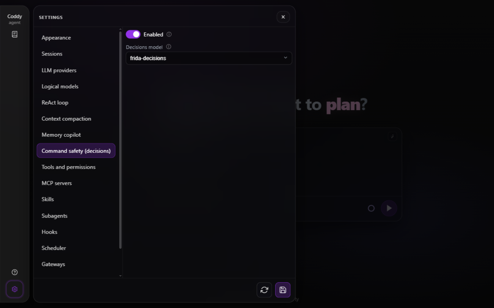

# Command safety (decisions)

With the check on, Coddy asks the NeuralDeep decisions endpoint - the same `sk-` key as the rest of the hub, a separate `POST /v1/decisions` quota - whether a shell command is safe before the permission gate decides on it. The answer is safe or unsafe. A safe command runs without a permission prompt. An unsafe one is asked about in every mode, with the verdict in the prompt, `bypass` included: there the prompt is the one place the operator still decides, so a command the check stopped can still run when the operator presses **Allow**, and the agent reads its output in the same turn. Where nobody can answer the prompt - a scheduled job, `coddy -p`, a subagent whose parent turn has ended with no surface to ask - the command is rejected. The refusal comes back as the result of the call - `command rejected as unsafe: the decisions model frida-decisions classified the command as dangerous (unsafe at 0.99, threshold 0.50); ask the operator or use a safer alternative` - so the session transcript records it, the tool call card in the web UI shows it with a cancelled status, and the model reads it and can choose another path.

The check is off by default. Turn it on in Settings → **Command safety (decisions)** or in `config.yaml`:

```yaml
decisions:
  enable: true
  model: frida-decisions   # or clef-flash
  threshold: 0.5           # unsafe once p(unsafe) reaches this
```

## When the check runs

The check covers `run_command` and the remote command of `ssh_run_command`, and only a command the operator did not allow explicitly:

| Command | `bypass` | `ask`, `accept_edits` |
|---|---|---|
| Safe | runs | runs without a prompt |
| Unsafe, or the check gave no verdict | asked about, the verdict in the prompt; rejected where nobody can answer | asked about, the verdict in the prompt; rejected where nobody can answer |
| Allowed by `tools.command_allowlist`, a session's "always allow" grant of exactly that command or a hook's `allow` | runs, not checked | runs, not checked |

The prompt the check raises is one no sender answers by itself: `bypass` on any surface and a messenger bot that approves its own agent both leave it to a person. Its choices are **Allow** once, **Allow always** (a session grant for that exact command, which is then trusted and not checked again; for `ssh_run_command` nothing is stored, so it works as **Allow**) and **Reject**, which refuses the call like any other prompt (`permission denied by user`); in `ask` the session switches of any prompt are offered too. Only `tools.command_allowlist` and a grant of exactly the command take a command past the check: the same command with arguments added, or one a program-wide grant from an ordinary prompt covers, is checked again, so `rm -rf build /` is checked after **Allow always** on `rm -rf build`. That is also why the check's prompt does not offer to always allow the whole program, as the prompt of an ordinary command does: such a grant would remember nothing the check reads.

On a surface where a person can answer - the web UI, the console, an editor - the check's prompt waits for the answer like any other prompt, so a turn running in `bypass`, a supervised goal included, stops at a flagged command until somebody answers or stops it.

A few calls are left as they are:

- a `PreToolUse` hook's `ask` keeps its prompt, and the command is not checked;
- a command the operator approved in a permission prompt is not checked again, on the fresh call and on the resume of an answered prompt alike;
- a turn of a messenger user who is not the bot's admin keeps every prompt for the bot to refuse, so the check never lets a command of such a turn run;
- foreground and background commands (`background: true`) are both checked before the process starts, and subagent children run under the same gate with their inherited configuration.

The [Telegram](../surfaces/gateway.md) and [Pachca](../surfaces/pachca.md) bots approve the prompts of their chat's own agent by themselves, but not the check's prompt: they ask it in the chat with buttons, as they ask a subagent's, and only the bot's admins can answer (in a turn of anybody else the prompt is refused, as above). A plan run started over HTTP has nobody to ask, so it rejects the command. The same holds for the prompt a `PreToolUse` hook forces with `ask` ([Hooks](hooks.md)): that is how a hook lets the operator run a command the hook would rather not let through unasked.

MCP tools are not checked, by design: a server's tools run because the operator declared the server and, for one a project brings, trusted it ([MCP servers](mcp.md)), and nothing in a tool call says whether what the server does with it is safe. The file tools are not checked either.

## The question and the verdict

The state sent to the endpoint is the command text plus where it would run - the working directory of a `run_command`, the `user@host` (and a port other than 22) of an `ssh_run_command`; the question is a single `choice` with two described options - `safe` (a routine development command: reads, builds, tests, installs, changes only rebuildable project files) and `unsafe` (broad or forced deletion, disk wipes, database drops, force-push, piping a download into a shell, anything irreversible beyond the project). The endpoint answers with the chosen option and the probability of each; Coddy counts the command as unsafe when the probability of `unsafe` reaches `decisions.threshold` (default 0.5, the point where the two options swap) and as safe below that - the threshold is the operator's dial, not the endpoint's own pick, so an answer that chose unsafe at 0.7 still counts as safe under a threshold of 0.9, and a borderline 0.6 counts as unsafe under the default. A bare answer without probabilities counts as certainty. `rm -rf /` scores around p(unsafe)=0.99 on both models; a plain `echo` or `go test ./...` is classified safe.

## The model

`decisions.model` picks between the two models the endpoint serves:

| Model | State budget | Typical latency | Quota units per request |
|---|---|---|---|
| `frida-decisions` (default) | 512 tokens of command text | ~20 ms | 1 |
| `clef-flash` | 8192 tokens | ~150 ms | 4 |

`frida-decisions` is an encoder pass with no generation, which is why it is both the default and the cheap option; `clef-flash` is the bigger generative model for commands whose context runs long. The check draws on the decisions quota bucket, separate from the chat class - the balance is served by `GET /v1/decisions/quota` on the hub.

The budget is a hard limit. The hub cuts a state longer than the model reads and reports the cut, and a verdict on the head of a command says nothing about the rest, where the destructive part may sit. Coddy therefore treats a command the model read only in part as one the check gave no verdict on: the prompt says the command is too long for the model, and where nobody can answer, the result says the same and tells the agent to split it into shorter commands or to write files with the file tools instead of a heredoc. A head the model already judged unsafe counts as unsafe. An operator whose agents run long commands sets `decisions.model` to `clef-flash`.

## The credential

The check resolves its credential exactly like chat requests through the neuraldeep provider: an explicit `providers[].api_key` (or `api_key_command`) on the first `neuraldeep` row, then that row's `NAME_API_KEY` environment variable (`NEURALDEEP_API_KEY` for a row named `neuraldeep`), then the row's stored hub sign-in (`coddy providers login <name>`); `api_base` picks the deployment (`.ru` or `.tech`) and `providers[].proxy` applies. The row can be absent: the check then uses the name `neuraldeep`, so `NEURALDEEP_API_KEY` or the sign-in stored by `coddy providers login neuraldeep` is enough.

## When the endpoint cannot answer

The endpoint is asked once per command, and one request waits at most five seconds. When it gives no verdict - no credential, a key it rejects, a request it refuses (an empty wallet, a model it does not serve), a rate limit, a network failure or a server error, an answer the question cannot have, or a command too long for the model - the command counts as unsafe: it is asked about with the reason in the prompt, and where nobody can answer it is not executed, with the reason in the result (`command not executed: the decisions safety check gave no verdict (...)`). A safety net that is on does not fail silently open; switch `decisions.enable` off to run commands without it.

## Testing

The offline suites stand in for the endpoint: `internal/llm/decisions_test.go` pins the request shape, the answer shapes and the error kinds on an `httptest` server, and `internal/agent/decisions_test.go` plus `features/decisions_check.feature` drive the gate itself - every row of the table above in each mode, the answers that are not a verdict and the calls the check must not touch. Two live probes run against the real endpoint, both skipped unless `NEURALDEEP_API_KEY` is set: the transport probe `internal/llm/decisions_live_test.go` (`rm -rf /` unsafe, `echo` safe, both models) and the end-to-end probe `internal/agent/decisions_live_e2e_test.go`, a full turn in bypass mode on a surface where nobody answers a prompt, whose scripted model requests `rm -rf /` and an `echo` - the destructive call comes back rejected in the transcript, the echo runs:

```
NEURALDEEP_API_KEY=... go test ./internal/agent -run TestLiveDecisionsE2E -count=1 -v
```



*Settings → Command safety (decisions): the enable switch, off by default, above the Model and threshold fieldset, whose (i) explains the two fields*
