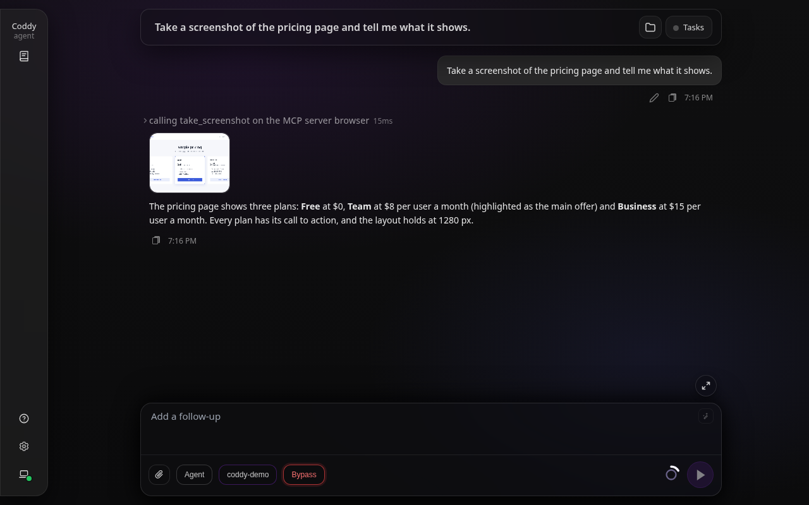
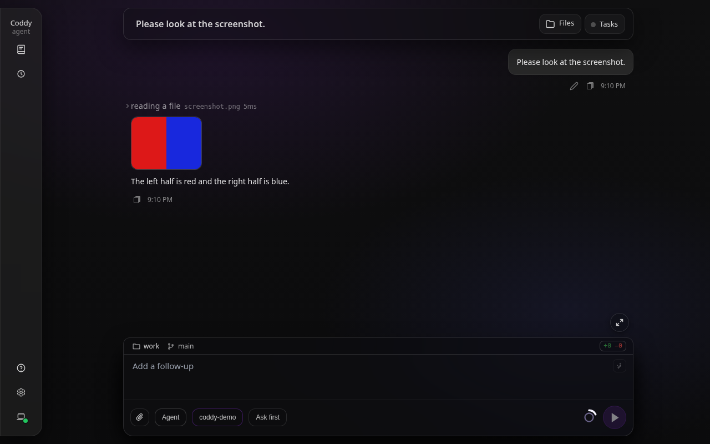

# Images

A model that reads images gets a picture three ways: you attach it to a prompt, the agent opens an image file of the workspace with `read`, or an MCP tool the agent calls returns one - a browser server's screenshot, a chart. This page covers the last two and where you see what the agent looked at. Attaching a picture in the web composer is described in [Web UI](../surfaces/web-ui.md#composer-file-attachments-multimodal) and, for a message sent while a turn runs, in [Message queue](message-queue.md); pasting one in the console or the browser, and marking it up first, in [Pasting and marking up pictures](picture-markup.md).

## A model that reads images

Pictures reach only a model marked as one that takes them, with `multimodal: true` on its row of `models`:

```yaml
models:
  - model: "openai/gpt-5.6-terra"
    multimodal: true
```

Every provider type sends them: an OpenAI-compatible endpoint as `image_url` parts, Anthropic as image blocks, the Codex backend as `input_image` parts, Devin with the prompt. An SVG attached to a prompt is text, and every provider gets it as text. Anthropic, the Codex backend and Devin take PNG, JPEG, GIF and WebP; a picture of another type is named in the message as not sent rather than failing the request. An OpenAI-compatible endpoint is sent a picture of any type, since a local server behind that API may take more types than OpenAI does. Mark a model this way only when it really accepts images; a text-only endpoint refuses a request that carries one.

## Reading an image file

`read` tells a picture by its content, never by its name: a PNG, JPEG, GIF or WebP file is an image even without an extension, and a text file named `shot.png` is read as text. For a model that reads images, `read` answers with one line naming the file, its type, size in pixels and bytes, and the model is shown the picture itself:

```text
screenshots/after.png: PNG image, 1280x720, 45.2 KB. The picture is attached for you to look at.
```

Use it the way you would ask a person to look: check a screenshot the tests just saved, compare a rendered page before and after a change, read a diagram. Several images read in one step reach the model together.

A picture is refused, with the reason, when:

- the session's model does not read images - a model switch in the middle of a turn counts, since the check is made when the file is read; this reason comes before any other, so the model is not told how to make a file smaller that it could not see anyway;
- the file is larger than 3.75 MB, which base64 encoding turns into the 5 MB one Anthropic request takes per image; the size on disk decides, before the file is loaded;
- a side is longer than 8000 pixels;
- the file ends before its image does - a screenshot still being written, a download cut short: a PNG is followed to its `IEND` chunk, a JPEG to its end-of-image marker, a WebP chunk by chunk to its image data, and a WebP whose header states a size other than what follows it is refused too, as libwebp refuses it;
- the file is all there but holds no image - a PNG with no image data, a JPEG with no scan - or a chunk of a PNG does not match its checksum;
- it is an animated WebP, which not every provider takes;
- the content looks like an image but cannot be decoded.

A picture the history kept although a provider refuses it would fail every later request of the session, which is why these are refused up front. The agent can save a scaled-down copy, or a frame, with a command and read that. A GIF is shown as its first frame, as a PNG: every provider takes that, and the rest of an animation is never decoded. Any other binary file - a PDF, an archive - is refused with its type and size, as before.

## Pictures an MCP tool returns

An MCP server answers a call with content blocks, and an `image` block carries a picture as base64. Coddy keeps it with the call's result, as it keeps the picture of a `read`, so a server that returns a screenshot - a browser automation server, one that draws charts - shows the model what it saw. The picture is named after the server, the tool and its place in the result, `<server>-<tool>-<n>` with the extension of its type:

```text
browser-take_screenshot-1.png (from call call_7)
```

Coddy checks it the way `read` checks a file. The content tells the type, whatever `mimeType` the server declared, and the same limits hold: a PNG, JPEG, GIF or WebP, at most 3.75 MB and 8000 pixels a side, and all there. A GIF is shown as its first frame. A picture that fails a check is named in the result with the reason, and the text blocks of the result stay:

```text
[MCP image 2 omitted: a PNG image of 5.1 MB, more than the 3.8 MB one picture may take]
```

One call keeps at most 20 pictures and 20 MB of them, as much as one request carries; the pictures after that are named in the result the same way. A result with no text of its own names the pictures it kept, `[MCP image 1: browser-take_screenshot-1.png]`, so the call's row in the console or an editor says what the call returned. A result the server marks as an error (`isError`) is the call's error: the model reads its text, and its pictures go nowhere, as a failed `read` keeps none. Embedded resources, resource links and audio blocks are left out.

A model without `multimodal` is not refused. The tool returned the picture either way, so Coddy keeps it with the session and the surfaces show it, while the model is told only its name; after a switch to a model that reads images the picture goes out like any other.

A screenshot costs context like any picture. A server that returns one at every step soon fills each request with the 20 newest, and once there are more than 20, every new picture changes the request where the oldest one it carries stands, so the provider's prompt cache holds only the part before it. When the model does not need the server's pictures, turn them off on the server's side: Playwright MCP, for one, takes `--image-responses omit`.



*The screenshot a browser server's take_screenshot returned, previewed under the call's row; a click opens it enlarged.*

## What the model is sent

The picture stays with the result of the call that produced it, a `read` or an MCP call. The transcript gains no extra message, so a reload, `/resume` in the console or an editor that loads the session shows the conversation as it was typed.

What goes to the provider is built from that transcript on every request. An OpenAI-compatible tool result cannot hold an image, and nothing may come between the results of one step, so the pictures of a step travel in one user message right after the step's tool results, named in the order they were read. The message is rebuilt the same way each time, so the provider's prompt cache keeps working.

A picture costs context like anything else the model reads, and it goes out with every request after the step that read it. A request carries at most 20 pictures and 20 MB of them, the pictures attached to prompts and the pictures of tool results together, newest first, a picture too large for the bytes left giving way to an older one that fits. A text file attached to a prompt is no picture and takes no place among them. That keeps a session of many screenshots within what a provider takes (the Anthropic API refuses a request over 32 MB, and wants pictures of at most 2000 pixels a side once a request holds more than 20); a picture left out is named where it was, in the note of its step or in its own prompt. When [result eviction](compaction.md#result-eviction) collapses an old `read`, its picture goes too; the result of an MCP call is not collapsed, and its pictures leave a request only to newer ones. Either way the note tells the model to read the file again or repeat the call if it needs the picture. The context estimate counts every picture a request carries as about 1600 tokens, the same pictures the request is built with, so eviction, [automatic compaction](compaction.md) and the context ring see a session of screenshots for what it costs, and a model without `multimodal` is charged for none.

A session switched to a model without `multimodal` sends no picture at all, prompt attachments included, and the model is told which pictures the steps and the prompts came with; a text file attached to a prompt still goes, written out in the message.

A file attached to a prompt that is neither a picture nor text - a PDF, an archive, a document a person sent the [Telegram bot](../surfaces/gateway.md#photos-and-files-the-person-sends) - is named in the message and never written out: its bytes as text would only fill the context window. A text file is written out up to its first 64 KB, the label saying how much of it that is: a message larger than the context window would stay in the history and fail every request after it. The session keeps every file whole with its assets, and the prompt says where, so the agent opens it with its tools.

Coddy keeps one copy of every picture a call returned, with the session's assets (`~/.coddy/sessions/<id>/assets/`), under the file's name plus a digest of its content. The result of a `read` names that copy, its type and size; the base64 the provider needs is built from the copy when a request goes out, so the transcript and the memory of a running session hold no second copy of the picture, and a picture read again unchanged is stored once. The copy is looked up by its name in the session's own assets directory, so a session directory that moved keeps its pictures, and it is sent only as it was saved: a copy that is gone, replaced by a link or holding other bytes than its digest names takes no place in the request, and the model is told the copy is gone and reads the file again or repeats the call. The surfaces show the same copy, so a screenshot overwritten a minute later still previews as the model saw it.

## Where you see it



*The picture a `read` showed the model, previewed under its row; a click opens it enlarged.*

| Surface | What it shows |
|---|---|
| [Web UI](../surfaces/web-ui.md) | A preview card under the `read` row or the MCP call's card; a click opens the picture enlarged. It works for a session started in the console or in Telegram, and through a remote server or a relay. |
| [Telegram](../surfaces/gateway.md) | The bot sends the picture into the chat as a photo, captioned with its name, while the turn runs; as a document when Telegram refuses the photo itself. |
| [Console](../surfaces/console.md) | The call's row with its text. |
| [Editors](../surfaces/editors.md) | The call with its text. |
