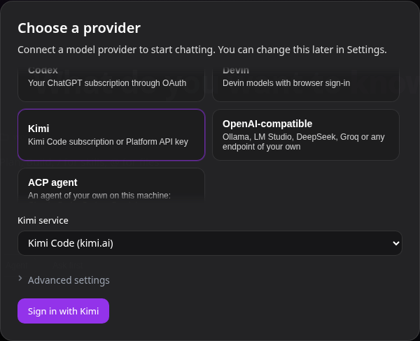
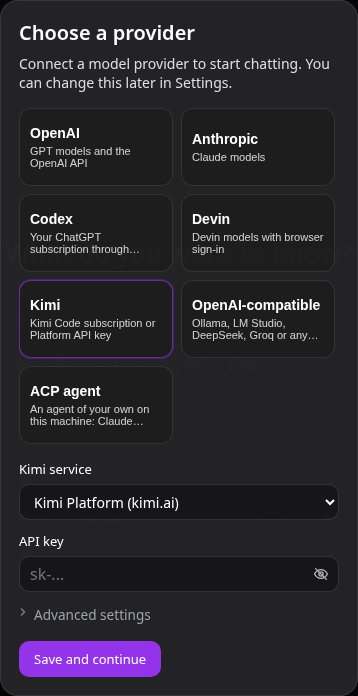

# Kimi

Use a Kimi Code subscription or a Kimi Platform API key as a model provider for Coddy.



*Selecting Kimi defaults to Kimi Code on kimi.ai.*



*Platform mode asks for an API key.*

## Configuration

A `type: kimi` provider has two credential modes. Omitted `mode` means `subscription`, for Kimi Code; `platform` uses a Kimi Platform API key. Omitted `region` means `global`; set `region: china` for mainland China. Configure logical models separately.

```yaml
providers:
  - name: kimi
    type: kimi
    mode: subscription
    region: global
```

For Platform, set `mode: platform` and supply `api_key` or `api_key_command`. Subscription mode rejects `api_key`, `api_key_command` and `api_base`. A Platform key is not a Kimi Code OAuth token.

| Region | Kimi Code authorization | Kimi Code API | Platform API |
| --- | --- | --- | --- |
| `global` | `https://auth.kimi.ai` | `https://api.kimi.ai/coding/v1` | `https://api.moonshot.ai/v1` |
| `china` | `https://auth.kimi.com` | `https://api.kimi.com/coding/v1` | `https://api.moonshot.cn/v1` |

The model catalog carries a protocol for each model. For subscription models, Coddy supports Kimi, Anthropic and OpenAI Responses transports; Platform inference currently accepts the Kimi protocol only. Catalog metadata is tied to the model, mode and region. A protocol mismatch requires validation rather than silently changing the transport.

Kimi Code accepts only temperature 1 and refuses any other value with HTTP 400, whatever the model. Coddy therefore leaves a `temperature` written on a `models[]` row out of a subscription request. A temperature an API client sends on the request itself still reaches the endpoint, which refuses it unless it is 1. Platform is the Moonshot API, which takes the parameter, so a configured temperature reaches it.

## Sign-in and CLI fallback

Kimi Code uses OAuth device authorization. Run `coddy providers login kimi` or sign in from the provider form. Follow the verification link and enter the displayed code. For an unsaved provider in the web UI, save the settings after signing in so the provider retains its identity. Platform mode uses a key and does not use this flow.

When no Coddy-managed credential exists, an eligible subscription row can read a Kimi CLI access token for the selected region. The eligible row is the only Kimi row, or the row named `kimi` when several exist. An invalid or uncertain managed credential does not fall back to the CLI account. Coddy reads the CLI credential without refreshing, modifying or deleting it. If the token expires or the server rejects it with HTTP 401, renew the login in Kimi CLI or sign in through Coddy. A token whose expiry is unknown is tried until the server rejects it. When CLI is the only source, sign out from Kimi CLI itself.

The CLI credential directory is `KIMI_CODE_HOME`, or `~/.kimi-code` when unset. The global and China credentials occupy separate files under its `credentials` directory.

## Usage and proxy

Subscription usage has four independent windows when the server supplies them: five hours, seven days, monthly total and monthly code. A missing window remains unknown. Booster wallet data is omitted; it is not displayed as a ruble balance. Platform mode does not provide subscription usage.

Provider requests use `providers[].proxy`, including device authorization, polling, refresh, model discovery, inference and usage. Omit it to inherit the process proxy, set `none` for a direct connection, or supply a proxy URL.

## Credential safety

Managed credentials are stored outside `config.yaml` under `$CODDY_HOME/providers/kimi-identities/<identity>/`, with separate region files. On Unix the files have owner-only permissions; on Windows they inherit the store directory's ACL. The non-secret identity in the provider row keeps a deleted and recreated row from inheriting the old managed login. Discarding an unsaved draft can leave an unused identity directory; inspect the configured identities and active drafts before removing one yourself. Coddy does not delete these directories automatically. Treat the credential directories as secrets. Subscription destinations are constrained to the selected region; do not send OAuth tokens to a Platform endpoint. If a refresh has an uncertain outcome, sign in again rather than retrying a potentially rotated token. Token updates from different processes use a shared lock. Windows does not guarantee that a directory change survives sudden power loss.
