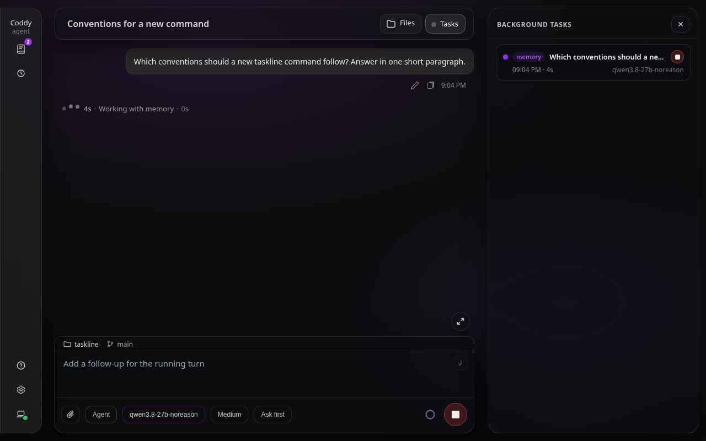
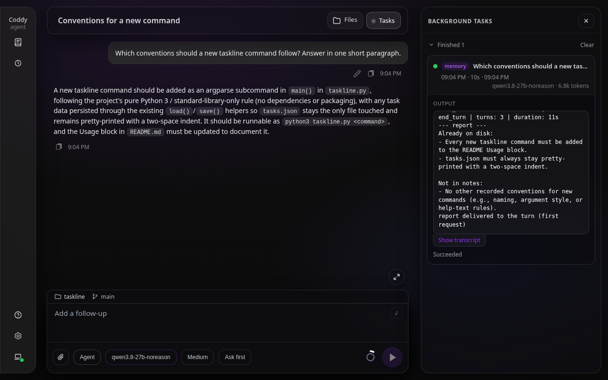
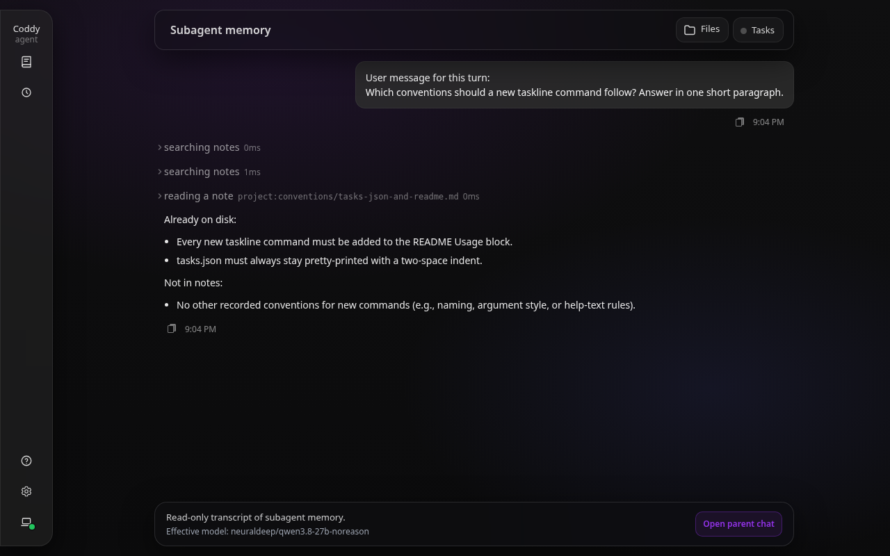
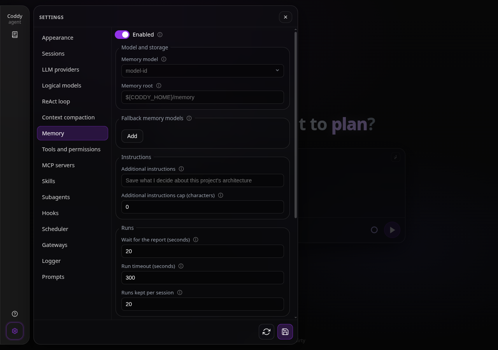

# Long-term memory

In the LLM sense, memory is whatever reaches the context: the chat history is the short-term part, and it ends with the session. Long-term memory in Coddy is a set of markdown and plain-text notes on disk that a dedicated child agent, the **memory subagent**, consults and updates. The main agent delegates to it the way it delegates to any subagent: a `spawn_agent` call under the bundled `memory` definition starts a child with its own session bundle, its own transcript and its own task log ([Subagents](subagents.md), [Background tasks](background-tasks.md)). The main agent never sees the memory tools; it sees only the child's report, as the result of that `spawn_agent` call, and the notes outlive any session.

Memory runs **on demand**: nothing happens on a turn until the model decides to ask. There is no background run started for every message, and a turn that never mentions the notes pays nothing for memory.

## What the memory subagent does

The child gets the parent's prompt as its task, opened by the [guides](#guides) of the memory roots that have one, and a system prompt of its own (`external/memory/prompts/memory_agent.md`, embedded in the binary, so changing it means a rebuild). It chooses one of two modes, never both in the same run:

- **Recall** loads context for the main assistant: it searches the notes, lists folders and reads files, then reports plain facts under `Already on disk` and, optionally, `Not in notes` - no paths, no file names - or exactly `(no memory hits)` when nothing matched. Recall is the default whenever the child is unsure, and it retries with English keywords and a folder listing when a first search finds nothing;
- **Persist** updates the notes when the parent asks to remember, save, forget or delete something, or when writing durable notes from the conversation is the evident intent. It reads existing notes first to avoid duplicates, creates a folder before the first save into it, and reports what it verified, saved, skipped or deleted. Keys, tokens and passwords are never written.

The prompt tells the child that answering the request is the main assistant's job: its report carries only what the notes hold. The child's last assistant message is the report, and it reaches the parent as the `spawn_agent` tool result, like any other delegation. The task is cut at 32 KiB, the bound a `spawn_agent` prompt has.

## How the model calls it

The memory subagent is a bundled subagent definition, `internal/subagents/bundled/memory.md`, listed in the model-facing catalog under the name `memory`. The model reaches it through `spawn_agent` with `agent: "memory"` and a prompt that says what to recall or to persist:

```text
spawn_agent  agent: "memory"
             prompt: "what do the notes say about our deployment target?"
```

Two switches decide whether the name is offered at all: the binary must be built with the `memory` tag (the release binaries and the Docker image carry it; from source, `make build TAGS="... memory ..."`, see [Build from source](../contributing/build.md)) and `memory.enable` must be true in `config.yaml`. While either is off the definition is **hidden from the catalog**, so the model never sees a spawn it would be refused, and a `spawn_agent` that names `memory` anyway is refused with a reason. Without the tag the memory keys are accepted and nothing runs. An operator's own definition named `memory` replaces the bundled one like any other built-in.

The spawned child is an **ordinary `agent`-kind background task**, not a special system task: it is listed by `background_list` like any subagent run, it can be read with `background_output` and waited on with `background_wait`, it counts against `subagents.max_concurrent`, and it fires `SubagentStart` and `SubagentStop` hooks like any delegation ([Hooks](hooks.md)). It runs in agent mode with the six memory tools and nothing else: no shell, no filesystem tools, no MCP servers. It cannot run in a worktree of its own; the spawn is refused before a checkout is made. Its timeout comes from the definition's frontmatter (`timeout_seconds: 300`), capped by `tools.background.max_timeout_seconds` like every task.

In agent and plan mode the child has the full tool set. In **ask mode** the run is recall-only: the child gets the search, list and read tools, its prompt says that saving is unavailable, and a save it asks for anyway is refused before execution, so a read-only session cannot change what is stored.

The child runs on `memory.model` when that names a configured model, otherwise on the session's model. Its completions are capped at `copilot_max_tokens` and its ReAct rounds at the larger of `recall_max_turns` and `persist_max_turns`. A model that is down or overloaded need not cost the run: `memory.fallback_models` is the chain tried after `memory.model`, and the session's own model is the last resort whether or not it is listed. The chain moves to the next model when a call failed before producing any output (the model is down, unauthorised, out of quota); a stream that broke after text was already delivered follows the ordinary retry policy instead, so no answer is streamed twice ([issue #247](https://github.com/coddy-project/coddy-agent/issues/247)).

The child's system prompt is the template `external/memory/prompts/memory_agent.md`, built into the binary. `memory.additional_prompt` adds a section of your own to it, **Operator instructions**, after the memory role and before the compact discovery catalog: a place to pin behaviour in your words, such as "only deal with the notes; never answer the task itself", or to name the language the notes are written in. The main agent never sees that text, and ask mode renders it the same way. `memory.additional_prompt_max_chars` cuts a longer text at that many characters, with a warning in the agent log at every launch that reads the cut text and a finding in `coddy -t`; `0` keeps it whole ([issue #266](https://github.com/coddy-project/coddy-agent/issues/266)).

## The prompt cache

A provider caches a request by its prefix: the tool definitions, then the messages from the start, and the first byte that differs from the previous request costs everything cached behind it ([The ReAct agent](../contributing/react-agent.md#the-system-prompt-is-frozen-for-the-turn)). The memory subagent is a separate conversation with a short prompt of its own; it shares no prefix with the parent and takes nothing from the parent's cache. The guides of the memory roots belong to its task, a message after its system prompt and tool definitions, so editing a guide moves nothing a provider has cached for the memory conversation.

On the parent's side the report is the result of a `spawn_agent` call, so it is appended to the history at its end like any other tool result and never moves the cached prefix. The main agent's system prompt carries the session notes alone (the `{{.Memory}}` slot of the templates, `agent.md`, `plan.md`, `ask.md`; see [Configuration](../getting-started/configuration.md)), so a recall that differs from call to call does not touch `messages[0]`.

## Watching a run

The spawned child is an ordinary subagent run, so it is watched where any subagent run is watched. The Tasks panel of the web UI lists it as a card tagged `memory` (the tag comes from the agent name, as a `spawn_agent` child carries its agent's name), titled with the prompt the parent passed; **Show transcript** opens the child session read-only, with the composer replaced by a link back to the chat. The open card shows the child's progress log: its tool calls and its text, then the `=== subagent report ===` block. Finished runs stay in the drawer's finished list and are cleared with the session's other tasks; deleting the session removes its memory children with it.

The model-facing pool tools see the run like any other agent task: `background_list` lists it, and `background_output`, `background_wait` and `background_stop` take its id. There is no separate `memory_run` update on the wire and no per-turn status line: the run is reported through the ordinary `agent`-kind task row and the `spawn_agent` tool result.



*The Tasks panel with a memory run in flight: the `memory` tag and the elapsed time*



*The finished run: the child's log and the report block*



*The memory child's transcript opened read-only from the run: the task, the search and the report*

## Bounds

- **Time.** One run is capped by the definition's `timeout_seconds` (300), which the pool caps by `tools.background.max_timeout_seconds` like every task. Hitting it stops the child and records the task as `timed_out`.
- **Concurrency.** The run counts against `subagents.max_concurrent` like any subagent, since it is one.
- **Capabilities.** The child has six tools its parent does not have, the one place a child's tool set does not narrow the parent's: the set is fixed in code, granted only to a child marked with the `memory` kind, and it touches the two note roots and nothing else.
- **Isolation.** The spawn refuses worktree isolation: a memory child runs in the parent's workspace, never in a checkout of its own.
- **Hooks.** `SubagentStart` and `SubagentStop` fire for the memory child like any delegation, and inside the child every ordinary event fires for its own turn. The `subagent` block of the payload carries `"kind": "memory"`, the key to match on ([Hooks](hooks.md)).
- **Exit.** A run stopped mid-persist loses its note.

## The tools

| Tool | Arguments | Recall | Persist |
|---|---|---|---|
| `coddy_memory_search` | `query`, `scope` (`global`, `project`, `both`) | yes | yes |
| `coddy_memory_list` | `path` (`global:` or `project:notes`; one level) | yes | yes |
| `coddy_memory_read` | `path` | yes | yes |
| `coddy_memory_mkdir` | `path` | | yes |
| `coddy_memory_save` | `title`, `body`, `scope`, optional `relative_path` | | yes |
| `coddy_memory_delete` | `path` (a file, or a folder with everything under it; never a root) | | yes |

Paths are `scope:relative/path.md` - `global:preferences.md`, `project:architecture/api.md` - and links inside a note body should use the same form (or a Markdown link with such a target) so they stay unambiguous across the two roots. Search ranks every note under the chosen roots against the query with the BM25F ranker of the [built-in documentation search](built-in-docs.md), returns at most `max_search_hits` snippets of up to 1,200 characters, best first, and is meant as an entry point: the child opens the hits with `coddy_memory_read` and follows the links inside. A save without `relative_path` gets a flat file name derived from the title, letters of any script kept; with it the note lands in that folder.

### How search ranks

A note has two fields: its path (the folders and the file name without `.md` or `.txt`) and its body. A word in the path says what a note is about, so it counts three times a word in the body. The weights are constants in the code, not settings.

- **Stemming.** Words are matched after stemming, English and Russian alike, so `configs` finds a note that says `config`, and a Russian query finds another form of a word (`настройка` finds `настройки`);
- **Rare words count more.** A word few notes have outweighs one most notes have, and repeating a word adds less each time, so a note that holds every word of the query ranks above one that holds a frequent word many times;
- **Prefixes.** A query word of three letters or more also finds the words it begins: `deploy` finds `deployment`, below a note that says `deploy`;
- **Function words count for nothing.** `how`, `to` and `the` (and their Russian counterparts) are dropped from the query, so `how to deploy the relay` ranks the note about the relay deployment first and does not return a generic how-to note for sharing `how to the`. A query made of function words alone finds nothing;
- **Order.** Notes with equal scores are ordered by path, and a hit carries its score;
- **Not a guide.** The `AGENTS.md` at the root of a scope is never a hit ([Guides](#guides)); one in a subfolder is an ordinary note.

The index is built from the files read for each call. Notes change between calls and the store is small, so there is nothing to keep or invalidate.

A note body holds at most `memory.max_note_chars` characters (default 900; characters, not bytes, so a note in Cyrillic or another non-Latin script gets the same room as one in English). The tool definition states the cap, so the child knows it before the call, and its prompt tells it to split a longer topic into several notes. A body over the cap is cut at a character boundary, ends with a `...` line, and the save answers `saved as <path> (warning: body truncated to 900 characters)` instead of the plain `saved as <path>`, so a cut is never silent ([issue #429](https://github.com/coddy-project/coddy-agent/issues/429)). `0` removes the cap.

## Storage layout

| Root | Where | Scope of the notes |
|---|---|---|
| global | `memory.dir`, or `$CODDY_HOME/memory` (`~/.coddy/memory`) when unset; `${CODDY_HOME}` and `~` expand | shared by every session |
| project | `<session cwd>/.coddy/memory`, not configurable | the workspace the session runs in |

Only `.md` and `.txt` files count. Nested folders are encouraged for thematic grouping, and the child calls `coddy_memory_mkdir` before saving into a new branch of the tree. Both roots are plain directories: they can be edited with any editor, and the project root can be committed with the repository or ignored, as the notes deserve.

The two roots treat links differently. The global root is yours: a note or a folder in it may be a link to anywhere, a synced folder for instance, and Coddy follows it. The project root comes with the checkout, so a link in it never leads out of it. Coddy reaches it through `os.Root`: a link inside it is followed only while its target stays inside, and `.coddy` and `.coddy/memory` must be real folders, not links. A note of a cloned repository that is a link to `~/.aws/credentials` is then neither read nor found by search, so it never reaches the model, and a save never lands in a folder that is a link to another project. Deleting such a link removes the link and leaves what it points at. A project root that is itself a link is refused with an error that says so; a search of both roots still answers from the global one.

## Guides

The child knows the notes only through search, list and read, plus its fixed prompt. An `AGENTS.md` at the root of a memory root is the place to tell it how you keep them: an index note to start from, one folder per topic, naming conventions, what never to save. `memory.additional_prompt` does the same for every workspace; a guide belongs to one root.

- **Where.** `AGENTS.md` at the top of the global root (`$CODDY_HOME/memory/AGENTS.md`, or under `memory.dir`) and at the top of the project root (`<workspace>/.coddy/memory/AGENTS.md`). The file existing is the switch, there is no setting for it, and a file of that name in a subfolder is an ordinary note;
- **Both levels, global first.** At the start of every run the child's task opens with the global guide, then the project guide, then the prompt, each guide under a heading that names its level and path. A level without a guide adds nothing: no heading, no placeholder. The two levels stay apart: neither overrides or merges into the other, and the child's prompt tells it to follow each guide for the notes of its own root;
- **Read like any note.** A guide goes through the same store as `coddy_memory_read`, so the project guide gets the protection of the rest of the project root: one that is a link leading out of `.coddy/memory`, a named pipe or other file that is not a regular one, or a file the disk refuses to open (no permission, a link that loops), is not read, a warning in the agent log says so, and the run goes on without it;
- **Size.** Coddy reads no more than the first 8 KiB of a guide, however big the file is, and ends it with a marker that says so when the file goes on. Keep it a map and put the detail in notes it points to; the child opens them with `coddy_memory_read` and `coddy_memory_list`, or finds them with `coddy_memory_search`;
- **Not in the prompt.** The guides ride in the task, never in the system prompt or a template: a `{{` in a guide is plain text, and editing a guide does not change the child's system prompt or tool definitions;
- **Quoted, so references stay text.** Every guide line is written into the task as a Markdown quote (`> ` before it), and a quoted line is prose to the `@` mention grammar. A project guide arrives with a checkout, so an `@~/.aws/credentials` or `@/abs/path` in it attaches no file to the child's request;
- **Not a search hit.** `coddy_memory_search` does not return the root `AGENTS.md`, since the child already has it. The child can still list and read it, and write it in a persist run when the guide asks for that.

With both guides present the task looks like this.

```text
Memory guide (global:AGENTS.md):
> <the global file, every line quoted>

Memory guide (project:AGENTS.md):
> <the project file, every line quoted>

Task from the parent:
<the prompt the parent passed>
```

With no guide the task is the prompt behind its preamble.

## Browsing the notes over HTTP

A binary built with both `http` and `memory` serves the two roots of a session as a tree under `/coddy/sessions/{id}/memory/*`; a plain `http` build answers `404` there.

| Method | Path | Notes |
|---|---|---|
| GET | `/coddy/sessions/{id}/memory/tree` | without `root`, the roots `global` and `workspace`; with `root` and optional `path`, the `.md` and `.txt` children one level down |
| GET | `/coddy/sessions/{id}/memory/file` | `root` and `path`; UTF-8 content |
| PUT | `/coddy/sessions/{id}/memory/file` | `{"root","path","content"}` |
| POST | `/coddy/sessions/{id}/memory/dir` | `{"root","path"}` creates a folder |
| DELETE | `/coddy/sessions/{id}/memory/file` | `root` and `path`; a file, or a folder recursively; `400` for the root itself |

`workspace` is the project root of that session's cwd. The routes reach both roots through the same store as the memory tools, so the rules of the storage layout above hold here too: a path that leaves a root by its spelling or through a link in the workspace root is answered with `400` and the reason, and so is every route of a workspace whose `.coddy/memory` is a link. The session's own notes (`agentMemory` in `session.json`) are not editable here. These routes are the contract written down under [Long term memory](../surfaces/web-ui.md#long-term-memory) in the web UI notes; the memory keys themselves are the **Memory** tab of the web UI's Settings.

## Configuration

```yaml
memory:
  enable: false
  model: ""                # models[].model for the memory subagent only; empty = the session's model
  fallback_models: []      # tried in order when the model above them fails before answering
  dir: ""                  # global root; empty = ${CODDY_HOME}/memory
  recall_max_turns: 6      # the child's round cap is the larger of the two
  persist_max_turns: 12
  copilot_max_tokens: 4096 # completion cap of the memory model's calls
  max_search_hits: 8
  max_note_chars: 900      # longest body one saved note may have, in characters; 0 = no cap
  additional_prompt: ""    # your own instructions for the memory subagent only; the main agent never sees them
  additional_prompt_max_chars: 0 # cut that text at so many characters (a warning is logged); 0 keeps it whole
```

| Key | Default | Meaning |
|---|---|---|
| `enable` | `false` | expose the memory subagent at all (needs the `memory` build tag) |
| `model` | `""` | pin the child to one `models[].model`; the main agent is unaffected |
| `fallback_models` | `[]` | tried in order when the model above them fails before answering; the session's own model is the last resort whether or not it is listed |
| `dir` | `""` | the global root |
| `recall_max_turns`, `persist_max_turns` | `6`, `12` | bound the child's ReAct rounds; the effective cap is the larger of the two |
| `copilot_max_tokens` | `4096` | completion cap for the memory model's calls |
| `max_search_hits` | `8` | snippets returned by `coddy_memory_search` |
| `max_note_chars` | `900` | longest body one note saved by `coddy_memory_save` may have, in characters; a longer one is cut with a warning in the tool's answer; `0` removes the cap |
| `additional_prompt` | `""` | your own instructions for the memory subagent, rendered as its **Operator instructions** section; the main agent never sees them |
| `additional_prompt_max_chars` | `0` | cut `additional_prompt` at that many characters, with a warning in the agent log and a `coddy -t` finding; `0` keeps it whole |

The field table is in the [config.yaml reference](../reference/config.md#memory); `config.example.yaml` carries the same block with comments. The web UI edits the same keys under **Settings → Memory**, grouped into **Model and storage**, the **Fallback memory models** list under it, **Instructions** and **Limits**.



*Settings → Memory: the model and the fallback models, the operator's additional instructions with their cap, and the turn and token limits with the note size cap*

## Cost and latency

Memory costs tokens only when the model asks. A turn that never spawns the memory subagent runs no memory model at all; a turn that does pays for one child conversation: the child's own system prompt (the template, environment block and discovery catalog), its native offer and its rounds, one model call at least, more when it uses tools. The child activates complete memory-tool definitions before calling them, which can add model requests. Pinning a small, fast model with `memory.model` keeps the cost of recall low while the main agent stays on the model you chose for it. A guide adds at most 8 KiB per root to the child's task on every run.

## Testing

- `features/memory_subagent.feature` (harness `internal/agent/bdd_memory_test.go`, `-tags memory`): the spawn under the bundled definition and the child bundle, the report as the `spawn_agent` result, the recall-only child of ask mode, a persist, a Cyrillic note kept whole under the character cap, the fallback chain, the pool admission, the ranking of the child's search, the guides at the top of its task. `features/memory_http.feature` (`external/httpserver/bdd_memory_http_test.go`, `-tags http,memory`): the read-only child transcript and the note routes over REST.
- Unit tests: `external/memory/agent_test.go` (the template, the task bound, the guides: both levels, one level, the size cut, braces kept literal, a guide behind a link), `internal/agent/prompt_cache_memory_test.go` (the child's system message and tool definitions identical across runs whose guides differ), `external/memory/storage/storage_test.go` (search ranking: stemming in English and Russian, rare words, path words, prefixes, function words, scopes and limits; snippets cut in characters, nested writes, file names from non-Latin titles, traversal, deletion, link targets), `external/memory/storage/storage_links_test.go` (a note, a guide, a folder and the project root that are links out of it, a link that stays inside, links followed in the global root), `external/memory/tools/register_test.go` (the tool definitions), `external/memory/tools/mem_save_test.go` (the note cap in characters, the truncation warning, `max_note_chars`), `external/httpserver/memory_http_test.go` (traversal over REST).
- `examples/acp/acp_e2e_memory.py`, `examples/httpserver/http_e2e_memory.py` and `examples/cli/cli_e2e_memory.py` drive a real model: a pre-seeded global note is recalled and shapes the reply, a `remember` turn persists a note, the ACP harness then asks for that fact in a fresh session so the answer can only come from disk, and a step where only a seeded global `AGENTS.md` leads to the note that answers, and the run's record is checked where the surface shows it (the `memory` task row over HTTP, the child bundle under `<session>/subagents/` for ACP and the console).
