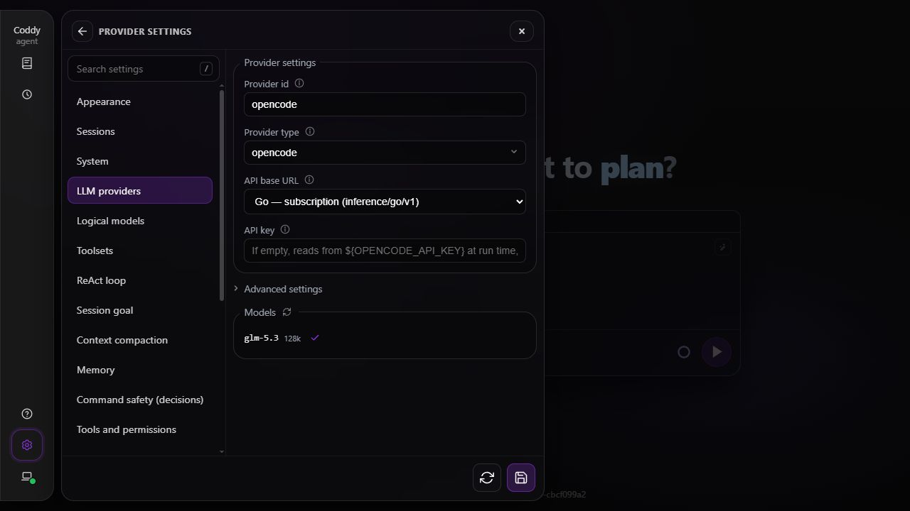
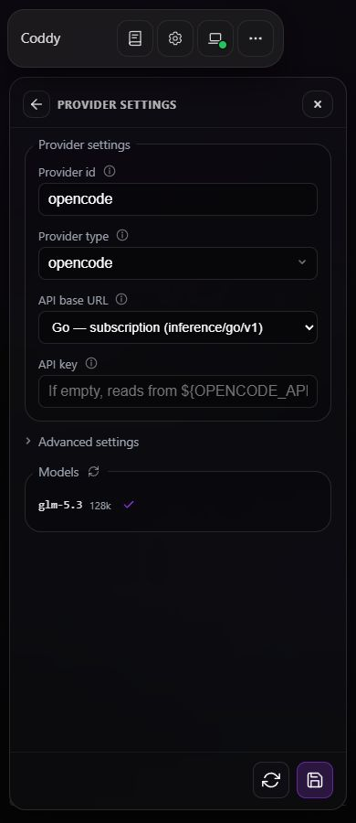
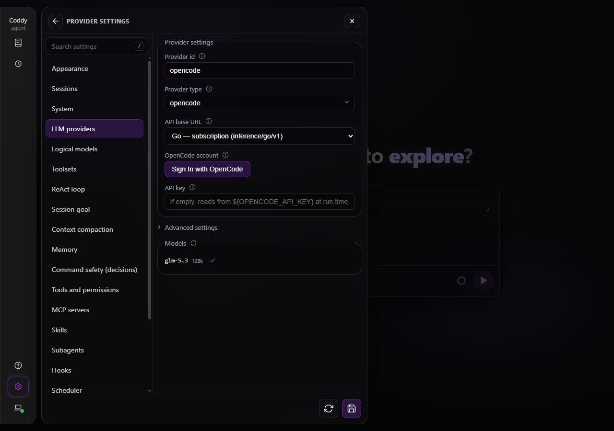
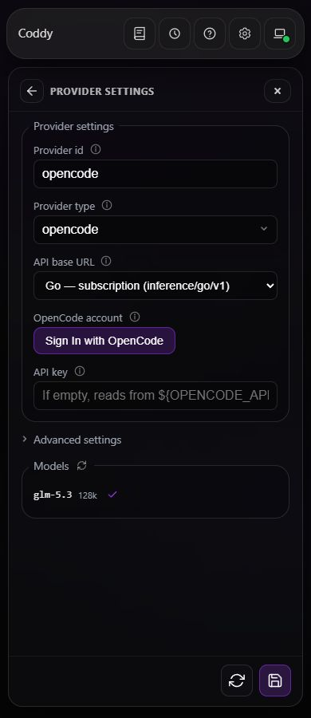
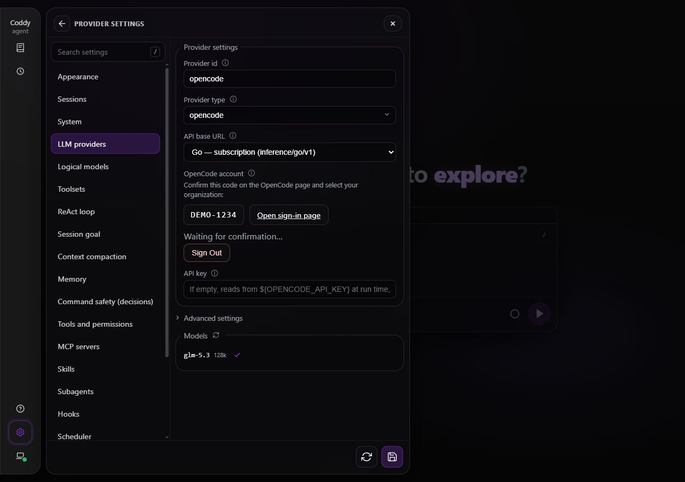
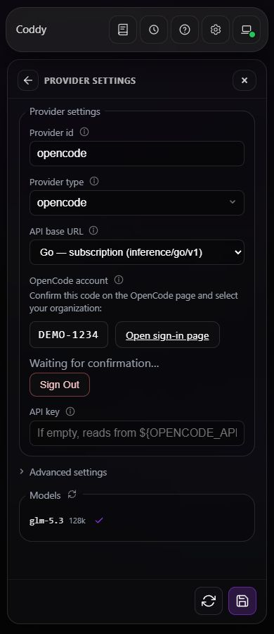
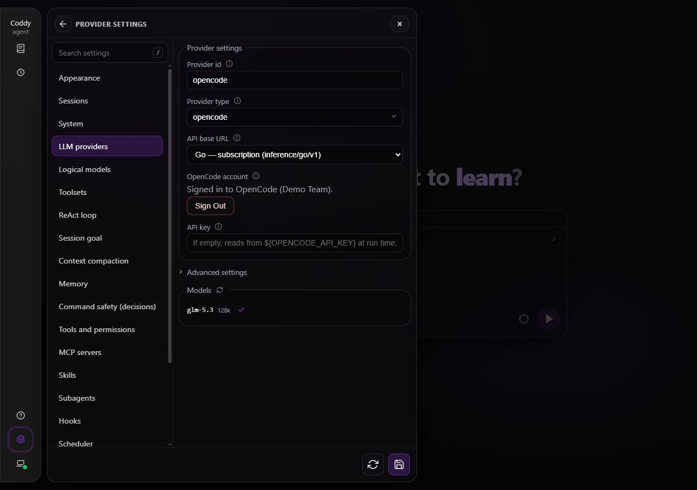
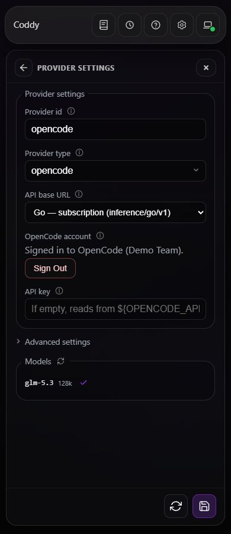

# OpenCode

A `type: opencode` provider gives Coddy the models of an [OpenCode](https://opencode.ai) gateway - the **Go** subscription or the pay-as-you-go **Console** (Zen) - with an account login or a service account key. OpenCode is only the backend here: the agent stays Coddy's own, with its system prompt, its tools, its permission gate and its ReAct loop, on every surface - the console, the web UI, ACP editors and the Telegram gateway.

OpenCode curates a catalog of coding models (Grok, GPT, Claude, Qwen, GLM, Kimi, DeepSeek, MiniMax, MiMo, Gemini and the rest) and serves each over the wire protocol that fits it. Coddy picks that protocol per model and gateway. Console's Jev decision models use a separate System One API and are not conversational models for Coddy.

## Sign in with an account

Run the login from a terminal on the machine that runs Coddy.

```bash
coddy providers login opencode
```

Coddy prints a short code and opens the OpenCode Console account page. Sign in, confirm the code and select your organization. You can open the printed URL in a browser on another machine. This follows the [OpenCode client's device method](https://github.com/anomalyco/opencode/blob/f394d9d410bc6bb7cafcebfc5e3180a9b80ebed9/packages/core/src/plugin/provider/opencode.ts).

In the console, `/login opencode` runs the same sign-in and writes the provider row and the gateway's models into `config.yaml` ([Console](../surfaces/console.md#signing-in-to-a-provider-login)).

The login stores access and refresh tokens at `$CODDY_HOME/providers/opencode/opencode-auth.json` with mode `0600`. Unless `--no-config` is given, it also adds the provider row, the gateway's models and an `agent.model` when it is empty to `config.yaml`. Use `--type opencode` to sign in another named profile, or `--api-base https://opencode.ai/inference/v1` to write Console into the row instead of Go. With `--no-config` the row stays as it is, so `--api-base` is refused there.

Before each catalog or inference request, Coddy refreshes a token that expires within 60 seconds and saves rotated tokens atomically. Requests carry the selected organization in `x-org-id`. A revoked refresh token requires a new login. `coddy providers list` shows the account organization without exposing tokens. The stored credential works on every Coddy surface. A running server reads it for an already loaded provider row; restart the server after adding a new row.

An explicit `api_key`, `api_key_command` or the row's `NAME_API_KEY` still wins over the stored login. `coddy providers logout opencode` deletes the local file. Revoke the account session or service account key in the Console to end it on the server.

Device authorization, polling and token refresh identify this application with `client_id: coddy`.

### Sign in from Settings

In **Settings → LLM providers**, open the OpenCode row and click **Sign In with OpenCode** below the gateway picker. Coddy shows the device code in the form and waits there. **Open sign-in page** opens Console, where the same code is shown for the device you are approving - compare the two before you approve. The form never opens that page on its own, so the code is on screen when Console asks for it. Then select your organization. The form shows the organization after confirmation; **Sign Out** removes the local login and also cancels a pending attempt.

The login uses the proxy currently shown in the form, including a new row or a saved row switched to OpenCode before Save. It serves both gateways, so the gateway picker alone decides where the row's requests go. Click **Save All** to keep those provider settings for chats and future token refreshes. Use the refresh icon beside the model list to read the catalog with the stored login. Tokens stay on the server and never appear in the browser or config YAML.

## Use a service account key

1. Sign in to the [OpenCode Console](https://opencode.ai/console).
2. Subscribe to **Go** (or **Go Plus**), or add credits for **Console**, and add your billing details.
3. Create a service account key and set it on the provider row.

```yaml
# yaml-language-server: $schema=https://coddy.dev/config.schema.json
providers:
  - name: opencode
    type: opencode
    api_key: "${OPENCODE_API_KEY}"   # or a literal key, or empty to read OPENCODE_API_KEY
    # api_base: https://opencode.ai/inference/v1   # Console; omit for the Go default
models:
  - model: opencode/glm-5.3
  - model: opencode/gpt-6-luna
  - model: opencode/claude-haiku-5-5
agent:
  model: opencode/glm-5.3
```

An empty `api_key` reads the row's `NAME_API_KEY` environment variable, then uses the stored credential if that variable is unset. A row named `opencode` reads `OPENCODE_API_KEY`. The `${OPENCODE_API_KEY}` form is expanded when the file loads; a bare empty value is read at call time.

### Store a service account key

```bash
coddy providers login opencode --api-key -
```

The `-` reads a key from a secret terminal prompt or a line on standard input. `--api-key KEY` supplies it directly. The key uses the same credential file and config update as an account login. Previously stored API keys remain supported.

## The two gateways

`api_base` picks the inference gateway. Account login uses the same Console device authorization service for both gateways; access depends on the selected organization and its subscription or credits. The stored login belongs to the account, not to a gateway, as in the OpenCode client, where Go and Console are two providers on one `OPENCODE_API_KEY`: the row's `api_base` alone decides which gateway its requests reach, and one login serves a Go row and a Console row alike.

| Gateway | `api_base` | What it is |
|---------|-----------|------------|
| **Go** (default) | `https://opencode.ai/inference/go/v1` | the Go / Go Plus monthly subscription |
| **Console** | `https://opencode.ai/inference/v1` | pay-as-you-go credits (Zen) |

An empty `api_base` means Go. A value that names neither gateway falls back to Go, so an OpenCode key is never sent to an arbitrary host. In the web UI's **Settings → LLM providers**, the row shows a gateway picker instead of a free-text base. `CODDY_OPENCODE_BASE_URL` moves the whole process to another address, for a stand or a test.

## The wire protocol per model

The OpenCode gateway serves different models over different protocols, and its `/models` list carries no hint of which - only ids. Coddy chooses from the model id:

| Protocol | Endpoint | Model families |
|----------|----------|----------------|
| OpenAI Responses | `/openai/v1/responses` | `grok-*`, `gpt-*`, `muse-*` |
| Anthropic | `/anthropic/v1/messages` | `claude-*`, `qwen*`, `minimax-m3` on Go |
| Google | `/google/v1beta/models/<id>:generateContent` | `gemini-*` |
| OpenAI-compatible | `/openai/v1/chat/completions` | `glm-*`, `kimi-*`, `deepseek-*`, `longcat-*`, `mimo-*`, `hy*`, `space-bunny`, the free chat models, and unknown ids |

These paths follow `https://opencode.ai/inference/go` for Go or `https://opencode.ai/inference` for Console. The catalog stays at `/v1/models` under that prefix. Console serves `qwen3.8-max` and every `minimax-*` model over Chat Completions; Go serves `qwen3.8-max` and `minimax-m3` over Anthropic. Older MiniMax models use Chat Completions.

An id this table does not know falls back to Chat Completions. The mapping follows the [OpenCode Go docs](https://opencode.ai/v2/docs/console/go/) and the [Console model endpoints](https://opencode.ai/v2/docs/console/models/); when OpenCode changes a model's protocol, update `opencodeProtocolForGateway` in `internal/llm/opencode.go`.

Reasoning levels are sent as OpenAI Responses `reasoning.effort`, an Anthropic thinking budget, OpenAI-compatible `reasoning_effort`, or Google's `thinkingConfig.thinkingLevel`, per the model's protocol. Gemini streams through `:streamGenerateContent?alt=sse`; Coddy preserves its signed response parts across tool calls and keeps partial text if a stream is cut before its finish reason. Inline pictures are supported; remote picture URLs are named as attachments without fetching them.

## Required client headers

The gateway is abuse-monitored and asks every client to identify itself and to keep a conversation on one route. Coddy sends these headers on inference and catalog requests across all four protocols:

- `User-Agent: coddy/<version>`, its own name rather than a generic SDK or HTTP-library one;
- `x-opencode-session: <session id>`, the stable id of the conversation, so OpenCode can optimize routing and reuse its prompt cache. A call that is not a conversation (a model list, a `--dry-run` probe) sends a generated id.

Coddy injects both headers into inference and catalog requests over the row's own transport. Account requests also identify Coddy with its `User-Agent`.

Only this row's OpenCode credential is sent. SDK defaults such as `OPENAI_API_KEY` and `ANTHROPIC_API_KEY` are discarded, and redirects to another origin are refused before forwarding a key.

## Proxy

`providers[].proxy` routes every OpenCode request - device authorization, account and organization discovery, token refresh, completions on all four protocols and the model list - exactly as it does for any other provider: `inherit` follows the environment's proxy, `none` connects directly, and a URL goes through that proxy. See [Provider proxy](../getting-started/configuration.md#provider-proxy).

## Usage limits

OpenCode meters each model against a monthly dollar budget (with 5-hour and weekly sub-limits), and you can watch it in the [console](https://opencode.ai/console). Coddy has no OpenCode account usage reader, so it shows no usage panel for an `opencode` row. A model's context window uses `max_context_tokens`, then catalog metadata when available, then 128000.

## Testing

- Unit tests: `internal/llm/opencode_test.go` checks exact inference paths for both gateways, headers, credential isolation, redirect refusal and stored credentials. `opencode_google_test.go` covers Gemini tool conversations, signed parts, usage and truncated streams.
- `features/provider_proxy.feature` covers all four API families, model discovery, account login, token refresh and login config updates through each proxy setting. `opencode_oauth_test.go` verifies HTTPS CONNECT routing, token rotation, concurrent refresh and failed authorization; `cmd/coddy/opencode_test.go` checks the terminal flow.
- The Responses transport is shared with the Codex backend (`internal/llm/responses_stream.go`); `internal/llm/codex_test.go` covers it.

### Settings screenshots

The screenshots show the running UI connected to a local Console stand.

| State | `1280px` | `390px` |
| --- | --- | --- |
| Before |  |  |
| Ready to sign in |  |  |
| Waiting for confirmation |  |  |
| Signed in |  |  |

## See also

- [Configuration](../getting-started/configuration.md) - providers, models and the credential order.
- [Environment variables](../reference/environment-variables.md) - `OPENCODE_API_KEY`, `CODDY_OPENCODE_BASE_URL`, `CODDY_OPENCODE_CONSOLE_URL`.
- [Config reference](../reference/config.md) - the `providers[]` and `models[]` fields.
