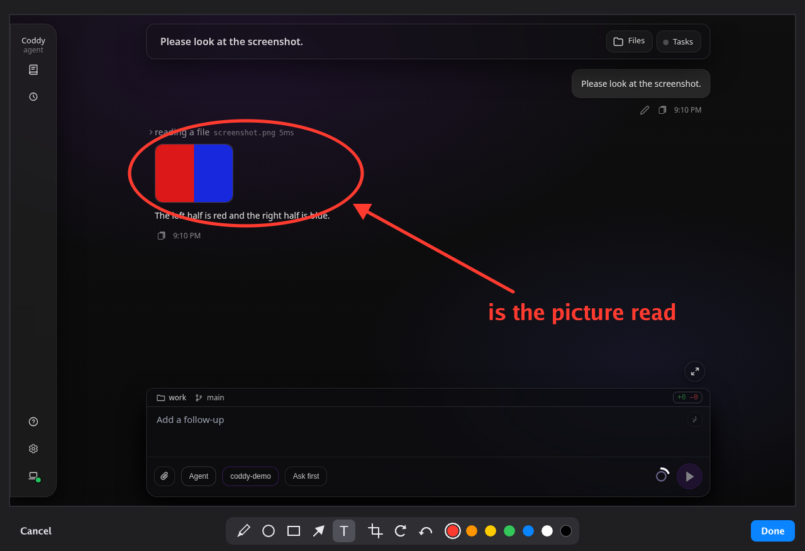
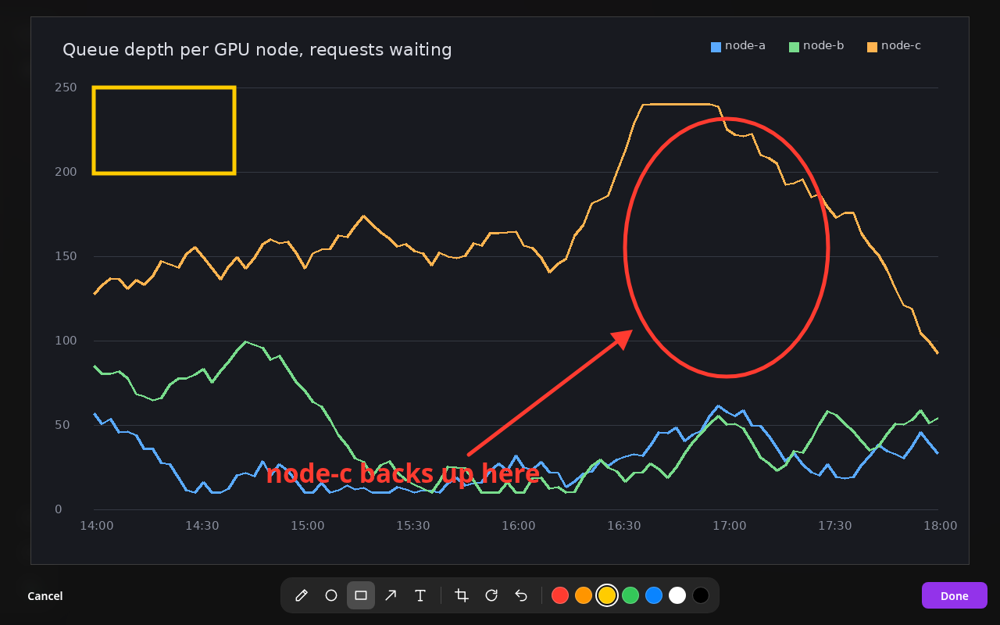

# Pasting and marking up pictures

A picture you copied - a screenshot, an image from a viewer or a browser, an image file copied in a file manager - goes into a prompt by pasting it, in the console and in the web UI. Before it is attached, the picture opens in a markup editor, where you circle the part that matters, point at it with an arrow and write a word next to it. The console opens the editor as a window on the desktop, the web UI over the chat; both have the same tools and the same buttons.

The picture reaches only a model that takes pictures, one with `multimodal: true` on its row of `models` ([Images](images.md#a-model-that-reads-images)).

## In the console

Press **ctrl+v** in the console to paste the picture the clipboard holds. A terminal pastes text only, so Coddy asks the desktop for the picture itself:

| Desktop | Where the picture comes from |
|---|---|
| X11, or Wayland with XWayland | the X clipboard, read over the X protocol by Coddy itself; `xclip` is not needed |
| Wayland | `wl-paste` from wl-clipboard when it is installed, then the X clipboard when XWayland runs |
| macOS | `osascript`, which every Mac has |
| Windows | PowerShell |

A picture the clipboard offers as PNG, JPEG, WebP, GIF, BMP or TIFF is taken; BMP and TIFF become PNG, since providers do not take them. An image file copied in a file manager is read from its path. A picture larger than 50 MB, or one whose header declares more than 40 megapixels, is refused before its pixels are decoded, with the reason; a clipboard whose owner does not answer within 15 seconds is reported as such. Where the terminal keeps ctrl+v for its own paste, as Windows Terminal does, press **alt+v**.

The picture appears in the editor as a marker, and the prompt that holds the marker carries the picture:

```text
what is circled here? [image #1]
```

Backspace deletes a marker as one piece, and the picture goes with it. The marker text reaches the model too, so a prompt with several pictures can say which one it means. A prompt recalled from history with the up arrow attaches its pictures again while they are among the last 32 pasted. A picture pasted while a turn runs travels with the message you queue ([Message queue](message-queue.md)).

The console has no pictures, so it names every picture a prompt carries as text: `[image #N]` for a picture, `[file: name]` for any other file. A prompt sent from the web UI or a Telegram chat with a picture shows in the console the same way, `[image #1] describe it`. The session keeps every picture with its assets, so the web UI shows a picture pasted in the console as a picture, and a click opens it full size:

![The web UI showing a prompt typed in the console: the pasted chart as a preview card over the bubble "[image #1] which node backs up here?", and the answer under it](../assets/picture-markup/console-paste-in-web-dark-1280.png)

*A picture pasted in the console, in the web UI.*

The console says so when the clipboard holds no picture, and refuses the paste when the session's model is not marked `multimodal` or has no row in `models`; a picture still in the markup window when the session switches to such a model is not attached either. Over `--remote` the server decides which models take pictures.

## The markup window



*The console's markup window on an X display.*

Where the environment names an X display (`DISPLAY` is set: an X11 session, Wayland with XWayland, XQuartz on a Mac, a display forwarded with `ssh -X`), the pasted picture opens in a window before it is attached. **Done** attaches the picture as marked up, **Cancel** attaches nothing. Closing the window is Cancel too. While the window is open the console keeps working, and the marker appears in the editor when you click Done.

The window is drawn by Coddy itself over the X protocol, with no GUI library, so the same static binary opens it everywhere an X server is reachable. Without an X display - a pure Wayland session, macOS without XQuartz, Windows, a remote shell - the picture is attached as copied. When the display is there but the window cannot open, the console says why and attaches the picture as copied as well.

| Tool | Key | What a drag does |
|---|---|---|
| Pencil | `p` | draws a line along the pointer |
| Ellipse | `o` | draws the outline of an ellipse in the box dragged |
| Rectangle | `r` | draws the outline of a rectangle |
| Arrow | `a` | draws an arrow from where the drag starts to where it ends |
| Text | `t` | a click puts a label there; type it, Enter finishes it, Escape drops it |
| Crop | `c` | keeps the part of the picture inside the box dragged |

The toolbar also turns the picture a quarter clockwise and takes back the last step: a shape, a label, a crop or a turn. Nothing is lost to a crop, since undo replays the original. The seven colours are red, orange, yellow, green, blue, white and black; a line's width and a label's size follow the size of the picture. **Enter** is Done and **Escape** is Cancel while no label is being typed, **ctrl+z** is undo. A label is typed in the keyboard layout in effect, a second layout such as Russian included, while the shortcuts go by the key: `r` and ctrl+z work in a Russian layout and with caps lock on. The window follows the desktop's scale (`Xft.dpi`).

## In the web UI



*The markup editor in the web UI.*

One picture pasted into the composer opens in the same editor over the chat. **Done** attaches it as a PNG named after the paste (`pasted-1.png`), **Cancel** or **Escape** attaches nothing. The tools, the keys and the colours are the ones in the table above, the keys going by their place on the keyboard as in the console; **Ctrl+Z** or **⌘Z** undoes the last step. Enter on a focused button of the toolbar presses that button, and Tab stays inside the editor.

A picture attached with the paperclip, dropped onto the composer or pasted together with others is attached at once. The pencil in the top-left corner of its card opens it in the editor: Done replaces it with the marked-up copy, Cancel leaves it as it was. A browser that cannot draw on a canvas attaches a pasted picture at once and shows no pencil. The editor's code is loaded the first time a picture opens; when it cannot be loaded (a tab left open across an update), a pasted picture is attached as it is.

## What is sent

Done turns the picture as it stands into a PNG: the marks drawn into it, cropped and turned as you left it. A picture attached without the editor goes as it was copied, in its own format. Either way it is an ordinary attachment from there on: the session keeps it with its assets, and the limits of [Images](images.md#what-the-model-is-sent) apply.
