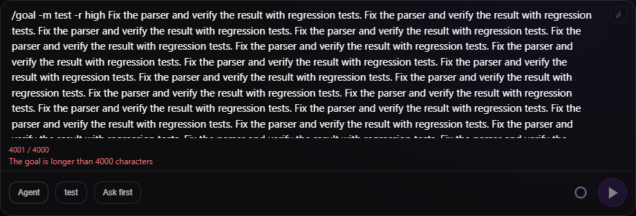

# Session goal and supervisor

A session goal keeps the agent working until a second model confirms the result. `/goal <objective>` sets the goal and starts work on it at once. After every turn the **supervisor** checks what the turn actually did against the objective. When work is left, it starts another turn that names what is missing. It stops when the check is met, when the work needs you, or when a budget runs out. A **watchdog** watches the same turns for stalls and loops.

The supervisor is a second model rather than the worker grading itself. It judges the evidence the harness recorded, such as tool calls, their results and the files changed, and treats the worker's final message as a claim. Before a goal is closed, a read-only **verifier** subagent opens the workspace and confirms every requirement.

## Commands

| Command | What it does |
|---|---|
| `/goal [-m\|--model <id>] [-r\|--reasoning <level>] [--then-file <path>] <objective>` | Sets the goal, replacing any earlier one, and starts a turn on it right away. The objective is limited to 4000 characters; put longer specifications in a file and name it, with an `@` mention (`/goal finish @plan.md`) or by attaching the file in the composer - the file rides with the first turn, where the worker reads it. `--model` and `--reasoning` choose the model and the reasoning level that check this goal, like `/compact --model`: a configured `models[].model` (or a part of one that matches exactly one model) and a level that model offers (`default` for its own). `-m` and `-r` are the short spellings. `--then-file` names a file whose text becomes the goal of a new session once this goal is met (see [Goal chains](#goal-chains)). |
| `/goal` | Shows the goal: its status and why, continuations used, the last check's verdict, and what is still open. The web UI and the console open their goal menu instead. |
| `/goal pause` | Stops the automatic continuations and keeps the goal. A turn working on it finishes the step it is in. |
| `/goal resume [-m\|--model <id>] [-r\|--reasoning <level>]` | Makes a paused, blocked or limited goal active again with a fresh continuation and token budget, and starts a turn. The goal keeps the checker it was set with unless the options name another. Resuming a blocked goal also accepts what the [risk gate](#risk-gate) found (see [Acknowledging a block](#acknowledging-a-block)). |
| `/goal clear` | Removes the goal. `stop`, `off`, `cancel`, `reset` and `none` work as well. |

The commands work in the web composer, the console, ACP editors, `POST /v1/responses`, Telegram and Pachca. In a messenger, only the bot's admins can set, pause, resume or clear a goal; any permitted user can show it. A goal is worked on in agent mode. It is saved with the session, so it survives a restart, and a compaction keeps the progress toward it in the summary.

Options go before the objective; they do not count toward its 4000 characters. An objective whose last two words are an option and a value (`/goal ship it --model mini`), or whose last word is `--model=mini`, is refused with a notice that names the option, since the option would otherwise become part of the objective. A sentence that ends with an option name and one more word, such as `document the --model flag`, reads the same way; reword the end of such an objective. An option written with a typographic dash (`—model`, which smart punctuation makes of `--model`) is refused at the start and at the end of the objective, with or without a value after it. An option name anywhere else in the objective stays text. Options after `resume`, `pause` or a clear word belong to that subcommand: `/goal resume -m <id>` picks the checker, `pause` and the clear words refuse options, and a mistyped option there (`/goal pause --modle mini`) is refused too instead of becoming the objective of a new goal.

The web composer counts the objective as you type `/goal`, the way the server counts it: without the leading options, trimmed, in characters. It does not send an objective longer than 4000 characters, and a `/goal` the server refuses comes back into the field with its attached files, so you can shorten it and send it again.



*An overlong goal stays in the composer for correction.*

## How a goal is worked on

1. **Kickoff.** `/goal <objective>` stores the goal and starts a turn whose message tells the worker to start now, restates the objective, and gives the rules: work from evidence, prove claims with tool results, do not weaken checks to pass them, and say so plainly when the work needs you. A file the objective names - an `@` mention in it, a file attached in the composer - rides with that first turn, so the worker reads it there; the turns after it restate the objective as text, and the file stays readable by its path.
2. **Check.** When the turn ends, the supervisor gets the objective, the requirement list from its previous check, and an **evidence digest**. The digest lists the tool calls in the goal's messages (see [Which messages count](#which-messages-count)) with their arguments and the head and tail of each result, plus the files the turns changed and the red flags of the [risk gate](#risk-gate): docker commands that changed containers or volumes, changed migration files, edited tests, test data or CI files, and added skip or suppression markers. The worker's final message comes last, labelled as claims. The supervisor answers with a requirement checklist and a verdict:
   - `met`: every requirement is proven by a tool result shown;
   - `not_met`: work is left, with the next steps;
   - `needs_user`: the worker asked a question only you can answer, lacks access, or found a conflict between the request and the tests;
   - `impossible`: the objective cannot be met in this workspace.
3. **Verify.** A `met` verdict goes to the verifier, a system subagent on the read-only tools (`read`, `glob`, `grep`, `print_tree`) that runs on the supervisor's model. It reads the files behind every requirement and answers in the same format. If it finds a gap, the goal goes on with the verifier's list. Its run appears in the session's Tasks panel as **Goal verification**. If the verifier itself fails to answer, the check's verdict stands and the reason says it was not verified. `supervisor.verify: false` skips this step.
4. **Continue.** For `not_met`, the next turn opens with the verdict's reason, what is still open, the checklist, the whole objective again, and the budget used so far. Restating the objective keeps a long run from drifting toward an easier task.
5. **Stop.** The goal becomes `complete` when the check (and the verifier) find it met, and `blocked` with the question when the work needs you. It becomes `limited` when `max_continuations` or `token_budget` is used up. Before that last stop the worker gets one wrap-up turn: no new work, only a summary of what is done, what is open and the next step. Ahead of all of these, the [risk gate](#risk-gate) blocks the goal straight after a turn whose messages hold a docker command that changes containers or volumes or a changed migration file.

A message you send while the supervisor works goes first; the goal is checked again after its turn. A `/goal` command sent while a turn runs waits for the turn's end, whatever the queue mode, and runs before any continuation. Pausing, clearing or replacing the goal while the supervisor is checking it takes effect at once: the check's verdict is dropped and no continuation starts. A turn that leaves a background command or subagent running with `notify_on_finish` defers its check: the wake that reports the work starts the next supervised turn. Work that wakes nobody - a system task such as the memory run, a task started with `notify_on_finish: false`, a process without a waker - is not waited for. Stop ends the run without changing the goal's status. Your next message is checked against the goal again, or use `/goal pause`.

Turns the supervisor starts are not messages you typed. Every surface shows each one as a one-line row, live and after a reload: **Goal set: ...**, **Goal continuation 2 of 10: tests still fail**, **Goal recovery 1 of 2: ...**, **Goal resumed: ...**. Telegram and Pachca post the same line as a message of its own, and the answer of the previous turn is sent before it.

## Statuses

| Status | Meaning | What moves it |
|---|---|---|
| `active` | Every turn end is checked; unfinished work is continued. | `/goal <objective>`, `/goal resume` |
| `paused` | Kept, nothing is checked or continued. The reason says who paused it: you, a usage limit, a turn that failed, a check that failed twice. | `/goal pause`, the menu, the system |
| `blocked` | The work needs you, or two turns in a row ended without a single tool call, or recovery from a stall or loop ran out, or the [risk gate](#risk-gate) found a docker command that changes containers or volumes or a changed migration file. The reason holds the question, or the line the gate wrote. | the supervisor |
| `complete` | Checked as met, and confirmed by the verifier when it could answer; a goal the verifier could not confirm says "not verified" and why in its notice and its last check. | the supervisor |
| `limited` | The continuation or token budget is used up. | the supervisor |

## Risk gate

A goal can run for hours with nobody watching, and two kinds of step do damage that a later turn does not repair: a command that replaces containers or volumes, and a rewrite of migrations that were already committed. After every turn of a goal, the supervisor applies two hard rules to what the goal's messages show. A turn that broke one blocks the goal at once, with a line that names the command or the files.

The rules apply to a session goal: one set with `/goal`, with `PATCH /coddy/sessions/{id}/goal`, or by a [goal chain](#goal-chains). The implicit supervision of `supervisor.enable` with no goal set is never blocked, because it keeps no goal status to block; its checker still sees the docker flag line among the red flags.

### Which messages count

The goal's evidence is the messages stored while the goal was active. Each carries the goal's id, and so do a compaction summary and a plan snapshot stored at that time. A client of `POST /v1/chat/completions` that sends the history back keeps the ids of the messages it replays unchanged; a message it changed or added carries none. The checker's digest (its activity part, the files and the red flags) and the gate read those messages and no others. A message stored while the goal is paused, blocked or limited, such as a turn you run yourself in between, is not the goal's: the gate does not read it and the digest does not show it. The ids are never sent to the model provider. The implicit supervision of `supervisor.enable` has no goal id and reads the messages from your latest request on.

A rewind removes messages together with the id they carry, and its undo brings them back with it. A new goal has a new id, so earlier messages are not its evidence: `/goal <objective>` makes one even with the same objective, and so do `PATCH` with an objective and the next link of a goal chain. A message stored by an older Coddy carries no id, so a goal set before the upgrade has as evidence only what it stores after it.

### Docker mutation

A `run_command` call of the goal whose command line holds the word `docker` or `docker-compose` and, in the same command, one of the words `up`, `down`, `rm`, `stop`, `restart`, `create`, `run`, `kill` or `prune`, in any position.

The gate reads the command line lexically, not as a shell does. It drops case, the quote characters `'` and `"` and backslashes (a backslash at the end of a line joins the line to the next), cuts what is left into commands at `;`, `&`, `|` and line breaks, so `&&`, `||` and pipes are covered, and looks at the words of each command. A word is a run of letters, digits, `-`, `_`, `.` and `/`, read from its last `/`, so a path counts by its last component: `/usr/bin/docker` is the word `docker`. Hence `/usr/bin/docker rm x`, `>/tmp/x docker compose down`, `(docker rm x)` and `$(docker rm x)` match, and so do `rm -rf docker` and `git rm docker`, where `docker` names a folder. A folder on the way of a path is no word of its own, so `rm -rf docker/tmp`, `go run ./docker/gen` and `cat docker-compose.yml` do not match. `--rm` is a different word from `rm`.

The reading is coarse on purpose. Quoted text matches like a command (`echo "docker compose down"`, `sh -c 'docker rm x'`, a line in the body of a here-document), `--help` and `--dry-run` exempt nothing, and `docker network create`, `docker image rm` and `docker compose run` match. A false positive costs one `/goal resume`. What the rule does not see is what a script (`./deploy.sh`, `make down`), an alias, a function or a variable expanded at run time (`$CMD`) runs.

A call that never ran does not count. These are the calls refused by a person (`permission denied by user`, `permission not granted: ...`), blocked by a hook (`blocked by hook: ...`), cancelled because a hook changed the approved arguments, because the arguments could not be saved before the permission prompt or because the turn was cancelled while a hook ran, rejected or not run by the [command safety check](decisions.md) in bypass mode, refused by Ask or Plan mode, by the session's toolset, by a subagent's tool set or by a restricted turn (a messenger user who is not the bot's admin), skipped (`not executed: ...`), and a repeat that the agent's loop guard did not execute. A call that ran and failed counts, and so does one with no recorded result. A result is read only when it carries the call's goal id (see [Which messages count](#which-messages-count)). A client of `POST /v1/chat/completions` cannot write the id, so a result it changed or added is not read. Its call counts like one with no recorded result, and the digest shows it without a result.

### Migration changed

A tracked file inside the workspace folder the goal was set in, under a folder named `migrations/`, `alembic/versions/`, `db/migrate/` or `db/changelog/` at any depth of the repository, that existed in the commit `HEAD` named when the goal was set and whose content now differs from its state at that moment. The folder names are matched on the path from the repository root, so a workspace that is itself such a folder, or lies below one, is covered too. Line endings alone are no change: a file that differs from that state only in CRLF against LF is not reported, also when it was already changed when the goal was set. It does not matter how the file changed: an `edit`, `write` or `apply_patch` call, a shell loop, `git commit`, `git checkout`, a deletion or a rename. A file whose index entry is flagged `assume-unchanged` or `skip-worktree` (the flag of a sparse checkout), which `git diff` does not look at, is compared by content too. A migration file added during the goal is not covered by this rule.

When the goal is set, it stores the start commit, the workspace folder and the content hash of every migration file the working copy already held changed. Your own pending edits are therefore not attributed to the goal until they change again, and a later workspace switch of the session does not move the folder the rule compares.

The comparison needs the `git` binary. There is no built-in fallback, so without git on `PATH` the rule is unavailable. Each look at the repository (when the goal is set, after each goal turn and at `/goal resume` of a blocked goal) is bounded by 10 seconds. It stops at the next file when that time runs out or the turn is cancelled, and a file larger than 16 MiB, on disk or in the commit, makes the comparison fail. A `diff.relative` setting in your git config does not matter. Only the files that git lists as changed, the files flagged `assume-unchanged` or `skip-worktree`, and the files already changed when the goal was set are read.

A goal set in a folder outside any git repository has nothing to compare: the rule does not apply to it and the digest has no line about it. When no start was recorded (no `git` binary, no commit yet, no answer in time, or a goal set by an older Coddy) or the comparison fails or times out, the digest says that the migration files could not be compared with the goal's start, gives the reason, and says that whether they changed is unknown, never "no changes". Unavailability alone never blocks.

### Red flags for the checker

The same rule table holds two advisory flags: tests, test data or CI files were changed, and a call adds a skip or suppression marker. The checker weighs them, and they never block.

Every flag, hard or advisory, is listed in the **Red flags** part of the digest, with the command or the files quoted. The listing stays even when the step that raised the flag was dropped from the activity part by its size budget, which keeps the newest steps within about 24,000 bytes. A finding you accepted is listed with `(acknowledged with /goal resume)`.

### What the gate does

The gate runs after every goal turn, directly after the supervisor confirms that the goal is still the one the turn worked on and still active, and before anything else: the wrap-up turn of a used-up budget, a turn that ended with queued messages, a recovery after a failed or stuck turn, a check deferred for background work, and the check itself. A hard finding that `/goal resume` has not accepted blocks the goal at once, with one line that names the commands or files:

```text
Goal blocked: run_command changed docker containers or volumes: `docker compose up -d`
Goal blocked: migration files that existed when the goal started were changed: migrations/0007_users.py, migrations/0008_orders.py
```

The line holds one clause per kind of finding, joined with `; `. A clause quotes each command in backticks, joins several with `, ` and lists at most 20 items, then `and N more`. The gate asks for no check, spends no recovery turn, adds no message to the history, and the verifier does not run. A pause, a clear or a replacement of the goal made while the gate reads git wins, and the gate then leaves the goal alone. Messages queued behind the turn still run after it as ordinary turns, since the goal is no longer active; with `supervisor.enable` they get its implicit check.

A turn that ends through a permission answer after a server restart (`POST /coddy/sessions/{id}/permission` resumes it outside the supervisor's loop) goes through the same gate when it ends, with the same ownership and cancellation rules. Only the gate: no check, recovery or continuation follows that turn.

The gate looks at what already happened. It never stops a step before it runs, so the container is already gone when the goal blocks. To stop such a step before it runs, use a `PreToolUse` hook with `failClosed: true`; [Hooks](hooks.md#examples) has an example for these two kinds of step.

### Acknowledging a block

`/goal resume` on a blocked goal accepts what the gate finds at that moment, in the same change that makes the goal active again: every docker call that counts in the goal's messages so far, and each changed migration file at the content it has then. The acceptance of a call is stored on the assistant message that made it and saved with the transcript. The acceptance of a file is saved with the goal. A restart keeps both.

A new matching call blocks again: it is a new message, even when it is stored in the same second with the same command and call id. A rewind takes the accepted messages away, so a regenerated call blocks again, and the undo of a rewind brings them back accepted. A further change of an accepted file to any other content blocks again; putting the file back to its start state is no change. A new goal (`/goal <objective>`, `PATCH` with an objective, or the next link of a goal chain) starts clean.

`/goal resume` on a paused or limited goal accepts nothing. A turn that was still running when the goal was paused gets no gate, so after the resume the gate reports the steps that turn stored before the pause once the next goal turn ends. What it stored after the pause is not the goal's.

### Limits

- The docker rule reads only the command line of `run_command`. What a script (`./deploy.sh`, `make down`), an alias, a function or a variable expanded at run time (`$CMD`) runs is not seen.
- A [`PreToolUse` hook](hooks.md) that rewrites the command is not seen: the gate reads the command as the model wrote it.
- A subagent's own `run_command` calls are in its own transcript and are not read. The migration rule still sees the files a subagent changed.
- Migration files outside the workspace folder the goal was set in are not checked, which matters when the session works in a subfolder of the repository.
- The gate tells that a call did not run from the text of its result. A call that ran, but whose own output reads like one of the harness's refusal texts (`permission denied by user`, `not executed: ...` and the like), is read as not run, and a docker command in it does not count.
- The rules are lexical and incomplete, and no sandbox: they name the common spellings after the fact.

## Goal chains

Long work often splits into packages that each deserve a fresh session: the context stays small, which matters on a model with a 32k window, and each package starts from a clean handoff. `--then-file` chains them:

```text
/goal --then-file .coddy/next-task.md Implement the sub-plan named under current in state.md.
```

The path is one word, without quotes or spaces. The worker of a chained goal is told that the next task goes into that file and that it creates the file only when work remains. When the supervisor finds the goal met and the verifier confirms it, Coddy:

1. reads the file, relative to the workspace (an absolute path and a leading `~/` work too);
2. renames it to `next-task.started-<UTC time>.md` next to it, so it never runs twice;
3. opens a new session in the same workspace, on the same model, reasoning level and permission mode, with the text of the file as its goal, the same checker and the same follow-up file;
4. starts working on that goal at once.

Both transcripts get a row that names the other session: **Goal chain: continued in session ...** in the finished one, **Goal chain: continued from session ... (link 2 of 10)** in the new one. The goal carries the links too: `thenFile`, `chainIndex`, `continuedFrom` and `continuedIn` in `GET /coddy/sessions/{id}/goal` and in the `session_goal` events, so a script that follows `GET /coddy/events` sees the chain move on. A session a chain opens is named after its goal.

The chain stops, with a row that says why, when:

- the follow-up file does not exist or is empty, which is how a chain ends once the work is done;
- the goal ends in any status but `complete`, or is paused or cleared; a goal is checked only in agent mode, so a plan or ask turn never moves a chain;
- the verifier could not confirm a met verdict (with `supervisor.verify: false` the check alone is enough);
- the chain has already opened `supervisor.max_chain_sessions` sessions (10 by default; `0` turns goal chains off, and `--then-file` is then refused);
- the file is longer than an objective may be or is not a regular file; it stays where it is.

The new session runs with nobody watching it: a permission prompt gets the answer the permission mode gives, and whatever the mode would ask about is refused. An unattended chain needs the permission mode `bypass`, which the new session inherits and keeps across a restart of the server. The file is read whoever wrote it, so name a file you and the agent control: a checkout that already holds it starts its text as the next goal.

Goal chains run under `coddy serve`: set the goal from the web UI, a messenger bot, or a console or an editor attached with `--remote`. A local console and a local `coddy acp` refuse `--then-file`, since nothing there can run a session nobody opened. In Telegram and Pachca the chat gets the row that names the new session and nothing more, because the new session is not bound to the chat; Telegram's `/resume <id>` follows it.

`/goal resume` keeps the follow-up file, and **Edit** in the goal menu sends it along. `/goal <objective>` and `PATCH /coddy/sessions/{id}/goal` with an objective replace the goal and drop the follow-up file and the place in the chain with it.

## Watchdog

While a goal turn runs, the watchdog sees every update the turn sends.

- **Stall.** A turn that sends nothing for `stall_seconds` is cut and gets a recovery turn. The timer counts any update as activity: text, reasoning and tool calls. It waits while a permission or question prompt is open, while a tool runs (a tool has its own timeout), and while background work runs. A model row with `stream: false` sends nothing while it answers, so for it the timer waits at least the row's `timeout_ms` (plus 30 s), and is off when the row sets none.
- **Loop.** Each finished tool call is a fingerprint of its name, its canonical arguments and a hash of its result. When the last operations form a cycle of one, two or three that came round `loop_repeat` times, the turn is cut and a recovery turn asks the worker to summarize what it tried and change approach. A cycle of two or three needs at least two full rounds. Assistant text in between does not hide a loop. The same call with a different result is progress: a test run that fails differently, or a file read after it changed.
- **Stuck and failed turns.** A turn the watchdog cut, the agent's own loop guard stopped, or the agent refused to go on with is checked before anything else, because a worker that loops is often one that needs you: a `needs_user` or `impossible` verdict blocks the goal with the question, anything left gets a recovery turn that names it and asks the worker to change approach or ask you. A passing provider error, such as a 5xx, a dropped stream or a stream that went silent, gets a recovery turn without a check. A usage limit pauses the goal. Any other error pauses it with the error as the reason.

Recoveries count against `max_nudges` per run. When they run out, the goal is blocked with the last reason.

## Configuration

A goal needs no configuration: without a `supervisor` section, or with an empty one, the session's own model checks the work with every bound at its default.

```yaml
supervisor: {}
```

Every key, with its default:

```yaml
supervisor:
  enable: false              # check ordinary turns against the latest request too
  model: ""                  # the checking model; empty uses the session's model
  verify: true               # confirm a met verdict against the workspace
  max_continuations: 10      # automatic turns per goal, then a wrap-up turn
  token_budget: 0            # uncached input + output tokens per goal; 0 = no cap
  max_chain_sessions: 10     # sessions a goal chain (--then-file) opens; 0 = chains off
  stall_seconds: 300         # 0 turns the stall timer off
  max_nudges: 2              # recovery turns after a stall, a loop or a failed turn
  loop_repeat: 3             # 0 turns loop detection off
```

The checking model is chosen per goal first: `/goal --model <id> --reasoning <level>` wins over `supervisor.model`, which wins over the session's model. `model` names a configured `models[].model`. Left empty, the session's own model checks its own work. Without `--reasoning` the check runs at the checking model's `reasoning_default`, the level a session on that model starts with, and at the provider's own level when the model configures none. Research on model judges finds that a model rates its own output higher, so a model of another family is the better choice even when it is smaller. The check runs without tools, through the same retries and proxy as the agent's own calls. An answer without valid JSON is asked for once more, and a check that fails twice pauses the goal. **Settings → Session goal** in the web UI edits the same keys.


*Settings → Session goal (Dark, 1280 px).*

`enable: true` puts ordinary turns under the same checks, with the latest request as the objective. Nothing is stored for them: a `blocked` or limited run ends with a notice. A goal is checked whatever `enable` says.

## The goal on every surface

- **Web UI**: a target mark on the plate over the composer, left of git's change count and in the colour of the status, appears once `/goal` sets a goal; its tip names the status and the objective. It opens the goal menu with the objective, the status and its reason, the last check with the verifier's mark, the checklist, the numbers, the model that checks it (**Checked by**) and the reasoning level it checks at (**Reasoning**: the goal's own, else the model's default), and **Pause**, **Resume**, **Edit** (keeps the checker) and **Clear** as icons. A bare `/goal` opens the same menu. Typing `/goal --` completes `--model` with the configured models and `--reasoning` with the levels of the model `--model` names; the short `-m` and `-r` open the same lists.
- **Console**: the footer shows the goal's status and continuations; a bare `/goal` opens the goal modal with the same details (the checker on a **Checked by** line and its level on a **Reasoning** line) and actions. Under `--remote` both follow the server.
- **HTTP**: `GET`, `PATCH` (`{"status":"paused"}` or `{"objective":"..."}`) and `DELETE /coddy/sessions/{id}/goal`, the `session_goal` and `goal_turn` events of a turn's stream, `event: session_goal` on `GET /coddy/events`, and `goal` in `GET /coddy/sessions/{id}/messages`; see [HTTP API](../reference/http-api.md).
- **ACP editors**: the `session_goal` and `goal_turn` session updates; an editor that renders neither still gets the command's answer as text.


*The goal menu of a goal the supervisor checked and the verifier confirmed (Dark, 1280 px).*


*The same menu on the Light theme (1280 px).*


*On a phone the menu is a bottom sheet (Dark, 390 px).*

## Compared with other agents

| | Coddy | Claude Code `/goal` | Codex `/goal` |
|---|---|---|---|
| Who decides the goal is met | a second model on an evidence digest, then a read-only verifier on the workspace | a small model on the transcript, no tools | the worker itself, through `update_goal`, after a completion audit |
| Continuation | separate goal turns, each restating the objective and what is left | inside the same turn | automatic turns while the status is active |
| Needs-you outcome | `needs_user` and `impossible` block the goal with the question | `impossible` clears it | `blocked` after three turns on the same blocker |
| Budgets | continuations, tokens, recovery turns; a wrap-up turn at the end | none, beyond a cap on turns without tool calls | tokens, with a wrap-up message |
| Stall and loop watchdog | yes | no | no-progress breakers only |
