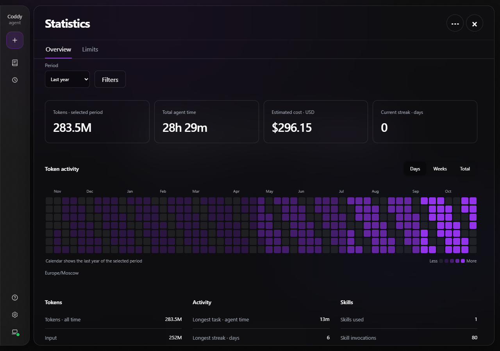
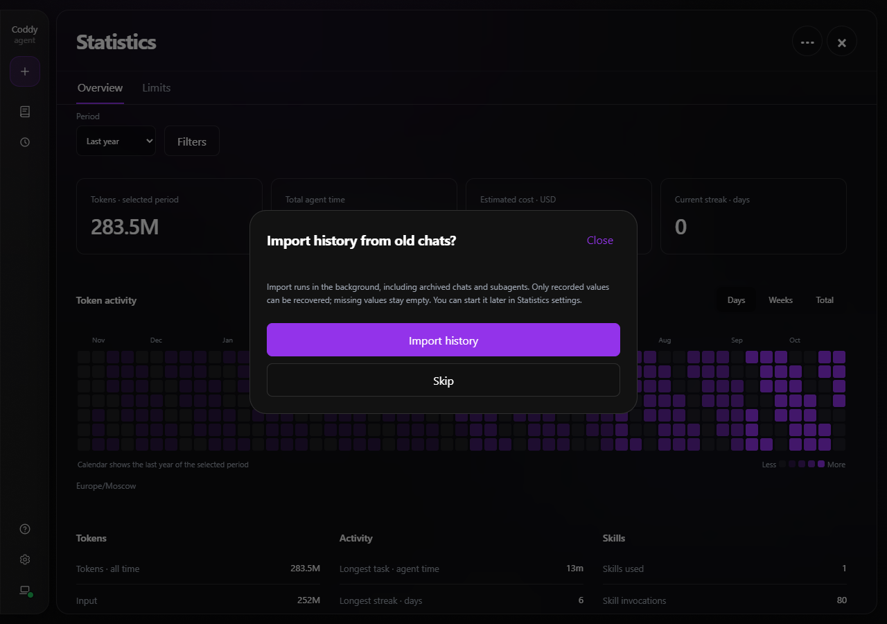
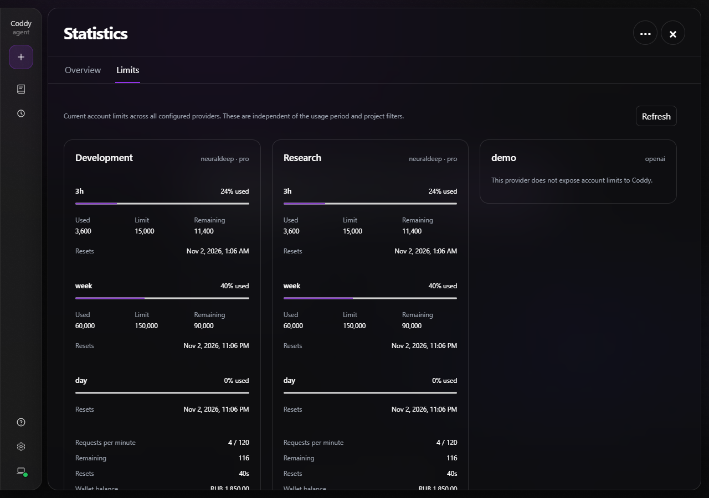
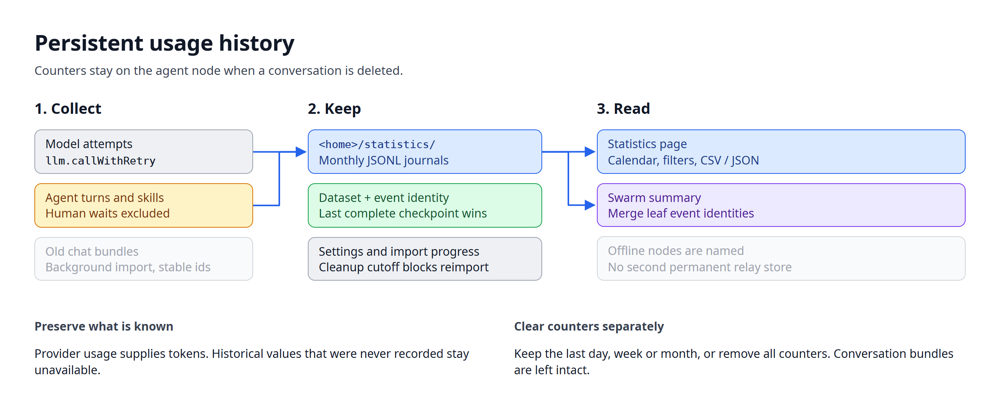

# Statistics

Open the **Coddy** menu in the web UI and choose **Statistics**. The **+** button starts a chat. The statistics page has its own address, `#/statistics`; closing it or pressing Escape returns to the previous screen.

*The activity calendar and usage counters on the statistics page.*

## Recorded usage

Coddy records model calls from its agent turns across the console, ACP, HTTP API, web UI, messengers, subagents, memory and scheduler. Direct model completions through the HTTP API are recorded too. Input, output and cached-input tokens come from provider usage. Cached input is part of input; reasoning output is part of output. Neither is added to the total a second time. A provider that reports no usage leaves that reading unavailable.

The page shows token totals, the busiest day, chats, manual requests, model calls, reasoning levels, installed and used skills, skill invocations, task duration and activity streaks. A task is one agent invocation. Its duration excludes time waiting for answers to questions or permission prompts and the agent's explicit wait for a quota reset. Total agent time sums the recorded durations, including parallel child runs; it is not elapsed calendar time. A streak counts consecutive dates with a manual request. A dash means that a value was not recorded.

Choose the last 7 days, 30 days, year, all time or a custom date range. Project, provider, model and source filters apply to the selected period. Open **Filters** to choose a project, provider, model or source; selected filters remain visible as chips. Four counters above the calendar show period tokens, active agent time, estimated cost and the current streak. The lists below the calendar group the remaining counters under Tokens, Activity and Skills. The lifetime token row covers the server's retained history. The calendar shows the final year of the selected period, by day, by week or cumulatively. Daily boundaries use the browser's time zone unless **Settings → Statistics** sets an IANA zone for the server.

## Storage and cleanup

The counters live under `<home>/statistics/`, apart from session bundles. Monthly `.jsonl` journals keep call records and turn checkpoints; `settings.json` keeps the dataset identity, time zone, prices, import progress and cleanup cutoff. Writes are serialized across Coddy processes sharing the same home. The last complete checkpoint wins; an unfinished final journal record is dropped before the next append. No prompt, answer, tool arguments or credential is copied into this store.

Statistics survive a restart and deletion of a chat. Coddy keeps them indefinitely. **Settings → Statistics → Clear statistics** offers four choices: remove everything, or keep the last day, week or month. The day and week are trailing 24-hour periods; the month starts at the same date in the previous month. Confirming removes counters, leaving conversations intact. The saved cutoff also excludes those records from later historical imports. A backup of the statistics directory is required to restore cleared counters.

## Importing old chats

The first visit offers to import old chats or skip the import. **Settings → Statistics** can start it later. Import runs in the background across archived chats, print runs, scheduler sessions and nested subagents. The chat's work continues while the page shows the Coddy work indicator, processed and total chat counts, and a progress bar. Leaving the page does not stop the import. An interrupted import can be started again; stable record identities prevent duplication.

*The import runs on the server while its progress is shown in the browser.*

Import restores dated user requests and the most recently saved usage sample from each old `stats.json`. That file did not keep the entire chat's usage, so it cannot reconstruct a lifetime total or a daily history of every model call. Old skill invocations, cache usage, reasoning settings and durations excluding human waits remain unavailable when the transcript did not record them. Newly collected turns are excluded from the historical import.

## Estimated cost and export

In **Settings → Statistics**, enter USD rates per million input, output and cached-input tokens for a model id or `provider/model`. A configured rate of zero represents a free model. Coddy saves the estimate with new calls that have a rate; an old call without an estimate can use a rate configured later. Changing a rate does not change estimates already recorded. Calls without a rate are counted beside the partial estimate. Subscription payments, cache-write premiums and separately billed tools are outside this estimate.

The **⋯** menu contains export and statistics settings. On a phone, filters, statistics settings opened from this menu and the first-import prompt open in bottom sheets. **Export CSV** exports daily counters for the current filters and time zone. **Export JSON** exports the filtered report, retained lifetime summary and warnings. An unavailable reading is an empty CSV cell or JSON `null`.

## Provider limits

The **Limits** tab lists every configured provider, including providers that have not served a chat. It shows every reported quota window, used and remaining counters, reset times, request rates, cooldowns, wallet balance and model restrictions. Missing fields stay absent. Providers without a supported usage source, disabled usage reads and failed requests have separate notices. A failed refresh keeps the last snapshot marked stale.

These are current account limits, independent of the overview's period, project, model and source filters. The page reads them every 30 seconds while visible; **Refresh** requests an update through the same server cache and pacing rules as the chat's usage panel. In swarm mode, limits remain grouped by node and provider. Identical provider names on different nodes are separate accounts; their quotas are not added together. A node that cannot answer remains visible with an error.

*Quota windows and availability for every configured provider.*

## Swarm summary

In a swarm environment, select **Whole swarm** or a particular node. Relays merge counters by persistent dataset and event identities, then compute distinct chats, daily peaks and streaks over the merged records. Multiple routes through a ring contribute the same event once. The summary names offline, outdated or unreachable nodes whose data could not be read. Their histories remain on those nodes; the relay does not copy them into a second permanent store.

The initial import dialog also covers reachable nodes in a swarm summary. The browser starts imports through their authenticated mounts and combines their progress. Time zone overrides, prices and cleanup remain settings of each node.

*Collection, retained history and the swarm summary share the same event identities.*

## HTTP API

`GET /coddy/statistics` returns the filtered report, retained lifetime summary, settings and installed-skill count. Query parameters are `timezone`, `from`, `to`, `project`, `provider`, `model`, `source` and `cwd`. Dates use `YYYY-MM-DD`, with both endpoints included. A saved server time zone takes precedence over the query.

`GET /coddy/statistics/events` returns counters with their dataset identities for relay aggregation. `GET /coddy/statistics/export?format=csv|json` exports the same filtered report. `PUT /coddy/statistics/settings` accepts `timezone` and a `prices` map whose values have `input`, `output` and `cached` rates. `POST /coddy/statistics/import` accepts `{"action":"start"}` or `{"action":"skip"}` and returns import progress with status 202. `DELETE /coddy/statistics?keep=none|day|week|month` clears counters. These routes use the ordinary HTTP credentials.

`GET /swarm/statistics` serves the merged report on a relay, with the same report filters and an optional `node` dataset id. `raw=1` includes the deduplicated events for another relay. Unavailable nodes appear in `warnings`.
