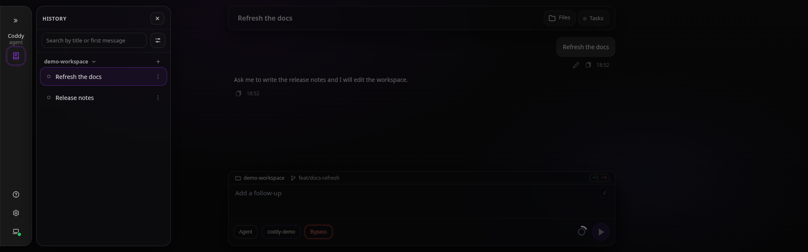

# Git worktrees

Coddy can give a session its own feature branch and working copy. The session's
working directory moves into the worktree, so its next `run_command`, file tool,
rule lookup and project-scoped MCP connection use that directory without a
manual `cd`.

In an agent conversation, ask Coddy to work on a feature branch. The
`worktree_open` tool takes `{"branch":"feature/login"}` and moves the session
into the worktree that holds the branch, or opens one for it: it fetches
`origin`, reads the default branch from `origin/HEAD`, and creates a new branch
from the fresh `origin/<base>` commit. A branch that exists only on `origin` is
checked out from `origin/<branch>` with tracking; a branch that already exists
locally is reused at its own tip, and a branch already checked out in a worktree
reuses that worktree. The tool refuses the default branch itself and a local
branch that tracks `origin/<base>`.

A new branch can also start where the session stands: with `"base":"head"` the
tool starts it at the commit the session's checkout is on, so the next branch is
stacked on the work in progress, even when the session works in a worktree
itself. A branch that already exists keeps its own tip whatever `base` says. In
both cases the new worktree goes under the main checkout's `.coddy/worktrees/`,
never inside the worktree it was opened from. With `{"path":"..."}` instead of a
branch, `worktree_open` enters a worktree that already exists, its folder
absolute or relative to the main checkout. It creates and fetches nothing, so it
reaches a worktree on a detached HEAD or one another tool opened; the main
checkout itself is `worktree_exit`'s.

`worktree_list` shows every worktree of the repository, the main checkout first,
and where each stands: its branch and last commit, uncommitted and unpushed
changes, commits ahead of and behind origin's default branch, whether it is
locked or its folder is gone, which one the session works in and which other
sessions work in each. It moves nothing and is offered in Plan and Ask modes
too. To look closer at one worktree without moving there, the agent runs `git`
in it with `run_command` and its `cwd`.

When the work in a worktree is done, `worktree_exit` moves the session back to
the main checkout, and its next tool call runs there. What happens to the
worktree depends on `action`. `{"action":"auto"}`, the default, removes the
worktree and its branch when the worktree holds nothing of its own: no
uncommitted change (ignored files do not count, except the ones
`.worktreeinclude` names that differ from the main checkout's,
[below](#files-git-does-not-carry)) and no commit that no other branch, remote
branch or tag holds, nobody else working in it and nothing below refusing its
removal. Otherwise it keeps the worktree, the session goes back all
the same, and the answer says why in `kept`. So a worktree opened to look around
goes away on the way back, and one with work in it waits for later.
`{"action":"keep"}` leaves the worktree and its branch for later in any case;
`worktree_open` with the same branch goes back to it. `{"action":"remove"}`
removes the worktree or refuses to leave. It refuses a worktree with uncommitted changes unless `discard_changes` is
`true`, and, whatever `discard_changes` says, a worktree on commits that no
branch, remote branch or tag holds (a detached HEAD with work of its own), one
with initialised submodules (their own commits live in the worktree's git
directory), one with a git repository of its own among its untracked folders (a
snapshot would keep only a pointer to its commit), a locked one, one another
live session of this Coddy process or a background task of any session still
works in (a chat of another Coddy process in the same worktree is not seen), and
one Coddy did not open (outside `.coddy/worktrees/`). Discarded changes are not
lost: before the worktree goes, Coddy saves them the way `git stash` does, the
index and the files, under `refs/coddy/worktree-snapshots/` and names the ref in
the answer, and `git stash apply --index <ref>` on the branch brings them back
as they were, files added with `--force` past `.gitignore` included.
Ignored files, such as build output, go with the worktree. The branch goes with
the worktree only when nothing would be lost: when another branch, a remote
branch or a tag holds every commit of it, as it does for a branch merged into
the default branch, pushed, or stacked under another one. A branch with commits
of its own stays, and the answer says so. A refusal leaves the session where it
was. A session whose worktree folder is gone, removed by hand or by
another chat, comes back to the main checkout with the same call, and git
forgets the worktree. Like `worktree_open`, the tool asks for approval under the
current permission mode, runs in agent mode only and is never offered to a
subagent: a subagent gets a worktree of its own through isolation instead
([A subagent in a worktree of its own](#a-subagent-in-a-worktree-of-its-own)).

The operator does the same with the `/worktree` command in the console, the web
UI and an ACP editor, without a turn of the model. `/worktree <branch>` moves the
chat into the worktree of the branch, opening one when there is none
(`--from-head` starts a new branch at the current commit); `/worktree <path>`
moves it into an existing worktree (a path starts with `/`, `./`, `../` or `~`
and is read from the chat's folder); `/worktree exit` brings the chat back to
the main checkout and removes the worktree when it holds nothing of its own, as
the tool's `auto` does (`--keep` keeps it anyway, `--remove` removes it or
refuses, and `--force` with `--remove` discards its uncommitted changes, kept as
a snapshot); and `/worktree` alone
says where the chat works and where every worktree of the repository stands, as
`worktree_list` does. The command makes the same checks and refusals as the
tools, but as operator input it asks for no approval and works in every session
mode. The messenger bots drop it like the other built-ins, and a turn the bot
restricts for somebody who is not its admin refuses it.

Creation requires an `origin` remote and an approval under the current tool
permission mode; reusing a worktree that already exists needs neither the
network nor `origin`. A refusal or a failed fetch leaves the session in its
original directory. Other errors the tool reports: an invalid branch name,
`origin/HEAD` that resolves to nothing, the branch being checked out in the
main checkout, and a worktree path that already exists on disk. Sessions whose
cwd sits inside a git submodule resolve `repo_root` to nothing and group under
their own folder in History.

The main checkout is advanced to the fetched default commit only by a safe
fast-forward: it must already be an ancestor, and a checked-out default branch
must have a clean worktree. A dirty or diverged main checkout is left alone;
the new feature branch still starts at the fetched remote commit. The agent's
turn context names the main checkout path and the default branch. Use
`run_command` with `cwd` when a command must run in the main checkout for one
call; omitting `cwd` uses the session's worktree.

Coddy keeps the worktrees under `<main checkout>/.coddy/worktrees/`; for
example, `feature/login` becomes `feature-login`. A `.gitignore` in that parent
folder hides the worktrees from the main checkout's status. Project rules,
skills, hooks and configured MCP servers are reloaded for the new cwd, with
project MCP declarations checked through the workspace trust gate; what the main
checkout approved holds there, and the project MCP servers it runs are shared
rather than started again
([What a worktree shares with its main checkout](#what-a-worktree-shares-with-its-main-checkout)).
The session records its new cwd for later turns.

A branch that exists only on a remote other than `origin` opens the same way: by
its name (`fix/typo`, taken from `origin` when `origin` has it too, else from
the first remote by name that does), or by its remote-tracking name
(`upstream/fix/typo`) to pick the remote. Either way the local `fix/typo` is
created at the remote branch and tracks it; an existing local `fix/typo` that
already tracks it is reused, and one that tracks something else is refused
rather than silently opened. The tool's answer names the local branch.

In the web UI, select a feature branch with the **Worktree** checkbox on the
plate over the composer before the first message. The same fetch, branch checks
and worktree placement apply. The branch list fetches every remote before it
opens and lists the branches only on a remote among the local ones, marked with
a cloud, so a branch pushed from another machine can be opened without a
terminal; see
[Per-session workspace](../surfaces/web-ui.md#per-session-workspace-folder--branch--worktree). Once the chat runs, the plate shows the main
project's name and the feature branch, the branch's tooltip naming the worktree;
History groups the main checkout and its worktrees under that project. The
session still runs inside the worktree. The web workspace picks give way to that
plate once the conversation starts; the agent tool can move its own session
during a turn.

The plate has no worktree-exit button or leave dialog at any width. Return to
the main checkout with `/worktree exit --keep`, `/worktree exit --remove` or
`/worktree exit --remove --force`, or ask the agent to use `worktree_exit`.
The removal checks and snapshots described above still apply. The plate reads
the working folder again when `worktree_open` or `worktree_exit` finishes,
while the turn still runs, and after every turn of the chat, so it follows
those tools and `/worktree` without a reload.



*The feature session runs in its worktree while the plate and History name the main project.*

`GET /coddy/workspace/context` reports `repo_root` (the main checkout) and
`base_branch` (from `origin/HEAD`) alongside the current `path` and `branch`.
Session list rows carry `repoRoot` for grouping. See the
[Web UI](../surfaces/web-ui.md#per-session-workspace-folder--branch--worktree)
and [HTTP API](../reference/http-api.md) for those surfaces.

If a managed worktree is later removed with `git worktree remove`, a saved
session that pointed inside `<main>/.coddy/worktrees/` opens against the main
checkout instead. History groups it there immediately; the original recorded
worktree path is retained until you explicitly choose another workspace.

## Files git does not carry

A new worktree is a fresh checkout of its branch, so the files git ignores are
not there: the `.env` the project runs with, a local `.coddy/mcp.json`, keys
under `secrets/`. List them in `.worktreeinclude` at the root of the main
checkout, one pattern per line in `.gitignore` syntax, and every worktree Coddy
creates gets a copy of the files that match a pattern and that git ignores:

```gitignore
# .worktreeinclude
.env
.coddy/mcp.json
secrets/
```

The convention is Claude Code's, so a repository that has the file already
works the same way in both. Only ignored files are copied: a file git tracks
comes with the branch, and an untracked file git does not ignore stays out
however a pattern names it. A file is copied only when the new worktree's branch
ignores it too, so a branch older than the ignore rule gets no copy it could
commit by accident. A copy keeps the file's mode (a `.env` readable only
by you stays so) and never overwrites a file the worktree already has. Links
are not copied, and neither is a file whose folder is a link in either
checkout; a folder the copy makes gets the mode of the main checkout's folder. The copy happens when the worktree is created, by
`worktree_open`, `/worktree` and the web UI's **Worktree** checkbox alike, and
also for the worktree of a subagent. `worktree_open` lists what it copied in
`included`. Without the file nothing is copied. A copy changed in the worktree,
or a file the include file names that only the worktree has, counts as work of
its own: leaving with `auto` keeps the worktree, while other ignored files, such
as build output, go with it.

## A subagent in a worktree of its own

A subagent that edits files in the parent's folder mixes its changes with the
parent's, and two subagents working in parallel mix theirs with each other. A
subagent with isolation works in a worktree of its own instead: a definition
asks for it with `isolation: worktree` in its frontmatter, and the parent model
with `"isolation":"worktree"` in the `spawn_agent` call. The child gets a new
branch `subagent/<name>-<id>` at the commit the parent's checkout is on, created
from that commit with no fetch and no `origin` needed, in a worktree under the
main checkout's `.coddy/worktrees/`, with the `.worktreeinclude` files copied
in. The parent's uncommitted changes are not there. A parent working in a
subfolder of its checkout hands the child the same subfolder of the worktree.

When the run ends, the worktree goes with its branch if the child left nothing
there: nothing `worktree_exit`'s `auto` would keep it for, no commit at all
(not even one a push or another branch holds), and no other session or
background task working in it. A run that changed files or committed keeps the
worktree, and the report the parent reads names its folder and branch: the
parent reviews the changes there, merges the branch, or opens it with
`worktree_open`. The agent task records them as `worktree` and `branch`. A
resumed run goes on in the worktree its earlier run worked in, on whatever
branch the child left it, and gets the same branch checked out anew when that
run's end removed the worktree. A run that worked in the
parent's folder is not moved into a worktree by a resume. Isolation needs a git
repository with a commit: anywhere else the spawn is refused before anything
starts. See [Subagents](subagents.md#a-worktree-of-its-own).

## What a worktree shares with its main checkout

A linked worktree is the same project as its main checkout, so what Coddy decided
about the project holds in every worktree of it. Only what the worktree itself adds
or changes is asked about again:

- approvals of project configuration. A project MCP declaration, a project subagent
  definition, a project hook file, a project marketplace entry and a project
  scheduler job approved in the main checkout are approved in its worktrees. A
  receipt is still bound to the digest of what was approved, so a declaration, a
  file or an entry the branch added or changed waits for its own approval. Each
  checkout keeps a receipt of its own, so approving the branch's version in the
  worktree leaves the main checkout's approval of its version in place, and the
  branch merged with the same content asks nothing. Deleting or renaming a job, or
  dropping a marketplace entry, in one checkout's file takes only that checkout's
  receipt, while an explicit revoke in either checkout revokes for the project.
  Removing a worktree withdraws nothing approved in it: its receipts stay with the
  project until an explicit revoke;
- your switches of project MCP servers (`<home>/mcp-overrides.json`): a server
  switched off in the main checkout is off in its worktrees;
- project MCP servers. A project server whose declaration does not name `${CWD}`
  runs the same command in every checkout, so the main checkout and its worktrees
  share one process, and moving a chat into a worktree does not restart it. A
  server whose declaration passes `${CWD}` (`node ${CWD}/server.js`) is given its
  own checkout's path and runs once per worktree: that is how an MCP server under
  development in a branch is tested. A relative path in a declaration is read from
  the folder Coddy was started in, not from the checkout;
- project scheduler jobs. The scheduler scans projects, not checkouts: a project
  job runs on cron once, from the main checkout, however many worktrees chats
  opened the scheduler in. A worktree's copy of a job is listed as not scheduled
  and can be run by hand from a chat there; a job a branch adds runs on cron once
  the branch is merged.

A folder inside a worktree answers to the same folder of the main checkout:
`<worktree>/pkg` to `<main checkout>/pkg`. In a worktree, `coddy mcp list`,
`coddy agents list` and `coddy hooks list` add a line naming the main checkout the
approvals are kept for, and the `workspace` field of `GET /coddy/mcp`,
`GET /coddy/subagents` and `GET /coddy/hooks` names it too.

A folder counts as a worktree only when git links it both ways: its `.git` file
names the repository's worktree storage, and that storage names the folder back. A
`.git` file copied or written into another folder, like a `.git` that is a link,
lends that folder nothing. A folder whose counterpart in the main checkout is a
link to somewhere else, or lies in a repository nested there, keeps approvals of
its own, and so does a folder of a worktree of a bare repository. The worktrees
of a repository that keeps its storage outside the main checkout
(`--separate-git-dir`) share nothing with the main checkout: when that storage is
named `.git`, they share the approvals of the folder that holds it, otherwise each
keeps its own.
Approvals a worktree recorded under its own path before Coddy shared them were not
moved, so the worktree asks once more for what only it had approved.
