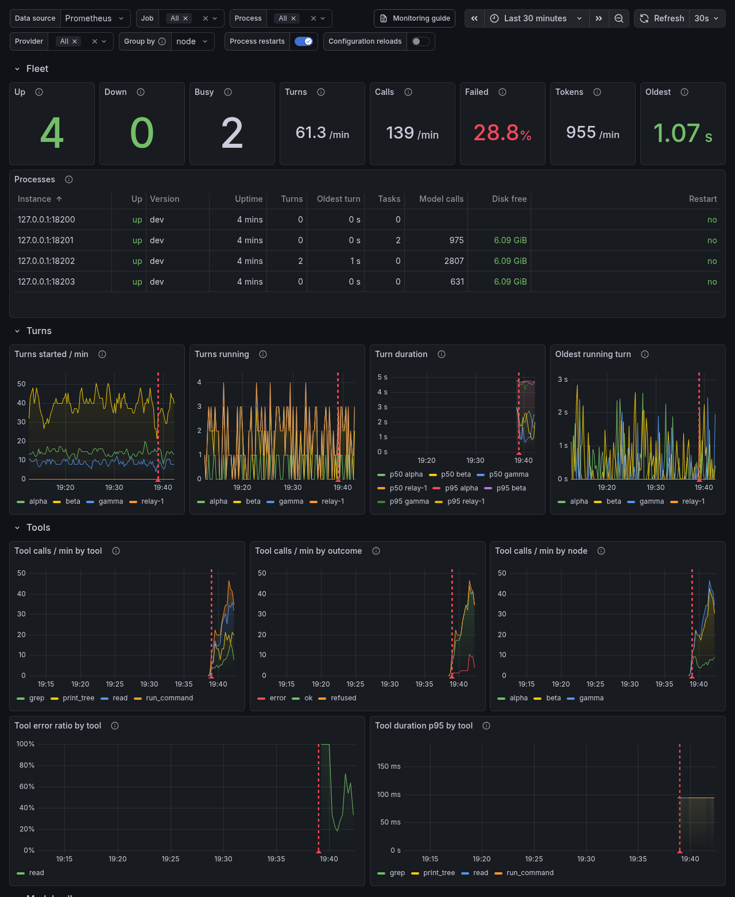

# Monitoring with Prometheus

`coddy serve` can export provider calls, tool calls, turns, prompts that wait for a person, provider quotas, the state of a swarm, background tasks and the disk of the session store as Prometheus metrics on a port of its own. This page covers enabling the exporter, scraping it, the metrics, the shipped alert rules and the Grafana dashboard.

## What the exporter is

The exporter is an auxiliary subsystem of [`coddy serve`](serve.md), off by default: never enough on its own (a configuration that enables only `metrics` is refused) and always free to stop. It needs the `metrics` tag, which the release binaries, the Docker image and the Linux packages carry; a binary without it refuses `metrics.enable: true` and names the tag.

- It serves `GET /metrics` on a listener of its own and shares no route or token with the [HTTP API](../reference/http-api.md).
- Counting starts with the process, whatever `metrics.enable` says, so an exporter enabled later shows what happened before. Counters restart at zero with the process.
- Only `coddy serve` exports, not the console or `coddy acp`.

## Enabling it

```yaml
metrics:
  enable: true
  host: 127.0.0.1   # the default; empty falls back to it
  port: 12347       # the default; 0 falls back to it
  token: "${CODDY_METRICS_TOKEN}"
```

The keys are in the [config reference](../reference/config.md#metrics). With a token set, a scrape without `Authorization: Bearer <token>` gets `401`; the scheme is matched in any case, and `${ENV}` in the token is expanded when the file loads. The **Metrics** tab of the Settings screen (`#/settings/metrics`) edits the same keys; its token field never shows the stored value, and an empty field keeps it.


*The Metrics tab of the Settings screen at 1280 px wide, Dark theme*


*The same tab at 390 px wide, Dark theme*

A [configuration change](serve.md#picking-up-a-configuration-change) applies to the running process with the counters kept: a new token applies from the next scrape, a new `metrics.host` or `metrics.port` rebuilds the listener in place, and `metrics.enable` starts or stops it. A listener that cannot bind stops the exporter alone (`subsystem failed` with `subsystem=metrics` in the log), and Prometheus sees the target down (`CoddyDown`). Run `coddy serve --dry-run` before you move the address: it reports a port another process holds at `metrics.port`.

## Binding beyond loopback

The exporter listens on `127.0.0.1:12347`, which only the machine itself reaches. The figures hold no conversation (see [what is never exported](#what-is-never-exported)) but show load and provider use. To scrape from another machine, set `metrics.host` to a reachable address (`0.0.0.0` for all) and set `metrics.token`. Without a token, a bind beyond loopback (anything but `localhost`, `127.x.x.x` and `::1`) logs a startup warning, a reload that clears the token of such an exporter logs it again, and `coddy serve --dry-run` warns at `metrics.host`.

In a container, loopback is the container's own, which a published port cannot reach: bind `0.0.0.0` with a token and publish port `12347`. See [Docker](../getting-started/docker.md#what-the-image-contains-by-default) for the image and [Security and trust](security.md#the-metrics-exporter) for what the token protects.

## Scraping it

```yaml
scrape_configs:
  - job_name: coddy
    authorization:
      type: Bearer
      credentials_file: /etc/prometheus/coddy-metrics-token
    static_configs:
      - targets: ["coddy.example.net:12347"]
```

An exporter on loopback with no token needs no `authorization` block. The [shipped rules](#the-shipped-alert-rules) watch `up{job=~"coddy.*"}`, so begin the job name with `coddy` for `CoddyDown` to cover it. Check by hand first:

```bash
curl -s -H "Authorization: Bearer $CODDY_METRICS_TOKEN" http://127.0.0.1:12347/metrics | head
```

It answers `200` with the exposition text; `401` with `WWW-Authenticate: Bearer realm="coddy-metrics"` for a missing or wrong token; `404` for any path but `/metrics`; and `503` when a third scrape arrives while two run or one runs over 10 seconds.

## What it exports

A scrape asks no provider, bot API or MCP server anything. The `go_*` and `process_*` families come from `github.com/VictoriaMetrics/metrics`, so the set depends on the platform. Coddy adds a generic HELP line to each and leaves them untyped. The tables list Coddy's own families.

### Provider calls

| Family | Type | Meaning |
|--------|------|---------|
| `coddy_llm_attempts_total{provider,model,outcome,attempt}` | counter | Provider invocation attempts, retries included: `attempt` is `first` or `retry`. |
| `coddy_llm_attempt_duration_seconds{provider}` | histogram | Attempt duration, the whole stream included. Buckets: 0.5, 1, 2.5, 5, 10, 30, 60, 120, 300, 600 seconds. |
| `coddy_llm_time_to_first_token_seconds{provider}` | histogram | Time from the start of a streamed attempt to its first chunk with text, reasoning or a tool call. Buckets: 0.25, 0.5, 1, 2, 4, 8, 15, 30, 60 seconds. |
| `coddy_llm_input_tokens_total{provider,model}` | counter | Input tokens the provider reported. |
| `coddy_llm_cached_input_tokens_total{provider,model}` | counter | Cached input tokens, a subset of the input tokens. |
| `coddy_llm_output_tokens_total{provider,model}` | counter | Output tokens the provider reported. |

An **attempt** is one call into a provider that the retry wrapper makes, so a retried call counts once per try: the first try is `attempt="first"`, every later one `attempt="retry"`, and the `first` attempts count the calls. Model listing, usage reads and sign-in are not attempts. Tokens come from the response of an attempt whenever one exists. The time to the first token is observed only for an attempt that streamed content to a caller; a non-streaming call and a stream that ended before any content have none.

Every attempt lands in exactly one `outcome`: `ok`, `canceled` (the caller stopped it), `timeout` (a deadline ran out or the stream stalled), `rate_limited` (HTTP 429), `auth` (401 or 403), `context_overflow` (the prompt does not fit the model's context), `client_error` (any other 4xx), `server_error` (a 5xx, a cut stream, a failed dial or a transient transport error) and `error` (everything else).

### Tool calls

| Family | Type | Meaning |
|--------|------|---------|
| `coddy_tool_calls_total{tool,outcome}` | counter | Tool calls the agent decided on, in every session of the process, a subagent's included. |
| `coddy_tool_call_duration_seconds{tool}` | histogram | How long the tool ran, for the calls that ran; hooks are not counted. Buckets: 0.1, 0.5, 1, 5, 15, 60, 300 seconds. |

`tool` is the name of a built-in tool (`read`, `run_command`, `spawn_agent`, the [tool reference](../reference/tools.md) lists them), `mcp` for any tool of an MCP server and `other` for a name the agent does not know, such as one the model made up. A call lands in one `outcome`: `ok` (the tool returned a result), `error` (it returned an error), `refused` (it never ran: the mode, the toolset, a subagent's tool set, a hook or the safety check refused it) or `denied` (the person declined it at the permission prompt). A prompt nobody answered, because the stream that carried it ended, is no outcome: the call is counted when it is resumed and runs.

### The process

| Family | Type | Meaning |
|--------|------|---------|
| `coddy_turns_started_total`, `coddy_turns_ended_total` | counter | Turns started and ended in this process. |
| `coddy_turn_duration_seconds` | histogram | Duration of the turns that ended, from the moment the session became busy. Buckets: 1, 5, 15, 30, 60, 120, 300, 600, 1800, 3600 seconds. |
| `coddy_config_reloads_total` | counter | Replacements of the live configuration. |
| `coddy_build_info{version,revision,goversion,goos,goarch,tags}` | gauge | The running build; the value is 1. |
| `coddy_subsystem_up{subsystem}` | gauge | 1 for a subsystem the process runs or is starting, 0 for one that is enabled and not running; the exporter is left out. |
| `coddy_restart_required` | gauge | 1 when a saved change only a fresh process can apply waits for a restart that nothing will perform on its own: a moved HTTP or swarm address, or a surface that runs turns in a process started without a session store ([Restarting itself](serve.md#restarting-itself)). |
| `coddy_turns_running` | gauge | Sessions with a turn running. |
| `coddy_turn_oldest_running_seconds` | gauge | Age of the longest-running turn, 0 when none runs. A wait for a permission or a usage limit is legitimate, so it proves no hang. |
| `coddy_background_tasks{kind,status}` | gauge | Background tasks of the model by kind (`command`, `agent`, `server`) and status (`queued`, `running`). |
| `coddy_sessions_disk_available_bytes`, `coddy_sessions_disk_size_bytes` | gauge | Free space a non-root writer can use on the disk holding the session store, and its size; absent when the read fails or the process has no session store. |

A **turn** is one run of the agent on a session, on any surface of the process, including one a finished background task wakes.

### Waiting, quotas and the swarm

| Family | Type | Meaning |
|--------|------|---------|
| `coddy_prompts_pending{kind}` | gauge | Prompts that wait for a person to answer: `permission` (a permission prompt) or `question` (the `question` tool). |
| `coddy_provider_quota_used_ratio{provider,window}` | gauge | Share of a usage window of a provider account used, from 0 to 1. |
| `coddy_provider_quota_reset_timestamp_seconds{provider,window}` | gauge | When that window starts over, as a Unix time; absent when the provider names no moment. |
| `coddy_swarm_joins{relay,transport,state}` | gauge | Registrations of this process into parent relays (`swarm.join`) by the relay's host, the transport (`direct`, `tunnel`) and the state of the last attempt (`online`, `offline`). |
| `coddy_swarm_nodes{kind,transport,state}` | gauge | Nodes the relay of this process knows, by kind (`agent`, `relay`), transport and state; only in a process that runs a relay. |

A prompt counts while the call that asked it waits, a subagent's included. One whose stream ended before an answer waits in no call, so it counts again only when it is resumed. A turn that waits for a prompt is not hung, and the waiting prompts tell `CoddyTurnLongRunning` apart from a stuck turn.

The quota families are read from the cache the session manager keeps for the usage panels of the surfaces, so a scrape asks no provider anything, and the numbers are as old as the last read the surfaces made (a turn's end reads them again). They exist for the provider types that have a usage reader: `neuraldeep`, `codex` and `devin`, with `providers[].usage_limits_panel` on. `window` is one of `session`, `day`, `week`, `acu` and `window-<seconds>`, with `-secondary` after a second window of the same length. A snapshot whose last read failed is left out rather than reported with old numbers.

### Labels and their budget

`provider` is the name of a provider row in `providers[]`, and `model` is the API model id of a model declared in `models[]`, without the provider prefix (`gpt-5`, not `openai/gpt-5`). Anything else is `other`: an undeclared provider is `provider="other", model="other"`, and an undeclared model of a declared provider is `model="other"`. A provider row or a model id that is itself named `other` shares its series with that fallback.

Labels are decided when an attempt is observed, against the live configuration. The first 16 provider names and the first 64 named provider and model pairs keep their own label, and every later one is `other`. An admitted name stays admitted, so a reload, a rename or a removal never takes a series from a counter, and a restart starts a fresh budget. At the bound, the `coddy_llm_*` families add up to about 2,100 series. The quota families carry only admitted provider names.

At start and at every configuration reload, each admitted provider gets `coddy_llm_attempts_total` at zero for every outcome of a first attempt and of a retry, and the three token counters at zero, once per declared model and once for `other`, and empty `coddy_llm_attempt_duration_seconds` and `coddy_llm_time_to_first_token_seconds`, so an `increase()` over its first attempt counts that attempt. `coddy_turn_duration_seconds` is there, empty, from the start; the tool families have no seeds.

### Reading the numbers

A scrape reads the families one after another, so they describe slightly different moments: within one scrape `coddy_llm_attempts_total` and the `_count` of `coddy_llm_attempt_duration_seconds` may differ, and started minus ended turns need not equal `coddy_turns_running`. Only a histogram's `_count` equals its own `+Inf` bucket. Compare families over a window with `rate()` or `increase()`, not as a pair of instants.

## The shipped alert rules

[`examples/prometheus/coddy-rules.yml`](../../examples/prometheus/coddy-rules.yml) holds seven alerts in one group named `coddy`; load it with `rule_files`:

| Alert | Severity | Fires when |
|-------|----------|------------|
| `CoddyDown` | critical | `up{job=~"coddy.*"}` is 0 for 5 minutes |
| `CoddyDiskLow` | warning | `coddy_sessions_disk_available_bytes` is below 512 MiB for 5 minutes |
| `CoddyProviderFailing` | warning | over 20% of one provider's attempts in 15 minutes ended `server_error`, `timeout`, `auth` or `rate_limited`, out of over 10, for 10 minutes |
| `CoddyTurnLongRunning` | info | `coddy_turn_oldest_running_seconds` is above one hour |
| `CoddyRestartRequired` | warning | `coddy_restart_required` is 1 for 10 minutes |
| `CoddySwarmJoinDown` | warning | a registration into a relay is `offline` for 5 minutes |
| `CoddyProviderQuotaHigh` | warning | a usage window of a provider account is over 90% used for 5 minutes |

CI tests them on every pull request. [`examples/prometheus/coddy-rules.test.yml`](../../examples/prometheus/coddy-rules.test.yml) holds cases that must fire and cases that must stay quiet for every rule; run them with `promtool test rules examples/prometheus/coddy-rules.test.yml`.

## The Grafana dashboard

[`examples/grafana/coddy-dashboard.json`](../../examples/grafana/coddy-dashboard.json) draws every family above for one process or a whole swarm: the fleet at a glance and a row per process, turns, tool calls, prompts that wait and provider quotas, the swarm's relays and registrations, model calls with the time to the first token and the retries, tokens, background tasks and subsystems, and the Go and process figures. Import it in Grafana (**Dashboards → New → Import**) and pick a Prometheus data source; it is made for Grafana 12.



*The dashboard over three agents and a relay of a swarm, grouped by the `node` label of the targets*

The variables at the top filter and split every panel:

- **Job** and **Process** pick the scrape jobs and the targets (`instance`);
- **Provider** narrows the model call and token panels;
- **Group by** names the label the per-group panels split by: `instance`, `job` or any label your scrape configuration puts on the targets, such as `node`, `role` or `site`. The list is read from the targets, so a label added there appears on its own.

[`examples/grafana/docker-compose.yaml`](../../examples/grafana/docker-compose.yaml) starts Prometheus and Grafana on the host network with the [shipped rules](#the-shipped-alert-rules) and the dashboard provisioned. List your exporters in [`examples/grafana/targets.yml`](../../examples/grafana/targets.yml), one entry per `coddy serve`, with the labels the **Group by** list should offer:

```yaml
- targets: ["10.0.0.11:12347"]
  labels: {node: alpha, role: agent}
- targets: ["10.0.0.10:12347"]
  labels: {node: relay-1, role: relay}
```

```bash
CODDY_METRICS_TOKEN=... docker compose -f examples/grafana/docker-compose.yaml up -d
```

Prometheus answers on `http://127.0.0.1:9090` and Grafana on `http://127.0.0.1:3000`, read-only without signing in (`admin` / `admin` to edit). `PROMETHEUS_PORT`, `GRAFANA_PORT` and `CODDY_TARGETS` (another targets file) move them. Prometheus rereads the targets file when it changes.

## What is never exported

The exporter reports counts, durations and state, never a prompt, model output, tool arguments or result, the text of a permission prompt or a question, session id or title, workspace folder, node name, the name of an MCP server or of its tools, or other content of a conversation. Every label value is a member of a closed set (an outcome, a task or prompt kind, a status, a subsystem name, a built-in tool name, a quota window, a swarm kind, transport or state, the build tags, the Go version, the OS, the architecture) or a name from your configuration (a provider row, a declared model id, the host of a relay in `swarm.join`), so keep those free of anything you would not put in a dashboard. The token is never exported, and `GET /coddy/config` reports only whether one is set.

## Relays and other processes

Every `coddy serve` has its own exporter on its own port, a relay included: a relay process exports the same families as any other process (its `coddy_subsystem_up{subsystem="swarm"}`, its build and its Go and process figures; its turn and token families stay at zero) and `coddy_swarm_nodes`, the nodes it knows. Every process that joins a relay exports `coddy_swarm_joins`. A relay does not carry the exporters of the nodes behind it: a mount refuses `/metrics`. Scrape each node directly, put the nodes of one swarm in one Prometheus job with a target for each, and label the targets (`node`, `role`) for the dashboard's **Group by**.

A node that joins its relay over the tunnel transport (`swarm.join[].advertise_url` empty) is in a network that accepts no inbound connection, so Prometheus cannot reach its exporter from outside. Run a Prometheus in agent mode next to such a node, scraping it on loopback and sending the samples on with `remote_write`.
