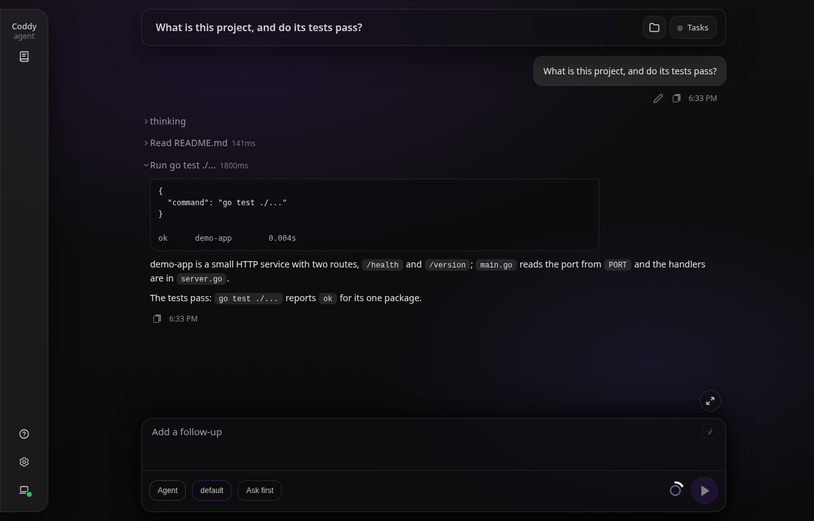
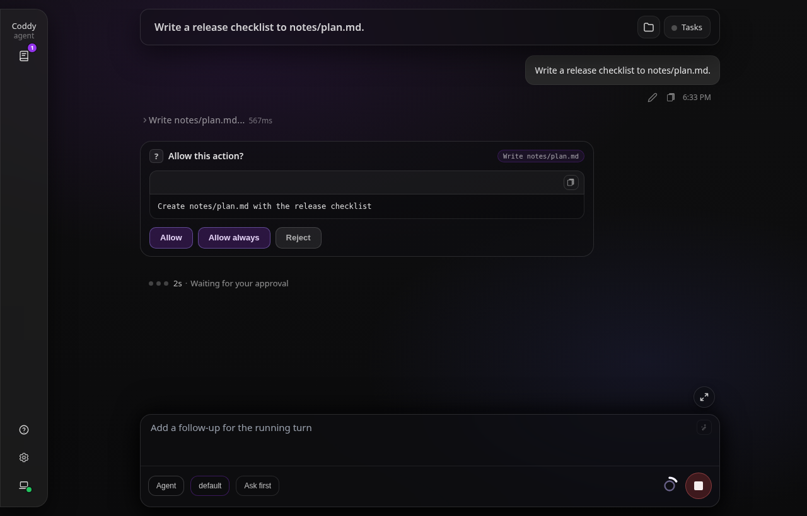
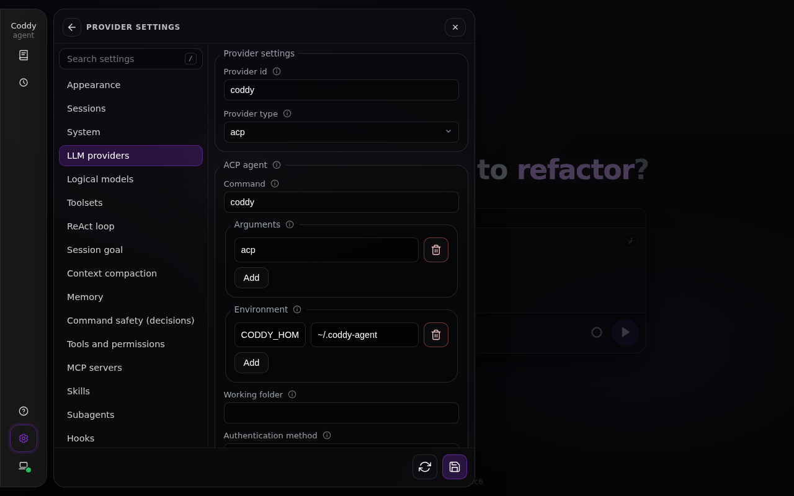
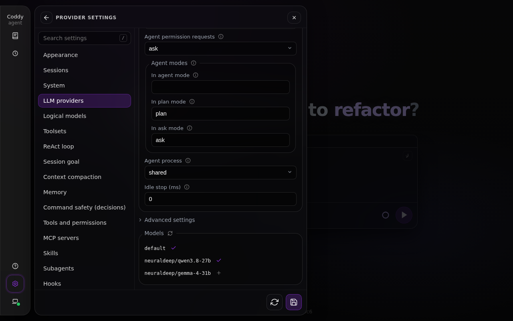
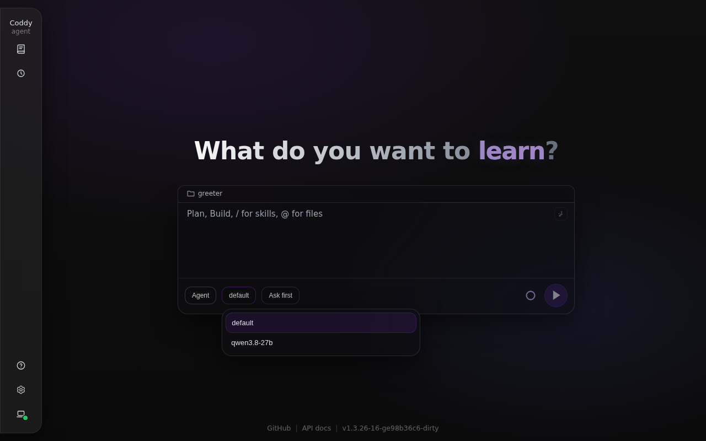

# ACP-агент как модель

Провайдер `type: acp` запускает локальную программу, которая говорит по [Agent Client Protocol](https://agentclientprotocol.com) через stdio, - `claude-agent-acp`, `codex-acp`, `opencode acp`, `zcode-acp-server`, другой `coddy acp` - и подключает её как модель. Её выбирают в селекторе моделей, как любую другую, и каждый интерфейс показывает её ответ по мере поступления: консоль, веб-интерфейс, редакторы с ACP, Telegram-шлюз.

За такой моделью стоит целый агент. У него свой системный промпт, свои инструменты и своя песочница, если она у него есть, и запускает он их в рабочей папке сессии. Coddy передаёт ему диалог, показывает то, что агент сообщает, и спрашивает вас, когда агент просит разрешения. Инструменты, правила и скилы Coddy к нему не относятся. Агент никогда не вызывает инструмент Coddy, поэтому ход на такой модели - один запрос и один ответ.

## Настройка

```yaml
providers:
  - name: claude
    type: acp
    acp:
      command: claude-agent-acp
      modes: {plan: plan, ask: plan}
models:
  - model: claude/default
```

`acp.command` - программа агента (её ищут в `PATH`), `acp.args` - её аргументы. Id модели после имени провайдера выбирает одну из собственных моделей агента. Значение `default` оставляет модель, с которой агент запускается, а любое другое значение должно быть моделью, которую агент предлагает (их показывают настройки, см. [Настройки и пробный запуск](#настройки-и-пробный-запуск)). Id модели может содержать косые черты - так называет свои модели `coddy acp` (`coddy/neuraldeep/qwen3.8-27b`).

| Агент | `command` / `args` | Вход | `modes.plan` / `modes.ask` |
| --- | --- | --- | --- |
| Claude Code | `claude-agent-acp` | вход Claude CLI | `plan` |
| Codex | `codex-acp` | `auth_method: api-key` и `OPENAI_API_KEY` в `env`, или вход ChatGPT в Codex CLI | `read-only` |
| OpenCode | `opencode`, `[acp]` | собственные провайдеры OpenCode | `plan` |
| ZCode | `zcode-acp-server` (с `process: per_session`) | собственный файл провайдеров ZCode | `plan` |
| Coddy | `coddy`, `[acp]` | собственный `config.yaml` (задайте ему отдельный `CODDY_HOME` в `env`) | `plan` / `ask` |

Другой Coddy в роли агента читает собственный `config.yaml` и предлагает модели, которые в нём перечислены. Скриншоты на этой странице сняты с такой строкой.

```yaml
providers:
  - name: coddy
    type: acp
    acp:
      command: coddy
      args: [acp]
      env:
        CODDY_HOME: ~/.coddy-agent
      modes: {plan: plan, ask: ask}
models:
  - model: coddy/default
  - model: coddy/neuraldeep/qwen3.8-27b
```

`~` в начале команды, аргумента, `cwd` или значения `env` - это ваша домашняя папка.

Остальные ключи блока `acp`:

- `env` - переменные, которые добавляются к окружению агента при запуске. Агент наследует окружение Coddy, поэтому `ANTHROPIC_API_KEY` или `OPENAI_API_KEY` из окружения Coddy может оказаться важнее собственного входа агента; чтобы выбрать, что увидит агент, задайте переменную здесь - со значением или пустую;
- `cwd` - одна папка для агента и всех сессий, которые он открывает. Если пусто, каждая сессия открывается в рабочей папке той сессии Coddy, которую она обслуживает. `${CWD}` в любом значении - эта рабочая папка, и тогда агент запускается отдельно для каждой рабочей папки;
- `auth_method` - id способа аутентификации, который Coddy передаёт в вызов ACP `authenticate` после запуска агента. Он нужен агенту, который не открывает сессию, пока клиент его не аутентифицирует. `codex-acp` с API-ключом требует `api-key`;
- `permissions` - `ask` (по умолчанию), `allow` или `deny`, см. [Разрешения](#разрешения);
- `modes` - собственный режим агента для каждого режима Coddy, см. [Режимы "План" и "Чат"](#режимы-план-и-чат);
- `process` - `shared` (по умолчанию) или `per_session`, см. [Процесс агента](#процесс-агента);
- `idle_timeout_ms` - сколько агент живёт после последнего вызова; 0 - шестьдесят минут.

Ключ `proxy` строки провайдера передаётся агенту через окружение. `inherit` (по умолчанию) оставляет переменные прокси из окружения Coddy как есть, включая `ALL_PROXY`. `none` убирает их. URL прокси задаёт `HTTPS_PROXY` и `HTTP_PROXY`, записывает в `NO_PROXY` loopback-адреса и убирает `ALL_PROXY`, чтобы собственный локальный трафик агента шёл напрямую. Учитывает ли их агент, решает сам агент. `timeout_ms`, если он больше нуля, ограничивает время каждого промпта. `api_base`, `api_key` и `api_key_command` не читаются.

## Сессия на агенте

Сессия Coddy привязана к одной ACP-сессии агента. Первый ход открывает её и отправляет весь диалог до этого момента; каждый следующий ход отправляет только новое сообщение, а историю, включая результаты инструментов, агент хранит сам. Системный промпт Coddy не отправляется. У агента есть свой, а промпт Coddy описывает инструменты, которые агент вызвать не может. Блок с текущим состоянием, который Coddy добавляет к каждому ходу (время, чек-лист задач, отчёт памяти), уходит после сообщения.

Если история в Coddy расходится с тем, что хранит агент, диалог начинается заново в новой ACP-сессии, и вся история уходит в её первый промпт. Это происходит после отката, правки сообщения, сжатия контекста, смены рабочей папки или перезапуска процесса агента. Тот же вопрос, заданный ещё раз после завершённого ответа (повторная генерация), тоже открывает новую сессию.

Что агент сообщает по ходу работы:

- его текст приходит как ответ, а его рассуждение - как рассуждение;
- каждый его вызов инструмента показан строкой инструмента, такой же, как у инструментов Coddy. В названии строки указано, с чем работает инструмент (`Read README.md`, `read notes.txt`), а в самой строке видно, что вызов получил и что вернул. Если в объявлении вызова агент назвал только инструмент, строка появляется, как только агент укажет файл или команду этого вызова, либо когда вызов завершится. Это собственные инструменты агента, Coddy ни один из них не запускает и ни одной модели не передаёт;
- ответ, который агент завершил без текста, выглядит как `(the agent finished without a message)`, а если агент прервал ответ, в нём указана причина, например `(the agent stopped: it reached its output limit)`.



*Ответ агента. Его вызовы инструментов идут отдельными строками. Строка запуска тестов раскрыта, видны команда и вывод.*

В ответе сохраняются первые строки вывода каждого вызова, а в сессии - весь вывод, как и у инструментов Coddy. Строки инструментов снова видны после перезагрузки, а также в консоли и в редакторе, который загружает сессию. Полный вывод строки открывается одним кликом.

Id модели выбирает модель агента через его параметр модели. Уровень рассуждения сессии задаёт значение параметра рассуждения агента, если у этого параметра есть значение с таким же именем. Режим сессии выбирает режим агента через `acp.modes`. Если ход не задаёт какое-то из этих значений, Coddy возвращает то, с которым началась ACP-сессия, поэтому выбор прошлого хода не сохраняется.

Кнопка остановки отменяет промпт агента так, как требует протокол. Уже сделанное агентом остаётся в ответе, следующее сообщение продолжает ту же сессию, а отменённый промпт никогда не отправляется повторно. Запрос, который повторил бы его, завершается ошибкой, потому что агент мог уже начать действовать. Если агент не подтвердил отмену за десять секунд, Coddy закрывает его ACP-сессию (следующее сообщение откроет новую из транскрипта) и даёт промпту ещё двадцать секунд на завершение. Затем Coddy останавливает процесс агента, а при `process: shared` вместе с ним обрываются промпты других сессий, которые он обслуживает.

## Режимы "План" и "Чат"

В режимах "План" и "Чат" сессия обещает ничего не записывать. Инструменты агента - не инструменты Coddy, поэтому Coddy держит это обещание, переводя агента в один из его собственных режимов только для чтения. Этот режим задают ключи `acp.modes.plan` и `acp.modes.ask` (режим каждого агента есть в таблице выше). Если для режима сессии режим агента не задан, Coddy отклоняет ход с сообщением, в котором назван ключ, а `coddy --dry-run` предупреждает об этом.

Кроме того, в режимах "План" и "Чат" Coddy отклоняет каждый запрос разрешения агента независимо от значения `acp.permissions`. Агента, который пишет без спроса (`bypassPermissions` у Claude, `yolo` у ZCode или инструмент, для которого вы раньше выбрали "Всегда разрешать"), удерживает только режим.

## Разрешения

Когда агент спрашивает разрешения перед запуском своего инструмента, ответ определяет `acp.permissions`:

- `ask` - отвечаете вы, в том же окне, что и для инструментов Coddy, в интерфейсе, где открыта сессия. Окно показано под строкой инструмента агента (в консоли и редакторе его заголовок - `Agent:` и название вызова). В окне видно, что агент сообщил о вызове, и три варианта - разрешить, разрешить всегда, если агент предлагает такой вариант, и отказать. Веб-интерфейс подписывает их "Разрешить", "Всегда разрешать" и "Отклонить", остальные интерфейсы - так, как их называет агент. В режиме разрешений `bypass` запрос разрешается без вопроса, а в `accept_edits` так разрешается правка;
- `allow` - каждый запрос разрешается один раз;
- `deny` - каждый запрос отклоняется.



*Агент просит разрешения записать файл. Окно показано под строкой инструмента, как и для инструментов Coddy.*

Запрос, на который никто не ответил, отклоняется, а не отменяется, поэтому агент продолжает свой ход. "Всегда разрешать" - это "всегда" самого агента. Его хранит у себя агент, а не Coddy.

Telegram-бот без вопросов разрешает вызовы инструментов своего агента чата, потому что так решил админ, который настроил бота. Запрос агента в их число не входит, поэтому бот присылает в чат вопрос с кнопками, как и для субагента. Решает нажатие кнопки.

## Чего агент не делает

Агент отвечает только внутри сессии. Вызовы, кроме ходов сессии, до него не доходят:

- сжатие контекста пропускает модель `acp` в своей цепочке и требует `compaction.model` с другой моделью; автоматическое сжатие на модели `acp` не запускается вовсе, потому что агент хранит и сжимает свой контекст сам;
- заголовки и теги нового чата пишет `agent.model` (а если он не задан, первая настроенная модель); если это модель `acp`, их пишет первая по алфавиту модель, за которой не стоит агент;
- проверке цели нужен `supervisor.model` с другой моделью, а субагенту памяти - `memory.model`. Без него ход на агенте идёт без отчёта памяти;
- кнопка "Улучшить промпт" в поле ввода веб-интерфейса берёт первую по алфавиту модель, за которой не стоит агент;
- `/v1/chat/completions` и `/v1/responses` с моделью `acp` в роли прямой модели отвечают 400; профили `agent`, `plan` и `ask` с ней работают;
- ход, ограниченный мессенджером (отправитель - не администратор бота), отклоняется. Ограничение действует на инструменты Coddy, а не на инструменты агента.

Счётчики токенов, которые сообщает агент, сохраняются для учёта; индикатор контекста сессии на агенте не измеряет контекст агента.

## Процесс агента

Один процесс агента обслуживает все сессии строки провайдера (или по одному на рабочую папку, если значение блока содержит `${CWD}`), у каждой сессии своя ACP-сессия. Процесс запускается при первом вызове, живёт `idle_timeout_ms` после последнего и останавливается вместе с Coddy (`coddy serve`, `coddy acp`, консоль). Упавший процесс запускается снова при следующем вызове, а его сессии начинаются заново из транскрипта.

`process: per_session` даёт каждой сессии Coddy собственный процесс. Это нужно `zcode-acp-server`, чтобы две сессии отвечали одновременно. Каждый его процесс выполняет только один промпт за раз.

Агентом может быть другой Coddy (`coddy acp`), у которого могут быть свои строки `acp`. Каждый Coddy передаёт агенту, которого запускает, `CODDY_ACP_DEPTH` на единицу больше, а Coddy, у которого собственное значение `CODDY_ACP_DEPTH` равно 3, агентов не запускает. Поэтому цепочка агентов, запускающих друг друга, обрывается на третьем.

Методы протокола для файлов и терминала (`fs/*`, `terminal/*`) агенту недоступны. Coddy не объявляет эти возможности, и агент читает, пишет и выполняет команды своими инструментами.

## Настройки и пробный запуск

В разделе Настройки → Провайдеры LLM у строки с типом `acp` вместо полей API показан блок ACP-агента.



*Строка `acp`, которая запускает `coddy acp`: команда, её аргумент и собственный `CODDY_HOME` агента.*

Список "Модели" в конце строки запрашивает модели у агента сохранённой строки. Сначала сохраните строку - форма не запускает программу, которая ещё не сохранена. `default` - модель, с которой агент запускается, остальные - модели, которые он предлагает. Как у любой строки провайдера, плюс добавляет модель `<row>/<id>` на вкладку "Логические модели", а галочка убирает её оттуда.



*Модели, которые предлагает `coddy acp`. `default` и `neuraldeep/qwen3.8-27b` уже есть на вкладке "Логические модели", а плюс добавляет туда `neuraldeep/gemma-4-31b`.*

Логическая модель строки появляется в селекторе моделей поля ввода, как любая другая, под именем модели, а полный id виден во всплывающей подсказке.



*Селектор моделей с двумя логическими моделями строки `coddy`.*

`coddy --dry-run` запускает каждого агента, открывает сессию, чтобы прочитать его модели, проверяет, что настроенные id моделей есть среди них, и предупреждает, если не задан `modes.plan` или `modes.ask`.

## Устранение неполадок

- `authentication required; set acp.auth_method to one of: ...` - агент хочет, чтобы клиент его аутентифицировал. Выполните вход в агенте отдельно или задайте способ аутентификации из списка (и ключ, который читает агент, в `env`);
- `acp.modes.ask of provider "..." is not set` (или `acp.modes.plan`) - сессия в режиме "Чат" (или "План"); задайте для этого режима режим агента только для чтения;
- `the agent's last prompt in this conversation ended without a clear outcome` - запрос повторил последнее сообщение после отменённого или упавшего промпта, который агент мог уже начать выполнять, и Coddy не отправил его ещё раз. Отправьте новое сообщение;
- `exited` со stderr агента - агент остановился. Следующий вызов запустит его снова; запустите команду вручную, чтобы увидеть причину;
- `Session is not active` от ZCode - две сессии одновременно обратились к одному процессу ZCode; задайте `process: per_session`.

<!-- docsgen:source sha256=569a23feada167ec -->
