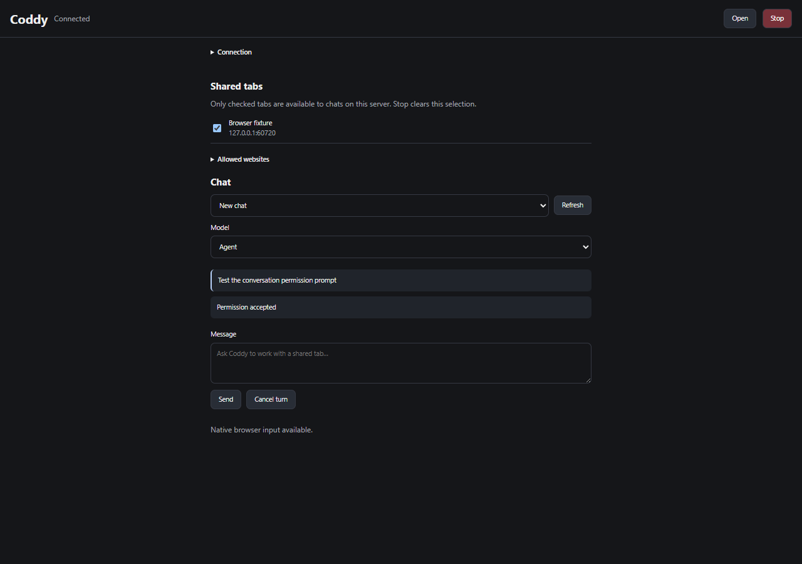

# Расширение браузера

Подключите выбранные вкладки Chrome, Firefox или Яндекс Браузера к своему `coddy serve`.
Расширение подключается прямо к браузерному порту 12348. Облачного посредника нет.
Содержимое страниц, которое использует агент, поступает провайдеру модели,
настроенному в Coddy.

## Настройте сервер

Создайте случайный ключ длиной не меньше 32 символов и сохраните его в
`<home>/.env` как `CODDY_BROWSER_KEY`. Настройте подключение в `config.yaml`.

```yaml
browser:
  enable: true
  host: 127.0.0.1
  port: 12348
  token: ${CODDY_BROWSER_KEY}
```

Запустите `coddy serve`. Браузерные инструменты работают без дополнительных тегов
сборки. Чат расширения требует сборку с `http`. На удалённом сервере укажите
доступный адрес и настройте `cert_file` вместе с `key_file` либо используйте
обратный HTTPS-прокси, который передаёт WebSocket Upgrade. Расширение принимает
обычный HTTP только для localhost, 127.0.0.1 и [::1].

Ключ расширения независим от `httpserver.auth_token`. Он открывает регистрацию
браузеров, передачу файлов и API диалогов расширения. Прямого доступа к настройкам
и файловым маршрутам рабочей папки этот ключ не даёт. Его владелец может запускать
диалоги с агентом, в которых действуют обычные разрешения инструментов сервера.
Ключ работает только с диалогами, которые он сам открыл: панель показывает только
их, а запрос разрешения, вопрос или переписку диалога, открытого другим оператором,
сервер отклоняет. Смена ключа перезапускает обработчик браузерных подключений и
отключает расширения со старым ключом.

## Установите расширение

Соберите расширение из этого репозитория с помощью Node.js.

```bash
node external/browser-extension/build.mjs
```

Сборка создаёт три папки в `external/browser-extension/dist/`.
В Chrome откройте `chrome://extensions`, включите режим разработчика и загрузите
`dist/chrome` как распакованное расширение. В Яндекс Браузере откройте
`browser://extensions` и загрузите `dist/yandex`. В Firefox откройте
`about:debugging`, выберите This Firefox, нажмите Load Temporary Add-on и укажите
`dist/firefox/manifest.json`. Временное расширение Firefox работает до закрытия
браузера; для постоянной установки нужна подпись.

Откройте Coddy на панели браузера. Укажите адрес браузерного порта, ключ расширения
и имя, например `Firefox - laptop`, затем нажмите Connect. Отметьте вкладки,
которые хотите передать агенту. Остальные вкладки на сервер не отправляются.
Open оставляет интерфейс в боковой панели, если браузер её поддерживает,
либо открывает отдельное окно расширения в Яндекс Браузере.



*Расширение подключено к локальному браузерному порту Coddy, выбрана одна вкладка.*

## Работайте из чата

Попросите Coddy показать подключённые браузеры и выбрать один из них. Инструмент
`browser` запоминает выбор в папке сессии. Каждый чат сервера может выбрать браузер.
Чат удерживает вкладку до конца хода. Доступ освобождается раньше при вызове `release`,
выборе другого браузера или отзыве вкладки в расширении. Другой чат в это время не может
изменять её.

Инструмент поддерживает `list`, `select`, `release`, `snapshot`, `screenshot`,
`navigate`, `click`, `type`, `press`, `scroll`, `drag`, `upload_file` и `download_file`.
Снимок структуры возвращает текст и ссылки на элементы; после перехода получите
новый снимок. Координаты задаются в CSS-пикселях области просмотра. Скриншоты
хранятся как результаты инструмента и передаются только моделям, которые принимают
изображения. Содержимое страниц считается недоверенными данными.

Перед первым обращением к сайту расширение запрашивает разрешение. Allow now
разрешает ожидающее действие; Always allow site сохраняет источник в расширении;
Decline отклоняет запрос. Источник включает схему и порт. Выбор вкладки и разрешение
сайта нужны одновременно. Сохранённое разрешение сайта не открывает другие его
вкладки. Stop отменяет ожидающие действия и очищает выбор вкладок. Чтобы продолжить,
выберите их заново.

Панель чата показывает диалоги, открытые этим ключом, создаёт новые, выводит ответ
по мере поступления и показывает запросы разрешений инструментов и вопросы. Диалоги
хранятся на сервере; их можно продолжить в других интерфейсах Coddy.

## Файлы и различия браузеров

`upload_file` читает файл сервера относительно рабочей папки и прикрепляет его к полю
загрузки, указанному в `params.ref`. `download_file` скачивает данные по адресу
`params.url` через браузер и сохраняет их в новый файл `path` относительно рабочей папки.
Размер файла ограничен 32 МиБ. Скачивание отклоняет перенаправления; укажите
конечный разрешённый URL. Политики cookie браузера и изоляция контейнеров могут
влиять на скачивание с авторизацией. Файлы передаются через одноразовые HTTP-ссылки
с ограниченным сроком действия на браузерном порту, без произвольных путей сервера.

Chrome и Яндекс Браузер используют debugger API для клавиатуры и мыши.
Firefox без локального компонента использует API страницы. Для редакторов,
которым нужны доверенные события клавиатуры или мыши, требуется дополнительный
адаптер ввода для Windows. Соберите и установите его на машине с Firefox.

```powershell
go build -o build/coddy-browser-host.exe ./cmd/coddy-browser-host
./external/browser-extension/install-firefox-host.ps1 -Executable ./build/coddy-browser-host.exe
```

Включите Use the local Firefox input adapter в расширении и подключитесь заново.
Firefox выводит нужную вкладку на передний план. Перед вводом адаптер проверяет
активное приложение и заголовок вкладки. Сетевого порта у него нет.
На других операционных системах Firefox пока поддерживает только ввод через API страницы.

Даже нативный ввод не гарантирует автоматизацию любого сайта. Прямой выбор фрейма
недоступен; для встроенных редакторов используйте скриншоты и нативный ввод.
Расширение не обходит вход в аккаунт и CAPTCHA. При закрытии браузера, перезапуске
расширения или потере связи результат действия может остаться неизвестным.
Coddy не повторяет его автоматически; проверьте страницу перед повторной попыткой.

## Проверьте сборку

```bash
node external/browser-extension/build.mjs
node --test external/browser-extension/tests/*.test.mjs
go test ./internal/browser ./internal/tools/browser ./cmd/coddy-browser-host
```

Дополнительный `TestExtensionBrowser` запускает настоящее расширение Chromium
с браузерным сервером. Установите Playwright и его Chromium, при необходимости
задайте `NODE_PATH`, затем выполните
`CODDY_BROWSER_E2E=1 go test ./internal/browser -run TestExtensionBrowser -v`.

<!-- docsgen:source sha256=36b8798d03234e08 -->
