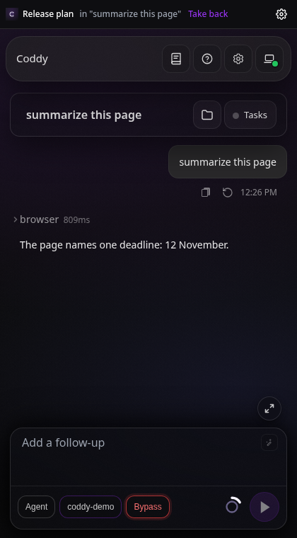

# Coddy for Browser

Coddy for Browser даёт чатам вашего Coddy работать в вашем собственном браузере, будь то Chrome, Яндекс Браузер или
Firefox: открывать вкладку, читать страницу, кликать, печатать, делать скриншот, переносить файл между страницей и
рабочей папкой. Модель работает на вашем сервере, а расширение
[Coddy for Browser](https://github.com/coddy-project/coddy-for-browser) выполняет её действия во вкладках, к которым
вы открыли доступ. Боковая панель расширения показывает веб-интерфейс вашего Coddy рядом со страницей, на которую вы
смотрите, а управлять браузером может и любой другой интерфейс - веб-интерфейс, консоль, редактор, чат в
Telegram, задание планировщика, узел вашего [роя](../operate/swarm.md) на другой машине.

## Как это устроено

Расширение подключается к HTTP-серверу `coddy serve`, своему домашнему серверу, и держит открытым один WebSocket.
Coddy отправляет каждое действие чата по этому сокету как запрос JSON-RPC, а расширение на него отвечает. Сервер сам к
браузеру не подключается, поэтому браузер на ноутбуке за NAT работает так же, как браузер на самом сервере. Чат
другого процесса Coddy, будь то консоль или редактор на той же машине или узел роя, добирается до браузера через HTTP
API домашнего сервера. Протокол описан на странице [Протокол браузера](../reference/browser-protocol.md).


*Как связаны браузер, его домашний сервер и чаты других процессов и через что проходит одно действие.*

Coddy дотягивается только до вкладок в своих группах вкладок браузера:

- в общей группе **Coddy** находятся вкладки, к которым вы открыли доступ, и любой чат может взять из неё вкладку;
- у каждого чата, который работает в браузере, своя группа с названием чата. Первым действием в общей вкладке чат
  переносит её в свою группу, и вкладка, которую он открывает, сразу попадает туда же. Другой чат в этой группе
  действовать не может;
- чтобы забрать вкладку, вытащите её из группы.

Содержимое страниц уходит к провайдеру модели, которым пользуется ваш Coddy, как и любой результат инструмента.

## Настройка сервера

Эндпоинт расширения и инструмент `browser` входят в модуль тега сборки `browser`. Он есть в бинарниках релиза, в
Docker-образе и в пакетах, а бинарник, собранный без него, отклоняет `browser.enable` и называет тег. Боковая панель
показывает веб-интерфейс, поэтому бинарнику нужен и тег `ui`, который есть в тех же сборках.

Сгенерируйте ключ не короче 32 символов, например командой `openssl rand -hex 32`, положите его в `<home>/.env` как
`CODDY_BROWSER_KEY` и включите модуль в `config.yaml`.

```yaml
browser:
  enable: true
  token: ${CODDY_BROWSER_KEY}
```

Расширение подключается к HTTP-серверу (`httpserver.enable`) по тому же адресу, что и веб-интерфейс. Сохраните блок
в разделе **Настройки** или перезапустите `coddy serve`. Новый ключ отключает расширения, которые держали старый.
Пока `browser.enable` включён, чатам доступен инструмент `browser`.

Запускайте `coddy serve` на машине с браузером. Перед сервером на другой машине нужен
обратный прокси с HTTPS, который пропускает переход на WebSocket. Простой HTTP расширение принимает только для
`localhost`, `127.0.0.1` и `[::1]`. Машина, которая не принимает входящих подключений, входит в ваш рой через `swarm.join`, и
другие узлы добираются до её браузера через релей ([Чаты других процессов Coddy](#чаты-других-процессов-coddy)).

Ключ не зависит от `httpserver.auth_token`. Он открывает сокет расширения и передачу его файлов. Веб-интерфейс в
боковой панели входит по одноразовому тикету, который выдаёт сокет, поэтому тот, у кого есть ключ, получает доступ и к
веб-интерфейсу сервера. Храните ключ в таком же секрете, как токен HTTP API.

## Установка расширения

Пакеты прикреплены к каждому [релизу](https://github.com/coddy-project/coddy-for-browser/releases) расширения, а
каждый прогон его CI сохраняет их в артефактах.

| Пакет | Браузеры |
| --- | --- |
| `coddy-for-browser-chrome-<version>.zip` | Chrome 116 и новее, Яндекс Браузер и другие браузеры на Chromium |
| `coddy-for-browser-firefox-<version>.xpi` | Firefox 139 и новее, с подписью Mozilla (в релизе, который был подписан) |
| `coddy-for-browser-firefox-<version>.zip` | Firefox 139 и новее, без подписи |

- **Chrome**: распакуйте архив в папку, которую не удалите, откройте `chrome://extensions`, включите
  **Режим разработчика**, нажмите **Загрузить распакованное расширение** и выберите эту папку;
- **Яндекс Браузер**: тот же архив и те же шаги, только на странице `browser://extensions`;
- **Firefox**: откройте подписанный `.xpi` в Firefox и подтвердите установку. Обычный Firefox ставит только
  дополнения, подписанные Mozilla, поэтому архив без подписи загружается как временное дополнение со страницы
  `about:debugging#/runtime/this-firefox` (**Загрузить временное дополнение**), и при закрытии Firefox его удаляет.
  Firefox Developer Edition и Nightly оставляют его установленным, если в `about:config` параметр
  `xpinstall.signatures.required` выставлен в `false`.

Чтобы собрать расширение из исходников, запустите `npm run build` в его клоне и загрузите папку `dist/chrome` или
`dist/firefox`. Подробности для каждого браузера есть в README расширения.

## Подключение браузера

Страница настроек расширения открывается после установки, а позже по кнопке настроек в боковой панели. Введите адрес
сервера (адрес его веб-интерфейса, `http://127.0.0.1:12345` для локального сервера), ключ и имя этого браузера и
нажмите **Save and connect**.


*Страница настроек Coddy for Browser, подключённого к локальному Coddy.*

К одному серверу можно подключить несколько браузеров, каждый под своим именем. Чат видит их список и выбирает один,
а если подключён один браузер, чат берёт его без вопросов.

## Боковая панель

Кнопка расширения на панели инструментов открывает его боковую панель с веб-интерфейсом домашнего сервера и всем,
что в нём есть, то есть моделями, вложениями, режимами разрешений, историей и вопросами, которые задаёт Coddy. В
Firefox он открывается в боковой панели Firefox. В Яндекс Браузере боковой панели для расширений нет, поэтому там
кнопка открывает ту же страницу в отдельном окне у правого края окна браузера. Панель входит в
веб-интерфейс по одноразовому тикету, который получает по своему сокету, так что пароль там вводить не нужно.

Перед отправкой сообщения веб-интерфейс спрашивает у панели, на какую вкладку вы смотрите, и панель переносит эту
вкладку в группу чата. Просьба про "эту страницу" работает со страницей перед вами, а вызов `browser` этого чата, в котором
вкладка не указана, действует на ней.



*Боковая панель - полоска расширения с текущей вкладкой и веб-интерфейс под ней.*

Полоска над веб-интерфейсом принадлежит самому расширению. В ней указаны текущая вкладка и то, чья она. Рядом стоят
кнопки **Share** и **Take back** и кнопка настроек расширения, а сама полоска подстраивается под тему веб-интерфейса.
Состояние подключения показано на странице настроек. Пока подключения нет, панель вместо веб-интерфейса показывает
карточку со ссылкой на эту страницу. Чат панели - обычная сессия Coddy, и он виден во всех списках сессий
веб-интерфейса. Чат другого окружения, на которое переключается веб-интерфейс, вкладку не получает. Вкладка
находится в браузере, подключённом к серверу самой панели.

Если панель открыта на вкладке, которая принадлежит чату домашнего сервера, панель показывает этот чат. Ход,
который там начали консоль, редактор, задание планировщика или API, выводится в панели по мере выполнения, как в
любом чате. Если вы перешли в другое место веб-интерфейса, имя чата в полоске снова открывает его. Чат другого
процесса Coddy живёт на своём сервере, поэтому панель показывает только его имя, а открыть сам чат не может.

Вопрос, который расширение задаёт о сайте или о чате с другой машины, появляется вверху панели поверх
веб-интерфейса, а чат вокруг него остаётся на виду.

## Как открыть доступ к вкладке

Чат вне панели может работать во вкладке, к которой вы открыли доступ. Нажмите **Share** в полоске боковой панели
или перетащите вкладку в группу **Coddy**, а **Take back** убирает её из группы. **Disconnect** на странице настроек
расширения отменяет все действия и убирает все вкладки из групп Coddy, при этом вкладки остаются открытыми. Кнопка
Stop на странице, где работает Coddy, делает то же самое, но не разрывает подключение.

## Работа из чата

Попросите словами, например "открой страницу релизов coddy-project/coddy-agent и перескажи последний релиз". Чат
вызывает инструмент [`browser`](../reference/tools.md):

- `list` показывает браузеры, до которых дотягивается чат, и вкладки, которыми он может пользоваться, с отметками
  `yours` (своя) и `busy` (другого чата);
- `select` запоминает браузер для чата, когда их подключено несколько;
- `open_tab`, `close_tab` и `release` открывают вкладку в группе чата, закрывают одну из его вкладок и возвращают его
  вкладки в общую группу;
- `snapshot` читает текст страницы и до 500 её элементов, каждый со своим `ref`, а `screenshot` прикладывает изображение
  видимой части вкладки, если модель читает изображения;
- `navigate`, `click`, `type`, `press`, `hover`, `scroll` и `drag` выполняют действия на странице. В Chrome и Яндекс Браузере
  клики и клавиши идут через отладчик браузера, поэтому страница получает их как доверенный ввод, такой же, как от
  человека. Отладчика для расширений в Firefox нет, поэтому там расширение создаёт события прямо на странице, а
  результат вызова содержит `"trusted": false`;
- `upload_file` и `download_file` переносят файлы между страницей и рабочей папкой.

`ref` из `snapshot` действует, пока страница не изменилась, поэтому после перехода чат читает страницу заново.
Инструмент `browser` спрашивает разрешение, как и другие инструменты с побочными эффектами, и чат подтверждает каждый
вызов, если сессия не работает в режиме разрешений `bypass`.

Перед первым действием на сайте расширение спрашивает вас в своём окне или в боковой панели, если она открыта,
разрешить ли его для этого чата, разрешить всегда или отказать. Ответ остаётся в браузере, и ни страница, ни Coddy
ответить за вас не могут. Сайты, разрешённые всегда, перечислены на странице настроек, и там же разрешение можно отозвать.

Страницы на этой машине - `localhost` и его поддомены, `127.0.0.1` и остальные адреса `127.0.0.0/8`, `[::1]` - на
любом порту считаются разрешёнными всегда, поэтому с локальным dev-сервером чат работает без вопросов расширения.
Это разрешение отключается на странице настроек. Оно не распространяется на сам сервер Coddy, по какому бы
локальному имени к его порту ни обращались. В веб-интерфейсе сервера одобряются запросы самого чата, поэтому чат
действует там только после вашего разрешения.
Для чата с другой машины расширение спрашивает о локальных страницах так же, как о любом другом сайте.


*Вопрос, который расширение задаёт перед тем, как Coddy начнёт действовать на новом сайте.*

Пока чат работает во вкладке, она подсвечена и показывает кнопку Stop, а название группы чата начинается с песочных
часов. Когда ход чата заканчивается, и то и другое пропадает.


*Вкладка, пока в ней работает Coddy.*

## Чаты других процессов Coddy

У браузера один домашний сервер, тот, к которому подключено его расширение. Чат, который работает где-то ещё,
добирается до браузера через HTTP API этого сервера, `/coddy/browser/v1`, с обычными учётными данными его API.
Это нужно включить на домашнем сервере.

```yaml
browser:
  enable: true
  token: ${CODDY_BROWSER_KEY}
  serve_remote: true
```

- **Консоль или редактор на той же машине.** `coddy` и `coddy acp` читают тот же `config.yaml`, что и `coddy serve`
  рядом с ними, и при включённом `serve_remote` их инструмент `browser` обращается к серверу по его `httpserver.host`
  и `port` с `httpserver.auth_token`. Если сервер запущен с другими флагами `-H`, `-P` или `--auth-token`, укажите его
  в `browser.remotes`;
- **другая машина.** Укажите домашний сервер в `browser.remotes` того процесса, в котором работает чат, именем из
  `httpserver.remotes` или адресом. До узла роя чат добирается через точку монтирования этого узла в релее, и для него
  берётся токен записи релея в `httpserver.remotes`, как для [`--remote`](../operate/remote.md).

```yaml
httpserver:
  remotes:
    - name: relay
      url: https://relay.example:8443
      token: ${CODDY_RELAY_TOKEN}
browser:
  enable: true
  remotes:
    - https://relay.example:8443/swarm/nodes/home
```

На машине с браузером работает `coddy serve` с ключом, `serve_remote` и `swarm.join`, который называет её `home`.
Чаты другой машины видят её браузер как `<browser id>@home` и выбирают его под этим именем. Процессу, который только
пользуется браузерами других серверов, свой ключ не нужен.

Решает человек у браузера. Перед первым действием чата, который обращается к браузеру через API, расширение
спрашивает, разрешить ли его. В вопросе названы чат и машина, на которой он работает. "Always allow" для сайта
распространяется только на чаты домашнего сервера, поэтому для чата с другой машины расширение спрашивает о каждом
новом сайте, а в названии группы его вкладок указана машина. Stop и Disconnect отзывают всё, что было разрешено
чатам с других машин.


*Чат, который работает на другой машине, спрашивает разрешение перед первым действием.*

Тот, у кого есть учётные данные API домашнего сервера, и так может запускать там ходы, в том числе через релей,
поэтому API не даёт больше прав, чем уже есть у этих учётных данных. Домашний сервер не видит, где заканчивается ход
удалённого чата, поэтому отметки работы с его вкладок пропадают через 45 с после его последнего действия.

## Файлы

`upload_file` читает файл рабочей папки (`path`, относительный путь) и ставит его в поле выбора файла, которое
называет `params.ref`. `download_file` скачивает `params.url` в браузере, с его cookie, и записывает байты в новый
файл рабочей папки, а существующий путь отклоняется. Файл не больше 32 МиБ. Скачивание не идёт по редиректам, поэтому
чат передаёт конечный адрес. Между расширением и его домашним сервером байты идут через одноразовые тикеты и никогда
через путь на сервере, который назвало бы расширение, а чат другого процесса передаёт их внутри своего вызова к
домашнему серверу.

## Ограничения

- проверяются Chrome, Яндекс Браузер и Firefox. Другие браузеры на Chromium загружают пакет для Chrome;
- только верхний фрейм страницы. До элементов во фреймах чат добирается через скриншот и координаты;
- пока расширение действует, Chrome и Яндекс Браузер показывают полосу о том, что расширение отлаживает браузер.
  Через 20 с после последнего действия расширение отключает отладчик;
- в Firefox страница может отличить ввод Coddy от ввода человека, и сайт, который это проверяет (некоторые редакторы
  и формы входа), такой ввод игнорирует. Переход назад или вперёд там выполняется сразу, а о новом сайте
  расширение спрашивает при следующем действии;
- закрытый браузер, перезапущенное расширение или потерянное соединение оставляют исход действия неизвестным. Coddy
  никогда не повторяет действие сам, а чат сначала проверяет страницу;
- один ключ на все браузеры сервера, поэтому тот, у кого он есть, может подключиться под именем другого браузера;
- расширение не вводит пароли, не решает CAPTCHA и не входит в аккаунты за вас.

## Проверка сборки

```bash
go test -tags=browser ./external/browser/...
go test -tags=http,browser ./external/httpserver -run Browser
```

Тесты проверяют настоящий эндпоинт через настоящий WebSocket с подставным расширением (`external/browser/browsertest`).
`features/browser.feature` содержит сценарии успешной работы инструмента, среди них чат другого процесса через API
домашнего сервера, а `features/browser_panel.feature` - сценарии веб-интерфейса боковой панели на настоящем агенте
с моделью, которая отвечает по заготовленному сценарию. `TestLiveExtension` проверяет эндпоинт и инструмент с
настоящим расширением в настоящем Chromium. Чтобы запустить этот тест, укажите в `CODDY_FOR_BROWSER_DIR` путь к
собранному клону расширения и сделайте Playwright доступным для Node. CI самого расширения запускает его пакет для
Chrome в Chromium, а пакет для Firefox в Firefox, в обоих случаях с имитацией сервера.

```bash
CODDY_FOR_BROWSER_DIR=../coddy-for-browser go test -tags=browser ./external/browser/... -run TestLiveExtension -v
```

<!-- docsgen:source sha256=90c50f8ce29d0486 -->
