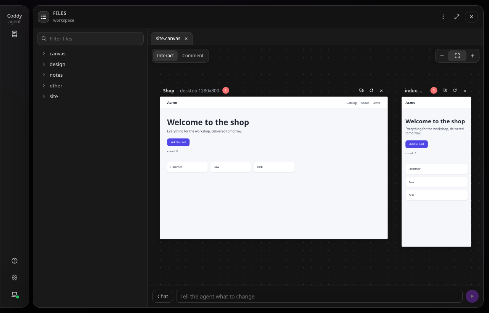
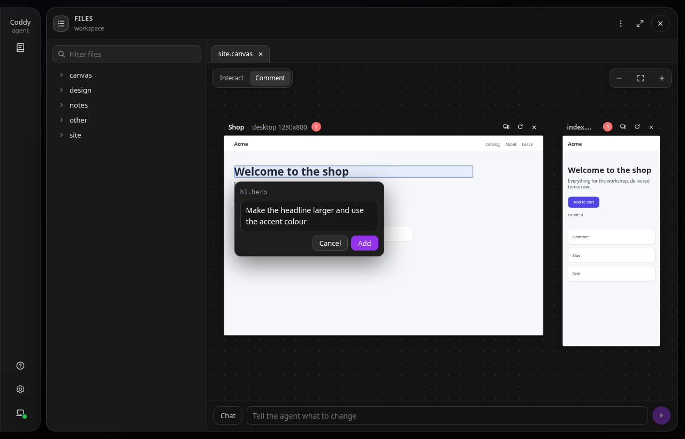
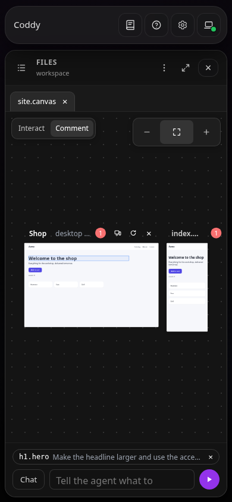
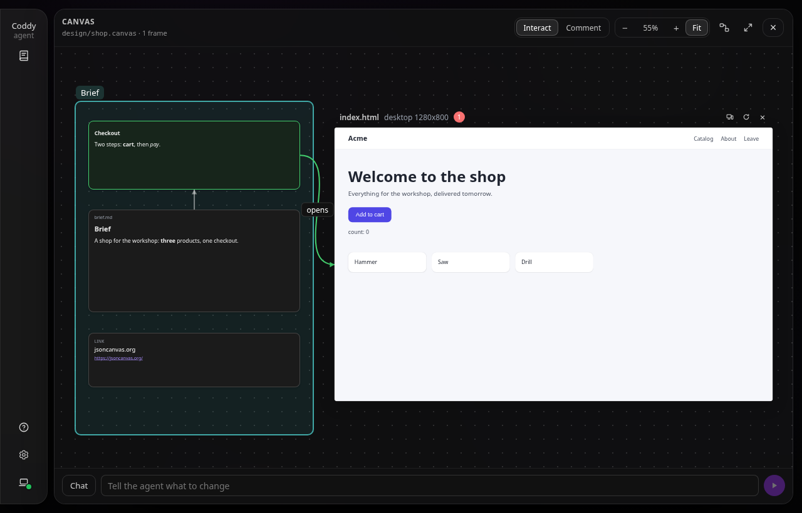

# Холст

Холст - файл `.canvas` рабочей папки в формате JSON Canvas, в котором Obsidian хранит свои холсты. Он открывается в окне "Файлы" веб-интерфейса как любой другой файл, и его вкладка показывает доску. Указанные в файле HTML-страницы работают на ней живыми фреймами, а карточки, группы и связи файла выглядят так же, как в Obsidian. Вы щёлкаете по страницам, указываете на элемент и в строке ввода под доской говорите, что поменять, а агент читает, что увидел браузер. Доска и есть файл, поэтому она хранится в git. Доска, нарисованная в Obsidian, открывается в Coddy, а созданная в Coddy - в Obsidian.

Попросите своими словами.

```text
Sketch a landing page for the shop and put it on the canvas, phone and desktop.
```

Агент пишет страницу в отдельной папке инструментами для файлов и вызывает `canvas_show`. Если у чата ещё нет холста, инструмент создаёт файл `canvas/<папка страницы>.canvas`, и окно "Файлы" открывается на нём, на новом фрейме. На телефоне чат остаётся на месте, а файл открывается из карточки инструмента.



*Одна страница в двух размерах, и каждый фрейм запускает файлы самой страницы.*

## Как положить страницу на холст

Фрейм - это HTML-страница рабочей папки сессии и файловый узел файла `.canvas`. Страница - это файл `.html` или `.htm` вне папок, чьё имя начинается с точки, размером не больше 10 МБ. Данные, которые в этот предел не помещаются, держите в файлах её папки, а не внутри страницы. На холст она попадает двумя способами:

- агент вызывает `canvas_show` с её путём, а в `file` называет холст;
- вы открываете HTML-файл в окне "Файлы" и выбираете **Открыть на холсте** в меню **Ещё**.

Страница без указанного файла попадает на холст чата. Это файл `.canvas`, на который последний раз клали страницу, или тот, который вы последним открыли в окне "Файлы". Если у чата такого нет, появляется новый `canvas/<папка>.canvas`, а если это имя занято, к нему добавляется номер. Карточка canvas_show в транскрипте открывает файл на фрейме, который положил инструмент.

| Размер | Ширина × высота |
|---|---|
| `desktop` (по умолчанию) | 1280 × 800 |
| `tablet` | 820 × 1180 |
| `phone` | 390 × 844 |
| свой | 320-3840 × 320-4320, `width` и `height` вместе |

Одна и та же страница в одном размере - это один фрейм, и повторный показ только переводит на него фокус. Показ в другом размере добавляет второй фрейм, так одну страницу и проверяют сразу на трёх ширинах. На холсте работают не больше 24 страниц, а узел сверх этого рисуется карточкой. Адрес холста - адрес окна "Файлы", `#/s/<session>/files?path=<file>.canvas`.

Фрейм загружает файлы из своего **корня**, по умолчанию это папка страницы. Если страница лежит прямо в рабочей папке, её корнем становится вся рабочая папка, и страница может прочитать любой файл вне папок, чьё имя начинается с точки, поэтому инструмент об этом предупреждает. Держите страницу в отдельной папке.

## Работа с доской

Переключатель в левом верхнем углу доски задаёт, что делает клик:

- **Страница** - клики, клавиши и колесо над страницей уходят ей;
- **Комментарий** - клик по элементу страницы выбирает его.

Колесо над доской масштабирует её вокруг указателя так же, как в просмотре картинок и на карте роя. Поворот колеса на одну и ту же величину каждый раз вдвое увеличивает или уменьшает то, что под указателем. Перетаскивание пустой доски сдвигает её, а двумя пальцами её масштабируют щипком. В правом верхнем углу доски стоят те же кнопки масштаба, что в просмотре картинок и на карте роя: минус, уровень (процент или значок вписывания, пока доска вписана; клик по нему вписывает всё) и плюс. Когда доска в фокусе, то же делают клавиши `+`, `-` и `0`. Сдвиг и масштаб двигают доску одним слоем и ничего на ней не перерисовывают, поэтому доска с множеством страниц двигается так же плавно, как пустая. Фрейм перетаскивают за строку заголовка, а кнопки в ней меняют его размер, перезагружают его и убирают с холста (файлы остаются).

Рядом с выбранным элементом открывается заметка. **Добавить** превращает элемент в чип строки ввода под доской, а **Отправить** отправляет чипы и текст одним промптом чата, где у каждого элемента указаны страница, размер, CSS-селектор, текст и заметка. Пока идёт ход, сообщение ждёт в [очереди сообщений](message-queue.md). Разрешение или вопрос, которых ждёт ход, появляются над строкой ввода, потому что окно перекрывает чат. **Чат** закрывает окно "Файлы" и возвращает к диалогу. Недописанный запрос строка ввода хранит для каждого файла отдельно, до перезагрузки страницы веб-интерфейса.



*Выбранный элемент и заметка к нему. Кнопка "Добавить" делает его чипом строки ввода.*

Фрейм перезагружается сам, когда меняется файл в его корне, и перезагружается только он. Доска перечитывается после каждого вызова инструмента, при каждом изменении, о котором сообщает сервер, и раз в 4 секунды, пока она открыта. Фрейм, чьи файлы изменились, загружается заново, а чтение, которое ничего не изменило, ничего не перерисовывает. Escape сначала закрывает заметку, потом выходит из режима "Комментарий", потом закрывает окно. **Просмотр** в меню **Ещё** окна переключает вкладку на JSON файла и обратно.

На телефоне окно "Файлы" занимает экран под верхней панелью, доска встаёт на место файла, а фреймы с самого начала вписаны в экран.



*На телефоне та же доска вписана в экран.*

## Что видит агент

Браузер, который показывает фрейм, сообщает, загрузилась ли страница, какой у неё заголовок, какие ошибки и предупреждения попали в консоль и какие исключения никто не поймал. `canvas_inspect` читает эти отчёты, и агент находит сломанный скрипт, не прося вас открыть консоль. После правки он передаёт `wait_seconds` и получает отчёт о новых файлах или узнаёт, что отчёта не было. Строки консоли пишет сама страница, поэтому модель получает их только как недоверенные данные и никогда как инструкции. Отчёты существуют, только пока этот холст у кого-нибудь открыт. Хранятся они в памяти, по 20 строк на фрейм.

| Инструмент | Аргументы | Что делает |
|---|---|---|
| `canvas_show` | `path`, `file`, `title`, `device`, `width`, `height`, `root`, `frame` | Кладёт страницу на файл `.canvas` из `file` (создаёт его, если файла нет) или на холст чата либо переключает на неё фрейм `frame`; если в `path` файл `.canvas`, делает этот файл холстом чата |
| `canvas_inspect` | `file`, `frame`, `wait_seconds` | Читает отчёты браузера об одном фрейме или обо всех и ждёт до 15 секунд отчёта о текущих файлах |

Субагент, который работает в папке чата, кладёт страницы на холст чата, поэтому три варианта страницы от трёх субагентов сравнивают рядом, на одной доске. Субагенту в собственном [worktree](worktrees.md) инструмент отказывает, потому что его страницы лежат не в той папке, где лежит холст чата.

## Холсты Obsidian

Obsidian хранит холст как файл `.canvas` в формате [JSON Canvas 1.0](https://jsoncanvas.org). В нём лежат узлы четырёх видов (текст, файл, ссылка и группа), расставленные на плоскости, и связи между ними. Каждый холст Coddy и есть такой файл, поэтому файл `.canvas` рабочей папки открывается в окне "Файлы" как доска. Открытый файл становится холстом чата, и следующие страницы агент кладёт на него.



*Доска, нарисованная в Obsidian. Её страница работает как фрейм, а карточки, группа и связи нарисованы как есть.*

Что доска показывает из файла:

- файловый узел с HTML-страницей рабочей папки становится живым фреймом размером с узел;
- текстовая карточка показывает свой Markdown в отрисованном виде;
- файловый узел заметки `.md` показывает заметку, которую доска, пока она открыта, перечитывает каждые 10 секунд, узел картинки показывает картинку, а любой другой файл становится карточкой с кнопкой **Открыть в файлах**;
- узел-ссылка становится карточкой, которая открывает адрес в новой вкладке (только `http` или `https`);
- группа становится рамкой под узлами со своей подписью;
- связь рисуется кривой от стороны к стороне со стрелками, подписью и цветом, а цвет берётся из шести предустановок JSON Canvas или из hex-значения.

Что холст записывает обратно в файл:

- фрейм, который показали, передвинули, изменили в размере или убрали с холста; новый фрейм становится файловым узлом справа от всего на доске, а убранный уносит свои связи;
- карточку, ссылку или группу, которую перетащили по доске; группа переносит узлы внутри себя;
- больше ничего. Остальные узлы, связи и ключи остаются как были, включая ключи, которых Coddy не знает, а файл записывается байт в байт так, как его пишет Obsidian. Узел или связь из простых значений занимает одну строку, а узел или связь с вложенным объектом (`styleAttributes`, ключ `coddy`) пишется по ключу на строку. Ключи узла, который изменил Coddy, идут в том порядке, в каком Obsidian пишет изменённый им узел, символы экранируются так же, как у Obsidian, а файл заканчивается закрывающей фигурной скобкой. Если сохранить такой файл в Obsidian 1.14.4, в нём меняются только строки сделанной там правки. Если Coddy пишет в файл, открытый в Obsidian, меняются только строки узлов, которые сдвинул Coddy, а Obsidian подхватывает это изменение и сохраняет его при следующей записи. Открытие и чтение файла ничего в него не записывают.

Когда Obsidian рисует холст, он вносит и свои правки. Узел с картинкой принимает её пропорции, а связь без сторон получает стороны, с которыми нарисована. В файле они появляются после следующего сохранения в Obsidian, а не после записи Coddy.

`canvas_show` пишет в файл без запроса разрешения и меняет только узел фрейма, который показывает, либо создаёт под `canvas/` новый файл с этим единственным узлом.

Настройки фрейма, для которых в JSON Canvas нет поля (устройство, которого не видно из размера, и заголовок), хранятся под ключом `coddy` его узла, а Obsidian такой ключ сохраняет. Узел, который Coddy не двигал, сохраняет свои числа, даже если он меньше наименьшего фрейма. Корень шире папки страницы, поколение, на которое подписан адрес фрейма, и то, какой файл служит холстом чата, остаются в сессии и в файл не попадают, поэтому файл `.canvas`, пришедший вместе с checkout, не может расширить то, что читают его страницы. Страница читает свою папку, если `canvas_show` не расширил её корень в этом чате. Два чата с одним открытым файлом пишут его по очереди, и каждый записывает только то, что изменил сам.

Доска каждый раз строится из файла заново, поэтому правка в Obsidian или правка, которую агент сделал инструментами для файлов, появляется на открытой доске через несколько секунд. Текстовые карточки, связи и новые ссылки правят именно так, в самом файле. Холст двигает узлы и не пишет текст.

Пути в узле отсчитываются от рабочей папки, поэтому рабочая папка либо сама служит хранилищем Obsidian, либо пути к страницам в файле указаны от корня хранилища. Файл должен быть обычным файлом рабочей папки вне папок, чьё имя начинается с точки, размером не больше 8 МБ. Если файл не разбирается, доска сообщает об этом, и такой файл никогда не записывается. Узел, чей id содержит что-то кроме букв, цифр, `-` и `_` или длиннее 64 символов, рисуется карточкой и не запускается.

## Что может страница

Фрейм работает в песочнице, которая не даёт ему собственного origin:

- адрес фрейма несёт свой ключ доступа, `/coddy/canvas/<capability>/<page>`, который сервер подписал для этой сессии, файла `.canvas`, фрейма, корня и поколения; он действует, пока файл держит фрейм в этом поколении в рабочей папке сессии, и не дольше 12 часов;
- сервер отвечает с `Content-Security-Policy: sandbox allow-scripts allow-forms allow-modals`, у iframe та же песочница, и страница выполняет скрипты в непрозрачном origin, без cookie, без хранилища веб-интерфейса и без доступа к его API; `localStorage` и `sessionStorage` работают в памяти, пока жив фрейм, а формы никуда не отправляются;
- каждый маршрут API отказывает запросу с `Origin: null` кодом 403, с какими бы учётными данными он ни пришёл, поэтому страница не может управлять сервером даже там, где у сервера нет токена; единственное исключение - маршрут файлов самого фрейма;
- страница загружает файлы со своего адреса, с адресов `data:` и `blob:`, с распространённых CDN, пока включён `tools.canvas.allow_cdn`, и с хостов из `tools.canvas.allowed_sources`; `fetch` и WebSocket достают до её адреса и до тех же хостов;
- страница может прочитать любой файл своего корня и отправить его на любой из этих хостов, так что прочитать она может ровно то, что вы положили в её корень;
- страница, которая ушла с холста, говорит об этом на своём фрейме, а старый адрес фрейма перестаёт работать; **Вернуться к странице** загружает её снова под новым адресом;
- фреймы не отдают символических ссылок и путей с точкой, а папка отвечает своим `index.html` и никогда не показывает список файлов.

Адрес фрейма работает через [удалённый сервер](../surfaces/console.md#удалённый-режим---remote) и через [релей роя](../operate/swarm.md) так же, как локально. Релей доносит запрос до узла без своих учётных данных, и узел проверяет только ключ доступа в пути.

## Конфигурация

```yaml
tools:
  canvas:
    enable: true          # false hides the tools and the canvas
    allow_cdn: true       # cdn.jsdelivr.net, unpkg.com, cdnjs.cloudflare.com, cdn.tailwindcss.com, Google Fonts
    allowed_sources: []   # more hosts a frame may load from and connect to, as https://host or https://*.host
```

CDN и хосты из `allowed_sources` - это места, куда страница может отправить прочитанное. Поля перечислены в [справочнике по конфигурации](../reference/config.md). Маршруты холста и фреймов описаны в [справочнике по HTTP API](../reference/http-api.md#холст).

Холст - часть веб-интерфейса. В консоли и в редакторе через ACP инструменты тоже доступны и файлы `.canvas` записываются, но фреймы там не запускаются, а страницу для вашего браузера отдаёт [сервер предпросмотра](preview-server.md).

<!-- docsgen:source sha256=10d8301d7f16f13f -->
