# Расширения на JavaScript

Веб-интерфейс загружает расширения на JavaScript, которые устанавливает оператор. Откройте **Расширения** в меню навигации или **Настройки → Расширения**, чтобы установить ZIP и включить или выключить расширения.

Расширение может добавлять страницы, панели и действия меню, обрабатывать входящие данные хода, наблюдать за событиями жизненного цикла и каждым кадром потока, отрисовывать вызовы инструментов и строки транскрипта, добавлять свой блок в запросы разрешений, рисовать цветами темы приложения и переопределять их, переводить свои тексты, добавлять поля и разделы в настройки и сужать список сессий. Первая версия поддерживает интерфейс браузера. Нативные исполняемые файлы, агентные инструменты, элементы поля ввода и каталоги расширений из [issue о расширениях](https://github.com/coddy-project/coddy-agent/issues/347) и [расширенной спецификации](https://gist.github.com/hijera/95b016e1721608e8c3974fe3b80e29dc) пока не реализованы.

Начните с короткого руководства ["Ваше первое расширение на JavaScript"](../tutorials/first-extension.md) или откройте [указатель примеров](../../../examples/extensions/README.md).

## Установка и включение

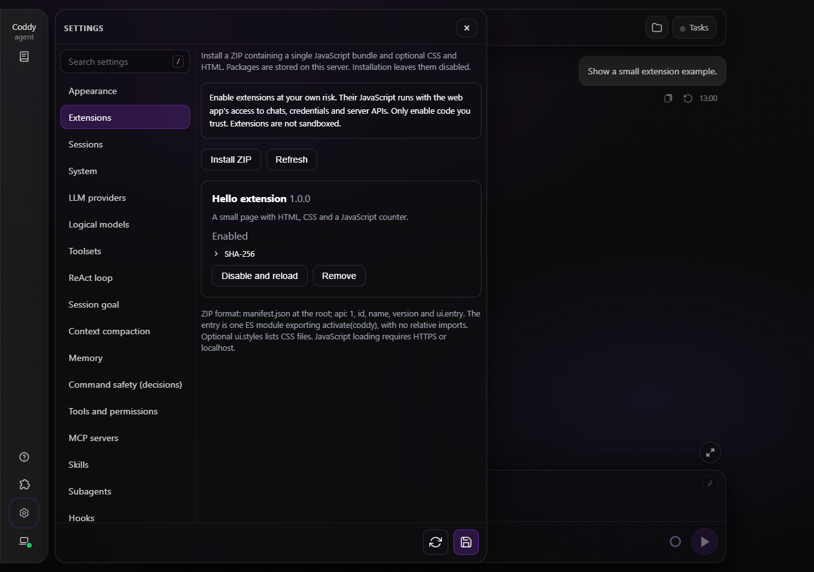

*Настройки расширений с включённым пакетом Hello.*

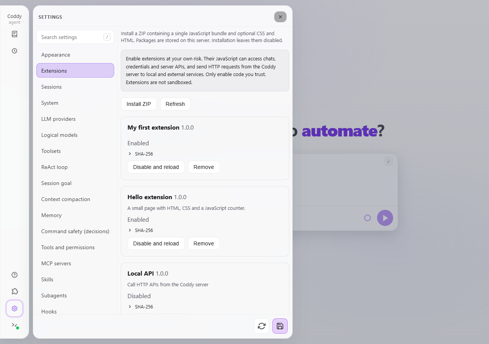

*Те же настройки в светлой теме.*

1. Нажмите **Установить ZIP** в разделе **Настройки → Расширения**. Установка проверяет архив и сохраняет его в `<home>/extensions/`. Расширение остаётся выключенным, код не выполняется.
2. Проверьте название, версию и SHA-256. Прочитайте исходный код, прежде чем включать чужой пакет.
3. Нажмите **Включить**, затем **Принять риск и включить**. Одобрение относится к конкретному хешу установленного пакета. Страница перезагрузится и загрузит расширение.
4. Откройте меню **Расширения**, чтобы воспользоваться его страницами и действиями. Пункт **Управление расширениями…** возвращает в раздел настроек.

**Вы включаете расширения на свой страх и риск.** Их JavaScript выполняется в контексте веб-приложения и получает доступ к чатам, учётным данным браузера и API сервера. Изоляции нет. Предупреждение описывает реальные возможности кода; SDK не ограничивает его права.

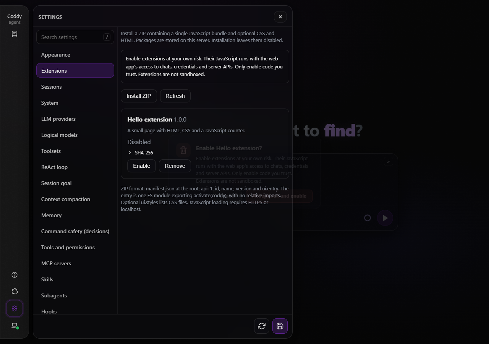

*Чтобы включить пакет, нужно принять риск выполнения его кода.*

При выключении или удалении расширения страница перезагружается, чтобы выгрузить выполненный код. Другие открытые браузеры проверяют список каждые 15 секунд и при получении фокуса; обнаружив отзыв доступа, они перезагружаются. Браузер может задержать проверку в фоновой вкладке. Для немедленного отзыва доступа перезагрузите все затронутые браузеры сами. После выполнения любого кода расширения смена удалённого окружения тоже перезагружает страницу.

Пакеты и их состояние хранятся на сервере, в том числе при работе через удалённое окружение или релей роя. Файлы загружаются через тот же API с аутентификацией, что и остальное приложение. Для загрузки JavaScript нужен HTTPS или localhost: там браузер может проверить SHA-256 через Web Crypto.

## Формат пакета

Пакет - один ZIP: до 8 МиБ в сжатом виде, 16 МиБ после распаковки и 128 записей. Поместите `manifest.json` в корень:

```json
{
  "api": 1,
  "id": "hello",
  "name": "Hello extension",
  "version": "1.0.0",
  "description": "A counter page",
  "ui": { "entry": "main.js", "styles": ["style.css"] }
}
```

Идентификатор состоит из строчных букв ASCII, цифр и дефисов, начинается с буквы и содержит не больше 32 символов. Имена файлов могут содержать буквы ASCII, цифры, подчёркивания, дефисы, точки и разделитель `/`. Абсолютные пути, выход в родительские каталоги, ссылки и имена, совпадающие без учёта регистра, запрещены. Архивы читаются в памяти и никогда не распаковываются в папку проекта.

`ui.entry` указывает на один готовый ES-модуль с экспортом `activate(coddy)`. Соберите зависимости в этот файл: внутри blob URL у относительных импортов нет базового пути. HTML и CSS можно записать строками в модуле или добавить файлами в ZIP. `ui.styles` перечисляет CSS-файлы, загружаемые вместе с расширением; используйте свой префикс классов, чтобы не менять остальной интерфейс.

Необязательное поле `permissions` верхнего уровня перечисляет области, которые заявляет пакет: `ui.page`, `ui.alter`, `sessions.read`, `sessions.assets.write`, `sessions.title`, `sessions.prompt`, `workspace.switch`, `events.publish`, `ide.actions`, `kv`, `config.read`, `config.write` и `llm.complete`. Словарь закрытый - пакет может заявить не больше 32 имён из строчных латинских букв и точек, и неизвестное имя установка отклоняет. Права по-прежнему даёт включение - перечень лишь задаёт словарь, который начнут применять на более позднем этапе, и пока код с ним никто не сверяет.

Необязательное поле `ui.compat_styles` перечисляет CSS-файлы из ZIP, которые загружаются только на устаревшем движке поверх обычных стилей. На современном движке они не применяются; подробности - в разделе о типе движка ниже.

Перезаписать существующий идентификатор нельзя. Удалите старый пакет, установите новый ZIP и одобрите пакет с новым хешем. Автоматического обновления и отката в этой версии нет.

## JavaScript API

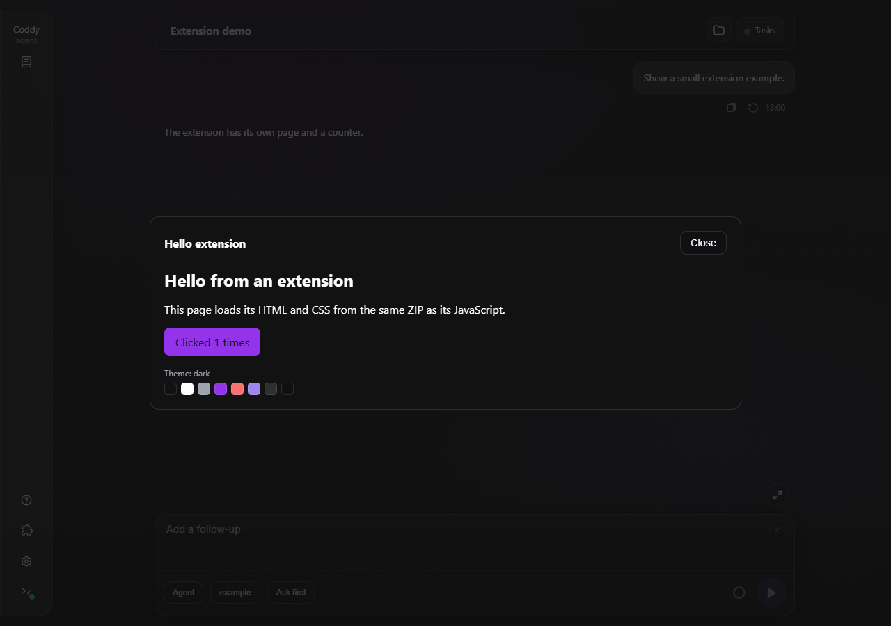

*Страница расширения с HTML, CSS, JavaScript-счётчиком и образцами цветов темы.*

```js
export function activate(coddy) {
  const page = coddy.ui.registerPage({
    id: "hello",
    title: "Hello",
    mount(element, api) {
      element.textContent = "Hello from an extension";
      return () => element.replaceChildren();
    }
  });
  const action = coddy.ui.registerMenuItem({
    id: "open",
    title: "Open Hello",
    onSelect: () => coddy.ui.openPage("hello")
  });
  action.update({ title: "Show Hello" });
  return () => { action.remove(); page.remove(); };
}
```

| API | Поведение |
| --- | --- |
| `coddy.api`, `coddy.id` | Версия SDK `1` и идентификатор расширения. |
| `coddy.signal` | Отменяется, когда расширение завершает работу. Передавайте сигнал обработчикам событий и запросам. |
| `coddy.host` | Зарезервированный канал приложения - `host.api` равен `1`, `await host.capabilities()` перечисляет разрешения манифеста, которые поддерживает эта сборка, `await host.fireEvent({type, data})` публикует одно событие приложения: `extension_event` в общем потоке сервера, чтобы обработчики хуков и мост IDE могли на него ответить, и `ext.<id>.<type>` обработчикам этой страницы, а `await host.request({type, data, timeoutMs})` отправляет один запрос `extension_request` и возвращает данные, которыми ответит тот, кто его обрабатывает, или `null` по истечении тайм-аута. Тип события соответствует `^[a-z][a-z0-9-]{0,63}$`, а `data` - одно значение JSON. |
| `coddy.assets.text(path)` | Загружает UTF-8-файл из конкретного включённого пакета через API с аутентификацией. |
| `coddy.net.fetch(url, options?)` | Отправляет HTTP(S)-запрос с сервера Coddy и возвращает `Response` с загруженным телом. |
| `coddy.events.on(type, listener)` | Наблюдает за `tabChanged`, `stepEnded` или `turnEnded`. Возвращает дескриптор с методом `remove()`. |
| `coddy.theme.get()` | Текущая тема: идентификатор, режим `light`/`dark` и вычисленные цвета, которыми рисует расширение. Замороженный снимок. |
| `coddy.theme.onChange(listener)` | Наблюдает за сменой темы; обработчик получает новый замороженный снимок. Возвращает дескриптор с методом `remove()`. |
| `coddy.theme.getEffects()`, `coddy.theme.onEffectsChange(listener)` | Уменьшенная анимация и тип движка. Обработчик получает только изменения; первое чтение снимка задаёт базовое состояние. |
| `coddy.theme.tokens()` | Все токены активной темы - имя и вычисленное значение. Приложение красится этим слоем целиком, а не только восемью цветами снимка. |
| `coddy.theme.override(colors)` | Переопределяет токены темы CSS-значениями, пока дескриптор их не уберёт: восемь имён цветов или любой `--token` из `tokens()`. Возвращает дескриптор с методами `update` и `remove`. |
| `coddy.ui.registerToolRenderer({id, server?, tool?, mount})` | Заменяет представление подходящих вызовов MCP и встроенных инструментов; исходные данные остаются доступны. |
| `coddy.ui.registerMessageRenderer({id, match, mount})` | Отрисовывает строки транскрипта: подходящие типы строк приложения и строки `ext_frame` для кадров, у которых нет своей строки. |
| `coddy.ui.registerPermissionPreview({id, tool?, mount})` | Добавляет свой блок под предпросмотром приложения на карточке разрешения. Запрос остаётся под контролем приложения. |
| `coddy.settings.registerField(field)` | Добавляет скалярное поле или поле-компонент в раздел настроек - приложения или собственный раздел расширения. Возвращает дескриптор для обновления и удаления. |
| `coddy.settings.registerSection({id, title, weight?, mount?})` | Добавляет собственный раздел настроек расширения. Поля того же расширения могут ссылаться на него в `section`. |
| `coddy.settings.get(id)`, `coddy.settings.set(id, value)` | Читает или сохраняет значение конфигурации расширения. Оба метода асинхронны; `set(id, null)` удаляет сохранённое значение. |
| `coddy.ui.registerPage({id, title, mount})` | Добавляет страницу в меню расширений. `mount(element, api)` может вернуть функцию очистки. |
| `coddy.ui.registerMenuItem({id, title, onSelect})` | Добавляет действие меню. |
| `coddy.ui.registerPanel({id, title, placement, mount})`, `coddy.ui.openPanel(id)` | Добавляет собственный интерфейс расширения - `"slide-over"`, `"full"` или `"drawer"` - и открывает его. Одновременно открыта одна панель. |
| `coddy.ui.anchor(name)`, `coddy.ui.onAnchor(name, fn)` | Якорный блок интерфейса приложения или `null`, пока этот интерфейс закрыт. `onAnchor` сообщает о появлении и исчезновении блока и возвращает дескриптор с методом `remove()`. |
| `coddy.ui.registerSessionFilter({id, title, filter?, mount?})` | Сужает список сессий и рисует чип рядом с фильтрами приложения. |
| `coddy.ui.engine()` | Тип движка оболочки: замороженный `{tier, chromiumMajor}`. |
| `coddy.ui.addCompatStyles(css)` | Накладывает таблицу стилей поверх стилей приложения, только на устаревшем движке. Возвращает дескриптор с методом `remove()`. |
| `handle.update(patch)`, `handle.remove()` | Обновляет или удаляет страницу, действие, панель или другой зарегистрированный элемент. Идентификаторы не меняются и принадлежат пространству имён расширения. Патч проверяется как при регистрации и завершается ошибкой при пустом заголовке или отсутствующем колбеке. |
| `coddy.ui.openPage(id)` | Открывает страницу этого расширения в диалоговом окне. |
| `coddy.stream.registerIncoming({id, transform})` | Обрабатывает входящие данные хода до того, как их применит браузер. Возвращает дескриптор с методом `remove()`. |
| `coddy.stream.onFrame({id, listener})` | Наблюдает за каждым кадром живого потока хода, включая типы событий, которые приложение не разбирает. Только чтение. Возвращает дескриптор с методом `remove()`. |
| `coddy.i18n.locale()`, `coddy.i18n.t(key, vars?)` | Текущая локаль приложения и поиск собственных текстов расширения под `ext.<id>.`. |
| `coddy.i18n.registerMessages(locale, dict)`, `coddy.i18n.onChange(fn)` | Регистрирует тексты одной локали и наблюдает за сменой локали приложения. Оба возвращают дескриптор с методом `remove()`. |
| `coddy.config.get(path?)` | Весь документ конфигурации или один точечный путь в нём (`providers.0.name`). |
| `coddy.config.set(path, value)` | Записывает один точечный путь - ключ объекта, индекс массива или `+` для добавления в массив - через транзакцию сохранения настроек: минимальная запись поверх файла как есть, комментарии сохраняются, результат устанавливается. Требует области `config.write`. |
| `coddy.hooks.register({id, into, mount})` | Наполняет хук, который объявил элемент интерфейса, - `into` это `<owner>/<name>`, - своим блоком. Возвращает дескриптор с методами `update` и `remove`. |
| `coddy.hooks.slot(name, element)` | Рисует вклады хука этого элемента `<this id>/<name>` внутри `element`; пустой слот ничего не рисует, а вклады монтируются и снимаются на лету. |
| `coddy.hooks.list()` | Хуки, объявленные действующими регистрациями, в виде `{owner, hook}` - куда можно вложиться. |
| `coddy.React` | Экземпляр React приложения для авторов, которым он нужен. Контракт монтирования страницы работает и с обычным DOM-кодом. |

`activate` может вернуть функцию очистки или промис, который её возвращает. Приложение даёт на активацию 10 секунд. При ошибке оно удаляет зарегистрированные элементы, запросы, стили и blob URL; ошибка появляется в настройках. Приложение само повторных попыток не делает: обновление списка не трогает неудавшееся расширение. Кнопка **Обновить список** в разделе **Настройки → Расширения** пробует снова, и только то, что не успело выполнить ни строчки кода. Модуль, чей код уже выполнился, по-прежнему ждёт перезагрузки страницы. Закрытие страницы вызывает функцию очистки её монтирования. Завершение работы расширения убирает всё, что оно держало: регистрации, стили, стили совместимости и переопределения темы. Первое чтение снимка эффектов задаёт базовое состояние для обработчиков `onEffectsChange`; исходное состояние они не получают. Очистка зависит от самого расширения и не может отозвать права произвольного JavaScript, выполненного в контексте приложения.

[Пример Hello](../../../examples/extensions/hello/manifest.json) содержит модуль, CSS и HTML. Из папки `examples/extensions/hello` выполните:

```sh
python -m zipfile -c hello.zip manifest.json main.js style.css panel.html
```

Установите полученный ZIP через настройки. Среда Node.js на сервере или в браузере не нужна.

## События навигации и завершения

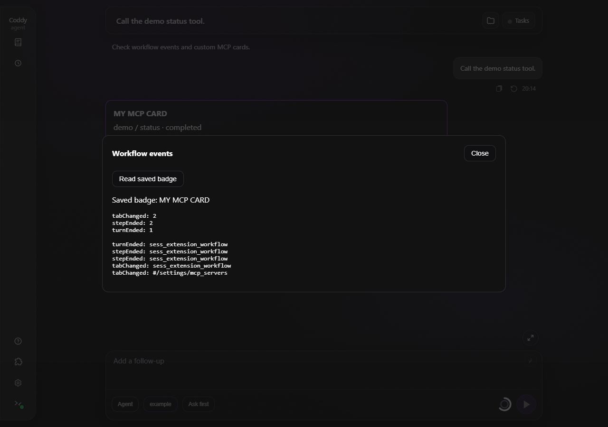

*Пример считает переходы между разделами, завершённые шаги модели и завершённые ходы.*

```js
coddy.events.on("tabChanged", ({ from, to, sessionId }) => {
  console.log("Opened", to, "from", from, "chat", sessionId);
});
coddy.events.on("stepEnded", ({ sessionId, usage }) => {
  console.log("Model call finished", sessionId, usage.totalTokens);
});
coddy.events.on("turnEnded", async ({ sessionId, at }) => {
  console.log("Agent turn finished", sessionId, at);
});
```

| Событие | Данные и источник |
| --- | --- |
| `tabChanged` | `{from, to, sessionId}` при изменении hash-маршрута приложения: чаты, разделы настроек, файлы, задачи и другие разделы. `from` и `to` содержат хеши; `sessionId` - чат назначения или `null`. Начальный маршрут, фокус браузера и переключение на другую вкладку браузера не вызывают событие. |
| `stepEnded` | `{sessionId, sequence, transport, turnStartedAt, usage}`, когда браузер получает кадр `token_usage` завершённого вызова модели. Это конец ответа модели, до завершения запрошенных ею инструментов. `sequence` - идентификатор или номер кадра, `transport` - `post` или `relay`, `turnStartedAt` - время начала на сервере, если известно, либо `null`; `usage` содержит исходные счётчики вызова модели. |
| `turnEnded` | `{sessionId, at}` из существующего общего подключения приложения к `/coddy/events`, когда заканчивается весь ход, в том числе при отмене или ошибке. Событие охватывает и ходы, запущенные через другой интерфейс или в другом чате. `at` - время события на сервере. |

Эти обработчики наблюдают за событиями; возвращаемые значения не отменяют навигацию и не меняют управление агентом. Обработчики могут запускать асинхронную работу. Приложение обрабатывает отклонённые промисы, удаляет сбойный обработчик и показывает его ошибку в настройках. Остальные обработчики продолжают работу. Сначала вызываются обработчики расширений по идентификатору в возрастающем ASCII-порядке, затем по порядку регистрации. Каждый обработчик получает замороженную копию данных.

Доставляются только события, полученные, пока обработчик зарегистрирован. Разрыв соединения или EOF сами по себе не означают завершения хода. События шага поступают из потоков, которые читает этот браузер; чтение истории через REST их не создаёт. Приложение отсеивает повторы по идентификаторам кадров и временным меткам завершения хода в пределах ограниченного окна в памяти. Перезагрузка сбрасывает это окно. Порядок доставки между потоком хода и общими событиями сервера не гарантируется. Преобразования потока не меняют данные событий жизненного цикла.

Удалите подписку методом `remove()` её дескриптора. Сигнал завершения работы расширения тоже удаляет его обработчики.

## Собственные карточки MCP

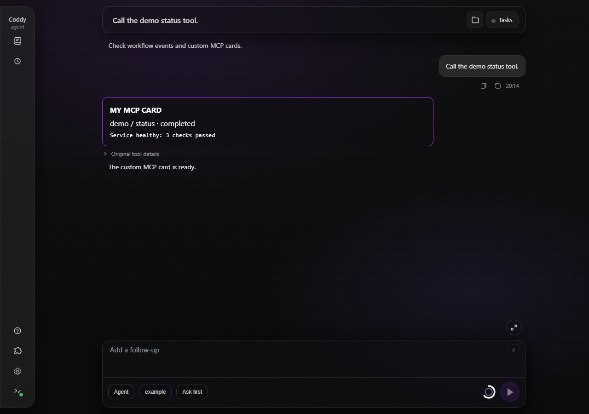

*Расширение показывает результат демонстрационного инструмента status и сохраняет доступ к исходному вызову.*

```js
coddy.ui.registerToolRenderer({
  id: "status-card", server: "demo", tool: "status",
  mount(element, call) {
    const title = document.createElement("strong");
    element.append(title);
    const update = (next) => {
      title.textContent = `${next.server}: ${next.status} - ${next.resultText}`;
    };
    update(call);
    return { update, dispose: () => title.remove() };
  }
});
```

`server` и `tool` сравниваются с точными именами; пропустите любое из полей или укажите `"*"`, чтобы сопоставлять все имена на этой позиции. Распознаются формы `server__tool` и `mcp__server__tool`. Вызов встроенного инструмента - имя без формы `server__tool` - сопоставляется с представлениями по собственному имени с пустым сервером, поэтому представление может взять инструмент приложения на себя; в снимке его `server` равен `""`, а `tool` - простому имени. Сначала выбирается более точная регистрация, затем идентификатор расширения в ASCII-порядке, затем порядок регистрации.

`mount(element, call, api)` получает SDK этого расширения и замороженный снимок вызова с полями `sessionId`, `toolCallId`, `name`, `server`, `tool`, `status`, `argsText`, `resultText`, `resultWasTruncated`, `permissionWaiting`, `durationMs` и `startedAtMs`. Время передаётся числом в миллисекундах или `null`, если его нет. `resultText` содержит полный результат, если он загружен, иначе предварительный просмотр. Представление не загружает полный результат автоматически.

Верните `{update(call), dispose()}`, чтобы сохранить тот же DOM при изменении входных данных, статуса или результата. `mount` и `update` должны завершаться синхронно. Если `mount` возвращает только функцию очистки или ничего, он вызывается заново при изменении данных. Приложение вызывает очистку при замене, удалении строки из окна транскрипта или завершении работы расширения. Исключение удаляет сбойную регистрацию и восстанавливает следующее подходящее представление либо обычный вид. Ошибки появляются в настройках.

Под собственным представлением остаётся пункт **Исходные данные вызова инструмента**, включая исходный ввод, вывод и обычные вложения. Приложение по-прежнему управляет запросами разрешений и показом вопросов. Собственная карточка меняет отображение в этом браузере; она не меняет аргументы и результаты инструментов, разрешения или сохранённую историю.

## Отрисовка строк транскрипта

`coddy.ui.registerMessageRenderer` отрисовывает строки транскрипта двух видов: тип строк, который приложение уже рисует (и который представление берёт на себя, только если называет этот тип), и `ext_frame` - живой кадр, для которого у приложения нет строки.

Кадр, для которого у приложения нет строки по имени события SSE, становится одной живой строкой транскрипта типа `ext_frame`, и только когда зарегистрированное представление сообщений его сопоставляет; кадр, который никто не сопоставил, отбрасывается. Пустое `event` обозначает текстовый кадр и никогда не попадает в эту категорию. Строки `ext_frame` живые - сервер сохраняет исходную историю, и следующее чтение истории заменяет их.

```js
coddy.ui.registerMessageRenderer({
  id: "usage-rows",
  match: "ext_frame:usage",
  mount(element, item) {
    element.textContent = `usage: ${item.data}`;
    return () => element.replaceChildren();
  }
});
```

`match` - строка или массив имён типов строк, `ext_frame:<event>`, `ext_frame` или `*`. `*` покрывает только строки `ext_frame` - строку, которую рисует приложение, представление забирает себе, только если называет её тип. При выборе сначала идёт `ext_frame:<event>`, затем `ext_frame`, затем точное имя типа, затем `*`; при равенстве выигрывает идентификатор расширения в возрастающем ASCII-порядке, затем порядок регистрации.

`mount(element, item, api)` получает SDK этого расширения и замороженный элемент: `sessionId`, `itemId`, `type`, `event` - имя события SSE строки `ext_frame`, для остальных строк пустое - и `data`, элемент в виде текста JSON или исходные данные кадра. Монтирование подчиняется контракту монтирования представления инструмента - верните функцию очистки или `{update(item), dispose()}` и завершайте работу синхронно. Исключение удаляет сбойное представление; строку приложения снова рисует приложение, а строка `ext_frame` уходит из транскрипта.

## Свой блок в карточке разрешения

```js
coddy.ui.registerPermissionPreview({
  id: "bash-note",
  tool: "bash",
  mount(element, call) {
    element.textContent = `About to run: ${call.argsText}`;
    return () => element.replaceChildren();
  }
});
```

`coddy.ui.registerPermissionPreview` добавляет свой блок в карточку разрешения приложения - блок расширения встаёт под собственным предпросмотром приложения, показывающим ожидающий вызов. Запрос, его варианты и выбор остаются под контролем приложения - представление меняет отображение в этом браузере и не меняет ни одно разрешение.

`tool` совпадает с именем вызова, равен `"*"` или опущен - тогда блок показывается для каждого запроса. Именованный инструмент важнее `"*"`, а `"*"` важнее неуказанного; при равенстве выигрывает идентификатор расширения в возрастающем ASCII-порядке, затем порядок регистрации.

`mount(element, call, api)` получает замороженный снимок `ExtensionToolCall` ожидающего вызова - `status` равен `"pending"`, а `permissionWaiting` - `true` - и подчиняется контракту монтирования представления инструмента. Исключение удаляет регистрацию, и карточка возвращается к собственному виду приложения.

## Цвета темы

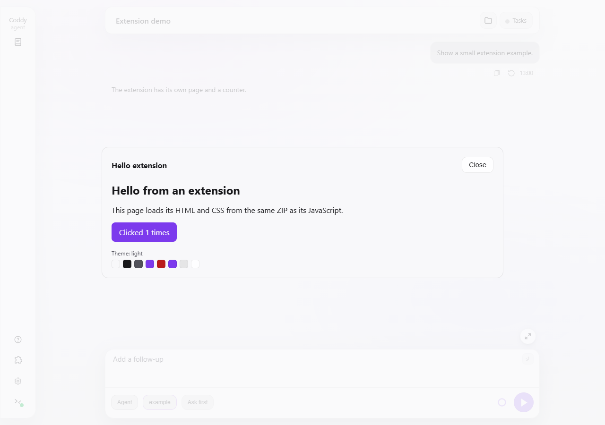

*Та же страница в светлой теме - образцы цветов рисует `coddy.theme`, а кнопку и надписи рисуют CSS-переменные темы.*

Стили расширения добавляются в документ приложения, поэтому CSS-переменные документа содержат цвета текущей темы. Рисуйте этими переменными - и внешний вид подстроится под любую из семи тем.

| Переменная | Цвет |
| --- | --- |
| `--bg` | Фон приложения и страницы окна расширения. |
| `--text` | Основной текст. |
| `--muted` | Дополнительный текст и подписи. |
| `--accent` | Акцент: выбранный элемент управления, основная кнопка. |
| `--coddy-danger` | Разрушающие действия и сбои. |
| `--coddy-link` | Ссылки в тексте. |
| `--coddy-glass-panel-border` | Рамка карточки или панели. |
| `--coddy-glass-panel-bg` | Матовый фон карточки или панели. |

Если рисуете вне CSS - на canvas или вычисленным в коде цветом - та же палитра доступна через `coddy.theme`.

```js
const paint = (theme) => {
  label.textContent = `Theme: ${theme.id}`;
  context.fillStyle = theme.colors.accent;
};
paint(coddy.theme.get());
const watched = coddy.theme.onChange(paint);
```

`coddy.theme.get()` возвращает замороженный снимок. `id` содержит идентификатор темы (`dark`, `light`, `midnight`, `solarized-dark`, `monokai`, `nord` или `rose-pine`), `mode` - `light` или `dark`, а `colors` сопоставляет `bg`, `text`, `muted`, `accent`, `danger`, `link`, `border` и `surface` вычисленным цветам (`rgb()` или `rgba()`, а для записи с `color-mix()` - `color(srgb ...)`), которые одинаково подходят и canvas, и стилю элемента. `surface` - матовый фон `--coddy-glass-panel-bg`, `border` - его рамка.

`coddy.theme.onChange(listener)` передаёт новый замороженный снимок при каждой смене темы и возвращает дескриптор с методом `remove()`. Снимки доставляются по идентификаторам расширений в возрастающем ASCII-порядке, затем по порядку регистрации. Приложение обрабатывает отклонённые промисы, удаляет сбойный обработчик и показывает его ошибку в настройках - так же, как для событий жизненного цикла. Сигнал завершения работы расширения удаляет обработчики; `get` и `onChange` прекращаются при завершении работы расширения, как и регистрации. [Пример Hello](../../../examples/extensions/hello/main.js) рисует свои образцы цветов именно так.

`coddy.theme.getEffects()` возвращает замороженный снимок `{reducedMotion, engine}`. `reducedMotion` включается, когда этого просит `prefers-reduced-motion` или когда на корне приложения стоит `data-effects="reduced"`; `engine` - тип движка. `coddy.theme.onEffectsChange(listener)` возвращает дескриптор с методом `remove()` и передаёт новый снимок только при изменении - первое чтение задаёт базовое состояние.

`coddy.theme.override(colors)` переопределяет токены темы на лету и возвращает дескриптор с методами `update(colors)` и `remove()`. `colors` сопоставляет имя токена - восемь имён цветов (`bg`, `text`, `muted`, `accent`, `danger`, `link`, `border` и `surface`) или любой `--token` из `coddy.theme.tokens()` - со значением CSS. Значение с `;`, `{`, `}` или `url(` отклоняется, а значение для одного из восьми имён цветов должно разбираться как цвет CSS. Переопределение действует, пока его не уберёт дескриптор, завершение работы расширения тоже его убирает, а приоритет в общих токенах получает более поздняя регистрация другого расширения. `coddy.theme.tokens()` возвращает весь активный слой токенов в виде имён и вычисленных значений. Приложение красится им, поэтому переопределение каждого цветового токена перекрашивает приложение целиком.

[Пример Theme Lab](../../../examples/extensions/theme-lab/main.js) открывает выдвижную панель с ползунками тона, насыщенности и светлоты, которые одним движением сдвигают каждый цветовой токен темы, и с выбором цвета для каждого токена; приложение перекрашивается на лету. Манифест заявляет `"permissions": ["ui.page"]`. [Пример NeuralDeep Setup](../../../examples/extensions/neuraldeep-onboarding/main.js) - диалог онбординга той же формы - спрашивает ключ, показывает, где его оформить, и записывает провайдера `neuraldeep` с моделью `neuraldeep/qwen3.6-35b-a3b` через `coddy.config.set`. Из папки `examples/extensions/theme-lab` упакуйте его следующей командой.

```sh
python -m zipfile -c theme-lab.zip manifest.json main.js style.css
```

## Тип движка и стили совместимости

Приложение при запуске помечает корень страницы атрибутом `data-coddy-engine="modern|legacy"`, до первого решения об отрисовке. Устаревший движок - Chromium 110 и ниже; `:has()` появился в версии 105, `color-mix()` - в версии 111, а панели JCEF в IntelliJ 2022 поставляются с Chromium 98-104. Движок, который не сообщает версию Chromium (Safari или Firefox), считается современным. `coddy.ui.engine()` возвращает замороженный `{tier, chromiumMajor}`, который определило распознавание; `chromiumMajor` равен `null`, если движок версию не назвал.

`coddy.ui.addCompatStyles(css)` накладывает таблицу стилей поверх стилей приложения и возвращает дескриптор с методом `remove()`. Она применяется только на устаревшем движке; на современном ничего не добавляется, но дескриптор работает в обоих случаях. Завершение работы расширения убирает эти таблицы стилей вместе с остальным. Файлы `ui.compat_styles` из манифеста загружаются так же при активации. Это поправка, которая нужна оболочке с Chromium 110 - её никогда не применяют там, где обычная таблица стилей уже рисует то, что она исправляет.

## Панели и якорные блоки

```js
const panel = coddy.ui.registerPanel({
  id: "theme-lab",
  title: "Theme Lab",
  placement: "slide-over",
  mount(element, api) {
    element.textContent = "Sliders go here";
    return () => element.replaceChildren();
  }
});
coddy.ui.registerMenuItem({
  id: "open-lab", title: "Theme Lab",
  onSelect: () => coddy.ui.openPanel("theme-lab")
});
```

`coddy.ui.registerPanel` даёт расширению собственный интерфейс, а `coddy.ui.openPanel(id)` открывает его. `placement` равен `"slide-over"`, `"full"` или `"drawer"`; одновременно открыта одна панель. Escape и кнопка закрытия вызывают функцию очистки монтирования. Дескриптор обновляет и удаляет панель так же, как дескриптор страницы.

Якорь - именованный блок интерфейса приложения: `composer.actions`, `chat.header`, `nav.rail`, `statusline`, `sessions.toolbar` или `settings.footer`. `coddy.ui.anchor(name)` возвращает блок или `null`, пока этот интерфейс закрыт; приложение монтирует блок, только пока открыт его интерфейс. `coddy.ui.onAnchor(name, fn)` возвращает дескриптор с методом `remove()` и вызывает `fn(boxOrNull)` при появлении и исчезновении блока, а если блок уже есть - сразу с ним.

## Хуки в элементах интерфейса

Элемент интерфейса дополняет API своим описанием - регистрация панели или страницы несёт `hooks: ["summary", "actions"]`, и каждое имя открывает слот, который наполняют другие расширения. Объявляющая сторона рисует `coddy.hooks.slot(name, element)` там, где место блока, а вкладывающаяся сторона отвечает через `coddy.hooks.register({id, into: "<owner>/<name>", mount})`. Пустой слот ничего не рисует, вклады монтируются по порядку идентификаторов владельцев и обновляются на лету - опоздавший вклад монтируется в открытый слот, а уходящий запускает очистку и уносит свой блок с собой - остающиеся блоки сохраняют DOM и состояние.

Вклад, бросивший исключение, снимается вместе с регистрацией, и ошибка появляется в настройках; соседи остаются. `coddy.hooks.list()` перечисляет все объявленные хуки - расширение может поискать, куда вложиться. Панель `examples/extensions/ok-coddy` объявляет `hooks: ["tricks", "footer"]` и рисует оба слота; `examples/extensions/ok-coddy-addon` наполняет их - ещё одна кнопка трюка и подпись в подвале, - и панель не знает о его существовании.

## Тексты расширения

```js
coddy.i18n.registerMessages("en", { greeting: "Hello, {name}" });
coddy.i18n.registerMessages("ru", { greeting: "Здравствуйте, {name}" });
label.textContent = coddy.i18n.t("greeting", { name: title });
```

`coddy.i18n` хранит собственные тексты расширения. `locale()` возвращает текущую локаль приложения. `t(key, vars?)` ищет `ext.<id>.<key>` - ключи принудительно получают этот префикс - в текущей локали, затем в `en`, а если ключа нет нигде, возвращает сам ключ; в любом случае подставляет в `{name}` значения из `vars`. `registerMessages(locale, dict)` возвращает дескриптор с методом `remove()`; повторная регистрация локали заменяет её словарь. `onChange(fn)` возвращает дескриптор с методом `remove()` и срабатывает при смене локали приложения.

## Поля в существующих разделах настроек

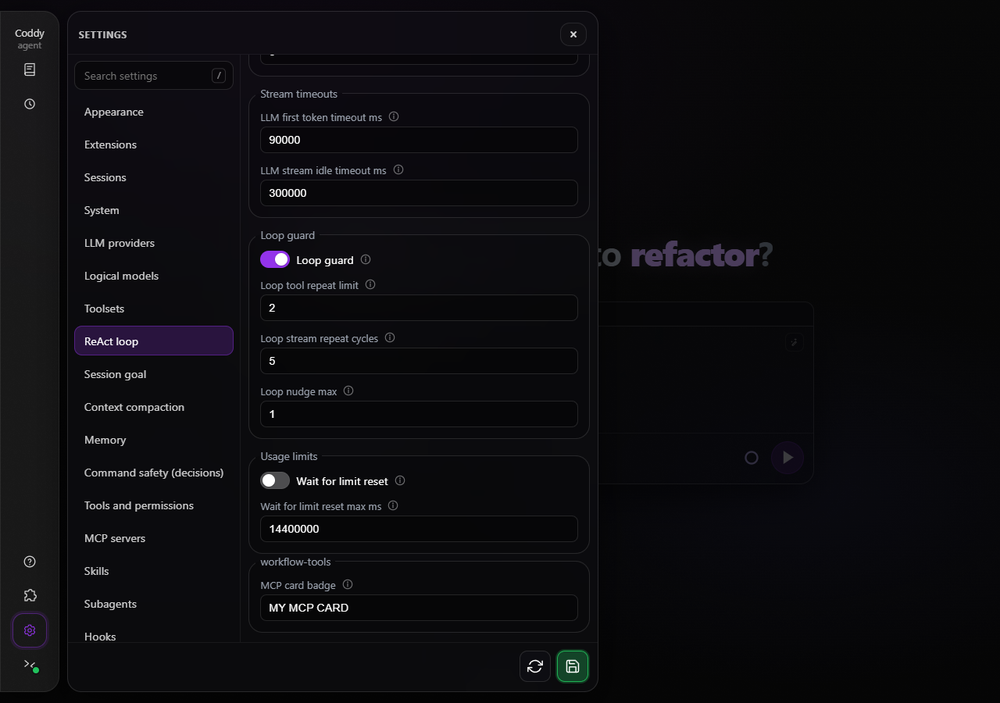

*Пример добавляет поле MCP card badge в существующий раздел "Цикл ReAct".*

```js
coddy.settings.registerField({
  id: "badge", section: "agent", title: "MCP card badge",
  type: "string", default: "CUSTOM MCP"
});
const badge = await coddy.settings.get("badge");
await coddy.settings.set("badge", "MY CARD");
```

Идентификатор поля начинается со строчной латинской буквы, затем содержит строчные латинские буквы, цифры или дефисы, не больше 64 символов. `section` - идентификатор существующего раздела: приложения (`agent`, `mcp_servers`, `tools`, `appearance`, `extensions`) или раздела, который зарегистрировало это расширение (ниже). Заголовок обязателен; `description` и `default` необязательны. Типы - `string`, `number` и `boolean`; строковое поле может объявить варианты выбора в `enum`. Значения по умолчанию должны соответствовать типу и вариантам выбора.

Зарегистрированные поля появляются под существующими элементами раздела, сгруппированные под идентификатором расширения. Они редактируют тот же черновик конфигурации, что и обычные поля, и используют его сохранение, перезагрузку и обработку несохранённых изменений. Значение по умолчанию показывается без записи на диск. Удаление поля или выключение расширения убирает элемент управления и сохраняет записанное значение.

Расширение может завести собственный раздел. `coddy.settings.registerSection({id, title, weight?, mount?})` возвращает дескриптор для обновления и удаления. Идентификатор подчиняется тем же правилам, что и идентификатор поля, заголовок обязателен. Раздел появляется после разделов приложения, а `weight` задаёт его место среди разделов расширений. `mount(element, api)` рисует произвольное содержимое над полями раздела. Поле того же расширения может назвать раздел в `section`; поле другого расширения - нет.

Поле может рисовать себя само - тип `"component"` вместо скалярного типа принимает `mount(element, api, state)`, где `state` - замороженные `{value, setValue}` обычного скалярного значения. Поле-компонент редактирует тот же черновик конфигурации и сохраняется как любое другое поле - его значения остаются обычными скалярными значениями в `extension_values`. Параметр `default` необязателен.

Значения хранятся в `config.yaml` сервера по пути `extension_values.<extension-id>.<field-id>`. Это обычная читаемая конфигурация, а не секреты только для записи. Расширение хранит не больше 128 скалярных полей; общий размер значений всех расширений ограничен 256 КиБ. Строки, записанные через SDK, сохраняют буквальные знаки доллара. Существующие ссылки на переменные окружения в YAML обрабатываются по обычным правилам загрузчика.

`get` читает сохранённое значение или зарегистрированное значение по умолчанию, если сохранённого нет; несохранённые правки формы не возвращаются. `set` использует обычную транзакцию конфигурации с аутентификацией и объединением по ревизии, сохраняет соседние значения, затем обновляет кеш настроек. Он принимает скалярные переменные и без зарегистрированного элемента управления. Вызовы прекращаются при завершении работы расширения. Сохранение перезагружает конфигурацию так же, как обычное сохранение настроек. Передача `null` удаляет ключ, после чего снова действует зарегистрированное значение по умолчанию.

[Пример Workflow tools](../../../examples/extensions/workflow-tools/main.js) объединяет события, карточку `demo__status` и поля в разделах настроек **Цикл ReAct** и **MCP-серверы**. Из папки `examples/extensions/workflow-tools` упакуйте его следующей командой.

```sh
python -m zipfile -c workflow-tools.zip manifest.json main.js
```

## Сужение списка сессий

```js
coddy.ui.registerSessionFilter({
  id: "hide-archived",
  title: "Active only",
  filter: (row) => !row.archived
});
```

`coddy.ui.registerSessionFilter` сужает список **Истории** после собственных фильтров приложения и возвращает дескриптор для обновления и удаления. `filter(row)` получает замороженные данные строки - `id`, `title`, `cwd`, `repoRoot`, `archived`, `pinned`, `origin`, `tags` и `updatedAt` - и возвращает `false`, чтобы скрыть строку. Пройти должны все зарегистрированные фильтры; фильтр, который завершается ошибкой, не учитывают, и строка остаётся.

`title` называет чип фильтра, а необязательный `mount(element, api)` рисует этот чип рядом с фильтрами приложения по контракту монтирования представления инструмента. Фильтр сужает уже полученные строки и ничего не перезагружает.

Сначала сужает приложение - список открывается на проекте открытого чата ([Веб-интерфейс](../surfaces/web-ui.md#список-сессий)), а фильтры расширений работают с тем, что осталось.

## HTTP-запросы с сервера

Вызывайте локальные и внешние API через сервер Coddy с помощью `coddy.net.fetch`. Браузер отправляет запрос к Coddy с аутентификацией; Go обращается к целевому сервису и возвращает его статус, заголовки и байты внутри JSON. Целевому сервису не нужны заголовки CORS. HTML и заголовки `Set-Cookie` целевого сервиса не становятся активным ответом веб-приложения.

```js
const response = await coddy.net.fetch("http://127.0.0.1:8080/api/data", {
  method: "POST",
  headers: {
    "Content-Type": "application/json",
    Authorization: "Bearer target-service-key"
  },
  body: JSON.stringify({ query: "hello" }),
  signal: coddy.signal
});
if (!response.ok) throw new Error(`Target returned HTTP ${response.status}`);
const data = await response.json();
```

`localhost` и адреса частной сети относятся к машине, на которой работает выбранный сервер Coddy. В удалённом окружении или при доступе через релей роя запрос выполняется на этом узле. Обычный браузерный `fetch` по-прежнему выполняется с машины браузера и подчиняется его сетевым правилам.

`options` принимает `method`, `headers`, `body` и `signal`. Поддерживаются методы `GET`, `HEAD`, `POST`, `PUT`, `PATCH`, `DELETE` и `OPTIONS`; по умолчанию используется `GET`. Тело запроса может быть строкой, `Blob`, `ArrayBuffer`, `Uint8Array` или `URLSearchParams`. У `GET` и `HEAD` тела нет. Читайте загруженный ответ через `text()`, `json()`, `arrayBuffer()` или `blob()`, проверяйте `status`, `ok` и `headers`. При HTTP-ошибке целевого сервиса промис возвращает ответ; при ошибке прокси промис отклоняется. У восстановленного ответа пустое поле `url`; сетевой поток он не предоставляет.

Каждый вызов требует точного хеша включённого пакета. При выключении или удалении пакета через этот сервер его выполняющиеся запросы прокси отменяются. SDK также отменяет их при завершении работы расширения или отмене сигнала вызывающего кода. Если с хранилищем расширений работает другой процесс, одобрение проверяется перед отправкой запроса и после чтения ответа. Тайм-аут вызова - 30 секунд; тело запроса ограничено 4 МиБ, тело ответа - 8 МиБ. Объект JSON запроса ограничен 6 МиБ, заголовки запроса - 32 КиБ, заголовки ответа - 64 КиБ. Отмена не устраняет последствия действий, которые целевой сервис уже выполнил.

Принимаются только абсолютные URL с `http:` и `https:`, без учётных данных и фрагментов. Разрешены адреса loopback, частной сети и внешних сервисов; сертификаты TLS проходят обычную проверку. Перенаправления возвращают ответ `3xx` и заголовок `Location`, перехода по ним нет. Прокси не хранит cookies и не использует прокси из окружения или настроек провайдеров. Он передаёт только заголовки, которые указало расширение, включая явный `Authorization` целевого сервиса. Bearer-токен внешнего запроса к Coddy и cookies браузера остаются в запросе к Coddy. Прокси отклоняет переданные вызывающим кодом cookies, заголовки маршрутизации, заголовки отдельного соединения, `Origin`, `Referer` и `Sec-*`. Cookies целевого сервиса и заголовки отдельного соединения в результат не попадают.

Включённое расширение получает доступ к сервисам, доступным с сервера, включая его loopback и частную сеть. Предупреждение в настройках сообщает об этом доступе. Возможности SDK входят в права одобренного кода; SDK не изолирует расширения друг от друга.

Сетевые вызовы асинхронны. Используйте их при активации, в обработчиках интерфейса или для обновления кеша, который читает синхронный обработчик входящего потока. Не возвращайте сетевой промис из `transform`.

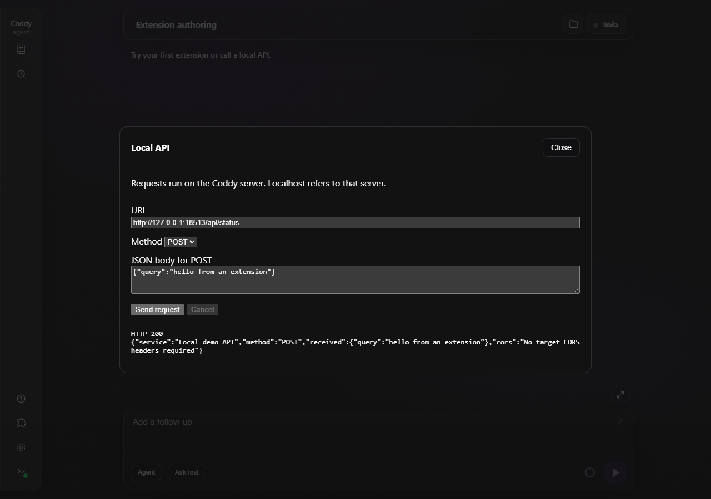

*Вызов локального API через сервер Coddy.*

[Пример Local API](../../../examples/extensions/local-api/main.js) содержит поле URL, запросы GET/POST и отмену. Из папки `examples/extensions/local-api` упакуйте его следующей командой.

```sh
python -m zipfile -c local-api.zip manifest.json main.js
```

## Входящие данные потока

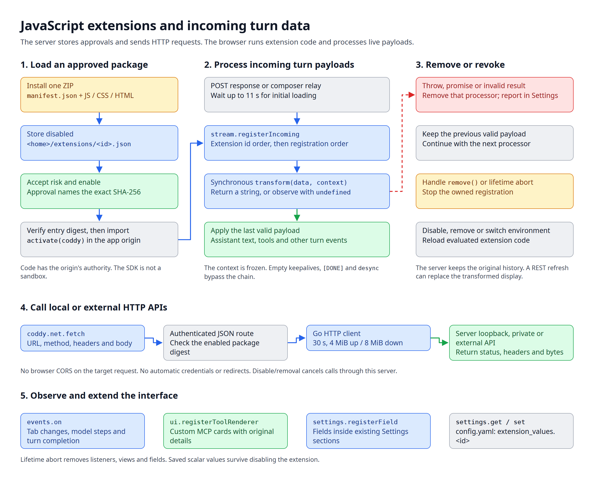

*Одобрение пакета, активация в браузере, цепочка обработки входящих данных и HTTP-запросы с сервера.*

Зарегистрируйте обработчик, чтобы читать, изменять или дополнять входящие данные SSE. Цепочка работает для новых ответов и для релея поля ввода, когда вы наблюдаете за ходом или восстанавливаете подключение к нему. Она обрабатывает и последние данные, если соединение закрывается без пустой строки.

Перед чтением потока хода браузер ждёт первоначальную загрузку расширений не дольше 11 секунд. Если загрузка завершается ошибкой или длится дольше, чтение продолжается с уже зарегистрированными обработчиками. Расширения, которые активируются позже, не получают уже прочитанные кадры повторно.

```js
export function activate(coddy) {
  const processor = coddy.stream.registerIncoming({
    id: "annotate",
    transform(data, context) {
      if (context.event !== "tool_call_update") return;
      const payload = JSON.parse(data);
      const result = payload.content?.[0]?.content;
      if (typeof result?.text === "string") {
        result.text += "\nProcessed by my extension";
      }
      return JSON.stringify(payload);
    }
  });
  return () => processor.remove();
}
```

`transform(data, context)` получает строку данных SSE и неизменяемый контекст:

| Поле | Значение |
| --- | --- |
| `sessionId` | Чат, за ходом которого следит этот обработчик потока. |
| `transport` | `"post"` для нового ответа; `"relay"` для хода, за которым наблюдают или к которому восстанавливают подключение. |
| `event` | Имя события SSE, например `tool_call_update`; пустая строка для обычных частей ответа. |
| `id` | Идентификатор события релея или пустая строка, если сервер его не передал. |
| `ageMs` | Возраст повторно переданного кадра, если релей его указал. |

Верните строку, чтобы заменить данные, или `undefined`, чтобы прочитать их без замены. Если на входе JSON, верните корректный JSON по схеме этого события. Можно менять текст, добавлять поля или вычислять данные для своей страницы. Сохраняйте идентификаторы и версии, по которым приложение сопоставляет вызовы инструментов, запросы и снимки состояния. Пустая строка не отменяет событие.

Приложение вызывает обработчики по идентификаторам расширений в порядке возрастания кодов ASCII, затем по порядку регистрации внутри расширения. Каждый обработчик получает результат предыдущего. Исключение, промис или некорректный результат удаляют сбойный обработчик; его ошибка появляется в разделе **Настройки → Расширения**. Следующий обработчик получает последние корректные данные. Приложение перехватывает отклонение промиса, но не ждёт его завершения. Используйте синхронные функции, которые завершаются быстро: медленный код блокирует браузер.

Метод `remove()` дескриптора и сигнал `coddy.signal` отменяют регистрацию обработчика. Кадры без данных, `[DONE]` и `desync` проходят мимо цепочки. Обработчик не может менять имена событий, идентификаторы и возраст кадров или создавать `[DONE]`.

`coddy.stream.onFrame({id, listener})` наблюдает за тем же потоком на уровне кадров и возвращает дескриптор с методом `remove()`. Каждый кадр живого потока хода доходит до обработчика - включая типы событий, которые приложение не разбирает, - в виде замороженной копии `{sessionId, transport, event, id, ageMs?, data}`, в порядке регистрации. Наблюдение доступно только для чтения - обработчик не может переписать или остановить кадр. Обработчик, который завершается ошибкой, удаляется, и ошибка сообщается так же, как у сбойного обработчика данных. Так расширение видит тип события, который появился после этой версии SDK; кадр, для которого у приложения нет строки, может также стать живой строкой транскрипта `ext_frame`, которую рисует представление сообщений.

Обработка действует на текущий поток в этом браузере. Сервер сохраняет исходную историю и контекст LLM. При следующем чтении истории исходные данные могут заменить изменённое отображение. Этот API не перехватывает исходящие запросы, историю по REST, аутентификацию, ресурсы или общий поток `/coddy/events`.

[Пример Stream tools](../../../examples/extensions/stream-tools/main.js) переводит входящий текст ассистента в верхний регистр и показывает последний полученный кадр на своей странице.

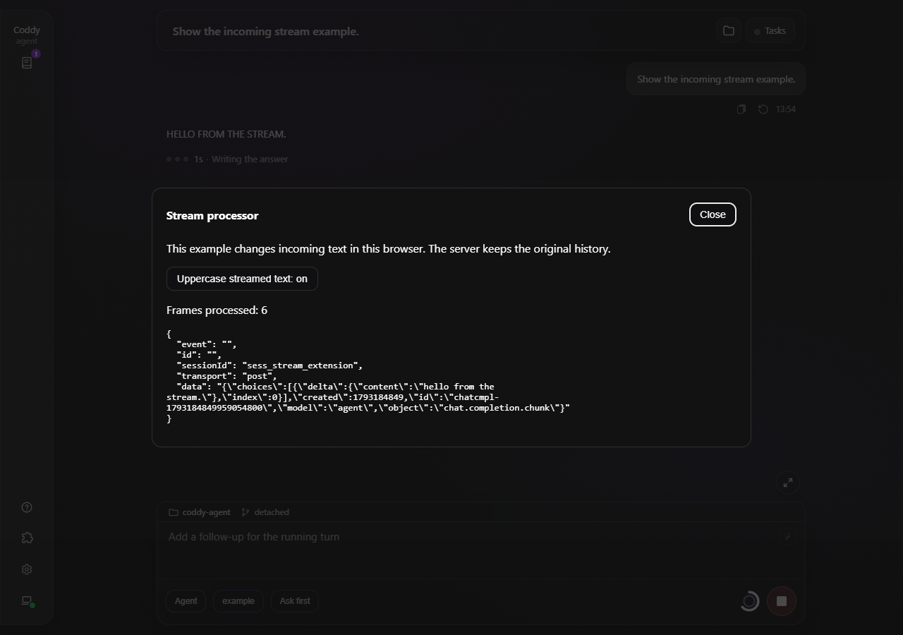

*Stream tools показывает входящие данные, а чат - изменённый текст.*

Соберите пакет из `examples/extensions/stream-tools`:

```sh
python -m zipfile -c stream-tools.zip manifest.json main.js
```

## Пробелы для альтернативных интерфейсов

Альтернативный интерфейс, собранный как расширение, - ящик `examples/extensions/ok-coddy` по мотивам прототипа coddy-duck-prototype, - рисует собственные интерфейсы, читает слой темы, наблюдает живой поток и дотягивается до сети, конфигурации и слотов хуков. Чего он пока не умеет и чего интерфейсу не додаёт API приложения:

- **Отправить промпт в сессию** - сообщение или файл в ленту диалога. В спецификации этот пробел называется `sessions.prompt`;
- **Открыть интерфейсы приложения** - список сессий, сессию, экран боковой панели. `coddy.nav` из спецификации ещё нет, поэтому кнопка **Список сессий** остаётся выключенной;
- **Элементы поля ввода** - переключение режима, выбор модели, любое в строках действий поля ввода (`registerComposerControl` из раздела 11 спецификации);
- **Прочитать диалог** - транскрипт и его живые обновления помимо наблюдения за потоком только на чтение; мини-чат отвечает заготовленными репликами, потому что читать сообщения сессии нечем;
- **Плавающие оверлеи** - питомец поверх всего вне панелей и якорных блоков (`coddy.ui.openOverlay` из спецификации); сегодня уточка живёт внутри панели, ящика или якорного блока.

Каждый из них закроется фазой спецификации, которой он принадлежит.

## Ограничения

- Строки `ext_frame` живые. Они никогда не сохраняются, и следующее чтение истории заменяет их исходными данными;
- канал приложения отвечает на `host.capabilities()` списком разрешений манифеста, которые поддерживает сборка, и сегодня это только `ui.page`; API сессий и сообщений появится в том же объекте позже;
- перечень `permissions` заявляет словарь областей, но код с ним не сверяют; любая область, включая `ui.alter`, пока только заявлена, а права по-прежнему даёт включение; `ide.actions` зарезервирована под мост действий IDE, который пока не поддерживает ни одна сборка;
- одновременно открыта одна панель, какому бы расширению она ни принадлежала;
- якорный блок - пустой `div`, который приложение держит в именованном месте и монтирует, только пока открыт его интерфейс; в остальное время `ui.anchor(name)` возвращает `null`, а `ui.onAnchor` - способ дождаться блока.

<!-- docsgen:source sha256=1f95a7a12ae78042 -->
