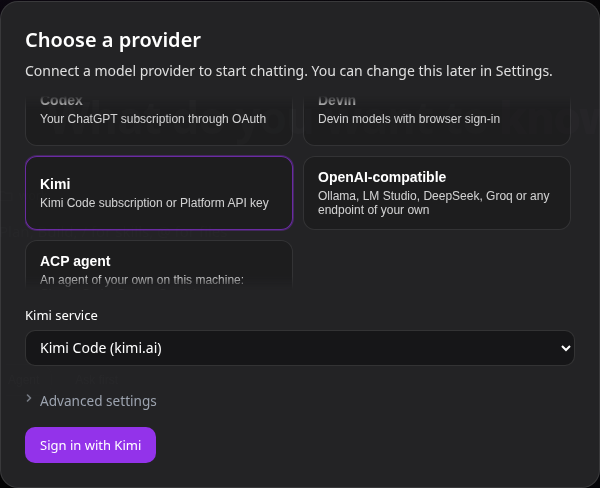
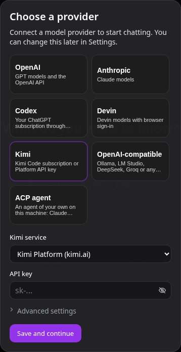

# Kimi

Подключите подписку Kimi Code или API-ключ Kimi Platform как провайдера моделей для Coddy.



*При выборе Kimi по умолчанию выбран Kimi Code на kimi.ai.*



*В режиме Platform форма запрашивает API-ключ.*

## Конфигурация

У провайдера `type: kimi` два режима учётных данных. Без `mode` используется `subscription` для Kimi Code; режим `platform` принимает API-ключ Kimi Platform. Без `region` используется `global`; для материкового Китая укажите `region: china`. Логические модели настройте отдельно.

```yaml
providers:
  - name: kimi
    type: kimi
    mode: subscription
    region: global
```

Для Platform укажите `mode: platform` и задайте `api_key` или `api_key_command`. Режим подписки отклоняет `api_key`, `api_key_command` и `api_base`. Ключ Platform и OAuth-токен Kimi Code - разные учётные данные.

| Регион | Авторизация Kimi Code | API Kimi Code | API Platform |
| --- | --- | --- | --- |
| `global` | `https://auth.kimi.ai` | `https://api.kimi.ai/coding/v1` | `https://api.moonshot.ai/v1` |
| `china` | `https://auth.kimi.com` | `https://api.kimi.com/coding/v1` | `https://api.moonshot.cn/v1` |

Каталог указывает протокол каждой модели. Для моделей подписки Coddy поддерживает транспорты Kimi, Anthropic и OpenAI Responses; для запросов к моделям Platform сейчас поддерживается только протокол Kimi. Метаданные каталога привязаны к модели, режиму и региону. При несовпадении протокола требуется проверка вместо незаметной смены транспорта.

Kimi Code принимает только температуру 1 и на любое другое значение отвечает HTTP 400, какую бы модель вы ни выбрали. Поэтому Coddy не отправляет в запрос подписки `temperature`, записанную в строке `models[]`. Температура, которую клиент API передал в самом запросе, доходит до эндпоинта, и тот отклоняет её, если это не 1. Platform работает через API Moonshot, который этот параметр принимает, поэтому туда настроенная температура доходит.

## Вход и резервный источник Kimi CLI

Kimi Code использует OAuth-авторизацию по коду устройства. Выполните `coddy providers login kimi` или войдите через форму провайдера. Откройте ссылку авторизации и введите показанный код. Если провайдер в веб-интерфейсе ещё не сохранён, после входа сохраните настройки, чтобы провайдер сохранил свой идентификатор. Режим Platform использует ключ без этой авторизации.

Если у Coddy нет собственных учётных данных, подходящая строка подписки может прочитать токен доступа Kimi CLI для выбранного региона. Подходящей считается единственная строка Kimi или строка с именем `kimi`, если их несколько. При недействительных или неопределённых собственных учётных данных Coddy не переходит к аккаунту CLI. Coddy читает учётные данные CLI без обновления, изменения и удаления. Если токен истёк или сервер отклонил его с HTTP 401, войдите в Kimi CLI снова или войдите через Coddy. Токен с неизвестным сроком действия используется до отказа сервера. Если используется только вход CLI, выходите из аккаунта в самом Kimi CLI.

Каталог учётных данных CLI задаёт `KIMI_CODE_HOME`. Если переменная не задана, используется `~/.kimi-code`. Учётные данные global и China хранятся в отдельных файлах каталога `credentials`.

## Лимиты и прокси

У подписки четыре независимых окна расхода, если сервер их передаёт - пять часов, семь дней, общий месячный лимит и месячный лимит кода. Отсутствующее окно остаётся неизвестным. Данные кошелька booster опущены; как баланс в рублях они не отображаются. Режим Platform не предоставляет лимиты подписки.

Запросы провайдера используют `providers[].proxy`, включая авторизацию устройства, опрос, обновление токена, получение каталога моделей, запросы к модели и чтение лимитов. Без этого поля используется прокси процесса, `none` задаёт прямое соединение, также можно указать URL прокси.

## Защита учётных данных

Учётные данные под управлением Coddy хранятся вне `config.yaml` в `$CODDY_HOME/providers/kimi-identities/<identity>/`, в отдельных файлах по регионам. В Unix доступ к файлам ограничен владельцем; в Windows файлы наследуют ACL каталога хранилища. Несекретный идентификатор строки провайдера не даёт удалённой и заново созданной строке унаследовать прежний вход под управлением Coddy. После отказа от несохранённого черновика может остаться неиспользуемый каталог идентификатора. Прежде чем удалить его вручную, проверьте идентификаторы в конфигурации и активные черновики. Coddy не удаляет эти каталоги автоматически. Защищайте каталоги учётных данных как секреты. Адреса подписки ограничены выбранным регионом; не отправляйте OAuth-токены на эндпоинт Platform. При неопределённом результате обновления токена войдите снова вместо повторной попытки с токеном, который уже мог смениться. Обновления токенов из разных процессов выполняются под общей блокировкой. Windows не гарантирует сохранение изменений каталога при внезапном отключении питания.

<!-- docsgen:source sha256=4de0ab4c34127299 -->
