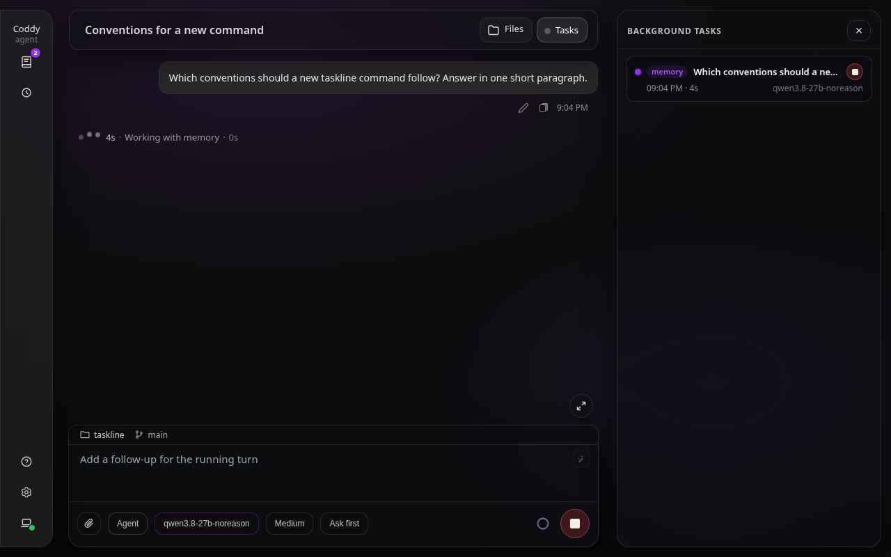
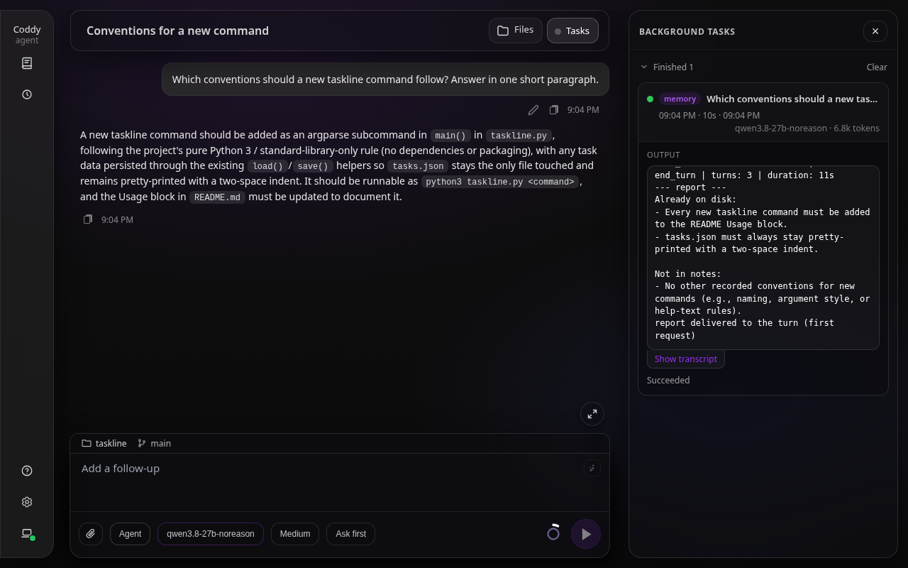
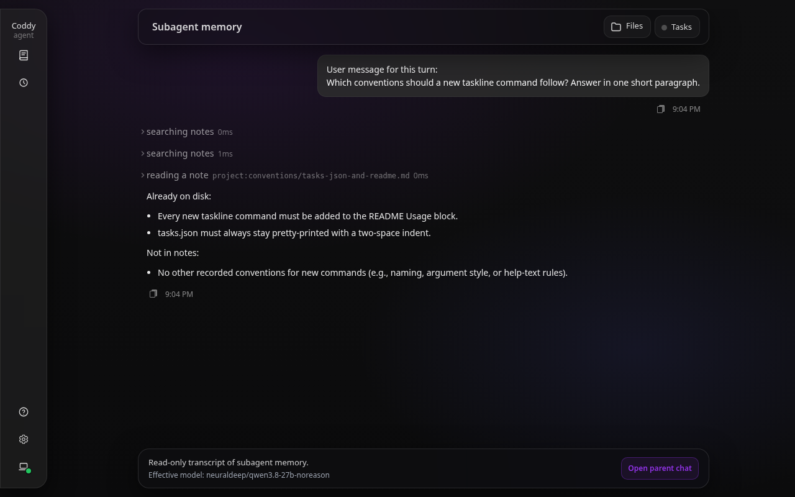
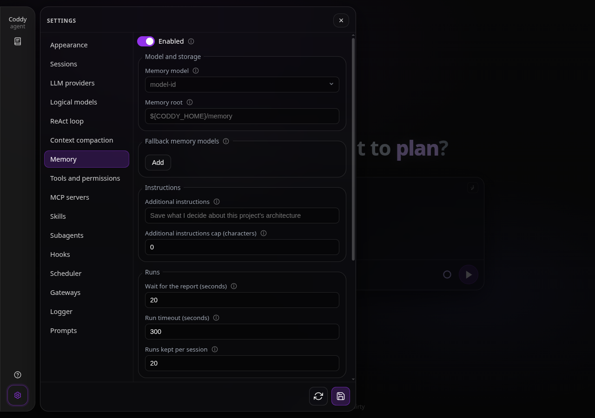

# Долговременная память

В применении к LLM память - всё, что попадает в контекст: история чата - её кратковременная часть, и она заканчивается вместе с сессией. Долговременная память в Coddy - набор заметок на диске в markdown и простом тексте; с ними сверяется и их обновляет отдельный дочерний агент, **субагент памяти**. Основной агент делегирует ему работу так же, как любому субагенту: вызов `spawn_agent` под встроенным определением `memory` запускает дочерний агент с собственным бандлом сессии, собственным транскриптом и собственным логом задачи ([Субагенты](subagents.md), [Фоновые задачи](background-tasks.md)). Основной агент никогда не видит инструменты памяти; он видит только отчёт дочернего агента - как результат этого вызова `spawn_agent`, - а заметки переживают любую сессию.

Память работает **по требованию**: пока модель не решит спросить, на ходу не происходит ничего. Фоновый запуск на каждое сообщение не стартует, и ход, который не обращается к заметкам, не тратит на память ничего.

## Что делает субагент памяти

Дочерний агент получает промпт родителя как задачу, перед которой стоят [руководства](#руководства) корней памяти, где они есть, и собственный системный промпт (`external/memory/prompts/memory_agent.md`, встроен в бинарник, поэтому после его изменения нужна пересборка). Он выбирает один из двух режимов и никогда не совмещает их в одном запуске:

- **Вспоминание** загружает контекст для основного ассистента: дочерний агент ищет по заметкам, просматривает папки и читает файлы, затем сообщает простые факты под `Already on disk` и, если нужно, `Not in notes` - без путей и имён файлов - или ровно `(no memory hits)`, когда ничего не нашлось. Вспоминание выбирается по умолчанию всякий раз, когда дочерний агент не уверен, а если первый поиск ничего не нашёл, он повторяет его с английскими ключевыми словами и просмотром папки;
- **Сохранение** обновляет заметки, когда родитель просит что-то запомнить, сохранить, забыть или удалить или когда из разговора очевидно, что нужно записать долговременные заметки. Дочерний агент сначала читает существующие заметки, чтобы не плодить дубликаты, создаёт папку перед первым сохранением в неё и сообщает, что проверил, сохранил, пропустил или удалил. Ключи, токены и пароли никогда не записываются.

Промпт говорит дочернему агенту, что отвечать на запрос - работа основного ассистента: его отчёт несёт только то, что есть в заметках. Последнее сообщение ассистента в дочерней сессии и есть отчёт; оно доходит до родителя как результат вызова `spawn_agent`, как при любом другом делегировании. Задача обрезается до 32 КБ, это тот же предел, что у промпта `spawn_agent`.

## Как модель его вызывает

Субагент памяти - встроенное определение субагента, `internal/subagents/bundled/memory.md`; в доступном модели каталоге оно числится под именем `memory`. Модель достигает его через `spawn_agent` с `agent: "memory"` и промптом, в котором сказано, что вспомнить или что сохранить:

```text
spawn_agent  agent: "memory"
             prompt: "what do the notes say about our deployment target?"
```

О том, предлагается ли это имя вообще, решают два переключателя. Бинарник должен быть собран с тегом `memory` (он есть в бинарниках релиза и в Docker-образе; при сборке из исходников - `make build TAGS="... memory ..."`, см. [Сборка из исходников](../contributing/build.md)), а `memory.enable` в `config.yaml` должен быть равен true. Пока хотя бы один из них выключен, определение **скрыто из каталога**, поэтому модель никогда не видит запуск, который ей всё равно отклонили бы, а `spawn_agent`, который назовёт `memory` вопреки этому, отклоняется с причиной. Без тега ключи памяти принимаются, но ничего не запускается. Собственное определение оператора с именем `memory` заменяет встроенное, как любое другое встроенное определение.

Запущенный дочерний агент - **обычная фоновая задача вида `agent`**, а не особая системная задача: `background_list` перечисляет её, как любой запуск субагента, её можно прочитать через `background_output` и дождаться через `background_wait`, она засчитывается в `subagents.max_concurrent` и, как любое делегирование, вызывает хуки `SubagentStart` и `SubagentStop` ([Хуки](hooks.md)). Она идёт в режиме "Агент" с шестью инструментами памяти и ничем больше: без оболочки, без инструментов файловой системы, без MCP-серверов. В собственном worktree она работать не может; запуск отклоняется ещё до создания чекаута. Её тайм-аут берётся из frontmatter определения (`timeout_seconds: 300`) и, как у любой задачи, ограничен `tools.background.max_timeout_seconds`.

В режимах "Агент" и "План" у дочернего агента полный набор инструментов. В **режиме "Чат"** запуск сводится к вспоминанию: дочерний агент получает инструменты поиска, просмотра и чтения, его промпт сообщает, что сохранение недоступно, а сохранение, которое он всё же запросит, отклоняется до выполнения, так что сессия только для чтения не может изменить сохранённое.

Дочерний агент работает на `memory.model`, если там указана настроенная модель, иначе на модели сессии. Длина его ответов ограничена `copilot_max_tokens`, а число раундов ReAct - большим из значений `recall_max_turns` и `persist_max_turns`. Недоступная или перегруженная модель не обязательно срывает запуск: `memory.fallback_models` - цепочка моделей, которые пробуются после `memory.model`, а собственная модель сессии остаётся последним вариантом, указана она в списке или нет. Цепочка переходит к следующей модели, когда вызов упал, не выдав никакого вывода (модель недоступна, не авторизована, исчерпала квоту); поток, оборвавшийся после того, как текст уже был доставлен, вместо этого идёт по обычной политике повторов, так что ни один ответ не передаётся дважды ([issue #247](https://github.com/coddy-project/coddy-agent/issues/247)).

Системный промпт дочернего агента - шаблон `external/memory/prompts/memory_agent.md`, встроенный в бинарник. `memory.additional_prompt` добавляет в него ваш собственный раздел **Operator instructions** после роли памяти и перед списком инструментов: здесь можно своими словами закрепить поведение, например "работай только с заметками; никогда не отвечай на саму задачу", или назвать язык, на котором пишутся заметки. Основной агент этот текст никогда не видит, а режим "Чат" выводит его так же. `memory.additional_prompt_max_chars` обрезает более длинный текст до этого числа символов, с предупреждением в логе агента при каждом запуске, который читает обрезанный текст, и замечанием в `coddy -t`; `0` оставляет текст целиком ([issue #266](https://github.com/coddy-project/coddy-agent/issues/266)).

## Кеш промпта

Провайдер кеширует запрос по префиксу: сначала определения инструментов, затем сообщения с начала, и первый байт, отличный от предыдущего запроса, лишает кеша всё, что за ним следует ([ReAct-агент](../contributing/react-agent.md#системный-промпт-заморожен-на-весь-ход)). Субагент памяти - отдельный диалог с собственным коротким промптом; общего префикса с родителем у него нет, и из кеша родителя он ничего не берёт. Руководства корней памяти входят в его задачу, то есть в сообщение после системного промпта и определений инструментов, поэтому правка руководства не сдвигает ничего из того, что провайдер закешировал для диалога памяти.

На стороне родителя отчёт - результат вызова `spawn_agent`, поэтому он добавляется в конец истории, как любой другой результат инструмента, и никогда не сдвигает закешированный префикс. Системный промпт основного агента несёт только заметки сессии (слот `{{.Memory}}` шаблонов `agent.md`, `plan.md`, `ask.md`; см. [Конфигурация](../getting-started/configuration.md)), поэтому вспоминание, которое меняется от вызова к вызову, не трогает `messages[0]`.

## Наблюдение за запуском

Запущенный дочерний агент - обычный запуск субагента, поэтому за ним следят там же, где и за любым запуском субагента. Панель "Задачи" веб-интерфейса показывает его карточкой с тегом `memory` (тег берётся из имени агента, так же как дочерний агент `spawn_agent` несёт имя своего агента), а заголовком служит промпт, который передал родитель. **Показать транскрипт** открывает дочернюю сессию только для чтения, где вместо поля ввода стоит ссылка обратно в чат. Открытая карточка показывает лог выполнения дочернего агента: его вызовы инструментов и его текст, затем блок `=== subagent report ===`. Завершённые запуски остаются в списке завершённых на панели и очищаются вместе с прочими задачами сессии; удаление сессии удаляет и её дочерние сессии памяти.

Инструменты пула, доступные модели, видят этот запуск как обычную задачу вида `agent`: `background_list` перечисляет его, а `background_output`, `background_wait` и `background_stop` принимают его идентификатор. Отдельного обновления `memory_run` на проводе больше нет и нет статусной строки на ход: о запуске сообщают обычная запись задачи вида `agent` и результат вызова `spawn_agent`.



*Панель "Задачи" с идущим запуском памяти - тег `memory` и прошедшее время*



*Завершённый запуск - лог дочернего агента и блок отчёта*



*Транскрипт дочернего агента памяти, открытый из запуска только для чтения - задача, поиск и отчёт*

## Ограничения

- **Время.** Один запуск ограничен `timeout_seconds` из определения (300), который, как и у любой задачи, ограничен пулом через `tools.background.max_timeout_seconds`. По достижении предела дочерний агент останавливается, а задача записывается как `timed_out`;
- **Одновременные запуски.** Запуск засчитывается в `subagents.max_concurrent`, как любой субагент, потому что он и есть субагент;
- **Возможности.** У дочернего агента есть шесть инструментов, которых нет у родителя, и это единственное место, где набор инструментов дочернего агента не сужает родительский: набор зафиксирован в коде, выдаётся только дочернему агенту с меткой вида `memory` и работает с двумя корнями заметок и ни с чем больше;
- **Изоляция.** Запуск в worktree отклоняется: дочерний агент памяти идёт в рабочей папке родителя и никогда в собственном чекауте;
- **Хуки.** `SubagentStart` и `SubagentStop` для дочернего агента памяти срабатывают, как для любого делегирования, а внутри дочернего агента каждое обычное событие срабатывает для его собственного хода. Блок `subagent` полезной нагрузки содержит `"kind": "memory"` - это ключ, по которому стоит сопоставлять ([Хуки](hooks.md));
- **Выход.** Запуск, остановленный посреди сохранения, теряет свою заметку.

## Инструменты

| Инструмент | Аргументы | Вспоминание | Сохранение |
|---|---|---|---|
| `coddy_memory_search` | `query`, `scope` (`global`, `project`, `both`) | да | да |
| `coddy_memory_list` | `path` (`global:` или `project:notes`; один уровень) | да | да |
| `coddy_memory_read` | `path` | да | да |
| `coddy_memory_mkdir` | `path` | | да |
| `coddy_memory_save` | `title`, `body`, `scope`, необязательный `relative_path` | | да |
| `coddy_memory_delete` | `path` (файл или папка со всем содержимым; никогда не корень) | | да |

Пути имеют вид `scope:relative/path.md` - `global:preferences.md`, `project:architecture/api.md`, - и ссылки внутри текста заметки должны использовать ту же форму (или Markdown-ссылку с такой целью), чтобы оставаться однозначными для обоих корней. Поиск ранжирует каждую заметку в выбранных корнях относительно запроса алгоритмом BM25F, тем же, что в [поиске по встроенной документации](built-in-docs.md), возвращает не больше `max_search_hits` фрагментов длиной до 1200 символов, лучшие первыми, и задуман как точка входа: дочерний агент открывает найденное через `coddy_memory_read` и переходит по ссылкам внутри. Сохранение без `relative_path` получает плоское имя файла, построенное из заголовка, с сохранением букв любой письменности; если же он указан, заметка попадает в эту папку.

### Как поиск ранжирует заметки

У заметки два поля - путь (папки и имя файла без `.md` или `.txt`) и текст. Слово в пути говорит, о чём заметка, поэтому оно весит втрое больше слова в тексте. Веса зашиты в коде константами, настроек для них нет.

- **Стемминг.** Слова сопоставляются после стемминга, английские и русские, поэтому `configs` находит заметку со словом `config`, а русский запрос находит другую форму слова (`настройка` находит `настройки`);
- **Редкие слова весят больше.** Слово, которое есть у немногих заметок, весит больше слова, которое есть почти у всех. Повтор слова добавляет всё меньше, поэтому заметка со всеми словами запроса стоит выше заметки с одним частым словом, повторённым много раз;
- **Префиксы.** Слово запроса из трёх букв и больше находит и слова, которые оно начинает: `deploy` находит `deployment`, но ниже заметки со словом `deploy`;
- **Служебные слова ничего не весят.** `how`, `to` и `the` (и русские аналоги) отбрасываются из запроса, поэтому `how to deploy the relay` ставит первой заметку о развёртывании релея и не возвращает общую инструкцию, которая совпала только словами `how to the`. Запрос из одних служебных слов ничего не находит;
- **Порядок.** Заметки с равным счётом идут по пути, а у результата есть счёт;
- **Не руководство.** `AGENTS.md` в корне области никогда не попадает в результаты ([Руководства](#руководства)), а такой файл в подпапке - обычная заметка.

Индекс строится из файлов, прочитанных при каждом вызове. Заметки меняются между вызовами, а хранилище небольшое, поэтому хранить и сбрасывать нечего.

Текст заметки содержит не больше `memory.max_note_chars` символов (по умолчанию 900; считаются символы, а не байты, поэтому заметке на кириллице или другой нелатинской письменности достаётся столько же места, сколько заметке на английском). Определение инструмента называет этот предел, поэтому дочерний агент знает его до вызова, а промпт велит ему делить длинную тему на несколько заметок. Текст сверх предела обрезается по границе символа, заканчивается строкой `...`, а сохранение отвечает `saved as <path> (warning: body truncated to 900 characters)` вместо простого `saved as <path>`, поэтому обрезка никогда не бывает молчаливой ([issue #429](https://github.com/coddy-project/coddy-agent/issues/429)). `0` снимает предел.

## Расположение хранилища

| Корень | Где | Область заметок |
|---|---|---|
| глобальный | `memory.dir`, а если не задан - `$CODDY_HOME/memory` (`~/.coddy/memory`); `${CODDY_HOME}` и `~` раскрываются | общий для всех сессий |
| проект | `<session cwd>/.coddy/memory`, не настраивается | рабочая папка, в которой идёт сессия |

Считаются только файлы `.md` и `.txt`. Вложенные папки приветствуются для тематической группировки, и дочерний агент вызывает `coddy_memory_mkdir` перед первым сохранением в новую ветку дерева. Оба корня - обычные каталоги: их можно править любым редактором, а корень проекта можно коммитить вместе с репозиторием или игнорировать, как того заслуживают заметки.

Два корня по-разному относятся к ссылкам. Глобальный корень - ваш: заметка или папка в нём может быть ссылкой куда угодно, например на синхронизируемую папку, и Coddy идёт по такой ссылке. Корень проекта приходит вместе с чекаутом, поэтому ссылка в нём никогда не выводит за его пределы. Coddy достигает его через `os.Root`: ссылка внутри него проходится, только пока её цель остаётся внутри, а `.coddy` и `.coddy/memory` должны быть настоящими папками, а не ссылками. Заметка клонированного репозитория, которая является ссылкой на `~/.aws/credentials`, тогда не читается и не находится поиском, то есть никогда не попадает к модели, а сохранение никогда не попадает в папку, которая является ссылкой на другой проект. Удаление такой ссылки убирает ссылку и оставляет то, на что она указывала. Корень проекта, который сам является ссылкой, отклоняется с ошибкой, которая об этом говорит; поиск по обоим корням всё равно отвечает по глобальному.

## Руководства

Дочерний агент знает о заметках только через поиск, просмотр и чтение плюс свой фиксированный промпт. `AGENTS.md` в корне корня памяти - это место, где объясняется, как вы их ведёте: индексная заметка, с которой начинать, одна папка на тему, правила именования, что никогда не сохранять. `memory.additional_prompt` делает то же самое для каждой рабочей папки, а руководство относится к одному корню.

- **Где.** `AGENTS.md` на верху глобального корня (`$CODDY_HOME/memory/AGENTS.md`, или под `memory.dir`) и на верху корня проекта (`<workspace>/.coddy/memory/AGENTS.md`). Сам факт, что файл существует, и есть переключатель, настройки для него нет, а файл с таким именем в подпапке - обычная заметка;
- **Оба уровня, сначала глобальный.** В начале каждого запуска задача дочернего агента открывается глобальным руководством, затем руководством проекта, затем промптом, и каждое руководство стоит под заголовком, который называет его уровень и путь. Уровень без руководства не добавляет ничего: ни заголовка, ни заглушки. Два уровня остаются раздельными: ни один не перекрывает и не сливается с другим, а промпт дочернего агента велит следовать каждому руководству для заметок его собственного корня;
- **Читается как обычная заметка.** Руководство проходит через то же хранилище, что и `coddy_memory_read`, поэтому руководство проекта получает защиту остального корня проекта. Руководство, которое является ссылкой, ведущей за пределы `.coddy/memory`, именованный канал или иной файл, не являющийся обычным файлом, либо файл, который диск не даёт открыть (нет прав, зацикленная ссылка), не читается, предупреждение в логе агента об этом говорит, а запуск продолжается без него;
- **Размер.** Coddy читает из руководства не больше первых 8 КБ, каким бы большим ни был файл, и оканчивает его отметкой об этом, когда файл продолжается. Держите его картой, а подробности выносите в заметки, на которые он указывает: дочерний агент откроет их через `coddy_memory_read` и `coddy_memory_list` или найдёт через `coddy_memory_search`;
- **Не в промпте.** Руководства едут в задаче, никогда не в системном промпте и не в шаблоне: `{{` в руководстве - простой текст, и правка руководства не меняет ни системный промпт дочернего агента, ни определения его инструментов;
- **В кавычках, чтобы ссылки оставались текстом.** Каждая строка руководства записывается в задачу как цитата Markdown (`> ` перед ней), а цитируемая строка - проза для грамматики упоминаний `@`. Руководство проекта приходит вместе с чекаутом, поэтому `@~/.aws/credentials` или `@/abs/path` в нём не присоединяет к запросу дочернего агента никакой файл;
- **Не результат поиска.** `coddy_memory_search` не возвращает корневой `AGENTS.md`, потому что у дочернего агента он уже есть. При этом он по-прежнему может его просматривать, читать и записывать в запуске сохранения, когда руководство об этом просит.

Когда есть оба руководства, задача выглядит так.

```text
Memory guide (global:AGENTS.md):
> <the global file, every line quoted>

Memory guide (project:AGENTS.md):
> <the project file, every line quoted>

Task from the parent:
<the prompt the parent passed>
```

Без руководств задача - это промпт после его вводной строки.

## Просмотр заметок по HTTP

Бинарник, собранный сразу с тегами `http` и `memory`, отдаёт два корня сессии как дерево по маршрутам `/coddy/sessions/{id}/memory/*`; обычная сборка с `http` отвечает там `404`.

| Метод | Маршрут | Примечания |
|---|---|---|
| GET | `/coddy/sessions/{id}/memory/tree` | без `root` - корни `global` и `workspace`; с `root` и необязательным `path` - дочерние `.md` и `.txt` на один уровень вниз |
| GET | `/coddy/sessions/{id}/memory/file` | `root` и `path`; содержимое в UTF-8 |
| PUT | `/coddy/sessions/{id}/memory/file` | `{"root","path","content"}` |
| POST | `/coddy/sessions/{id}/memory/dir` | `{"root","path"}` создаёт папку |
| DELETE | `/coddy/sessions/{id}/memory/file` | `root` и `path`; файл или папка рекурсивно; `400` для самого корня |

`workspace` - это корень проекта той рабочей папки, в которой идёт сессия. Маршруты достают оба корня через то же хранилище, что и инструменты памяти, поэтому правила расположения хранилища выше действуют и здесь: путь, который покидает корень по своей записи или через ссылку в корне проекта, получает `400` с причиной, и каждый маршрут для рабочей папки, у которой `.coddy/memory` является ссылкой, тоже. Собственные заметки сессии (`agentMemory` в `session.json`) здесь не правятся. Эти маршруты - записанный контракт из раздела [Долговременная память](../surfaces/web-ui.md#долговременная-память) заметок о веб-интерфейсе; сами ключи памяти находятся на вкладке **Память** настроек веб-интерфейса.

## Конфигурация

```yaml
memory:
  enable: false
  model: ""                # models[].model for the memory subagent only; empty = the session's model
  fallback_models: []      # tried in order when the model above them fails before answering
  dir: ""                  # global root; empty = ${CODDY_HOME}/memory
  recall_max_turns: 6      # the child's round cap is the larger of the two
  persist_max_turns: 12
  copilot_max_tokens: 4096 # completion cap of the memory model's calls
  max_search_hits: 8
  max_note_chars: 900      # longest body one saved note may have, in characters; 0 = no cap
  additional_prompt: ""    # your own instructions for the memory subagent only; the main agent never sees them
  additional_prompt_max_chars: 0 # cut that text at so many characters (a warning is logged); 0 keeps it whole
```

| Ключ | По умолчанию | Значение |
|---|---|---|
| `enable` | `false` | предлагать ли субагента памяти вообще (нужен тег сборки `memory`) |
| `model` | `""` | привязывает дочернего агента к одной `models[].model`; основной агент не затрагивается |
| `fallback_models` | `[]` | пробуются по порядку, когда указанная выше модель падает, не ответив; собственная модель сессии остаётся последним вариантом, указана она в списке или нет |
| `dir` | `""` | глобальный корень |
| `recall_max_turns`, `persist_max_turns` | `6`, `12` | ограничивают раунды ReAct у дочернего агента; действующий предел - больший из двух |
| `copilot_max_tokens` | `4096` | предел длины ответа для вызовов модели памяти |
| `max_search_hits` | `8` | число фрагментов, которые возвращает `coddy_memory_search` |
| `max_note_chars` | `900` | самая длинная заметка, которую сохраняет `coddy_memory_save`, в символах; более длинная обрезается с предупреждением в ответе инструмента; `0` снимает предел |
| `additional_prompt` | `""` | ваши собственные указания для субагента памяти, выводятся в его разделе **Operator instructions**; основной агент их никогда не видит |
| `additional_prompt_max_chars` | `0` | обрезать `additional_prompt` до этого числа символов, с предупреждением в логе агента и замечанием в `coddy -t`; `0` оставляет текст целиком |

Таблица полей находится в [справочнике config.yaml](../reference/config.md#memory); `config.example.yaml` несёт тот же блок с комментариями. Веб-интерфейс правит те же ключи в **Настройки → Память**, сгруппированные в **Модель и хранилище**, идущий под ним список **Резервные модели памяти**, **Указания** и **Ограничения**.



*Настройки → Память: модель и резервные модели, дополнительные указания оператора с пределом длины, лимиты ходов и токенов вместе с пределом размера заметки*

## Стоимость и задержка

Память стоит токенов только тогда, когда модель сама спрашивает. Ход, который не запускает субагента памяти, не гоняет модель памяти вообще; ход, который запускает, платит за один дочерний диалог: собственный системный промпт дочернего агента (шаблон, блок об окружении, шесть определений инструментов) и его раунды, минимум один вызов модели, больше - когда он пользуется инструментами. Привязка к небольшой быстрой модели через `memory.model` держит стоимость вспоминания низкой, пока основной агент остаётся на выбранной для него модели. Руководство добавляет к задаче дочернего агента не больше 8 КБ на корень при каждом запуске.

## Тестирование

- `features/memory_subagent.feature` (харнес `internal/agent/bdd_memory_test.go`, `-tags memory`): запуск под встроенным определением и бандл дочернего агента, отчёт как результат `spawn_agent`, дочерний агент режима "Чат" только для вспоминания, сохранение, кириллическая заметка, оставшаяся целой в пределах предела по символам, цепочка резервных моделей, приём в пул, ранжирование поиска у дочернего агента, руководства в начале его задачи. `features/memory_http.feature` (`external/httpserver/bdd_memory_http_test.go`, `-tags http,memory`): транскрипт дочернего агента только для чтения и маршруты заметок по REST.
- Модульные тесты: `external/memory/agent_test.go` (шаблон, предел задачи, руководства: оба уровня, один уровень, обрезка по размеру, фигурные скобки остаются текстом, руководство за ссылкой), `internal/agent/prompt_cache_memory_test.go` (системное сообщение и определения инструментов дочернего агента идентичны между запусками с разными руководствами), `external/memory/storage/storage_test.go` (ранжирование поиска: стемминг в английском и русском, редкие слова, слова из пути, префиксы, служебные слова, области и пределы; фрагменты, обрезанные по символам, вложенные записи, имена файлов из нелатинских заголовков, обход каталогов, удаление, цели ссылок), `external/memory/storage/storage_links_test.go` (заметка, руководство, папка и корень проекта, которые являются ссылками наружу, ссылка, остающаяся внутри, ссылки, пройденные в глобальном корне), `external/memory/tools/register_test.go` (определения инструментов), `external/memory/tools/mem_save_test.go` (предел заметки в символах, предупреждение об обрезке, `max_note_chars`), `external/httpserver/memory_http_test.go` (обход каталогов по REST).
- `examples/acp/acp_e2e_memory.py`, `examples/httpserver/http_e2e_memory.py` и `examples/cli/cli_e2e_memory.py` работают с реальной моделью: заранее положенная глобальная заметка вспоминается и влияет на ответ, ход с `remember` сохраняет заметку, затем харнес ACP спрашивает тот же факт в новой сессии, так что ответ может прийти только с диска, и шаг, где к нужной заметке ведёт только заранее положенный глобальный `AGENTS.md`; запись запуска проверяется там, где интерфейс её показывает (строка задачи `memory` по HTTP, бандл дочернего агента под `<session>/subagents/` для ACP и консоли).

<!-- docsgen:source sha256=a7923c9bb3b41fee -->
