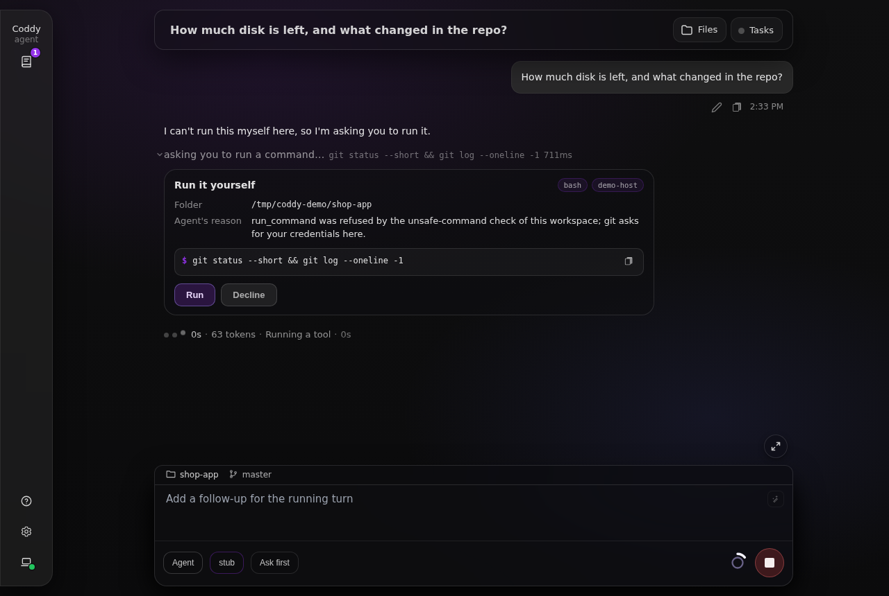
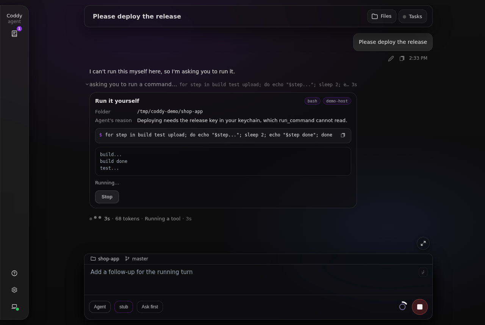
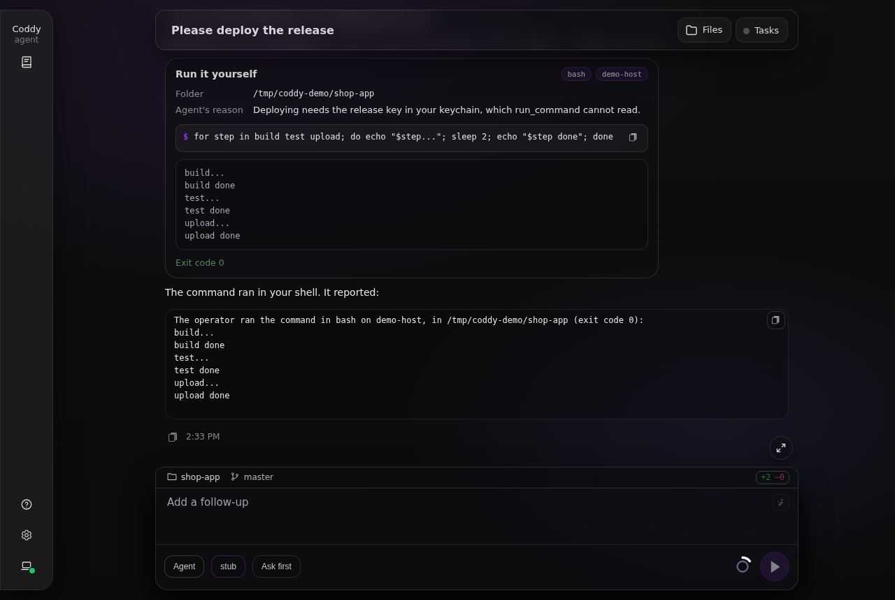
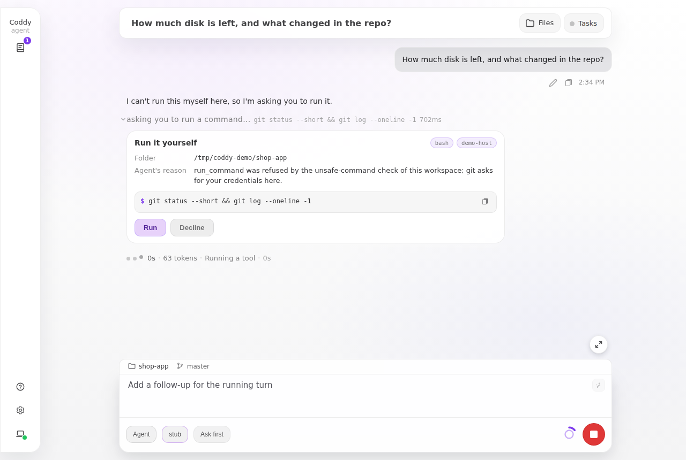
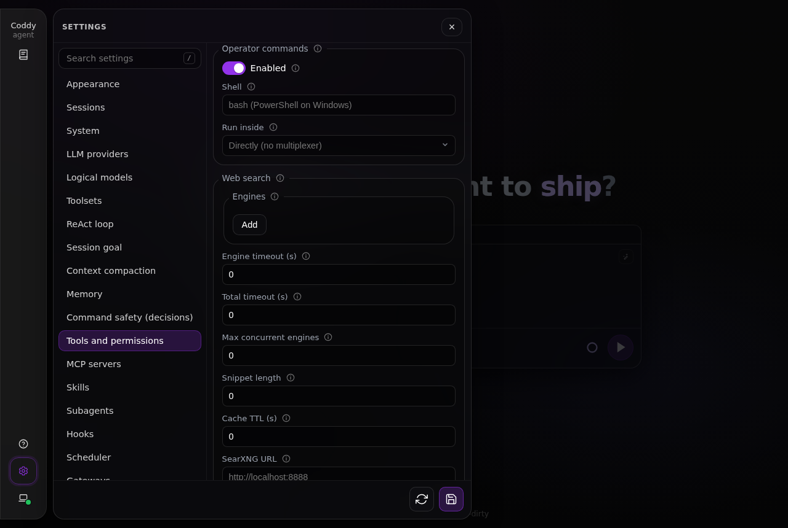
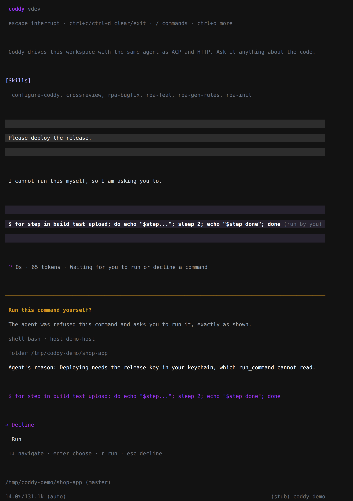
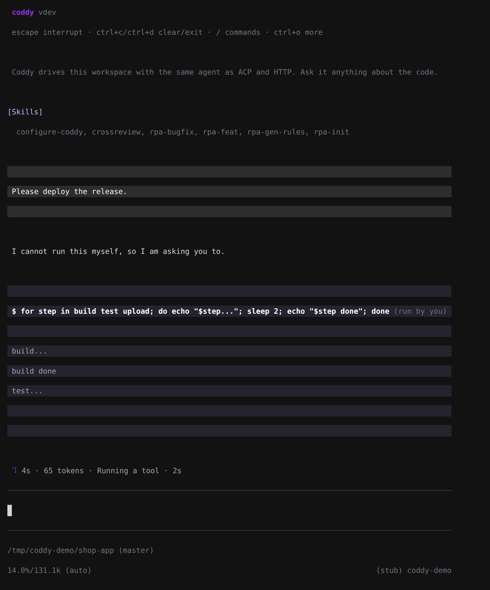

# Команды оператора

Некоторые команды оболочки агенту выполнять нельзя: их отклоняет [проверка опасных команд](decisions.md), в [наборе инструментов](../reference/tools.md) нет `run_command`, вызов блокирует хук. Если такую команду всё же нужно выполнить, агент просит вас запустить её через инструмент `operator_command`. Вы видите точную команду, оболочку, машину и папку и нажимаете **Запустить** или **Отклонить** (в консоли - **Run** или **Decline**). Команда выполняется в вашей оболочке оператора, её вывод по мере выполнения появляется на карточке и возвращается агенту, который читает его и продолжает работу в том же ходе.

Запрос показывают веб-интерфейс и консоль, изменить команду нельзя. То, что вы читаете, байт в байт совпадает с тем, что получит оболочка. Ещё до показа инструмент отклоняет команду, папку или причину, в которых есть управляющие символы (кроме перевода строки и табуляции), символы форматирования (переопределение направления текста, символы нулевой ширины), разделители строк и абзацев, селекторы вариантов или символы-заполнители. Для `cmd` он отклоняет и многострочную команду, потому что `cmd` выполнил бы только её первую строку.

Карточка фиксирует командную строку, но не всё, что эта строка запускает. Скрипт, Makefile или скрипт из `package.json`, который запускает команда, лежит в рабочей папке, куда агент может писать, поэтому прочитайте его, прежде чем нажать **Запустить**. Причину пишет сам агент. zsh (`.zshenv`) и fish (`config.fish`) читают файлы запуска даже с `-c`, а bash читает `$BASH_ENV`, если переменная задана; PowerShell (`-NoProfile`), `cmd` (`/d`) и `sh` не читают ничего. Буквы, которые выглядят как другие (кириллическая `і` в имени хоста), и пробелы, кроме обычного, инструмент не отклоняет. Карточка показывает их как есть, но их можно принять за другой текст.

## Запрос

Агент передаёт инструменту команду и объясняет, почему просит вас её запустить.

| Аргумент | Значение |
|---|---|
| `command` | Команда оболочки ровно в том виде, в каком она выполнится. |
| `reason` | Почему команду должны запустить вы, что не дало агенту выполнить её и что она делает. Показывается рядом с командой. |
| `cwd` | Путь к папке, в которой нужно выполнить команду, абсолютный или относительный (от рабочей папки сессии). Если `cwd` не задан, команда выполняется в рабочей папке. |

Карточка показывает команду, причину агента, оболочку и путь к её исполняемому файлу, хост и папку (символические ссылки в пути уже раскрыты). Когда карточка появляется, ни один её элемент не получает фокус, поэтому клавиша, которую вы нажимали в поле ввода, ничего не запустит.



*Команда, которую агенту не дали выполнить, ждёт вас. Оболочка и хост справа, редактировать нечего.*

- **Запустить** запускает команду. Пока она выполняется, её последние строки появляются на карточке. Если ход отменили в момент нажатия или папка изменилась, пока карточка ждала (в путь к папке подставили ссылку), команда не запускается, и агент узнаёт причину;
- **Отклонить** отклоняет запрос. Агент узнаёт об этом, и до конца хода ту же команду инструмент отклоняет, не спрашивая вас снова;
- **Остановить** прерывает выполняющуюся команду так же, как Ctrl+C. Coddy посылает `SIGINT` её группе процессов, чтобы программа, которая убирает за собой по Ctrl+C, успела это сделать. Через 3 секунды или сразу при втором нажатии (**Завершить принудительно**) вся группа завершается. Ход продолжается с тем, что команда успела вывести. В Windows прерывание послать нельзя, поэтому **Остановить** сразу завершает команду.



*Пока команда выполняется, на карточке видны её последние строки. "Остановить" прерывает её.*

Из результата инструмента агент узнаёт, где выполнилась команда, её код выхода и вывод, обрезанный по лимиту вывода `run_command` (`tools.output_limits.run_command`).

```text
The operator ran the command in bash on build-box, in /srv/app (exit code 0):
...
```



*Когда команда закончилась, карточка сохраняет сведения о её выполнении, а агент продолжает работу с выводом.*



*Карточка в светлой теме.*

У запроса нет тайм-аута, он ждёт вашего ответа столько, сколько нужно. Кнопка остановки в поле ввода завершает ход и так же останавливает команду (сначала Ctrl+C, затем завершение всей группы процессов). Ход ждёт завершения команды до 12 секунд. Команда, которая за это время завершилась, записывается как остановленная, с выводом и кодом выхода, как если бы вы остановили её сами. Если команда продолжает работать после конца хода, её запрос остаётся открытым, а на карточке остаётся кнопка **Остановить**, пока команда не завершится.

## Где предлагается инструмент

Инструмент предлагается агенту только там, где на запрос может ответить человек.

| Интерфейс | Команды оператора |
|---|---|
| Веб-интерфейс | да |
| Консоль (`coddy`) и `coddy --remote` | да |
| Потоковый клиент `POST /v1/responses` | нет, если он не объявляет `metadata.coddy_operator_commands` (см. [HTTP API](../reference/http-api.md)) |
| Клиент `POST /v1/chat/completions` | нет |
| ACP-редакторы, боты Telegram и Pachca, `coddy -p`, планировщик, субагенты, запуски цели с супервизором | нет |

Инструмент предлагается в режимах "Агент" и "План", но не в режиме "Чат", где оболочки нет вовсе. [Хук](hooks.md) `PreToolUse` может заблокировать его, как любой другой инструмент; хук, который ловит `Bash` или `run_command`, на него не срабатывает.

## Где выполняется команда

Команда выполняется на машине, которой принадлежит сессия, в папке сессии. Для консоли это ваша машина, для веб-интерфейса и `coddy --remote` - хост `coddy serve`. Команда работает от того же пользователя, что и Coddy, с окружением Coddy (внутри tmux или screen - с окружением сервера мультиплексора и пейджерами, заменёнными на `cat`, см. [долгие запуски](#долгие-запуски-tmux-или-screen)). Правила Coddy она обходит, правила операционной системы - нет.

## Команды, которые ничего не спрашивают

Интерактивный ввод инструмент не поддерживает. Агент всегда должен писать команду, которой от вас ничего не нужно: ни пароль, ни подтверждение, ни редактор, ни пейджер. Описание инструмента говорит об этом модели при любых настройках и называет нужные формы: `sudo -n` вместо `sudo`, `apt-get -y`, `ssh -o BatchMode=yes`, git с `GIT_TERMINAL_PROMPT=0`. Команду, которая не выполнится без пароля или ответа, этим инструментом не запускают. Описание велит агенту написать её вам в сообщении, и вы запустите её сами. Это только указание модели, Coddy его не проверяет. До запуска команду, которая спросит, не отличить от той, что не спросит.

Если команда запросит ввод, её поведение зависит от того, где она выполняется:

- без мультиплексора у команды нет терминала, а её ввод пуст. Программа, которая что-то спрашивает, обычно сразу завершается с ненулевым кодом выхода, и агент читает ошибку. Программа, которая повторяет вопрос после пустого ответа или открывает собственное окно (askpass, pinentry, менеджер учётных данных), ждёт, пока вы не нажмёте **Остановить**. В Windows у команды есть консоль без окна, и программа, которая читает эту консоль, незаметно ждёт там, пока вы не нажмёте **Остановить**;
- в окне [tmux или screen](#долгие-запуски-tmux-или-screen) у команды есть терминал, поэтому вопрос не приводит к ошибке, и команда ждёт. Тайм-аута нет, и ход ждёт вместе с ней, пока вы не нажмёте **Остановить**.

У `sudo` есть два собственных ограничения:

- `sudo -n` никогда не спрашивает пароль, поэтому выполняет только то, что пароля не требует: команду, которую sudoers разрешает вашей учётной записи без пароля (`NOPASSWD`), или команду, на которую ещё действует билет sudo. Всё остальное завершается ошибкой "a password is required";
- по умолчанию sudo хранит билеты отдельно для каждого терминала, а команда работает не в вашем, поэтому `sudo`, выполненный в вашем терминале, не поможет.

В Windows нельзя повысить права команды и получить её вывод обратно. Команду, которой нужны права администратора, запустите сами в терминале администратора.

## Оболочка

```yaml
tools:
  operator_command:
    enable: true      # false: the tool is never offered
    shell: ""         # empty: PowerShell on Windows, bash on Linux, macOS and Android
    multiplexer: ""   # macOS, Linux: tmux or screen
```

`shell` - имя из `PATH` (`bash`, `zsh`, `fish`, `sh`, `pwsh`, `powershell`, `cmd`) или путь к исполняемому файлу (`C:\Program Files\Git\bin\bash.exe`, `/data/data/com.termux/files/usr/bin/zsh`). Пустое значение означает PowerShell в Windows (`pwsh`, затем Windows PowerShell) и bash в остальных системах (`bash`, затем `sh`), в Android - из Termux. Тип оболочки определяется по имени исполняемого файла. PowerShell получает `-NoProfile -Command`, `cmd` - свою командную строку без изменений (`/d /s /c "..."`), любая другая оболочка - `-c`. Если оболочка не найдена, Coddy сообщает об ошибке и не подставляет другую, потому что команда, написанная для zsh, не должна выполниться в sh. `coddy serve --dry-run` показывает, какую оболочку Coddy выбирает на этом хосте.

Команды `!!`, которые вы набираете в консоли сами, и команды, которые агент просит вас запустить, выполняются в одной и той же оболочке. Агент этот раздел изменить не может. `config_set` отклоняет любой путь внутри `tools.operator_command`, потому что оболочка, выбранная агентом, запускалась бы при каждом нажатии **Запустить**.

В веб-интерфейсе это раздел **Настройки → Инструменты и разрешения → Команды оператора** с полями **Включено**, **Оболочка** (пустое поле показывает оболочку платформы по умолчанию) и **Запускать внутри**.



*Раздел команд оператора в настройках.*

## Долгие запуски (tmux или screen)

В macOS и Linux `multiplexer: tmux` или `multiplexer: screen` запускает каждую команду оператора в фоновой сессии мультиплексора. Команда получает настоящий терминал, поэтому запускаются и программы, которые без терминала работать отказываются. Если `coddy serve` перезапустится, команда продолжит работать в своём окне (см. примечание о systemd ниже). Если закрыть консоль, которая запустила команду, команда останавливается, и в мультиплексоре тоже. Терминал нужен не для того, чтобы отвечать команде, поэтому она по-прежнему должна [ничего не спрашивать](#команды-которые-ничего-не-спрашивают). Сессией управляет Coddy. Вы видите и одобряете только саму команду, строку `tmux` вы не видите никогда, а карточка показывает собственный вывод команды.

- одна сессия мультиплексора на сессию Coddy, `coddy-<id>`, и каждая команда получает в ней своё окно. tmux работает на собственном сервере Coddy (`tmux -L coddy`, без `tmux.conf`), поэтому ваши сессии tmux не затрагиваются. Сессия остаётся и после того, как её команды закончились, Coddy её не удаляет. Завершите её командой `tmux -L coddy kill-session -t coddy-<id>` (все сразу - `tmux -L coddy kill-server`) или `screen -S coddy-<id> -X quit`;
- карточка показывает, как попасть в собственное окно команды, например `tmux -L coddy attach -t '=coddy-1a2b3c4d5e6f:=oc-0a1b2c3d4e5f'` (для screen - `screen -x coddy-1a2b3c4d5e6f -p oc-0a1b2c3d4e5f`). В этой команде tmux или screen указан полным путём к исполняемому файлу, который использует Coddy. Подключитесь от имени пользователя, под которым работает Coddy, чтобы видеть команду в её терминале. Вывод при этом продолжает идти на карточку;
- **Остановить** посылает окну Ctrl+C, затем завершает группу процессов команды;
- окно получает окружение, с которым был запущен сервер мультиплексора. У tmux один сервер `-L coddy` на все процессы Coddy вашей учётной записи (и консоль, и `coddy serve`), поэтому окно получает окружение того процесса, который первым запустил сервер; screen запускает по сессии на каждую сессию Coddy. Под юнитом systemd в окружении обычно нет `DISPLAY` и `SSH_AUTH_SOCK` вашего терминала, а `PATH`, изменённый позже, не доходит до окна, пока сервер работает. Подключение к tmux копирует в сессию `DISPLAY`, `SSH_AUTH_SOCK` и подобные переменные вашего терминала (`update-environment` у tmux), так что их получают и окна следующих команд;
- в терминале программы выводят цвета и индикаторы прогресса и перерисовывают весь экран. Карточка и результат очищают вывод, но то, что оставляют там `htop`, `vim` или `less`, агенту почти бесполезно;
- под пользовательским юнитом systemd (`coddy serve install`) сервер мультиплексора стартует в собственном scope, поэтому перезапуск сервиса не прерывает долгий запуск; без `systemd-run` прерывает. Перезапуск всё равно завершает ход. Команда продолжает работать в своём окне (подключитесь, чтобы её увидеть), но её вывод больше не доходит ни до агента, ни до карточки, а окно и её файлы в бандле сессии (`operator-commands/` рядом с историей сессии) остаются, пока вы не закроете окно;
- в Windows нет ни того, ни другого, там настройка не учитывается, а `--dry-run` предупреждает об этом. В macOS нет tmux из коробки, установите его (`brew install tmux`) или используйте `screen`. Нужен tmux 3.0 или новее.

Если команда всё же остановилась на вопросе и вы подключаетесь, чтобы ответить, это уже за пределами того, что поддерживает инструмент, и последствия такие:

- отвечать приходится на машине сессии, а не в браузере. Для веб-интерфейса и `coddy --remote` это терминал на хосте `coddy serve`, например по SSH;
- у каждой команды своё окно, а значит, свой терминал. По умолчанию sudo хранит билеты отдельно для каждого терминала, поэтому спрашивает пароль заново для каждой команды;
- всё, что показывает окно, видит агент, потому что оно попадает на карточку, в историю сессии и в запрос к провайдеру модели. sudo не выводит пароль на экран, но если программа показывает набираемые символы, пароль попадёт туда же;
- если никто не подключился, ответа тоже нет. Команда ждёт, пока вы не нажмёте **Остановить**, а **Остановить** посылает ей Ctrl+C.

## В консоли

Консоль показывает запрос в модальном окне над полем ввода. Сначала выбрана кнопка **Decline**. Enter, нажатый до появления окна, ничего не запускает, он отклоняет запрос, и отказ действует до конца хода. Буквенные клавиши ничего не выбирают, поэтому слово, которое вы набирали, тоже ничего не запустит. Перейдите на **Run** и нажмите Enter. Escape отклоняет запрос.



*Консоль спрашивает до запуска, сначала выбрана Decline.*

Пока команда выполняется, её блок инструмента показывает вывод. Escape останавливает команду (ход продолжается с её выводом), второй escape завершает её принудительно, и только после этого escape прерывает ход.



*После Run вывод команды идёт в блок инструмента.*

Скриншоты консоли сделаны скриптом `examples/cli/capture_operator.py`.

## См. также

- [Инструменты](../reference/tools.md) - строка `operator_command`;
- [Консоль](../surfaces/console.md) - `!!`, оболочка оператора для команд, набранных вручную;
- [HTTP API](../reference/http-api.md) - событие `operator_command` и `POST /coddy/sessions/{id}/operator-command`;
- [Справочник по конфигурации](../reference/config.md) - `tools.operator_command`.

<!-- docsgen:source sha256=0b12f157bc4dc3d3 -->
