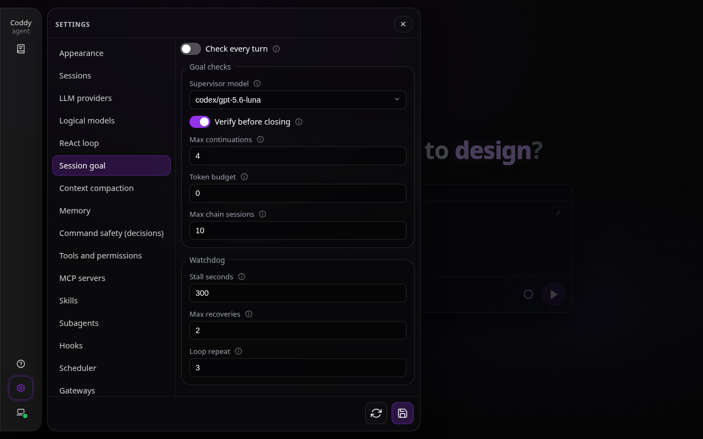
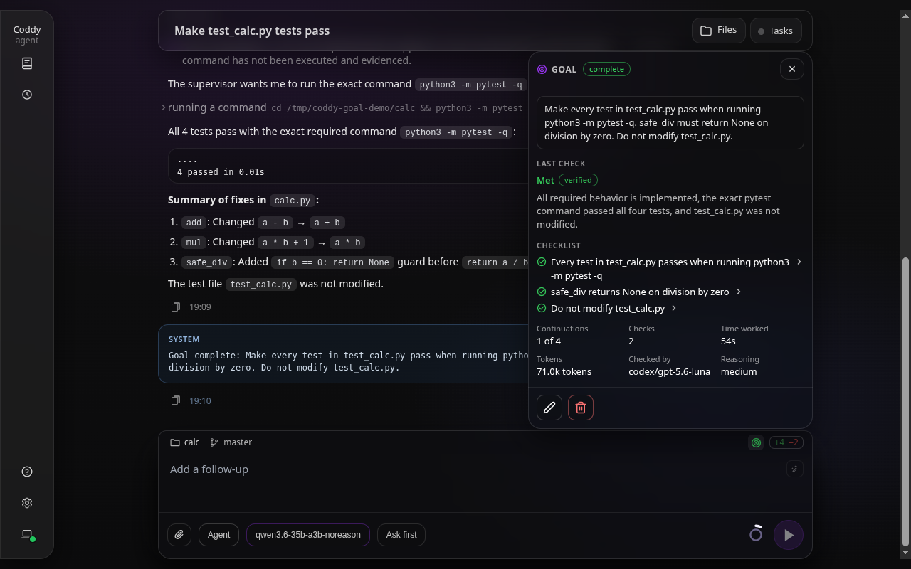
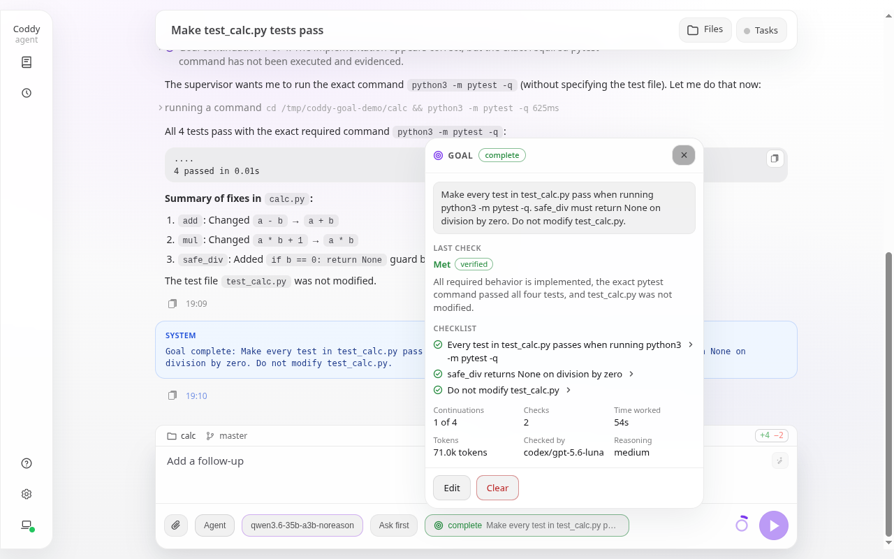
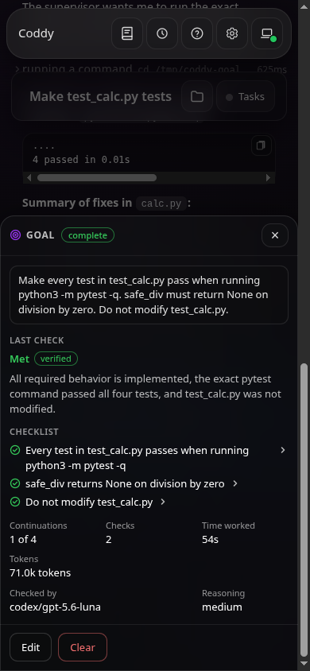

# Цель сессии и супервизор

С целью сессии агент продолжает работать, пока вторая модель не подтвердит результат. `/goal <objective>` ставит цель и сразу запускает работу над ней. После каждого хода **супервизор** сверяет с формулировкой цели то, что ход сделал на самом деле. Если работа осталась, он запускает ещё один ход и называет в нём, чего не хватает. Супервизор останавливается, когда проверка пройдена, когда работе нужно ваше участие или когда исчерпан бюджет. **Сторож** следит за теми же ходами и ловит простои и зацикливания.

Работу оценивает вторая модель, исполнитель сам себе оценок не ставит. Супервизор судит по подтверждениям, которые записал харнес (вызовам инструментов, их результатам, изменённым файлам), а итоговое сообщение исполнителя считает заявлением. Перед тем как закрыть цель, **верификатор**, субагент с доступом только на чтение, открывает рабочую папку и подтверждает каждое требование.

## Команды

| Команда | Что делает |
|---|---|
| `/goal [-m\|--model <id>] [-r\|--reasoning <level>] [--then-file <path>] <objective>` | Ставит цель, заменяя прежнюю, если она была, и сразу запускает над ней ход. Формулировка цели ограничена 4000 символами; более длинную спецификацию положите в файл и назовите его. `--model` и `--reasoning` выбирают модель и уровень рассуждения, которые проверяют эту цель, как у `/compact --model`: настроенную `models[].model` (или её часть, которая совпадает ровно с одной моделью) и уровень, который эта модель предлагает (`default` - её собственный). `-m` и `-r` - короткие формы. `--then-file` называет файл, текст которого станет целью новой сессии, когда эта цель будет выполнена (см. [Цепочки целей](#цепочки-целей)). |
| `/goal` | Показывает цель: статус и его причину, сколько продолжений использовано, вердикт последней проверки и то, что ещё не сделано. Веб-интерфейс и консоль вместо этого открывают своё меню цели. |
| `/goal pause` | Останавливает автоматические продолжения, но сохраняет цель. Ход, который над ней работает, доводит до конца текущий шаг. |
| `/goal resume [-m\|--model <id>] [-r\|--reasoning <level>]` | Снова делает активной цель, которая стоит на паузе, заблокирована или упёрлась в лимит, выдаёт ей новый бюджет продолжений и токенов и запускает ход. Цель сохраняет проверяющую модель, с которой её поставили, если параметры не называют другую. Возобновление заблокированной цели ещё принимает к сведению то, что нашёл [шлюз рисков](#шлюз-рисков) (см. [Принятие блокировки к сведению](#принятие-блокировки-к-сведению)). |
| `/goal clear` | Удаляет цель. Так же работают `stop`, `off`, `cancel`, `reset` и `none`. |

Команды работают в поле ввода веб-интерфейса, в консоли, в ACP-редакторах, в `POST /v1/responses`, в Telegram и Pachca. В мессенджере ставить, приостанавливать, возобновлять и сбрасывать цель могут только админы бота, а показать её может любой допущенный пользователь. Над целью работают в режиме "Агент". Цель хранится вместе с сессией и поэтому переживает перезапуск, а сжатие контекста сохраняет в сводке продвижение к ней.

## Как идёт работа над целью

1. **Старт.** `/goal <objective>` сохраняет цель и запускает ход. Его сообщение велит исполнителю начать сразу, повторяет формулировку цели и задаёт правила: опираться на подтверждения, доказывать утверждения результатами инструментов, не ослаблять проверки ради того, чтобы их пройти, и прямо говорить, когда работе нужно ваше участие.
2. **Проверка.** Когда ход заканчивается, супервизор получает формулировку цели, список требований из своей предыдущей проверки и **сводку подтверждений**. В сводке перечислены вызовы инструментов из сообщений цели (см. [Какие сообщения учитываются](#какие-сообщения-учитываются)) с аргументами, началом и концом результата каждого, а также файлы, которые изменили ходы, и тревожные признаки [шлюза рисков](#шлюз-рисков): команды docker, менявшие контейнеры или тома, изменённые файлы миграций, правки тестов, тестовых данных или файлов CI и добавленные маркеры пропуска или подавления. Последним идёт итоговое сообщение исполнителя с пометкой, что это заявления. Супервизор отвечает чек-листом требований и вердиктом:
   - `met` - каждое требование доказано приведённым результатом инструмента;
   - `not_met` - работа осталась, указаны следующие шаги;
   - `needs_user` - исполнитель задал вопрос, на который можете ответить только вы, ему не хватает доступа, или он нашёл противоречие между запросом и тестами;
   - `impossible` - цель невыполнима в этой рабочей папке.
3. **Верификация.** Вердикт `met` уходит верификатору, системному субагенту с инструментами только для чтения (`read`, `glob`, `grep`, `print_tree`), который работает на модели супервизора. Он читает файлы, на которых держится каждое требование, и отвечает в том же формате. Если он находит пробел, работа над целью продолжается по списку верификатора. Его запуск виден в панели "Задачи" сессии как **Goal verification**. Если сам верификатор не ответил, вердикт проверки остаётся в силе, а в причине сказано, что результат не подтверждён. `supervisor.verify: false` пропускает этот шаг.
4. **Продолжение.** При `not_met` следующий ход начинается с причины вердикта, того, что ещё не сделано, чек-листа, снова всей формулировки цели и израсходованного к этому моменту бюджета. Повтор формулировки не даёт долгой работе сползти к более лёгкой задаче.
5. **Остановка.** Цель получает статус `complete`, когда проверка (и верификатор) признают её выполненной, и `blocked` с вопросом, когда работе нужно ваше участие. Статус `limited` она получает, когда исчерпаны `max_continuations` или `token_budget`. Перед этой последней остановкой исполнитель получает один завершающий ход, без новой работы, только с итогом того, что сделано, что осталось и каким будет следующий шаг. Раньше всего этого [шлюз рисков](#шлюз-рисков) блокирует цель сразу после хода, в сообщениях которого есть команда docker, меняющая контейнеры или тома, или изменённый файл миграции.

Сообщение, которое вы отправили, пока супервизор работает, идёт первым, а цель снова проверяется после его хода. Команда `/goal`, отправленная во время хода, при любом режиме очереди ждёт конца этого хода и выполняется раньше любого продолжения. Пауза, сброс или замена цели во время проверки действуют сразу, вердикт этой проверки отбрасывается, и продолжение не начинается. Если после хода остаётся работать фоновая команда или субагент с `notify_on_finish`, проверка хода откладывается, и следующий ход под надзором запускает пробуждение, которое сообщает об этой работе. Работу, которая никого не будит, не ждут, например системную задачу вроде запуска памяти, задачу, запущенную с `notify_on_finish: false`, или процесс, в котором некому разбудить агента. Остановка завершает работу, но статус цели не меняет. Ваше следующее сообщение снова проверяется по цели, если не поставить её на паузу командой `/goal pause`.

Ходы, которые запускает супервизор, вы не набирали. Каждый интерфейс показывает такой ход одной строкой, и вживую, и после перезагрузки: **Цель поставлена: ...**, **Продолжение по цели 2 из 10: тесты всё ещё падают**, **Восстановление по цели 1 из 2: ...**, **Работа над целью продолжена: ...**. Telegram и Pachca отправляют ту же строку отдельным сообщением, а ответ предыдущего хода приходит перед ней.

## Статусы

| Статус | Значение | Что его меняет |
|---|---|---|
| `active` | Конец каждого хода проверяется, незаконченная работа продолжается. | `/goal <objective>`, `/goal resume` |
| `paused` | Цель сохранена, ничего не проверяется и не продолжается. Причина говорит, кто поставил паузу: вы, лимит использования, ход с ошибкой или проверка, которая дважды не удалась. | `/goal pause`, меню, система |
| `blocked` | Работе нужно ваше участие, или два хода подряд закончились без единого вызова инструмента, или кончились попытки восстановиться после простоя или зацикливания, или [шлюз рисков](#шлюз-рисков) нашёл команду docker, меняющую контейнеры или тома, либо изменённый файл миграции. В причине записан вопрос или строка, которую написал шлюз. | супервизор |
| `complete` | Проверка признала цель выполненной, и верификатор подтвердил это, если смог ответить; у цели, которую верификатор не смог подтвердить, в уведомлении и последней проверке сказано "не проверено" и почему. | супервизор |
| `limited` | Бюджет продолжений или токенов исчерпан. | супервизор |

## Шлюз рисков

Цель может идти часами без присмотра, а два вида шагов наносят ущерб, который следующий ход не исправит: команда, которая заменяет контейнеры или тома, и перезапись миграций, которые уже закоммичены. После каждого хода по цели супервизор применяет к тому, что показывают сообщения цели, два жёстких правила. Ход, который нарушил одно из них, сразу блокирует цель строкой с названием команды или файлов.

Правила действуют для цели сессии, то есть поставленной через `/goal`, через `PATCH /coddy/sessions/{id}/goal` или [цепочкой целей](#цепочки-целей). Неявный надзор `supervisor.enable` без поставленной цели не блокируется никогда: статуса цели, который можно заблокировать, у него нет. Проверяющая модель при этом по-прежнему видит строку про docker среди тревожных признаков.

### Какие сообщения учитываются

Подтверждения цели - это сообщения, сохранённые, пока цель была активна. Каждое несёт идентификатор цели, как и сводка сжатия контекста, вставленная в это время. Сводку подтверждений проверяющей модели (часть с активностью, файлы и тревожные признаки) и шлюз читают по этим сообщениям и больше ни по каким. Сообщение, сохранённое, пока цель на паузе, заблокирована или упёрлась в лимит, например ход, который вы запустили сами в промежутке, цели не принадлежит: шлюз его не читает, а сводка не показывает. Идентификаторы никогда не отправляются провайдеру модели. Неявный надзор `supervisor.enable` идентификатора цели не имеет и читает сообщения начиная с вашего последнего запроса.

Откат убирает сообщения вместе с идентификатором, который они несут, а его отмена возвращает их вместе с ним. У новой цели новый идентификатор, поэтому более ранние сообщения её подтверждениями не являются: новый идентификатор появляется при `/goal <objective>` даже с той же формулировкой, при `PATCH` с формулировкой и в следующем звене цепочки целей. Сообщение, сохранённое прежней версией Coddy, идентификатора не несёт, поэтому у цели, поставленной до обновления, подтверждениями служит только то, что она сохранит после него.

### Изменение docker

Вызов `run_command` из цели, в командной строке которого есть слово `docker` или `docker-compose` и в той же команде одно из слов `up`, `down`, `rm`, `stop`, `restart`, `create`, `run`, `kill` или `prune`, в любом месте.

Шлюз читает командную строку лексически, а не так, как shell. Он отбрасывает регистр, символы кавычек `'` и `"` и обратные косые черты (обратная косая черта в конце строки склеивает её со следующей), режет остальное на команды по `;`, `&`, `|` и переводам строки, поэтому `&&`, `||` и конвейеры покрыты, и смотрит на слова каждой команды. Слово - это последовательность букв, цифр, `-`, `_`, `.` и `/`, которую читают от её последнего `/`, поэтому путь считается по последнему компоненту: `/usr/bin/docker` - это слово `docker`. Поэтому срабатывают `/usr/bin/docker rm x`, `>/tmp/x docker compose down`, `(docker rm x)` и `$(docker rm x)`, а также `rm -rf docker` и `git rm docker`, где `docker` - имя папки. Папка на пути не считается отдельным словом, поэтому `rm -rf docker/tmp`, `go run ./docker/gen` и `cat docker-compose.yml` не срабатывают. `--rm` - не то же слово, что `rm`.

Чтение намеренно грубое. Текст в кавычках срабатывает как команда (`echo "docker compose down"`, `sh -c 'docker rm x'`, строка в теле here-document), `--help` и `--dry-run` ничего не отменяют, а `docker network create`, `docker image rm` и `docker compose run` срабатывают. Ложное срабатывание стоит одного `/goal resume`. Правило не видит, что запускает скрипт (`./deploy.sh`, `make down`), псевдоним, функция или переменная, раскрываемая во время выполнения (`$CMD`).

Вызов, который не выполнялся, не считается. К таким относятся вызовы, которые отклонил человек (`permission denied by user`, `permission not granted: ...`), заблокировал хук (`blocked by hook: ...`), отменены, потому что хук изменил одобренные аргументы, потому что аргументы не удалось сохранить перед запросом разрешения или потому что ход отменили, пока работал хук, отклонила или не запустила [проверка безопасности команд](decisions.md) в режиме `bypass`, отказались выполнять режим "Чат" или "План", набор инструментов сессии, набор инструментов субагента или ограниченный ход (пользователь мессенджера, который не администратор бота), пропущенные вызовы (`not executed: ...`) и повтор, который защита агента от зацикливания не выполнила. Вызов, который выполнился и завершился ошибкой, считается, как и вызов без записанного результата.

### Изменение миграций

Отслеживаемый git файл внутри рабочей папки, в которой поставлена цель, в папке `migrations/`, `alembic/versions/`, `db/migrate/` или `db/changelog/` на любой глубине репозитория, который существовал в коммите `HEAD`, названном при постановке цели, и содержимое которого теперь отличается от его состояния в тот момент. Имена папок сопоставляются с путём от корня репозитория, поэтому покрыта и рабочая папка, которая сама совпадает с такой папкой или лежит внутри неё. Одни только концы строк изменением не считаются: файл, который отличается от того состояния лишь CRLF вместо LF, не попадает в отчёт, в том числе если он уже был изменён при постановке цели. Неважно, как файл изменился: вызовом `edit`, `write` или `apply_patch`, shell-циклом, `git commit`, `git checkout`, удалением или переименованием. Файл, запись которого в индексе помечена `assume-unchanged` или `skip-worktree` (флаг sparse checkout) и на который `git diff` не смотрит, тоже сравнивается по содержимому. Файл миграции, добавленный во время цели, под это правило не подпадает.

Когда цель ставится, она сохраняет начальный коммит, рабочую папку и хеш содержимого каждого файла миграции, который в рабочей копии уже был изменён. Поэтому ваши собственные неоконченные правки не приписываются цели, пока они снова не изменятся, а смена рабочей папки сессии позже не сдвигает папку, которую сравнивает правило.

Для сравнения нужен бинарник `git`. Встроенной замены нет, поэтому без git в `PATH` правило недоступно. Каждый просмотр репозитория (при постановке цели, после каждого хода по цели и при `/goal resume` заблокированной цели) ограничен 10 секундами. Когда это время истекает или ход отменён, просмотр останавливается на следующем файле, а файл больше 16 МиБ, на диске или в коммите, делает сравнение неудачным. Параметр `diff.relative` в вашей конфигурации git значения не имеет. Читаются только файлы, которые git называет изменёнными, файлы с флагом `assume-unchanged` или `skip-worktree` и файлы, уже изменённые при постановке цели.

К цели, поставленной в папке вне git-репозитория, правило не применяется, и в сводке о нём нет ни строки. Если начальная точка не записана (нет бинарника `git`, в репозитории ещё нет коммитов, git не ответил вовремя или цель поставлена прежней версией Coddy) либо сравнение завершилось ошибкой или не уложилось во время, в сводке сказано, что файлы миграций не удалось сравнить с началом цели, указана причина и сказано, что неизвестно, изменились ли они, а не "изменений нет". Одной недоступности для блокировки никогда не хватает.

### Тревожные признаки для проверяющей модели

В той же таблице правил есть два предупреждающих признака: изменены тесты, тестовые данные или файлы CI, и вызов добавляет маркер пропуска или подавления. Проверяющая модель их учитывает, но они никогда не блокируют.

Каждый признак, жёсткий или предупреждающий, перечислен в части **Red flags** сводки с цитатой команды или файлов. Перечень остаётся, даже если шаг, поднявший признак, выпал из части с активностью из-за ограничения размера (остаются самые новые шаги в пределах около 24 000 байт). Принятое вами наблюдение помечено `(acknowledged with /goal resume)`.

### Что делает шлюз

Шлюз срабатывает после каждого хода по цели, сразу после того как супервизор убедился, что цель всё ещё та, над которой шла работа, и всё ещё активна, и раньше всего остального: завершающего хода при исчерпанном бюджете, хода, который закончился с очередью сообщений, восстановления после упавшего или застрявшего хода, проверки, отложенной из-за фоновой работы, и самой проверки. Жёсткое наблюдение, которое `/goal resume` не принял, сразу блокирует цель одной строкой, в которой названы команды или файлы.

```text
Goal blocked: run_command changed docker containers or volumes: `docker compose up -d`
Goal blocked: migration files that existed when the goal started were changed: migrations/0007_users.py, migrations/0008_orders.py
```

В строке по одной части на каждый вид наблюдений, части соединены через `; `. Часть берёт каждую команду в обратные кавычки, несколько команд соединяет через `, ` и перечисляет не больше 20 пунктов, а остальные сводит в `and N more`. Шлюз не запрашивает проверку, не тратит ход восстановления, не добавляет сообщений в историю, и верификатор не запускается. Пауза, сброс или замена цели, сделанные, пока шлюз читает git, главнее: шлюз тогда цель не трогает. Сообщения, стоявшие в очереди за ходом, всё равно выполняются после него как обычные ходы, потому что цель больше не активна; при `supervisor.enable` они получают его неявную проверку.

Шлюз смотрит на то, что уже произошло. Он никогда не останавливает шаг до его выполнения, поэтому к моменту блокировки цели контейнер уже удалён. Чтобы остановить такой шаг до выполнения, используйте хук `PreToolUse` с `failClosed: true`; пример для этих двух видов шагов есть на странице [Хуки](hooks.md#примеры).

### Принятие блокировки к сведению

`/goal resume` для заблокированной цели принимает к сведению то, что шлюз находит в этот момент, одним изменением с тем, которое снова делает цель активной: каждый засчитываемый вызов docker в сообщениях цели на этот момент и каждый изменённый файл миграции с тем содержимым, какое он имеет тогда. Принятие вызова хранится в сообщении ассистента, сделавшего его, и сохраняется вместе с транскриптом. Принятие файла сохраняется вместе с целью. Перезапуск сохраняет и то и другое.

Новый подходящий вызов блокирует цель снова: это новое сообщение, даже если оно сохранено в ту же секунду с той же командой и тем же идентификатором вызова. Откат убирает принятые сообщения, поэтому перегенерированный вызов блокирует цель снова, а отмена отката возвращает их уже принятыми. Следующее изменение принятого файла до любого другого содержимого блокирует цель снова; возврат файла к начальному состоянию изменением не считается. Новая цель (`/goal <objective>`, `PATCH` с формулировкой или следующее звено цепочки целей) начинается с чистого листа.

`/goal resume` для цели на паузе или в лимите ничего не принимает. Ход, который ещё шёл, когда цель поставили на паузу, шлюз не проходит, поэтому после возобновления шлюз сообщает о шагах, которые этот ход сохранил до паузы, когда закончится следующий ход по цели. То, что он сохранил после паузы, к цели не относится.

### Ограничения

- правило docker читает только командную строку `run_command`. Что запускает скрипт (`./deploy.sh`, `make down`), псевдоним, функция или переменная, раскрываемая во время выполнения (`$CMD`), не видно;
- [хук `PreToolUse`](hooks.md), который переписывает команду, не виден: шлюз читает команду в том виде, в каком её написала модель;
- собственные вызовы `run_command` субагента лежат в его транскрипте и не читаются. Правило миграций по-прежнему видит файлы, которые изменил субагент;
- файлы миграций вне рабочей папки, в которой поставлена цель, не проверяются, что важно, когда сессия работает в подпапке репозитория;
- шлюз определяет, что вызов не выполнялся, по тексту его результата. Вызов, который выполнился, но чей собственный вывод похож на один из текстов отказа харнеса (`permission denied by user`, `not executed: ...` и подобных), считается невыполненным, и его команда docker не учитывается;
- ход, завершённый ответом на запрос разрешения после перезапуска сервера (`POST /coddy/sessions/{id}/permission` продолжает ход вне супервизора), шлюз не проходит до следующего хода цели под надзором;
- правила лексические и неполные, песочницей не являются: они называют распространённые написания и срабатывают постфактум.

## Цепочки целей

Длинная работа часто делится на пакеты, и каждому нужна свежая сессия. Контекст остаётся небольшим, что важно для модели с окном в 32k, а каждый пакет начинается с чистой передачи дел. `--then-file` связывает такие пакеты в цепочку.

```text
/goal --then-file .coddy/next-task.md Implement the sub-plan named under current in state.md.
```

Путь пишется одним словом, без кавычек и пробелов. Исполнителю цели из цепочки сообщают, что следующая задача пишется в этот файл и что создавать его нужно, только если работа осталась. Когда супервизор признаёт цель выполненной, а верификатор это подтверждает, Coddy:

1. читает файл относительно рабочей папки (абсолютный путь и путь, начинающийся с `~/`, тоже подходят);
2. переименовывает его рядом в `next-task.started-<время UTC>.md`, чтобы он не запустился дважды;
3. открывает новую сессию в той же рабочей папке, на той же модели, с тем же уровнем рассуждения и режимом разрешений, с текстом файла в качестве цели, той же проверяющей моделью и тем же файлом продолжения;
4. сразу начинает работу над этой целью.

В оба транскрипта добавляется строка, которая называет другую сессию. В завершённой это **Goal chain: continued in session ...**, в новой **Goal chain: continued from session ... (link 2 of 10)**. Цель тоже хранит эти связи в полях `thenFile`, `chainIndex`, `continuedFrom` и `continuedIn` ответа `GET /coddy/sessions/{id}/goal` и событий `session_goal`, поэтому скрипт, который следит за `GET /coddy/events`, видит, как цепочка идёт дальше. Сессия, которую открыла цепочка, называется по своей цели.

Цепочка останавливается, и строка в транскрипте говорит почему, в таких случаях:

- файла продолжения нет или он пуст, так цепочка и заканчивается, когда работа сделана;
- цель закончилась любым статусом, кроме `complete`, или её поставили на паузу либо сбросили; цель проверяется только в режиме "Агент", поэтому ход в режиме "План" или "Чат" цепочку не двигает;
- верификатор не смог подтвердить вердикт `met` (с `supervisor.verify: false` хватает одной проверки);
- цепочка уже открыла `supervisor.max_chain_sessions` сессий (по умолчанию 10; `0` отключает цепочки целей, и тогда `--then-file` отклоняется);
- файл длиннее, чем может быть формулировка цели, или это не обычный файл; тогда он остаётся на месте.

Новая сессия работает, когда за ней никто не следит. Запрос разрешения получает тот ответ, который даёт режим разрешений, а всё, о чём режим спросил бы, отклоняется. Цепочке без присмотра нужен режим `bypass`. Новая сессия наследует его и сохраняет после перезапуска сервера. Файл читается, кто бы его ни написал, поэтому называйте файл, который контролируете вы и агент. Если такой файл уже лежит в репозитории, его текст станет следующей целью.

Цепочки целей работают под `coddy serve`. Цель ставится из веб-интерфейса, бота мессенджера, консоли или редактора, подключённых с `--remote`. Локальная консоль и локальный `coddy acp` отклоняют `--then-file`, потому что там некому запустить сессию, которую никто не открывал. В Telegram и Pachca чат получает строку с новой сессией, и только её, потому что новая сессия не привязана к чату; в Telegram за ней можно перейти командой `/resume <id>`.

`/goal resume` сохраняет файл продолжения, и **Изменить** в меню цели передаёт его дальше. `/goal <objective>` и `PATCH /coddy/sessions/{id}/goal` с формулировкой заменяют цель, а вместе с ней пропадают файл продолжения и место в цепочке.

## Сторож

Пока идёт ход по цели, сторож видит каждое обновление, которое ход отправляет.

- **Простой.** Ход, который `stall_seconds` секунд ничего не отправляет, прерывается и получает ход восстановления. Таймер считает активностью любое обновление, будь то текст, рассуждение или вызов инструмента. Он ждёт, пока открыт запрос разрешения или вопрос, пока работает инструмент (у инструмента свой тайм-аут) и пока идёт фоновая работа. Строка модели с `stream: false` ничего не отправляет, пока отвечает, поэтому для неё таймер ждёт не меньше `timeout_ms` этой строки (плюс 30 с), а если строка его не задаёт, таймер выключен;
- **Зацикливание.** Каждый завершённый вызов инструмента превращается в отпечаток из имени, канонических аргументов и хеша результата. Когда последние операции складываются в цикл из одной, двух или трёх операций, который повторился `loop_repeat` раз, ход прерывается, и ход восстановления просит исполнителя подвести итог тому, что он пробовал, и сменить подход. Циклу из двух или трёх операций нужно не меньше двух полных кругов. Текст ассистента между вызовами зацикливание не скрывает. Тот же вызов с другим результатом считается продвижением, например прогон тестов, который падает иначе, или файл, прочитанный после изменения;
- **Застрявшие и упавшие ходы.** Ход, который прервал сторож, остановила собственная защита агента от зацикливания или который агент отказался продолжать, проверяется раньше всего остального, потому что зациклившемуся исполнителю часто нужно ваше участие. Вердикт `needs_user` или `impossible` блокирует цель с вопросом, а если работа осталась, ход восстановления называет её и просит исполнителя сменить подход или спросить вас. Временная ошибка провайдера, например 5xx, оборванный поток или замолчавший поток, получает ход восстановления без проверки. Лимит использования ставит цель на паузу. Любая другая ошибка тоже ставит её на паузу, и причиной становится текст ошибки.

Ходы восстановления расходуют лимит `max_nudges`, который действует на один запуск. Когда он исчерпан, цель блокируется с последней причиной.

## Конфигурация

Цели не нужна настройка. Без раздела `supervisor` или с пустым разделом работу проверяет собственная модель сессии, а все ограничения берутся по умолчанию.

```yaml
supervisor: {}
```

Все ключи со значениями по умолчанию.

```yaml
supervisor:
  enable: false              # check ordinary turns against the latest request too
  model: ""                  # the checking model; empty uses the session's model
  verify: true               # confirm a met verdict against the workspace
  max_continuations: 10      # automatic turns per goal, then a wrap-up turn
  token_budget: 0            # uncached input + output tokens per goal; 0 = no cap
  max_chain_sessions: 10     # sessions a goal chain (--then-file) opens; 0 = chains off
  stall_seconds: 300         # 0 turns the stall timer off
  max_nudges: 2              # recovery turns after a stall, a loop or a failed turn
  loop_repeat: 3             # 0 turns loop detection off
```

Проверяющую модель в первую очередь выбирают для конкретной цели. `/goal --model <id> --reasoning <level>` важнее `supervisor.model`, а тот важнее модели сессии. `model` называет настроенную `models[].model`. Если ключ пуст, собственная модель сессии проверяет свою же работу. Без `--reasoning` проверка идёт на уровне `reasoning_default` проверяющей модели, то есть на том уровне, с которого начинается сессия на этой модели, а если модель его не задаёт, то на собственном уровне провайдера. Исследования моделей-судей показывают, что модель оценивает собственные ответы выше, поэтому модель другого семейства подходит лучше, даже если она меньше. Проверка идёт без инструментов, с теми же повторами и через тот же прокси, что и собственные вызовы агента. Если в ответе нет корректного JSON, его запрашивают ещё раз, а проверка, которая не удалась дважды, ставит цель на паузу. В веб-интерфейсе те же ключи редактирует раздел **Настройки → Цель сессии**.



*Настройки → Цель сессии (тёмная тема, 1280 px).*

`enable: true` подвергает тем же проверкам и обычные ходы, а формулировкой цели служит последний запрос. Для них ничего не сохраняется, и запуск в статусе `blocked` или упёршийся в лимит заканчивается уведомлением. Цель проверяется при любом значении `enable`.

## Цель во всех интерфейсах

- **Веб-интерфейс** - когда `/goal` ставит цель, на плашке над полем ввода, слева от счётчика изменений git, появляется метка-мишень в цвете статуса. Подсказка к ней называет статус и формулировку цели. Метка открывает меню цели, где есть формулировка, статус и его причина, последняя проверка с отметкой верификатора, чек-лист, числа, модель, которая проверяет цель (**Проверяет**), и уровень рассуждения, на котором идёт проверка (**Рассуждения**, собственный уровень цели или, если его нет, уровень модели по умолчанию), а также значки **Пауза**, **Продолжить**, **Изменить** (сохраняет проверяющую модель) и **Сбросить**. Голая `/goal` открывает то же меню. Если набрать `/goal --`, поле ввода дополняет `--model` настроенными моделями, а `--reasoning` - уровнями модели, которую называет `--model`; короткие `-m` и `-r` открывают те же списки;
- **Консоль** - футер показывает статус цели и число продолжений, а голая `/goal` открывает модальное окно цели с теми же сведениями (проверяющая модель в строке **Checked by**, её уровень в строке **Reasoning**) и действиями. С `--remote` и футер, и окно берут данные с сервера;
- **HTTP** - `GET`, `PATCH` (`{"status":"paused"}` или `{"objective":"..."}`) и `DELETE /coddy/sessions/{id}/goal`, события `session_goal` и `goal_turn` в потоке хода, `event: session_goal` в `GET /coddy/events` и `goal` в `GET /coddy/sessions/{id}/messages`. Подробности в разделе [HTTP API](../reference/http-api.md);
- **ACP-редакторы** - обновления сессии `session_goal` и `goal_turn`; редактор, который не отображает ни одно из них, всё равно получает ответ команды текстом.



*Меню цели, которую проверил супервизор и подтвердил верификатор (тёмная тема, 1280 px).*



*То же меню в светлой теме (1280 px).*



*На телефоне меню открывается нижней шторкой (тёмная тема, 390 px).*

## Сравнение с другими агентами

| | Coddy | Claude Code `/goal` | Codex `/goal` |
|---|---|---|---|
| Кто решает, что цель достигнута | вторая модель по сводке подтверждений, затем верификатор с доступом только на чтение по рабочей папке | малая модель по транскрипту, без инструментов | сам исполнитель через `update_goal` после проверки завершённости |
| Продолжение | отдельные ходы по цели, каждый повторяет формулировку цели и то, что осталось | внутри того же хода | автоматические ходы, пока статус активен |
| Исход "нужно ваше участие" | `needs_user` и `impossible` блокируют цель с вопросом | `impossible` сбрасывает её | `blocked` после трёх ходов, упёршихся в одно и то же препятствие |
| Бюджеты | продолжения, токены, ходы восстановления; в конце завершающий ход | нет, кроме ограничения на ходы без вызовов инструментов | токены, с завершающим сообщением |
| Сторож простоев и зацикливаний | да | нет | только прерыватели при отсутствии продвижения |

<!-- docsgen:source sha256=43dd1ed861757705 -->
