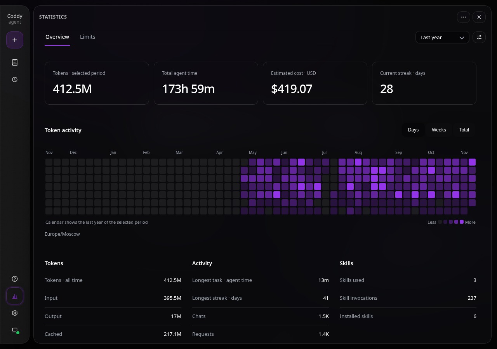
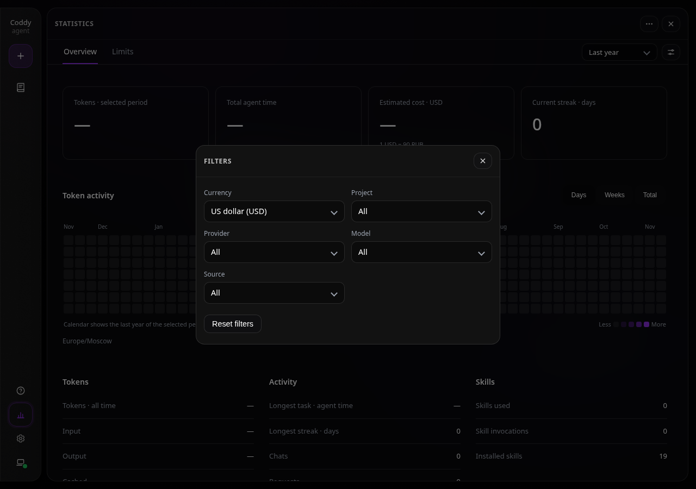
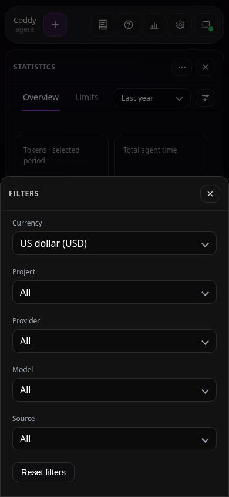
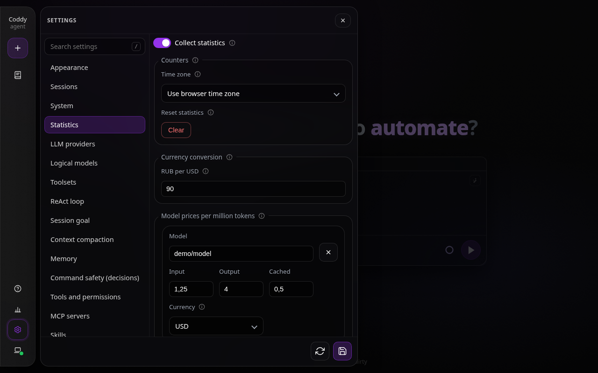
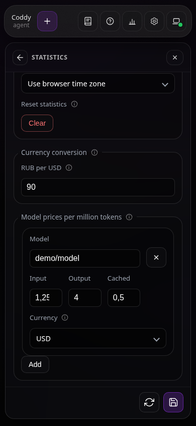
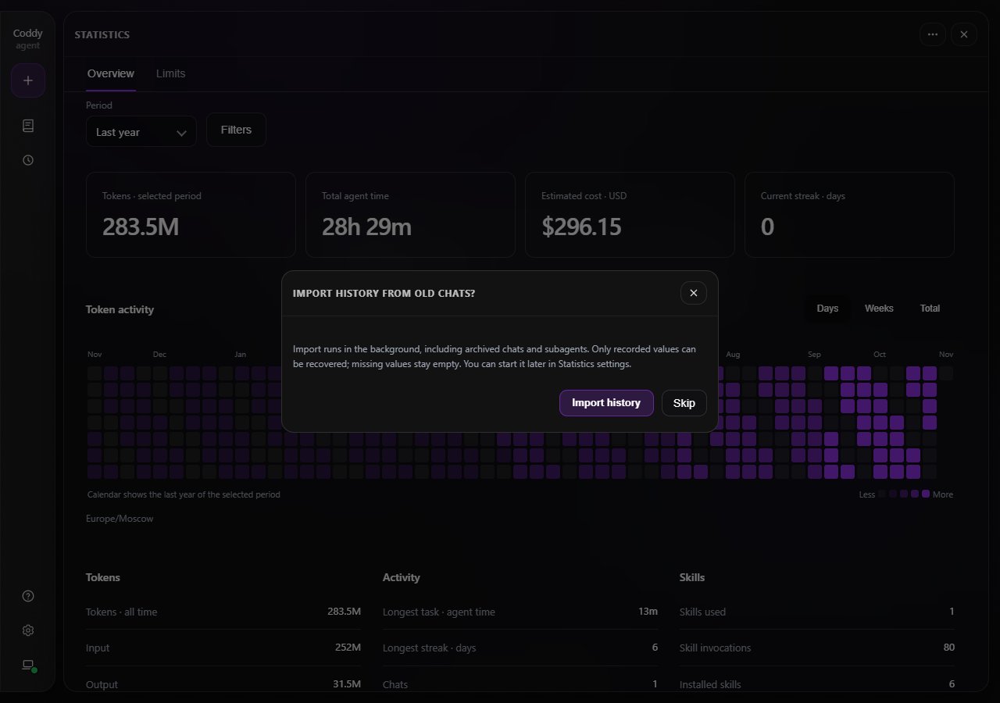
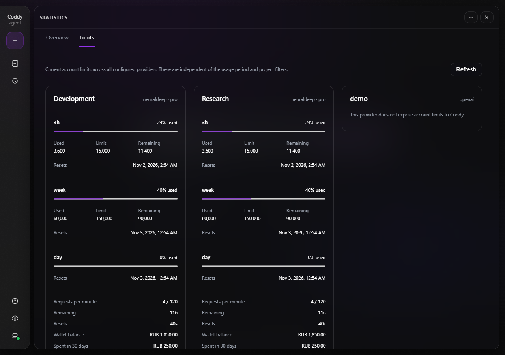
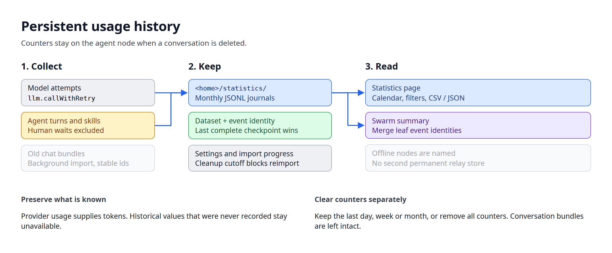

# Статистика

Откройте **Статистику** в боковой панели, между документацией и настройками. Кнопка **+** создаёт чат. У страницы статистики есть свой адрес, `#/statistics`. Закройте её или нажмите Escape, чтобы вернуться к предыдущему экрану.

*Календарь активности и счётчики расхода на странице статистики.*

*Панель фильтров переключает валюту отображения оценки.*

*На телефоне фильтры открываются в нижней панели.*

## Учёт расхода

Coddy записывает вызовы моделей во время работы агента через консоль, ACP-канал редактора, HTTP API, веб-интерфейс, мессенджеры, субагентов, память и планировщик. Каждый интерфейс называет себя сам, поэтому фильтр источников их различает. Ходы, записанные прежней сборкой, когда консоль и ACP себя ещё не называли, остаются вместе под источником **Консоль и ACP**; новые туда не добавляются. Прямые обращения к моделям через HTTP API тоже учитываются. Провайдер сообщает число входящих, исходящих и входящих токенов из кеша. Токены из кеша уже входят во входящие, а токены рассуждений - в исходящие. Coddy не прибавляет их повторно. Если провайдер не сообщает расход, значение останется недоступным.

Страница показывает расход токенов, самый активный день, чаты, ручные запросы, вызовы моделей, режимы рассуждений, установленные и использованные навыки, вызовы навыков, длительность задач и серии активных дней. Задача - один запуск агента. Её длительность не включает ожидание ответов на вопросы, разрешений и явное ожидание сброса квоты. Общее время работы агента складывается из записанных длительностей, включая параллельную работу субагентов. Эта сумма не равна времени, прошедшему от начала до конца работы. Серия учитывает последовательные дни с ручными запросами. Прочерк означает, что значение не записано.

Выберите последние 7 дней, 30 дней, год, всё время или свой диапазон дат. Фильтры проекта, провайдера, модели и источника действуют в выбранном периоде. Откройте **Фильтры**, чтобы выбрать проект, провайдера, модель или источник. Выбранные фильтры остаются видны на странице в виде меток. Панель **Фильтры** также переключает валюту отображения стоимости. Четыре счётчика над календарём показывают токены за период, время активной работы агента, оценку стоимости и текущую серию. Остальные счётчики собраны в списки **Токены**, **Активность** и **Навыки** под календарём. Строка токенов за всё время учитывает сохранённую историю сервера. На календаре показан последний год выбранного периода: по дням, по неделям или нарастающим итогом. Границы дней определяются по часовому поясу браузера, если в разделе **Настройки → Статистика** для сервера не указан часовой пояс IANA, - тогда страница запрашивает его.

## Выключение сбора

Переключатель **Настройки → Статистика → Собирать статистику** останавливает
запись. С выключенным сбором машина не записывает ни ходов, ни вызовов
провайдера, а боковая панель перестаёт предлагать страницу: рисовать было бы
нечего. Уже записанное остаётся на диске, его удаляет сброс ниже. Включённый
обратно сбор продолжает запись с этого момента.

*Ручной курс USD/RUB и свой тариф модели с отдельной валютой.*

*На телефоне три ставки расположены в одной строке, а селектор валюты занимает отдельную строку.*

## Хранение и очистка

Счётчики хранятся в `<home>/statistics/`, отдельно от чатов. Месячные журналы `.jsonl` содержат записи вызовов и контрольные точки ходов. В `settings.json` хранятся идентификатор набора данных, часовой пояс, валюта отображения, курс USD/RUB, тарифы, прогресс импорта и граница очистки. Процессы Coddy с одной домашней папкой записывают данные по очереди. Учитывается последний полный снимок. Перед следующей записью Coddy удаляет незавершённую строку в конце журнала. Промпты, ответы, аргументы инструментов и учётные данные в это хранилище не копируются.

Статистика сохраняется после перезапуска и удаления чата. Coddy хранит её бессрочно. Кнопка **Настройки → Статистика → Сбросить статистику** удаляет все счётчики и начинает счёт заново. Она сначала спрашивает и предупреждает, что чаты останутся на месте, а сброс отменить нельзя. Сохранённая граница очистки исключает эти записи из последующих импортов. Для восстановления удалённых счётчиков нужна резервная копия папки статистики.

## Импорт старых чатов

При первом открытии страница предлагает подтянуть данные старых чатов или пропустить импорт. Позже его можно запустить в разделе **Настройки → Статистика**. Импорт работает в фоне и включает архивные чаты, запуски в режиме print, сессии планировщика и вложенных субагентов. Вы можете продолжать работу в чате. На странице видны значок работы Coddy, число обработанных чатов, общее число чатов и индикатор прогресса. Закрытие страницы не останавливает импорт. Прерванный импорт можно запустить снова. Постоянные идентификаторы записей исключают дублирование.

*Импорт работает на сервере, а браузер показывает его прогресс.*

Импорт восстанавливает ручные запросы с записанной датой и последний сохранённый показатель расхода из каждого старого `stats.json`. Этот файл не хранил расход всего чата. По нему нельзя восстановить общую сумму за всё время или историю всех вызовов по дням. Старые вызовы навыков, расход кеша, режимы рассуждений и длительности без учёта ожидания ответов и разрешений пользователя остаются недоступными, если в истории чата нет этих данных. Новые задачи, для которых уже собрана статистика, в импорт старой истории не входят.

## Оценка стоимости и экспорт

Coddy автоматически оценивает стоимость по ценам models.dev, встроенным в бинарник. При открытии статистики каталог не запрашивается. На вкладке **Обзор** откройте **Фильтры**, чтобы переключить отображение оценки между USD и RUB. По умолчанию суммы показываются в USD. В разделе **Настройки → Статистика** задаётся ручной курс USD/RUB, по умолчанию 90; текущий курс показан под счётчиком стоимости. Для каждого пользовательского тарифа модели можно выбрать USD или RUB. По умолчанию используется USD. Тарифы в RUB пересчитываются в канонический USD для учёта стоимости; сохранённые суммы и экспорт остаются в USD. Раскройте **Свои цены** только для того, чтобы задать другой тариф или цену модели, которой нет в каталоге. Укажите ставки для входных токенов, выходных токенов и кешированного ввода за миллион токенов в валюте, выбранной для модели. Тариф задаётся для идентификатора модели или пары `provider/model`; тариф, указанный для конкретного провайдера, имеет приоритет. Нулевой тариф обозначает бесплатную модель. Оценка по каталогу рассчитывается при чтении счётчиков, поэтому позже её можно пересчитать по своему тарифу. Оценка по своему тарифу, сохранённая вместе с вызовом, остаётся прежней. Число вызовов без известной цены показано рядом с частичной оценкой. Оплата подписок, надбавки за запись кеша и отдельно оплачиваемые инструменты в неё не входят.

В меню **⋯** находятся экспорт и настройки статистики. На телефоне фильтры, настройки статистики из этого меню и предложение выполнить первый импорт открываются в нижних панелях. Кнопка **Экспорт CSV** выгружает счётчики по дням с текущими фильтрами и часовым поясом. Кнопка **Экспорт JSON** выгружает отчёт с учётом выбранных фильтров, сводку за всё время по сохранённой истории и предупреждения. Недоступное значение - пустая ячейка в CSV или `null` в JSON.

## Лимиты провайдеров

На вкладке **Лимиты** перечислены все настроенные провайдеры, включая те, которые ещё не использовались в чатах. Здесь показаны все полученные лимиты по периодам, расход и остаток, время сброса, частота запросов, паузы, баланс кошелька и ограничения моделей. Если провайдер не сообщил показатель, он не отображается. Отдельные сообщения обозначают отсутствие поддерживаемого источника данных о расходе, отключённое получение данных и ошибки запросов. При неудачном обновлении последний снимок остаётся на странице с пометкой об устаревших данных.

Это текущие лимиты аккаунтов. Они не зависят от периода, проекта, модели и источника, выбранных в обзоре. Для аккаунта NeuralDeep здесь показаны лимиты хаба и окна подписки Kimi из поля `kimi`. Пока страница видна, она запрашивает их каждые 30 секунд. Кнопка **Обновить** запрашивает данные через тот же серверный кеш и с теми же ограничениями частоты, что и панель расхода в чате. В режиме swarm лимиты сгруппированы по узлам и провайдерам. Одинаковые имена провайдеров на разных узлах обозначают отдельные аккаунты; их квоты не суммируются. Если узел не отвечает, он остаётся на странице с сообщением об ошибке.

*Лимиты по периодам и доступность данных всех настроенных провайдеров.*

## Сводка swarm

В окружении swarm выберите **Весь swarm** или отдельный узел. Каждый узел сводит свой журнал по тем же фильтрам, поэтому по сети идут счётчики, а не история. Релей объединяет эти сводки по постоянным идентификаторам наборов данных и по объединённым дням считает уникальные чаты, дневные максимумы и серии активности. Если к узлу ведут несколько путей через кольцо, он учитывается один раз. Релей раскладывает все узлы по тому календарю, который запросил, поэтому узел со своим часовым поясом всё равно попадает в дни всего роя. В сводке перечислены отключённые, устаревшие или недоступные узлы, данные которых прочитать не удалось. Их история остаётся на этих узлах. Релей не копирует их историю во второе постоянное хранилище. Для отчётов, полученных напрямую от узлов панель **Фильтры** содержит поле **Валюта**. Агрегированные отчёты `GET /swarm/statistics` остаются в USD, поскольку ответ релея не содержит общих настроек валюты отображения и курса.

Диалог импорта при первом открытии также предлагает подтянуть историю доступных узлов в сводке swarm. Браузер запускает импорт через их маршруты с проверкой доступа и объединяет прогресс. Часовой пояс, тарифы и очистка настраиваются на каждом узле.

*Сбор данных, сохранённая история и сводка swarm используют одни идентификаторы событий.*

## HTTP API

`GET /coddy/statistics` возвращает отчёт по фильтрам, сводку за всё сохранённое время, настройки и число установленных навыков. Параметры запроса - `timezone`, `from`, `to`, `project`, `provider`, `model`, `source` и `cwd`. Даты задаются в формате `YYYY-MM-DD`, обе границы включены. Запрос с параметром `timezone` раскладывается по нему, запрос без него - по часовому поясу, сохранённому на сервере; на этой разнице держится единый календарь узлов на релее.

`GET /coddy/statistics/export?format=csv|json` выгружает отчёт по фильтрам. `PUT /coddy/statistics/settings` принимает `enabled`, `timezone`, валюту отображения `currency` (`USD` или `RUB`, по умолчанию `USD`), положительный курс `usdToRub` (по умолчанию `90`) и карту `prices` с ключами в виде id модели или пары `provider/model`. У каждого тарифа есть ставки `input`, `output`, `cached` за миллион токенов и необязательное поле `currency` (`USD` или `RUB`, по умолчанию `USD`). Тарифы в RUB пересчитываются в канонический USD для учёта стоимости; в выбранную валюту переводится только отображаемая оценка. Поле, которого нет в теле запроса, сохраняет прежнее значение; пустой объект `prices` удаляет все пользовательские тарифы; тариф без поля `cached` считает кешированный ввод по ставке `input`, как это делает каталог. `POST /coddy/statistics/import` принимает `{"action":"start"}` или `{"action":"skip"}` и возвращает прогресс импорта со статусом 202. `DELETE /coddy/statistics?keep=none|day|week|month` очищает счётчики. Для этих маршрутов действуют обычные учётные данные HTTP.

`GET /swarm/statistics` возвращает объединённый отчёт на релее с теми же фильтрами и необязательным идентификатором набора данных `node`. Параметр `raw=1` добавляет события без дубликатов для следующего релея. Недоступные узлы перечислены в `warnings`.

<!-- docsgen:source sha256=2097747564669149 -->
