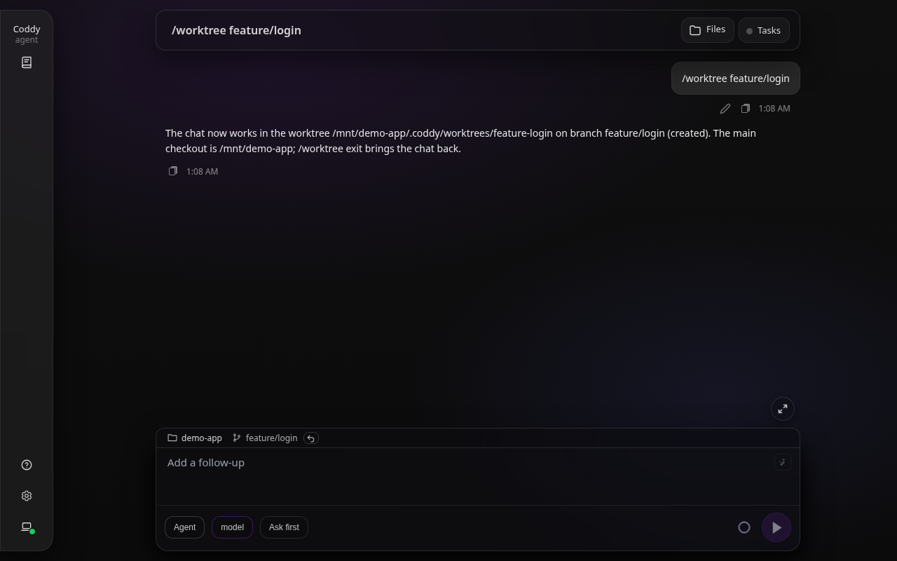
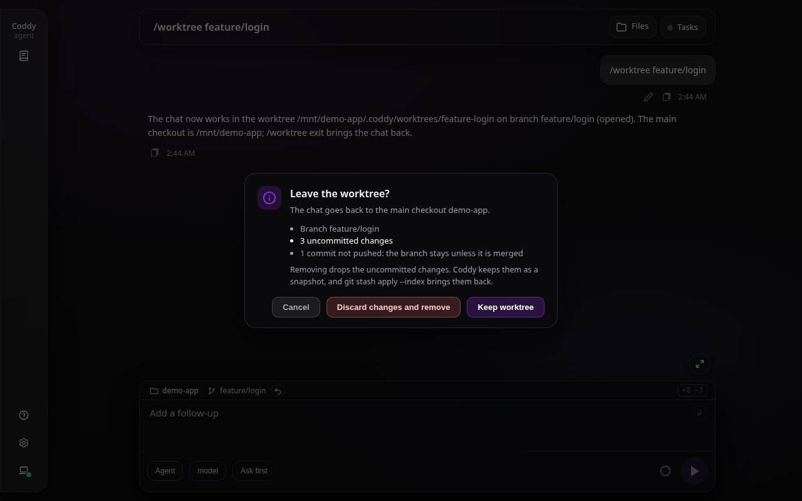

# Git worktree

Coddy может выделить сессии собственную ветку фичи и рабочую копию. Рабочий
каталог сессии переносится в worktree, поэтому её следующий `run_command`,
файловый инструмент, поиск правил и подключение MCP с областью проекта
используют этот каталог без ручного `cd`.

В агентном диалоге попросите Coddy работать в ветке фичи. Инструмент
`worktree_open` принимает `{"branch":"feature/login"}` и переносит сессию в
worktree, где эта ветка уже извлечена, или открывает для неё новый. Он делает
fetch `origin`, читает ветку по умолчанию из `origin/HEAD` и создаёт новую ветку
от свежего коммита `origin/<base>`. Ветка, которая есть только на `origin`,
извлекается из `origin/<branch>` с отслеживанием; ветка, которая уже есть
локально, переиспользуется на своей вершине, а для ветки, уже извлечённой в
каком-то worktree, переиспользуется этот worktree. Инструмент отказывается
работать с самой веткой по умолчанию и с локальной веткой, которая отслеживает
`origin/<base>`.

Новая ветка может начаться и там, где сейчас стоит сессия. С `"base":"head"`
инструмент начинает её с коммита, на котором стоит чекаут сессии, и следующая
ветка ложится поверх текущей работы, даже если сессия сама работает в worktree.
Уже существующая ветка остаётся на своей вершине, что бы ни говорил `base`. В
обоих случаях новый worktree появляется в `.coddy/worktrees/` основного
чекаута и никогда внутри того worktree, из которого его открыли. С
`{"path":"..."}` вместо ветки `worktree_open` заходит в уже существующий
worktree, чья папка указана абсолютным путём или относительно основного
чекаута. Он ничего не создаёт и не делает fetch, поэтому доходит и до worktree
с detached HEAD, и до worktree, который открыл другой инструмент. Сам основной
чекаут - это дело `worktree_exit`.

`worktree_list` показывает все worktree репозитория, начиная с основного
чекаута, и состояние каждого. Это ветка и последний коммит, незакоммиченные и
неотправленные изменения, коммиты впереди и позади ветки по умолчанию на
`origin`, заблокирован ли worktree и не пропала ли его папка, в каком из них
работает сессия и какие другие сессии работают в каждом. Он никуда не переносит
сессию и доступен также в режимах "План" и "Чат". Чтобы подробнее посмотреть на
один worktree, не переходя в него, агент запускает там `git` через
`run_command` с его `cwd`.

Когда работа в worktree закончена, `worktree_exit` возвращает сессию в основной
чекаут, и её следующий вызов инструмента выполняется там. `{"action":"keep"}`,
значение по умолчанию, оставляет worktree и его ветку на потом, и
`worktree_open` с той же веткой возвращается в него. `{"action":"remove"}` по
дороге удаляет worktree. Инструмент отказывается удалять worktree с
незакоммиченными изменениями (если только `discard_changes` не равен `true`), а
при любом `discard_changes` - worktree на коммитах, которых нет ни в локальных,
ни в удалённых ветках, ни в тегах (detached HEAD с собственной работой),
worktree с инициализированными сабмодулями (их собственные коммиты лежат в
git-каталоге worktree), worktree, среди неотслеживаемых папок которого есть
отдельный git-репозиторий (снимок сохранил бы только указатель на его коммит),
заблокированный worktree, worktree, в котором ещё работает другая живая сессия
этого процесса Coddy или фоновая задача любой сессии (чат другого процесса
Coddy в том же worktree не виден), и worktree, который открыл не Coddy (он
лежит вне `.coddy/worktrees/`). Отброшенные изменения не теряются. Перед
удалением worktree Coddy сохраняет их так же, как `git stash`, вместе с
индексом, в `refs/coddy/worktree-snapshots/` и называет ссылку в ответе, а
`git stash apply --index <ref>` на ветке возвращает их в прежнем виде, включая
файлы, добавленные через `--force` в обход `.gitignore`. Игнорируемые
файлы, например результаты сборки, удаляются вместе с worktree. Ветка уходит
вместе с worktree, только если git считает её слитой (`git branch -d`). Ветка с
собственными коммитами остаётся, и ответ об этом говорит. При отказе сессия
остаётся там, где была. Сессия, чья папка worktree пропала, потому что её
удалили вручную или из другого чата, тем же вызовом возвращается в основной
чекаут, а git забывает этот worktree. Как и `worktree_open`, инструмент просит
одобрения в текущем режиме разрешений, работает только в режиме "Агент" и
никогда не предлагается субагенту.

Оператор делает то же самое командой `/worktree` в консоли, веб-интерфейсе и
редакторе с ACP, без хода модели. `/worktree <branch>` переносит чат в worktree
этой ветки и открывает его, если такого нет (`--from-head` начинает новую ветку
с текущего коммита); `/worktree <path>` переносит его в существующий worktree
(путь начинается с `/`, `./`, `../` или `~` и отсчитывается от папки чата);
`/worktree exit` возвращает чат в основной чекаут (`--remove` заодно удаляет
worktree, а `--force` вместе с ним отбрасывает незакоммиченные изменения,
сохранив их снимком); а `/worktree` без аргументов говорит, где работает чат и в
каком состоянии каждый worktree репозитория, как это делает `worktree_list`.
Команда делает те же проверки и отказывает в тех же случаях, что и инструменты,
но как ввод оператора не просит одобрения и работает в любом режиме сессии.
Боты мессенджеров отбрасывают её, как и другие встроенные команды, а в ходе,
который бот ограничивает для того, кто не админ, команда получает отказ.

Для создания нужны remote `origin` и одобрение в текущем режиме разрешений
инструментов; для переиспользования уже существующего worktree не нужны ни
сеть, ни `origin`. При отказе или неудачном fetch сессия остаётся в исходном
каталоге. Другие ошибки, о которых сообщает инструмент, - недопустимое имя
ветки, `origin/HEAD`, который ни во что не разрешается, ветка, извлечённая в
основном чекауте, и путь worktree, который уже существует на диске. Сессии, чей
cwd лежит внутри git-подмодуля, получают пустой `repo_root` и группируются в
Истории под собственной папкой.

Основной чекаут продвигается к полученному коммиту ветки по умолчанию только
безопасной перемоткой вперёд - он уже должен быть предком этого коммита, а
извлечённая ветка по умолчанию должна быть без незакоммиченных изменений.
Грязный или разошедшийся основной чекаут остаётся нетронутым, а новая ветка
фичи всё равно начинается с полученного удалённого коммита. Контекст хода
агента называет путь основного чекаута и ветку по умолчанию. Используйте
`run_command` с `cwd`, когда одну команду нужно выполнить в основном чекауте;
без `cwd` используется worktree сессии.

Coddy хранит worktree в `<main checkout>/.coddy/worktrees/`; например,
`feature/login` превращается в `feature-login`. `.gitignore` в этой
родительской папке скрывает worktree из статуса основного чекаута. Правила
проекта, скилы, хуки и настроенные MCP-серверы перезагружаются для нового cwd,
а проектные объявления MCP проходят проверку доверия к рабочей папке. Сессия
запоминает новый cwd для следующих ходов.

Ветка, которая есть только на remote, отличном от `origin`, открывается так
же - по имени (`fix/typo`; ветка берётся с `origin`, если `origin` её тоже
содержит, иначе с первого по имени remote, где она есть) или по имени удалённой отслеживаемой
ветки (`upstream/fix/typo`), чтобы выбрать remote явно. В обоих случаях
локальная `fix/typo` создаётся на удалённой ветке и отслеживает её; уже
существующая локальная `fix/typo`, которая отслеживает её же, переиспользуется,
а та, что отслеживает что-то другое, отклоняется и молча не открывается. Ответ
инструмента называет локальную ветку.

В веб-интерфейсе выберите ветку фичи флажком **Worktree** на плашке над полем
ввода до первого сообщения. Действуют те же fetch, проверки ветки и размещение
worktree. Перед открытием список веток делает fetch всех remote и показывает
ветки, которые есть только на удалённой стороне, среди локальных, помечая их
облаком, так что ветку, запушенную с другой машины, можно открыть без
терминала; см.
[Рабочая папка сессии](../surfaces/web-ui.md#рабочая-папка-сессии-папка--ветка--worktree). Когда чат запущен, плашка показывает имя основного
проекта и ветку фичи, а подсказка у ветки называет worktree; История
группирует основной чекаут и его worktree под этим проектом. Сессия при этом
работает внутри worktree. Как только диалог начинается, элементы выбора рабочей
папки в веб-интерфейсе уступают место этой плашке, а инструмент агента может
перенести свою сессию прямо во время хода.

У чата, который работает в связанном worktree, путь обратно есть на плашке.
Это стрелка сразу после ветки.

*Стрелка после ветки возвращает чат в основной чекаут.*

Сначала стрелка спрашивает, оставить worktree или удалить его, как это делает
Claude Code при завершении сессии в worktree, и показывает, что затронет
удаление. Это ветка, незакоммиченные изменения, неотправленные коммиты и всё,
что сейчас мешает удалению (другой чат в worktree, идущая фоновая задача,
блокировка, коммиты вне веток, сабмодули, отдельный git-репозиторий внутри,
worktree, который открыл не Coddy).
Ответ по умолчанию - оставить, он отправляет `/worktree exit`. Удаление
отправляет `/worktree exit --remove` или, если есть незакоммиченные изменения,
`/worktree exit --remove --force`. Тогда кнопка говорит, что отбрасывает их, а
диалог - что сохраняет их снимком. При каждом открытии диалог читает
`GET /coddy/sessions/{id}/worktree` и читает его снова, если чат перешёл в
другую папку, пока диалог открыт. Как только этот ход заканчивается, плашка
называет основной чекаут. Плашка перечитывает, где работает чат, после каждого
его хода, поэтому без перезагрузки следует за `worktree_open`, `worktree_exit` и
`/worktree`.

*Удаление worktree с незакоммиченной работой предупреждает, что отбросит её и сохранит снимок.*

*Сессия фичи работает в своём worktree, а плашка и История называют основной проект.*

`GET /coddy/workspace/context` сообщает `repo_root` (основной чекаут) и
`base_branch` (из `origin/HEAD`) вместе с текущими `path` и `branch`.
Строки списка сессий несут `repoRoot` для группировки. Эти интерфейсы описаны
на страницах
[Веб-интерфейс](../surfaces/web-ui.md#рабочая-папка-сессии-папка--ветка--worktree)
и [HTTP API](../reference/http-api.md).

Если управляемый worktree позже удалить командой `git worktree remove`,
сохранённая сессия, которая указывала внутрь `<main>/.coddy/worktrees/`,
откроется на основном чекауте. История сразу группирует её там; исходный
записанный путь worktree сохраняется, пока вы явно не выберете другую рабочую
папку.

<!-- docsgen:source sha256=376571aae55d52cd -->
