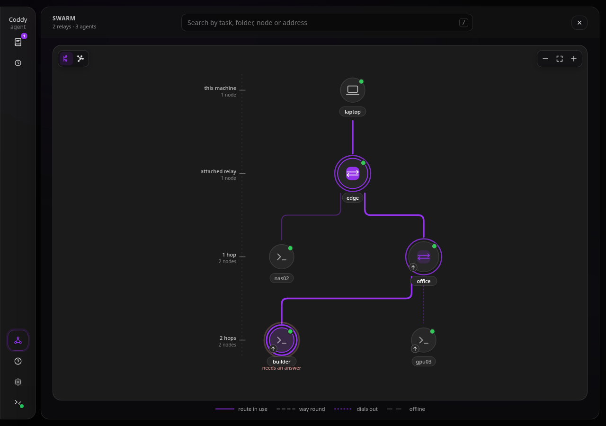
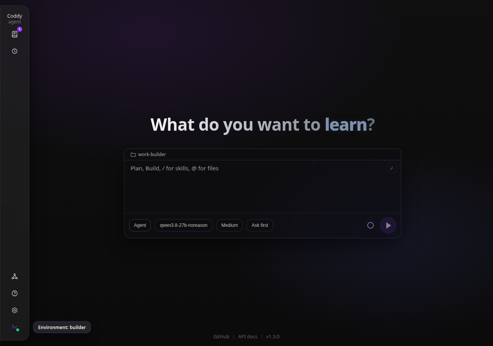
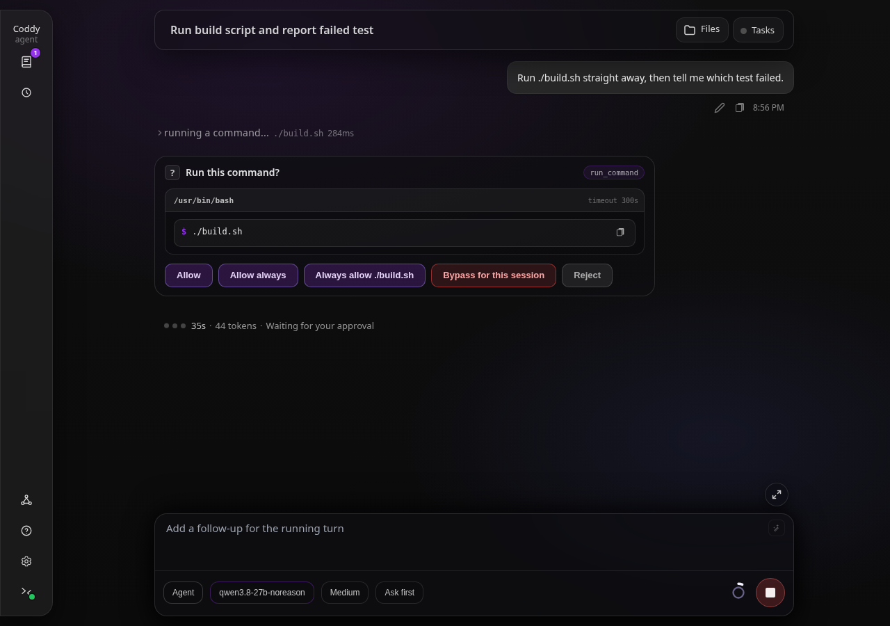
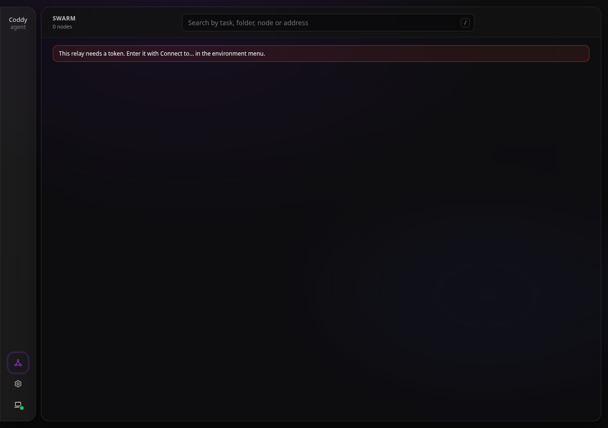
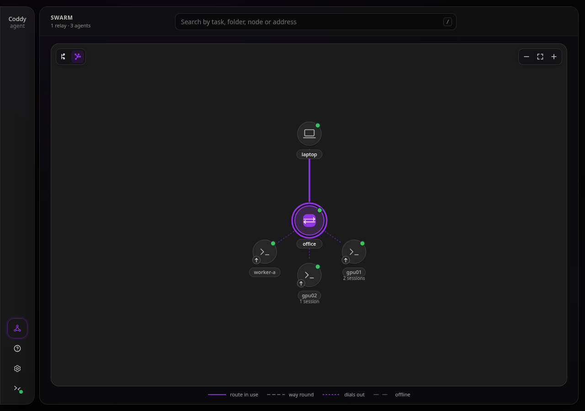
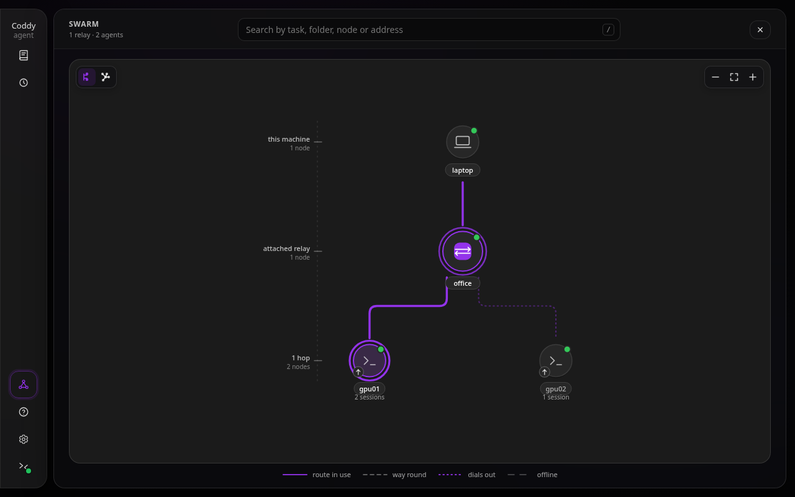
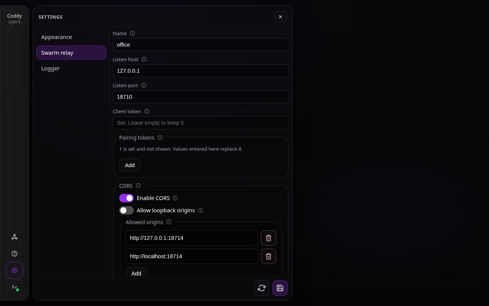

# Рой - релеи, узлы и единый список всего

https://github.com/user-attachments/assets/2a26f40a-97dd-46ef-b554-80e53602ed44

*Трёхминутная запись на версии 1.3.0 - два релея и три узла в консоли, затем релей как удалённое окружение веб-интерфейса ноутбука, холст карты в графовой раскладке, разрешение, отвеченное через два релея, и окна файлов и правок узла за обоими релеями. Файл лежит в репозитории как [swarm.mp4](../../assets/video/swarm.mp4).*

**Рой** - это набор узлов coddy, доступных через один или несколько **релеев**. Релей - точка
встречи без состояния. Узлы регистрируются в нём, он передаёт им запросы и сводит их списки
сессий в один. Сам релей ничего не хранит, поэтому всё, что он сообщает, всегда остаётся живым
отражением того, что ему сообщили узлы.

Релей собирается с `-tags swarm`, а этот тег входит в поставляемый набор (`FULL_TAGS` в **Makefile**),
поэтому релей есть в бинарниках релиза, образе Docker, пакетах Linux и формуле Homebrew. Собрать
его самостоятельно можно командой `make build TAGS="http ui scheduler memory cli gateway swarm"`.

Отдельной команды у релея нет. Его запускает `coddy serve`, когда `swarm.enable` равен true, рядом
со всем остальным, что включено в конфигурации. Бинарник, собранный без этого тега, при запуске
отклоняет `swarm.enable` и называет тег; хук присоединения на стороне агента - заглушка, которая не
запускает горутин и не открывает соединений, а в остальном бинарник ведёт себя ровно так же, как
до появления этой функции.

## Зачем

Запуск `coddy serve` на нескольких машинах уже работает, и `--remote` уже управляет одной из
них. Но так нет одного места, где видно всё, и нет способа попасть на нужную машину, если к ней
нельзя подключиться.

Релей решает обе задачи. Он знает каждый узел, который к нему присоединился, поэтому подключённый
к нему клиент сразу видит все их сессии с пометкой владельца. А присоединиться к нему может и
узел, к которому вообще нет входящего маршрута, потому что такой узел сам открывает соединение.

## Как это устроено

```
    client ──▶ relay "outer" ──┬──▶ relay "middle" ──▶ agent8
                               │                   └──▶ relay3 ──▶ agent7
                               └──▶ relay3 (shortcut) ──────────┘
```

На этой схеме видны три вещи.

С точки зрения родителя релей - такой же узел. `middle` присоединился к `outer` ровно так же,
как `agent8` к `middle`, и больше для цепочки ничего не нужно - ни второго механизма, ни хопа,
который знает глубину цепочки.

До `relay3` можно добраться двумя путями. Это кольцо, и оно допустимо, потому что рой убирает
дубликаты по идентичности и выбирает более короткий маршрут.

`agent7` не открывал ни одного порта. Он сам подключился к `relay3`, и управляют им по этому же
соединению в обратную сторону.

## Запуск

```yaml
# a relay
swarm:
  enable: true
```

```bash
coddy serve --swarm-auth-token "$CLIENT_TOKEN" --swarm-pairing-token "$PAIRING_TOKEN"
```

Релей, который больше ничего не делает, добавляет `--http=false`. Релей, который одновременно
работает обычным агентом, оставляет API включённым и обслуживает и то и другое - свои сессии на
`httpserver.port`, а весь парк узлов на `swarm.port`.

Узел присоединяется к релею, указав его в своей конфигурации.

```yaml
swarm:
  join:
    - url: "https://relay.example"
      name: "nas02"                        # becomes a URL path segment
      pairing_token: "${CODDY_SWARM_PAIRING_TOKEN}"
      advertise_url: "https://nas02:12345" # omit this to dial out instead
      token: "${NODE_OWN_TOKEN}"           # what the relay presents when it proxies
```

`swarm.join` учитывает каждый процесс `coddy serve`, независимо от того, запущен ли в нём свой
релей. На этой симметрии и строятся цепочки релеев.

По возможности задавайте `swarm.join[].token` явно; лучше выделить для родительского релея
отдельные учётные данные, и явное значение всегда приоритетнее. Если у релея этого токена нет, он
берёт свой настроенный `swarm.auth_token`, чтобы родитель мог войти в дочерний релей через его
точку монтирования. У агентов такой замены нет, и агент без токена присоединения регистрируется
без учётных данных узла.

Имена необязательны. Запись присоединения без `name` занимает имя хоста машины, на которой она
работает (точки заменяются дефисами, поскольку имя становится сегментом пути), и релей без `swarm.name` тоже
называется по имени хоста - в `/swarm/info`, на карте и в маршрутах своих сессий. Задайте имя,
если у двух машин одинаковое имя хоста или если имя хоста ни о чём не говорит.

## Два транспорта

**Прямой** - релей сам подключается к `advertise_url` узла. Используйте его, когда релей может
добраться до узла.

**Туннель** - не указывайте `advertise_url`. Узел подключается к релею, релей перехватывает это
соединение и дальше отправляет по нему запросы, а узел на них отвечает.
Только так можно попасть в сеть, которая не принимает входящих соединений, в том числе на телефон
в мобильной сети ([Телефоны Android как узлы роя](../tutorials/swarm-android-nodes.md)).
За туннелем следят оба конца: релей пингует узел после 30 с без кадра и ждёт ответа 15 с, узел
пингует релей после 15 с и ждёт 30 с, а соединение без ответа закрывает любой из них
([Живость](#живость-туннеля-и-вызова-общей-модели)).

Туннель работает на HTTP/2 с prior knowledge поверх соединения, которое началось как обычный
HTTP-запрос, поэтому нет ни самодельного протокола кадров, ни новой зависимости. Всё, что выше
транспорта, работает с обычным HTTP и никогда не узнаёт, какой транспорт используется.

Зато туннелю нужно **сквозное сырое соединение**. Посредник, который заново нарезает запросы на
кадры, - прокси уровня 7 или терминатор только для HTTP/2 перед релеем - не оставляет соединения,
которое можно перехватить, и рукопожатие завершается ошибкой, которая прямо об этом говорит.
Прямого транспорта это не касается.

## Доступ к узлу

Каждый узел смонтирован под релеем.

```
GET https://relay.example/swarm/nodes/nas02/coddy/sessions
```

Поскольку это обычный базовый URL с путём, **нынешний клиент работает без изменений**.

```bash
coddy --remote https://relay.example/swarm/nodes/nas02 --remote-token "$CLIENT_TOKEN"
coddy acp --remote https://relay.example/swarm/nodes/nas02 --remote-token "$CLIENT_TOKEN"
```

Цепочки складываются, если выписать путь целиком.

```
/swarm/nodes/middle/swarm/nodes/relay3/swarm/nodes/agent7/v1/models
```

Каждый хоп отрезает свой префикс и передаёт остальное дальше.

### Что точка монтирования пропускает, а что нет

Она пропускает `/v1/*`, `/coddy/*`, `/openapi*`, `/docs*`, маршруты роя только для чтения и дальнейшие хопы `/swarm/nodes/*` (`/swarm/stats`, собственные счётчики релея, не пропускаются: родитель не читает счётчики дочернего релея).
Это список разрешённых **префиксов**, а не маршрутов, поэтому новые маршруты узла работают с
первого дня.

Она отклоняет `/swarm/register` и `/swarm/tunnel` при любом методе, а также `DELETE /swarm/nodes/{node}`, причём
последний - по методу, поскольку читать список узлов дочернего релея - обычное дело, а выселять
из него узлы - нет. Прокси аутентифицируется на узле от имени вызывающего, поэтому всё, до чего
можно добраться через точку монтирования, релей тем самым разрешает вызывающему, а решать, кто
входит в рой, вызывающему не положено.

Браузер, который работает через релей, получает ответ CORS релея (`swarm.cors`) и больше ничего, а
заголовки `Access-Control-*` из собственного ответа узла остаются за точкой монтирования. У узла,
к которому браузеры обращаются и напрямую, включён `httpserver.cors`, и если пропустить его
заголовки, они оказались бы рядом с заголовками релея, а браузер отклоняет ответ, в котором
разрешённый origin назван дважды. То же правило не даёт политике узла открыть релей, у которого собственный CORS выключен.
Поскольку ответ релея единственный, в нём есть всё, что нужно окну "Файлы" веб-интерфейса с
другого origin: `HEAD` среди методов, `Range` и `If-None-Match` среди заголовков запроса, а
`ETag`, `Content-Range`, `Accept-Ranges` и `Content-Disposition` открыты странице.

Путь, написанный вручную, ограничен тем же бюджетом хопов, что и параллельный опрос узлов,
поэтому клиент не может бесконечно ходить по кольцу, выписывая хопы один за другим.

## Общий список

```
GET /swarm/sessions?q=&node=&limit=&include_activity=
```

Опрашиваются все узлы, параллельно и с ограничением по времени, а ответы сливаются, начиная с самых
новых. У дочернего релея запрашивается его собственный общий список, а не список узлов, поэтому
слияние рекурсивно проходит по цепочке, хотя каждый релей по-прежнему общается только со своими
прямыми потомками.

Каждая строка несёт **и** идентичность, и маршрут:

- `agent_uuid` + `id` - агент, которому принадлежит сессия, и идентификатор, под которым этот агент её знает.
  Эта пара переживает переименование, переключение на резерв и перезапуск релея;
- `node_path` - как этот релей смог добраться до неё только что. В кольце таких путей может быть
  несколько, и сообщается самый короткий. Из двух одинаково коротких побеждает маршрут, у которого
  первый отличающийся хоп раньше по алфавиту, причём сравнение идёт по хопам, а не по склеенному
  пути целиком. Так же маршрут узла выбирает и топология, поэтому строка не меняет маршрут от
  запроса к запросу.

Идентификаторы сессий каждый узел выбирает сам, и они **действительно** совпадают, поэтому
полагаться на голый идентификатор нельзя.

Медленный или пропавший узел становится записью в `warnings` рядом с результатами, а не ошибкой
вместо них, ведь одна недоступная машина не должна обнулять список по всему парку.

**Поиск** охватывает и работу, и машину. Запрос, совпадающий с именем или адресом узла, возвращает
всё, что есть на этом узле; иначе запрос передаётся каждому узлу, и тот сверяет его с заголовком
сессии, первым сообщением пользователя и рабочей папкой.

## Кольца и маршруты

`GET /swarm/topology` возвращает узлы, рёбра между ними и маршрут для каждого узла.

Маршруты получаются обходом в ширину, который посещает узлы по возрастанию числа хопов, поэтому
первый найденный маршрут - один из кратчайших, а уже встреченный узел больше не раскрывается, и по
той же причине обход кольца заканчивается, а не крутится вечно. Равенство разрешается
лексикографически, поэтому двум клиентам, спросившим один и тот же релей, называют один и тот же
маршрут. Маршрут никогда не повторяет хоп, поэтому не может по пути пройти цикл по кругу.

`alternates` - другие рёбра любой длины, которые обход видел входящими **в этот узел**; на них
клиент переключается, когда короткий хоп умирает. Это не маршруты, унаследованные от другого пути
к какому-то предку. После точки слияния дальше переносится только кратчайший путь через неё, поэтому
у узла за ромбом один маршрут, а не два. Перечисление всех k кратчайших путей заполнило бы список
догадками, а список для переключения полезнее, когда он верен и короток.

Для каждого **запроса** релей дописывает свой идентификатор во внутренний заголовок и отклоняет
запрос, в котором он уже есть, поэтому обход не может ходить по кругу вечно. Глубина пути
монтирования, написанного вручную, ограничена так же.

Ветка, которая замыкается обратно на обход, отвечает `looped: true` и ничего не добавляет, но
предупреждения не вызывает. Цепочка, которая просто **слишком длинная**, - другой ответ. Там что-то
есть, но до него не добраться, поэтому здесь предупреждение будет. В кольце это обычный конец ветки, а предупреждение на
каждый запрос в здоровом рое приучает оператора игнорировать предупреждения. Предупреждения
заслуживает узел, который релей ещё знает, но не может достать, в том числе узел с устаревшей
арендой, который иначе молча исчез бы, и тогда "эта машина упала" выглядело бы ровно как "у этой
машины нет работы".

## Интерфейс



*Граф топологии с работающим релеем*



*Узел, которым управляют через релей - его папка и модели в поле ввода, его имя на кнопке окружения*



*Запрос разрешения, переданный через два релея*



*Релей, которому нужен токен, прежде чем он что-либо покажет*

Подключение идёт обычным путём выбора окружения: меню окружения внизу боковой панели, **Подключиться к…**, адрес
релея и его клиентский токен, либо запись `httpserver.remotes`, которая называет релей, с её
`token`, если вы храните его там ([Удалённый режим](remote.md#токен)). Странице, которую отдаёт
другая машина, например `coddy serve` на ноутбуке, нужно ещё, чтобы `swarm.cors` релея пускал её
origin - точным значением в `allowed_origins` или, для страницы на loopback-адресе с любым портом,
который занял `coddy serve` ноутбука, через `allow_loopback: true`. Меню окружения сообщает об этом
в строке релея, когда мешает именно это, а как только релей принимает токен, перечисляет его
агентов, так что до узла и из меню
один щелчок. Поскольку окружение отвечает как релей, на боковой панели появляется пункт **Рой**, а
на обычном агенте его нет вовсе.

Экран "Рой" показывает топологию и поле поиска, запросы которого уходят на релей. Он открывается в
доке той же ширины, что и просмотр документации, и карта заполняет его целиком.

**Выберите раскладку, затем исследуйте холст.** Карта открывается в режиме **Древовидная раскладка** -
виде с корнем и уровнями хопов. **Графовая раскладка** - детерминированный граф с корнем для
изучения колец и перекрёстных связей. Его корень - релей или локальный компьютер, когда карта
показывает машину, с которой началось подключение. Граф идёт сверху вниз по глубине кратчайшего
маршрута - узлы каждого релея расходятся веером по дуге под ним, цепочки релеев свисают глубже, а связи - прямые линии.
Выбор принадлежит только этому браузеру и хранится в ключе localStorage `coddy_swarm_layout`; он
не меняет конфигурацию релея и не влияет на другой браузер. Сохранённое старое значение `star`
переводится в графовую раскладку; если ключа нет, он недоступен или некорректен, по умолчанию
остаётся древовидная.

На карте есть переключатели древовидной и графовой раскладок и кнопки **Уменьшить**,
**Показать граф целиком** и **Увеличить**. Масштаб колёсиком центрируется на указателе;
перетаскивание сдвигает вид по обеим осям, даже когда граф вписан целиком; масштаб меняется
щипком двумя пальцами; перетаскивание и щипок не активируют узел. Когда фокус на холсте, **`+`** или
**`=`** увеличивает, **`-`** уменьшает, а **`0`** вписывает весь граф. В раскладке с верхней
панелью элементы управления холстом - области касания 40px. Вписывание графа сбрасывает камеру,
как и смена релея или раскладки; обычный опрос топологии раз в пять секунд не сбрасывает ручной
сдвиг или масштаб, но удерживает камеру в изменившихся границах графа.



*Графовая раскладка - узлы релея веером под ним и управление камерой поверх холста.*

Используемый маршрут выделен акцентным цветом. Каждый релей на нём обведён, а релей, которым
приложение сейчас управляет, обведён сильнее; альтернативные маршруты остаются заметно
второстепенными. Так транзитный релей читается как часть соединения и не выглядит выбранной целью.

**Домашний экран релея - рой.** Из API агента релей отдаёт только свои настройки
(`/coddy/config*`), без сессий, рабочей папки, модели и документации, поэтому полю ввода некуда
отправлять, а панели истории нечего показывать. Так что, когда приложение направлено на релей, оно убирает экран чата, скрывает "Историю" и
"Планировщик" на боковой панели и вместо них показывает карту. Меню окружения остаётся на своём обычном месте,
внизу боковой панели, поэтому даже когда карта сообщает об ошибке, в том числе что релею нужен
токен, оператор может сменить окружение или ввести нужные учётные данные. Зайдите на узел, и всё это
вернётся, потому что у узла всё это есть.

**Работа на узле.** Щёлкните узел на карте, и приложение переключится на точку монтирования этого
узла, а карта останется открытой поверх, пока вы не решите, что там делать. Дальше узлом управляет каждый
уже существовавший экран: панель истории показывает
сессии этого узла, поле ввода - его рабочую папку и каталог моделей, настройки редактируют
конфигурацию этого узла, и всё это с релеем посередине, о котором никто не знает. Длинный диалог на
узле там тоже читается постранично. Каждое чтение указывает свою страницу в строке запроса, а точка
монтирования передаёт её узлу без изменений, в том числе через туннель
([Длинные сессии](../surfaces/web-ui.md#длинные-сессии)). Просмотр документации - единственный
экран, который остаётся привязан к серверу самой страницы, потому что страницы берутся из локального бинарника.



*Карта, открытая поверх узла - машина, на которой работает страница, наверху, а маршрут до узла, на котором находится приложение, нарисован одним путём*

**Наблюдение с карты.** Каждый узел сообщает, чем занят, по тому же общему списку сессий, что
использует поиск: сколько у него сессий, сколько ходов выполняется и ждёт ли там что-то ответа на
запрос разрешения. Запустите работу на нескольких машинах, вернитесь к карте, и она покажет, какие
из них закончили, а какая задаёт вам вопрос. Щёлкните ту, что спрашивает, и приложение переключится
на неё, не закрывая карту; её "История" покажет сессию, которая вас ждёт.

**Возврат и переключение.** Пункт "Рой" остаётся на боковой панели, пока вы внутри узла,
потому что релей, через который вы пришли, запоминается. Он открывает карту релея поверх узла, не
покидая его. Карта читается прямо с релея с тем же клиентским токеном, а "История",
"Планировщик" и чат узла остаются на месте, поэтому ничего не перезагружается. На этой карте узел, на котором вы
находитесь, отмечен обводкой, как карточка релея, когда вы на релее, а маршрут до него нарисован
одним связным путём; до другого узла один
щелчок, а щелчок по узлу, на котором вы находитесь, ничего не делает. Переключение между узлами или между
узлом и его релеем не перезагружает страницу. Над релеем карта рисует
машину, на которой работает страница, с её именем хоста, как точку, откуда начинается подключение, и щелчок по ней
возвращает на "Локальное". Щелчок по релею подключает к самому релею, а релей, подключённый в цепочку
под ним, открывается на своей карте, доступной через эту. На самом релее релей не кнопка,
потому что подключаться не к чему.

**Откуда берётся SPA.** Релей, собранный с `-tags "swarm ui"`, отдаёт веб-консоль по своему
адресу, так что релей можно открыть в браузере. Это тот же бандл, что отдаёт узел, и он
считает релей ещё одним окружением. Открытый с того же origin на релее, который требует токен,
он скажет об этом и попросит токен, а не покажет пустой рой. Если релей собран
без тега `ui`, его корневой адрес объясняет, как пересобрать, а веб-консоль всё равно можно
открыть с любого узла и направить на релей.

## Общие модели через релей

Узел может одалживать модели другим Coddy ([Общие модели](../features/shared-models.md)), а mount релея пропускает этот трафик без отдельной настройки: у провайдера заёмщика указаны `api_base: https://relay.example/swarm/nodes/<node>` и `type: coddy`, а mount проводит `/coddy/llm/models` и `/coddy/llm/completions` как любой маршрут `/coddy/*`. Это работает и для узла, который релей набирает сам, и для узла, который сам открыл туннель. Потоки идут как server-sent events через прокси, который сбрасывает буфер после каждой записи; heartbeat общего потока не даёт бездействующему хопу закрыть соединение. Перестроенный после изменения конфигурации релей обрывает текущие потоки, а заёмщик повторяет запрос, пока ничего не показано. Клиент или туннель, исчезнувший без следа, отключается максимум через 45 с ([Живость](#живость-туннеля-и-вызова-общей-модели)).

**Релей подменяет учётные данные.** `api_key` заёмщика - клиентский токен релея (`swarm.auth_token`). Релей заменяет его токеном, с которым зарегистрировался узел: `swarm.join[].token` или `swarm.upstreams[].token`. Поэтому предел `httpserver.shared_models.max_streams` на учётные данные считает всех клиентов релея вместе. Медленный клиент способен удерживать слот, пока приходит тело запроса (лимит ожидания тела - 30 с). Чтобы выдать заёмщику меньше полномочий, чем у всего релея, используйте [клиентов с областью](#клиенты-с-областью).

**Одна привилегия на токен присоединения.** Узел, созданный только для общих моделей, присоединяется с одним из токенов общих моделей, поэтому релей получает только LLM-маршруты: три вызова и ping проверки.

```yaml
# on the node
swarm:
  join:
    - url: "https://relay.example"
      name: "workstation"
      pairing_token: "${CODDY_SWARM_PAIRING_TOKEN}"
      token: "${CODDY_SHARED_MODELS_TOKEN}"   # one of httpserver.shared_models.tokens
```

Релею для этого ничего менять не нужно, оба транспорта работают. Процесс узла регистрирует служебную метку `coddy.token_class: shared_models`, когда `swarm.join[].token` входит в `httpserver.shared_models.tokens`, и убирает её в противном случае. Список агрегированных сессий всё ещё обращается к этому узлу с токеном узла и получает `401`; для узла с меткой это ожидаемо. Ошибка сервера, тайм-аут, недоступный узел или истёкшая аренда всё равно дают предупреждение. Старый узел метку не отправляет и остаётся в `warnings` как `workstation: 401 Unauthorized`, как и узел с пустым, устаревшим или заменённым токеном. `GET /swarm/topology` передаёт для узла `token_class: shared_models`, а веб-интерфейс отмечает его как доступный только для общих моделей. Метка не выдаёт прав: `coddy -t` предупреждает о вручную заданной метке, если токен присоединения не является токеном общих моделей. Управлять таким узлом через релей - из меню окружений или с `--remote` - нельзя.

Узел без токена заставляет релей не посылать `Authorization`. При включённой аутентификации каждый вызов через mount отвечает `401`. Без аутентификации узел открыт всем клиентам релея на всех маршрутах, кроме LLM-маршрутов: при строке с `shared_as` и без `httpserver.allow_insecure` они отвечают `403` с `kind: auth`. Поэтому для общих моделей через релей токен нужен и на узле.

**Отдельный релей для узлов только с общими моделями.** Клиентский токен заёмщика открывает mount каждого узла этого релея. Токен общей модели защищает лишь узлы, которые присоединились с ним; узел, присоединившийся с основным токеном, открывает клиентам релея все свои маршруты. Держите администрируемые узлы и узлы, которые лишь отдают модели, на разных релеях.

**Удаление токена отключает узел при следующей регистрации.** Релей хранит токен из последней регистрации узла, в том числе пустой. Работающий узел не перечитывает конфигурацию присоединения: `coddy serve` читает `swarm.join` только при старте. Поэтому удаление или изменение `swarm.join[].token` начинает действовать после **перезапуска** `coddy serve` узла. Чтобы отключить узел сразу, удалите его:

```bash
curl -X DELETE -H "Authorization: Bearer $RELAY_CLIENT_TOKEN" https://relay.example/swarm/nodes/workstation
```

Самописный регистратор должен посылать токен при каждой регистрации, не только при первой: heartbeat без него стирает токен.

### Живость туннеля и вызова общей модели

Участник, исчезнувший без FIN или RST, не виден соединению, которое лишь пишет heartbeat. Поэтому общий вызов ограничен на каждом участке, от которого зависит его слот, максимум 45 с (B) после исчезновения участника; объяснение дано в [разделе об исчезнувшем участнике](../features/shared-models.md#пропавший-узел).

- **Туннель со стороны узла.** Узел - HTTP/2-сервер туннеля. После 15 с без кадра он пингует релей и закрывает соединение, если за 30 с ответа нет. Пропавший релей замечается максимум через 45 с, каждый вызов в туннеле завершается, слот освобождается, а узел переподключается;
- **Туннель со стороны релея.** После 30 с без кадра релей пингует узел и закрывает соединение, если за 15 с ответа нет;
- **Клиент релея.** Для `POST /swarm/nodes/{node}/coddy/llm/completions` релей ставит `TCP_USER_TIMEOUT` в 30 с только на своё клиентское соединение и восстанавливает значение в конце вызова. После обрыва он отменяет запрос к узлу, а узел освобождает слот;
- **Ограничены только клиенты HTTP/1.1.** В HTTP/2 одно соединение несёт много потоков, поэтому опцию нельзя ограничить одним вызовом. Локальный Coddy предлагает HTTP/1.1 удалённому `coddy`, а сторонний HTTP/2-клиент TLS-релея обслуживается без проверки; один раз на соединение релей пишет в журнал `shared call over HTTP/2: a vanished client is not detected before the call ends`;
- **Платформы.** Опция есть в Linux, включая Android. В macOS, Windows и BSD прямой и клиентский участки используют системный тайм-аут повторной передачи, а ping туннеля работает везде.

## Где находятся настройки

| Что | Где |
|---|---|
| Работает ли этот процесс релеем вообще | `swarm.enable` в `config.yaml` или `--swarm` / `--swarm=false` |
| Развёртывание самого релея: адрес привязки, клиентский токен и токены присоединения, TLS, статические узлы релея | `swarm:` в `config.yaml` или флаги `--swarm-*` |
| К каким релеям присоединяется этот процесс | `swarm.join` в `config.yaml`, учитывается независимо от того, работает ли процесс релеем |
| Релеи, которые предлагает меню окружения в интерфейсе | `httpserver.remotes` сервера страницы: имя, URL и, по желанию, клиентский токен (`token`, лучше ссылкой `${ENV}`) |
| Страницы с других серверов, которым можно обращаться к релею | `swarm.cors` (`enable`, `allow_loopback` для веб-интерфейса ноутбука на любом loopback-порту, `allowed_origins`) |
| Учётные данные вне файла | `CODDY_SWARM_TOKEN`, `CODDY_SWARM_PAIRING_TOKEN`, `--swarm-auth-token`, `--swarm-pairing-token` |

**Собственные настройки релея.** Если открыть панель настроек на релее (его карта - домашняя
страница), она редактирует развёртывание релея и его журнал: вкладку **Релей роя** (имя, адрес
прослушивания, клиентский токен и токены присоединения, CORS, TLS, сроки аренды и ожидания узлов, узлы релея, родительские релеи) и **Логирование**.
Вкладки "Сессии" нет, потому что релей не хранит сессий. Маршруты те же, что у агента, -
`GET /coddy/config/schema`, `GET /coddy/config`, `POST /coddy/config/validate`, `PUT
/coddy/config` - их обслуживает релей за своим клиентским токеном, и они передают только эти два
раздела. Остальная конфигурация хоста (ключ провайдера модели, HTTP-сервер) через релей не
показывается и не записывается, а сохранение, в котором назван другой раздел, отклоняется.



*Настройки релея - его развёртывание, учётные данные доступны только для записи*

Там все учётные данные доступны только для записи, как их и отдаёт чтение конфигурации. Поле токена показывает, задан ли
он, пустое поле его сохраняет, а значение заменяет. Токены присоединения - список, который заменяется целиком.
Сохранённое записывается поверх `config.yaml` релея, комментарии и написание остаются прежними, и
релей пересобирается на новой конфигурации. Узлы за несколько секунд заново регистрируются и открывают туннели, а поток,
который шёл через релей, обрывается, и клиент его возобновляет. Новый адрес прослушивания требует
перезапуска, который релей под диспетчером или systemd получает сам. Его же требует включение
HTTP-сервера, шлюза или планировщика в файле процесса, запущенного только как релей, потому что такой процесс
не открывал хранилище сессий, а эти интерфейсы запускают ходы агента. Новый клиентский токен завершает сеанс
у всех клиентов, включая страницу, с которой вы сохраняете, поэтому введите новый токен в меню окружения.
Вкладка **Логирование** сохраняется так же, как остальные, и релей читает её при следующем запуске,
как агент поступает со своими настройками логирования.
Правка файла подхватывается так же, без перезапуска.

Изменение настроек релея через другой релей отклоняется. Релей, подключённый в цепочку под этим,
доступен через точку монтирования, как любой узел, но его токены и правила регистрации решают, кто
к нему присоединяется, а клиент родителя не его оператор. Читать их через точку монтирования можно.

## Безопасность

Три вида учётных данных, три задачи.

| Учётные данные | У кого они | Что они разрешают |
|---|---|---|
| `swarm.auth_token` | у клиентов | пользоваться этим релеем |
| `swarm.pairing_tokens` | у узлов | присоединяться к этому релею |
| `token` каждого узла | у релея | действовать от имени этого узла |

**Релей - дверь во весь парк.** Он хранит учётные данные каждого узла, поэтому тот, у кого есть его
клиентский токен, управляет каждым узлом, до которого дотягивается релей, транзитивно через все хопы, включая
сессии узла, его инструменты и настройки и секреты, которые отдаёт `GET /coddy/config` узла (ключи
провайдеров, токены удалённых серверов). Это прямо заявлено,
а не смягчено, ведь в этой версии нет клиентских ACL для отдельных узлов. Дайте каждому узлу
учётные данные, выпущенные для его релея, а не свои, поставьте перед релеем TLS и держите токен
присоединения в секрете.

Релей, который слушает не на loopback и не имеет клиентского токена, **отказывается запускаться** (`swarm.allow_insecure`
это переопределяет). На loopback токен генерируется на время работы, а не остаётся пустым, потому что
открытый релей отдаёт свои полномочия любому локальному процессу.

Имя узла подтверждается **секретом аренды**, который выпускает релей, а не общим токеном
присоединения, потому что общие для парка учётные данные не должны позволять одному узлу присвоить имя другого,
перенаправить его трафик или читать предназначенные ему промпты. Секрет хранится в домашней папке coddy,
поэтому после перезапуска узел сразу получает то же имя. `DELETE /swarm/nodes/{node}` - административный путь перехвата имени.

Объявленный URL - **граница SSRF**. Допускается только `http(s)` без учётных данных, строки запроса и
фрагмента; затем имя хоста разрешается, и проверяется каждый адрес. Адреса link-local, multicast,
unspecified и адреса облачных метаданных отклоняются сразу. Loopback разрешён, только когда
сам релей слушает loopback (случай разработки), а частные диапазоны - только когда
`swarm.allow_private_upstreams` называет хосты, и это же вносит эти имена в список разрешённых. Прошедшие проверку
адреса **закрепляются**, и релей подключается именно к ним, потому что повторное разрешение имени
при подключении снова открыло бы окно, которое закрыла проверка.

Прокси **заменяет** `Authorization` вызывающего, а не пересылает его, вырезает cookie, hop-by-hop заголовки
и заголовки пересылки, убирает токен SSE из строки запроса перед хопом и никогда не
следует перенаправлениям. Сегменты пути оцениваются **после декодирования**, потому что `%2e%2e` проходит любую проверку
экранированной формы и превращается в `..`, как только его что-то декодирует, и так запрос к API
узла выбрался бы обратно к собственным маршрутам релея.

Один запрос пропускается без клиентского токена - `GET` или `HEAD` к
`/coddy/sessions/{id}/workspace/raw` узла с `access_token` и без заголовка `Authorization`. Так
окно "Файлы" веб-интерфейса воспроизводит видео или аудио и скачивает файл. Медиаэлемент
не может отправить заголовок, поэтому узел подписывает право доступа к одному файлу одной сессии на час,
а браузер кладёт его в адрес. Релей не может проверить эту подпись и не ручается за неё.
Запрос доходит до узла с правом доступа в строке запроса и без собственных учётных данных релея,
и узел его принимает или отклоняет. Запрос с двумя значениями `access_token` под это исключение не подпадает, а клиентский токен релея так никогда не передаётся, ни по какому маршруту. Без клиентского
токена такой запрос не получает от самого релея ничего, кроме простого `401` проверки доступа для всего, что
релей отклонил бы (неизвестный или недоступный узел, путь, который он не пропускает); в остальных случаях на него отвечает только узел.
Релей, который не требует клиентского токена, передаёт такой запрос дальше так же, без своих учётных данных,
поэтому релей с проверкой доступа выше по цепочке нельзя обойти через него.

При сохранении конфигурации учётные данные сохраняются по **адресу назначения**, а не по метке.
Переименование записи сохраняет её токен, а смена адреса - нет.

Собственные настройки релея (см. выше) редактируют его с клиентским токеном, который и так управляет каждым узлом,
до которого дотягивается релей; они не добавляют полномочий, которых у токена не было, и до них нельзя
добраться через точку монтирования родительского релея.

## Клиенты с областью

Заёмщику общей модели не нужен токен релея, открывающий весь парк. Запись `swarm.clients` даёт ему отдельные учётные данные только для маршрутов общих моделей перечисленных узлов:

```yaml
swarm:
  auth_token: "${RELAY_CLIENT_TOKEN}"          # the full class, unchanged
  clients:
    - name: acme                               # the label of logs and counters; lower case, unique
      token: "${ACME_RELAY_TOKEN}"             # a token belongs to one class only
      scope: shared_models                     # the only scope
      nodes: [workstation, edge/gpu-box]       # exact hop paths
      max_streams: 2                           # shared-model calls the entry may hold at once; 0 = no limit
      rate_per_minute: 30                      # calls it may start per minute; 0 = no limit
      rate_burst: 5                            # calls that may start at once before the rate applies
```

- **Что открывает запись.** Только `GET /coddy/llm/models`, `GET /coddy/llm/models/{alias}/usage`, `POST /coddy/llm/completions` и `POST /coddy/llm/alive` - ping [проверки приложения](../features/shared-models.md#проверка-приложения-клиент-сообщает-что-он-доступен) - для указанного узла. Метод и декодированный путь должны совпасть в точности: без `HEAD`, `OPTIONS`, завершающего слеша и маршрутов, которые будущая версия добавит под `/coddy/llm/`. На остальных маршрутах клиент получает обычный `401`, а под mount разрешённого узла - `404` `not carried by a node mount`;
- **`nodes` задаёт точные пути хопов.** `workstation` разрешает только прямой узел, `edge/gpu-box` - только `gpu-box` через дочерний релей `edge`, а `*` - любой путь ровно из одного хопа. Запись не разрешает более длинную цепочку с тем же началом и одноимённый узел в другом месте;
- **Узел вне списка неотличим от несуществующего.** В обоих случаях клиент получает одинаковый `404` `no such node in this relay`;
- **Узел не видит клиента.** Как и для полного токена, релей заменяет учётные данные токеном узла;
- **У каждой записи свои лимиты.** `max_streams` ограничивает одновременные completions, `rate_per_minute` с `rate_burst` - число запусков в минуту. Считается только `POST /coddy/llm/completions`; listing и ping не занимают слот и не расходуют окно. Превышение возвращает `429` с `kind: busy`, `code: client_streams` или `client_rate` и целым `Retry-After`. Окна живут в памяти и после перезапуска заполняются заново;
- **Релей считает работу клиентов.** `GET /swarm/stats`, доступный только полному токену, отдаёт `{since, rows[{client, node, outcome, calls, duration_ms, max_duration_ms}]}`. В нём есть только метки и агрегированные счётчики; промпты, токены и их хеши не попадают в ответ;
- **Токен принадлежит одному классу.** Он отличается от основного, swarm-, pairing- и shared-model токенов и от токенов остальных записей; дубликат отклоняют загрузчик и `coddy -t`.

### Клиентские сертификаты

TLS у релея отвечает только за транспорт. С `swarm.tls.client_ca_file` рукопожатие **требует** сертификат, который восходит к этому CA, и отказывает любому участнику без него - включая присоединяющиеся узлы и браузеры. Тогда узлу нужны `dial.cert_file` и `dial.key_file` ([Шифрование и прокси](#шифрование-и-прокси)).

- **Coddy не читает идентичность из сертификата.** Ни имя, ни subject, ни класс. Клиента релея отличает его **токен**: сертификат ничего не открывает и ничего не добавляет к запросу, а запрос с сертификатом без токена получает `401`. Полномочия владельца сертификата задаются обратным прокси и инфраструктурой: [Сертификаты и TLS](certificates.md#куда-уходят-остальные-риски);
- **Coddy создаёт сертификаты.** Встроенный `coddy tls` с `swarm.tls.auto: true` выдаёт релею серверную пару; при `require_client_cert: true` рукопожатие требует сертификат встроенного набора. `auto: true` на `swarm.join[].dial`, `swarm.upstreams[].dial` или `swarm.node_tls` предъявляет клиентскую пару и доверяет набору. См. [Сертификаты и TLS](certificates.md#встроенные-сертификаты-coddy-tls). Вручную заданный файл имеет приоритет над `auto`;
- полный и ограниченный классы не меняются: полный токен открывает релей, токен записи - только маршруты общих моделей перечисленных узлов.

#### Собственный сертификат релея для узла

Узел, который сам обслуживает TLS и требует клиентский сертификат (`httpserver.tls.client_ca_file`), ждёт сертификат от релея; узлу с частным сертификатом нужен CA, которому релей доверяет. Зарегистрированный узел не может задавать ни то ни другое, поэтому это делает оператор релея:

```yaml
swarm:
  node_tls:
    ca_file: /etc/coddy/nodes-ca.pem        # verifies the nodes' server certificates; without it the system roots
    cert_file: /etc/coddy/relay-client.crt  # presented when a node asks for a certificate
    key_file: /etc/coddy/relay-client.key   # set with cert_file
    # auto: true                            # or the built-in bundle and client pair (coddy tls), with no file named
```

- **Где действует.** Для каждого узла с прямым `advertise_url` и для записи `swarm.upstreams` без блока `dial`. Запись upstream с `dial` использует только собственный блок: `node_tls` с ней не объединяется. `ca_file` здесь заменяет системные корни; узел, который сам открыл туннель, TLS не обслуживает и этих настроек не получает;
- **Здесь нет прокси и отключения проверки.** Настраиваются только CA и сертификат: прокси для всех узлов обходил бы проверку исходящего `advertise_url`, а `insecure_skip_verify` остаётся свойством конкретного upstream;
- **Что видит узел.** Сертификат релея для всех клиентов одинаков. Узел отличает релей, а не его клиентов;
- **Ротация.** Пара читается при каждом рукопожатии и заново разбирается, только когда изменились байты файлов. CA читается при построении маршрута на следующей регистрации; изменение блока `swarm` перестраивает релей, реестр, клиентские окна и счётчики;
- **Проверки.** `coddy -t` отклоняет сертификат без ключа, `--dry-run` загружает пару и CA, а релей с нечитаемым `ca_file` не запускается и называет `swarm.node_tls`.

Итоги модельных проверок для этих правил описаны в [`docs/plans/remote-model-provider-phase3.md`](../../plans/remote-model-provider-phase3.md) (D1, D2 и D5). Полное руководство по сертификатам: [Сертификаты и TLS](certificates.md).

## Шифрование и прокси

Релеи обычно стоят в разных сетях.

```yaml
swarm:
  tls:
    cert_file: "/etc/coddy/relay.crt"
    key_file: "/etc/coddy/relay.key"
  join:
    - url: "https://parent.example"
      dial:
        proxy: "socks5://127.0.0.1:1080"   # http, https, socks5, socks5h
        ca_file: "/etc/coddy/internal-ca.pem"
```

Нужны оба файла или ни одного; минимальная версия TLS 1.2; сертификаты читаются при запуске, поэтому
для их ротации нужен перезапуск. `insecure_skip_verify` существует для лабораторных условий и попадает в журнал при каждом использовании.

Открытие туннеля через прокси к релею с TLS складывается из шагов: подключиться к прокси, выполнить `CONNECT` к
релею, обернуть соединение в TLS, выполнить upgrade, поменять роли местами. Слой HTTP/2 сверху ничего об этом не знает.

## Чего нет намеренно

- **Нет постоянного хранения.** Реестр живёт в памяти, и узлы снова наполняют его, отмечаясь у релея. После
  перезапуска `/swarm/info` сообщает `registry_warming`, чтобы клиент мог отличить "только что запустился" от
  "здесь ничего нет";
- **нет постраничной выдачи по нескольким узлам.** Каждый узел возвращает первую страницу, а слияние обрезает результат; глубокая
  история одного узла листается его собственной постраничной выдачей через его точку монтирования;
- **один туннель - одно соединение.** Переподключение завершает потоки, которые шли по
  старому соединению, а объёмный ответ делит управление потоком с идущим ходом. Оба свойства присущи
  одному соединению HTTP/2 на узел, и обходить их не стали;
- **один процесс релея на эндпоинт.** Две реплики за балансировщиком нагрузки разделили бы
  реестр и туннели;
- **нет авторизации клиентов по отдельным узлам.** Радиус поражения описан выше.

## Справка

- `coddy serve --help` - флаги;
- `docs/reference/config.md` - блок `swarm:`;
- `features/swarm_*.feature` - исполняемые спецификации;
- `examples/swarm/` - живой стенд: релеи, агенты, кольцо и узел, который только сам подключается наружу;
- руководства: [релей и его узлы в Docker](../tutorials/swarm-relay-and-nodes.md), [цепочка релеев](../tutorials/swarm-multi-hop.md), [работа с удалёнными узлами](../tutorials/swarm-remote-nodes.md).

<!-- docsgen:source sha256=fdaf3eff3c758dba -->
