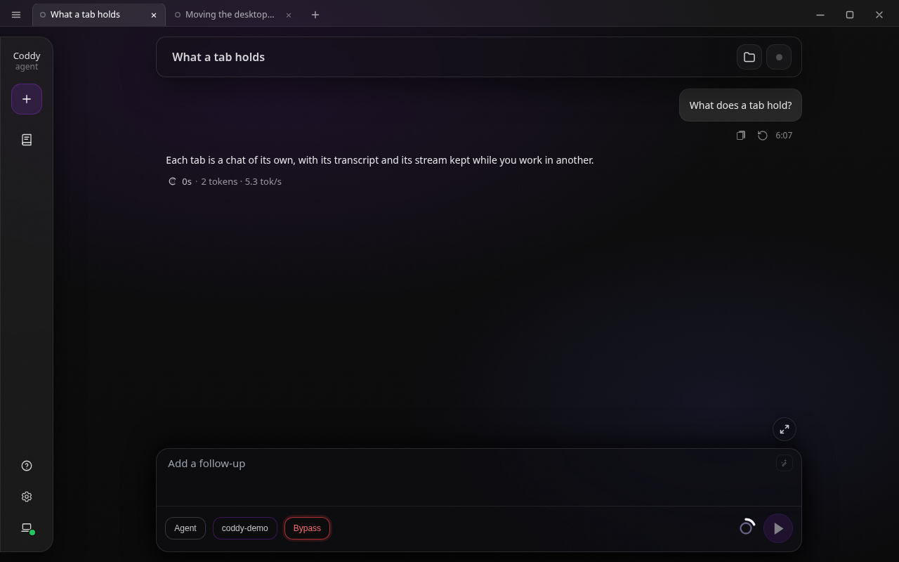
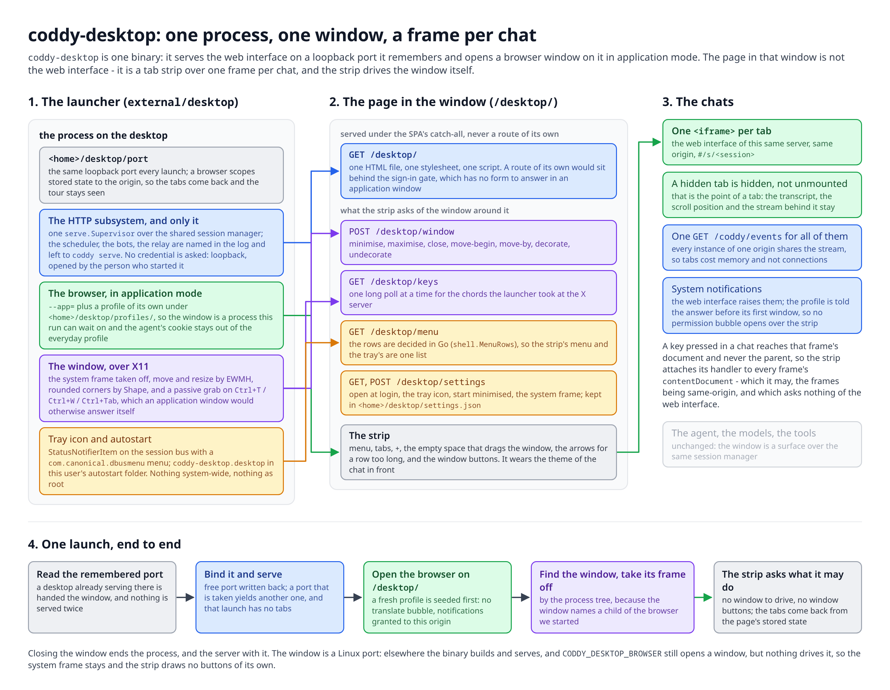
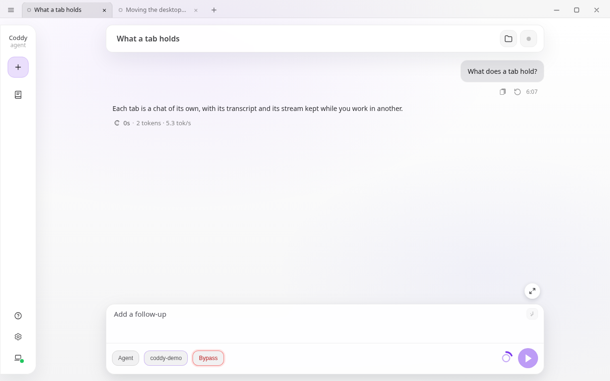
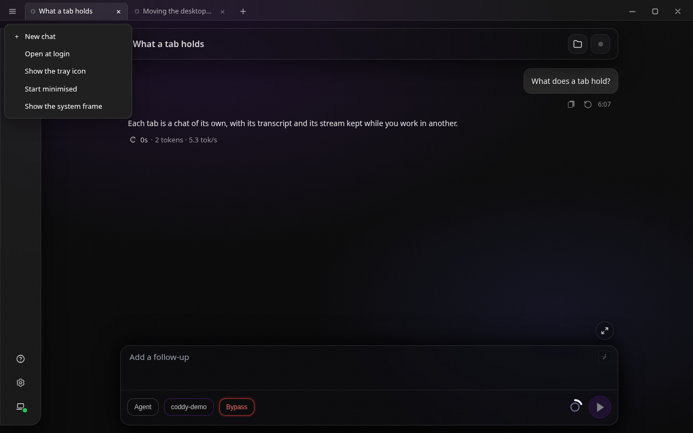

# Окно на рабочем столе

`coddy desktop` открывает Coddy как приложение на вашей машине: окно с полосой вкладок, по чату на
вкладку, поверх того же веб-интерфейса, который отдаёт `coddy serve`. Это команда обычного
бинарника, он есть в релизных сборках, и работает она под Linux, macOS и Windows.



*Два чата как вкладки: передняя названа по своему диалогу, `+` открывает ещё одну.*

## Что это

Окно показывает знакомый веб-интерфейс. Каждая вкладка - это он же, загруженный ещё раз, поэтому
чат за неактивной вкладкой сохраняет транскрипт, позицию прокрутки и поток событий, пока вы заняты
в другой. Агент, сессии и конфигурация те же: окно - клиент обычного HTTP-интерфейса, поднятого на
loopback-порту этой машины.

Что окно добавляет по сравнению с браузером:

- запускается как программа, из меню или терминала, адрес набирать не нужно;
- держит несколько диалогов рядом как вкладки и возвращается к ним после перезапуска;
- это отдельное окно, без адресной строки, закладок и чужих вкладок вокруг чата;
- держит куку сессии агента отдельно от браузера, в котором вы читаете почту.

Как части складываются друг с другом, от запуска до чата во фрейме:



*Один процесс отдаёт веб-интерфейс на запомненном loopback-порту и открывает на нём окно браузера.
Страница в этом окне - полоса вкладок поверх фреймов, по фрейму на чат, и она же управляет окном
через собственные маршруты.*

## Как получить

Окно есть в каждом релизном бинарнике, так что установленному Coddy ничего досоздавать не нужно:

```bash
coddy desktop
```

Из чекаута `make desktop` - это `make build` с релизным набором тегов:

```bash
make desktop        # build/coddy с тегами: http ui scheduler memory cli gateway swarm metrics browser desktop
./build/coddy desktop
```

Поверхность стоит 0,44 МиБ в бинарнике, где уже есть HTTP-сервер и веб-интерфейс, поэтому это
команда, а не вторая программа, которую пришлось бы ставить и обновлять отдельно, и поэтому она
есть в каждой сборке: в релизных архивах, в пакетах, в формуле Homebrew и в образе контейнера.

Нужен установленный браузер семейства Chromium - Chrome, Chromium, Edge, Brave, Vivaldi или Яндекс
Браузер, - его окно и запускается в режиме приложения. У Firefox такого режима нет, он не
используется.

### Пакет для Linux

`coddy-desktop` - отдельный пакет рядом с `coddy`, и программы в нём нет: он ставит пункт меню
(`/usr/share/applications/coddy-desktop.desktop`) и названную в нём иконку, так что Coddy
появляется в меню приложений и запускается оттуда без терминала, а зависит от `coddy`, чья команда
`desktop` и есть окно. На сервере, где работает только `coddy serve`, ставится один агент.

```bash
make deb-desktop    # dist/coddy-desktop_<версия>_linux_<арх>.deb
make rpm-desktop    # то же самое в виде .rpm
```

Как и пакет агента, он ничего не включает, не заводит системных учётных записей и не пишет в
`/etc`: состояние окна лежит в `~/.coddy` того, кто его запустил, а **Open at login** пишет в его
же папку автозапуска. Браузер указан рекомендацией, а не зависимостью - подойдёт любой из семейства
Chromium, а `CODDY_DESKTOP_BROWSER` назовёт другой.

## Запуск

```
coddy desktop [--window auto|browser|native] [--browser PATH] [--frame] [--auth]
              [--config PATH] [--home DIR] [--cwd DIR] [--log-level LEVEL] [-t]
```

| Флаг | Что делает |
| --- | --- |
| `--window` | какое окно открыть: `auto` (по умолчанию), `browser` для режима приложения, `native` для окна вокруг системного WebView, которого пока нет в сборке |
| `--browser` | каким браузером открыть окно, по имени в `PATH` или по пути. Он же `CODDY_DESKTOP_BROWSER` |
| `--config`, `--home`, `--cwd` | как у `coddy serve`: файл конфигурации, домашняя папка агента, рабочая папка новых чатов |
| `--frame` | оставить системный заголовок и рамку. Без него в сессии X11 заголовком служит сама полоса вкладок |
| `--log-level` | `debug`, `info`, `warn` или `error`, перекрывает конфигурацию |
| `--auth` | спрашивать учётные данные, настроенные в конфигурации. Без него окно не спрашивает ничего (ниже) |
| `-t`, `--test-config` | проверить файл конфигурации и выйти, ничего не запуская |

Окно поднимает веб-интерфейс и больше ничего. Если конфигурация включает ещё Telegram-бота, бота
Пачки, релей роя, планировщик, экспортёр или эндпоинт браузера, они остаются записанными как есть,
просто этот процесс их не запускает, говорит об этом при старте и оставляет их за `coddy serve`. Запускать их дважды поверх одной домашней
папки бесполезно: два бота на одном токене заставляют Telegram отвечать `409`, два планировщика
выполняют каждое задание дважды, а релей, который не смог занять свой порт, утянул бы окно за собой.

## Вкладки

| Действие | Как |
| --- | --- |
| Новая вкладка | `+` справа на полосе или `Ctrl`+`T` |
| Закрыть вкладку | её `×`, средний клик по ней или `Ctrl`+`W` для передней |
| Переключиться | клик по вкладке или `Ctrl`+`1` ... `Ctrl`+`9` |
| Следующая, предыдущая | `Ctrl`+`Tab` и `Ctrl`+`Shift`+`Tab`, по кругу в обе стороны |
| Перезагрузить передний чат | `Ctrl`+`R`, перезагружает только эту вкладку, остальные не трогает |
| Пройти длинный ряд | две стрелки рядом с кнопками окна, они появляются, когда вкладки шире полосы |

Аккорды работают и когда вы печатаете в чате, но часть из них добирается туда окольным путём. Окно
приложения отвечает на `Ctrl`+`T`, `Ctrl`+`W`, `Ctrl`+`R` и `Ctrl`+`Tab` само - новым окном
браузера, закрытием приложения, перезагрузкой всей полосы и переходом по своим вкладкам, - и
отменить это со страницы нельзя. В сессии X11 лаунчер забирает эти клавиши на уровне X-сервера,
захватом на собственном окне, и передаёт их полосе вкладок; `Ctrl`+`Tab` и `Ctrl`+`Shift`+`Tab` -
это два захвата, а не один, потому что захват совпадает с модификаторами точно. `Ctrl`+`1` ...
`Ctrl`+`9` обходятся без этого: своих вкладок у окна приложения нет, поэтому цифры оно отдаёт
странице. Рядом с `Ctrl` для каждого аккорда работает `Alt`, а на Mac ещё и `Cmd`: это то, что
остаётся в сессии Wayland и на macOS, где забрать клавиши у браузера нельзя. Аккорд читается по
физической клавише, поэтому русская и любая другая раскладка отвечает теми же клавишами, что и
латинская.

Ряд длиннее полосы прокручивается, а вкладка, на которую вы переключились, всегда попадает в поле
зрения, поэтому аккорды остаются рабочими при любом числе чатов.

Вкладка называется по диалогу за ней, название окно берёт из списка сессий. Ещё не начатый чат
называется `New chat`.

Перед названием каждая вкладка несёт состояние своего чата, той же меткой, что и список History.

| Метка | Что значит |
| --- | --- |
| Залитая точка, пульсирующая | чат работает: идёт ход или ещё не закончилась фоновая задача |
| Кольцо акцентного цвета темы | чат ждёт вас, разрешения или ответа |
| Красная точка | последний ход этого чата завершился ошибкой |
| Залитая точка акцентного цвета | чат закончил, пока вы были в другой вкладке |
| Полое кольцо | чат закончил |

Одну вкладку окно держит всегда: закрытие последней открывает пустой чат, а не оставляет окно
пустым. Приложение заканчивается, когда вы закрываете окно, вместе с ним останавливается и сервер
за ним.

Каждая вкладка - полноценный экземпляр веб-интерфейса, поэтому память растёт с числом вкладок
примерно так же, как росла бы с тем же числом вкладок браузера. Потоки событий при этом не
множатся: все экземпляры одного источника делят одно соединение.

## Само окно

В сессии X11 окно открывается без системной рамки, и полоса вкладок работает его заголовком. На
macOS, на Windows и в Wayland окно оставляет себе ту рамку, которую рисует рабочий стол, а полоса
остаётся просто полосой вкладок: всё описанное ниже добавляет именно X11. Слева
направо она несёт меню десктопа, вкладки, `+`, пустое место, за которое окно двигают, две стрелки
для ряда длиннее полосы и кнопки свернуть, развернуть и закрыть у правого края. Пока окно не
развёрнуто, его углы скруглены, в развёрнутом они прямые.

| Действие | Как |
| --- | --- |
| Подвинуть окно | тащите пустую часть полосы |
| Развернуть или вернуть | двойной клик по пустой части полосы или средняя кнопка справа |
| Свернуть, закрыть | кнопки у правого края |
| Меню десктопа | кнопка у левого края полосы |

Окно, которое оконный менеджер закрепил - развёрнутое или прижатое к краю через `Meta`+`Left`, -
отпускается, как только вы начинаете тащить полосу, и встаёт обратно под указатель, как это
происходит при перетаскивании любого заголовка. Горячие клавиши вашего рабочего стола действуют на
это окно так же, как на любое другое.

Полоса одета в тему, в которой сейчас чаты. Цвета она читает с переднего чата, поэтому все девять
тем веб-интерфейса доходят до полосы, вкладок и точек состояния, а тема, сменённая в **Настройках**,
доезжает до полосы без перезагрузки.



*Полоса в теме Light, то же окно, что выше.*

## Меню десктопа

Кнопка у левого края полосы открывает настройки самого окна. Они принадлежат машине, а не странице,
и лежат в `<home>/desktop/settings.json`, поэтому переживают запуск, которому пришлось взять другой
порт.



*Меню окна, открытое от левого края полосы.*

| Пункт | Что делает |
| --- | --- |
| **New chat** | то же, что `+` |
| **Open at login** | Linux: пишет `coddy-desktop.desktop` в папку автозапуска этого пользователя (`$XDG_CONFIG_HOME/autostart`, иначе `~/.config/autostart`). macOS: агент запуска `~/Library/LaunchAgents/dev.coddy.desktop.plist`. Windows: значение под ключом `Run` этого пользователя. Ничего не ставится на всю систему и права администратора не нужны |
| **Show the tray icon** | показывает знак Coddy в системном лотке как StatusNotifierItem на шине сессии. Клик по нему возвращает окно из-за другого окна или с панели задач |
| **Start minimised** | следующий запуск откроет окно свёрнутым, чего обычно и хочет окно, открытое при входе в систему |
| **Show the system frame** | возвращает окну заголовок и рамку, которые рисует ваш рабочий стол. Полоса тогда перестаёт рисовать свернуть, развернуть и закрыть, потому что их несёт рамка. Только для сессии X11: в остальных рамка есть всегда |

Переключатель сдвигается только после того, как лаунчер действительно это сделал: сессия без лотка
или папка автозапуска, в которую нельзя писать, оставляют переключатель на месте и пишут причину на
самом пункте.

У значка в лотке то же меню. Правый клик открывает перечисленные выше пункты, сверху к ним
добавлены ещё два - **Show the window** возвращает окно из-за другого окна или с панели задач,
**Hide the window** убирает его обратно, - а внизу, за отдельной чертой, стоит **Quit Coddy**: со
спрятанным в лоток окном значок остаётся единственным выходом из приложения. В меню полосы такого
пункта нет, потому что кнопка закрытия окна и так в двух сантиметрах от него. Оба меню строятся из одного списка на стороне Go
(`shell.MenuRows`), поэтому новый пункт полосы появляется и на значке; сам значок говорит на
`com.canonical.dbusmenu` - это протокол меню, который называет StatusNotifierItem и рисует любой
современный лоток. **New chat**, выбранный на значке, сначала возвращает окно, потому что чат,
открытый за спрятанным окном, никто не просил.

Там, где окном управлять нельзя вовсе - в сессии Wayland программа не может ни двигать чужое окно,
ни снимать с него рамку, - окно остаётся с системной рамкой, а полоса своих кнопок не рисует. Всё
остальное работает так же.

## Ссылки наружу

Ссылка на другой сайт - документация, issue, что угодно написанное моделью - открывается в том
браузере, которым вы пользуетесь, через системный опенер рабочего стола. Иначе клик внутри вкладки
загрузил бы сайт прямо во фрейм, под полосу вкладок без адресной строки, без кнопки "назад" и без
выхода, кроме закрытия вкладки. Адреса самого Coddy ссылками наружу не считаются и остаются в окне.

Наружу передаются только `http` и `https`. Любую другую схему окно отклоняет: опенер отдаёт
полученное тому приложению, которое эту схему объявило, а ссылка в чате - это текст, написанный
моделью.

## Уведомления

Окно показывает те же системные уведомления, что и веб-интерфейс. Включите их в **Настройки -
Оформление - Уведомления**, и чат, который закончил ход, попросил разрешение или задал вопрос, пока
ни одно окно Coddy не в фокусе, положит уведомление на рабочий стол, а клик по нему поднимет этот
чат. Правила те же, что у веб-интерфейса, они описаны в разделе [Уведомления](web-ui.md#уведомления).

Своего окно добавляет одно - оно не спрашивает. Ответ на вопрос браузера записан в свежий профиль
ещё до первого окна, поэтому переключатель не открывает над полосой вкладок пузырь с разрешением.
Разрешение выдано адресу этого окна и никакому другому, и держится оно, пока держится порт. Запуску,
которому пришлось взять другой порт, достаётся разрешение, которое уже не совпадает, и браузер
спросит один раз.

## Порт, который он запоминает

Первый запуск занимает свободный loopback-порт и записывает его в `<home>/desktop/port`, каждый
следующий поднимается на том же. Браузер привязывает сохранённое страницей состояние именно к порту,
поэтому постоянный порт и позволяет окну вернуться к оставленным вкладкам, а первому туру -
остаться просмотренным.

Отсюда два следствия:

- если порт занял кто-то другой, запуск берёт следующий свободный и говорит об этом. Такой запуск
  начинается без вкладок, а новый порт становится тем, который возьмёт следующий;
- запуск приложения, когда окно уже открыто, второй раз ничего не поднимает. Второй процесс видит
  работающий десктоп и просит у него окно.

Профиль браузера для окна лежит в `<home>/desktop/profiles/<браузер>`, по одному на браузер. Именно
он делает окно отдельным процессом и держит куку агента отдельно от вашего повседневного профиля.
Места он занимает столько же, сколько свежий профиль браузера, несколько десятков мегабайт.

## Вход

Окно ничего не спрашивает. Оно слушает loopback для того, кто сам запустил приложение, а форма
входа в окне, которое он же и открыл, ничего не доказывает, поэтому `coddy desktop` работает без
учётных данных, что бы ни было в конфигурации, - токен, аккаунт для формы, оба сразу.

**Конфигурация на диске не меняется.** Тот же `config.yaml` по-прежнему требует вход у `coddy
serve`, доступного по сети, а экран настроек внутри окна показывает настоящие значения, поэтому
сохранение оттуда не унесёт ваш аккаунт с диска.

Отсюда два следствия. Любая программа на этой машине может дойти до этого порта и управлять агентом,
то есть ровно та же сделка, что у `coddy serve` на loopback по умолчанию. А если учётные данные
нужны обратно - общая машина, второй пользователь, - флаг `--auth` спрашивает то, что настроено в
конфигурации, и форма входа появляется прямо в окне.

Окно поднимает веб-интерфейс и больше ничего, и это тоже решение процесса, а не правка: остальные
подсистемы просто не входят в список интерфейсов, которые он запускает.

## Linux, macOS и Windows

Окно открывается на всех трёх. Разница в том, насколько система даёт Coddy этим окном управлять:

| | Linux (X11) | Linux (Wayland) | macOS | Windows |
| --- | --- | --- | --- | --- |
| Окно, вкладки, настройки | да | да | да | да |
| Без системной рамки, полоса как заголовок | да | нет | нет | нет |
| Скруглённые углы, перетаскивание за полосу, свои кнопки | да | нет | нет | нет |
| `Ctrl`+`T`, `Ctrl`+`W`, `Ctrl`+`R`, `Ctrl`+`Tab` забираются у браузера | да | нет | нет | нет |
| `Alt` (и `Cmd` на Mac) для тех же аккордов | да | да | да | да |
| Значок в лотке | да | да | нет | нет |
| Open at login | файл автозапуска | файл автозапуска | агент запуска | ключ `Run` |

Там, где аккорд забрать у браузера нельзя, то же самое делают `Alt`+`T`, `Alt`+`W`, `Alt`+`R` и
`Alt`+`Tab`, а на Mac рядом с ними работает `Cmd`.

Браузер ищется там, где его держит каждая система: в `PATH` на Linux, в `/Applications` и
`~/Applications` на macOS, в Program Files и локальных данных приложений пользователя на Windows.
`CODDY_DESKTOP_BROWSER` называет его по пути, если машина держит браузер в другом месте:

```bash
CODDY_DESKTOP_BROWSER="/Applications/Google Chrome.app/Contents/MacOS/Google Chrome" coddy desktop
```

Перед работой на macOS или Windows стоит знать две вещи. Ни Gatekeeper, ни SmartScreen тут не на
что ругаться, потому что запускается уже установленный на машине браузер, - но сам `coddy` остаётся
консольной программой, поэтому на Windows позади окна висит то консольное окно, из которого его
запустили. И без собственного управляемого окна полоса не рисует кнопок окна, а меню не предлагает
переключатель рамки: и то, и другое несёт системный заголовок рабочего стола.

Если браузера семейства Chromium не нашлось вовсе, запуск печатает адрес и работает, пока вы его не
остановите, так что интерфейс доступен в обычном браузере.

## Смотрите также

- [Веб-интерфейс](web-ui.md) - интерфейс, который показывает окно
- [coddy serve и демон](../operate/serve.md) - долгоживущий процесс для всего остального
- [Сборка из исходников](../contributing/build.md) - теги сборки и что несёт каждый

<!-- docsgen:source sha256=c4978dbaac802a51 -->
