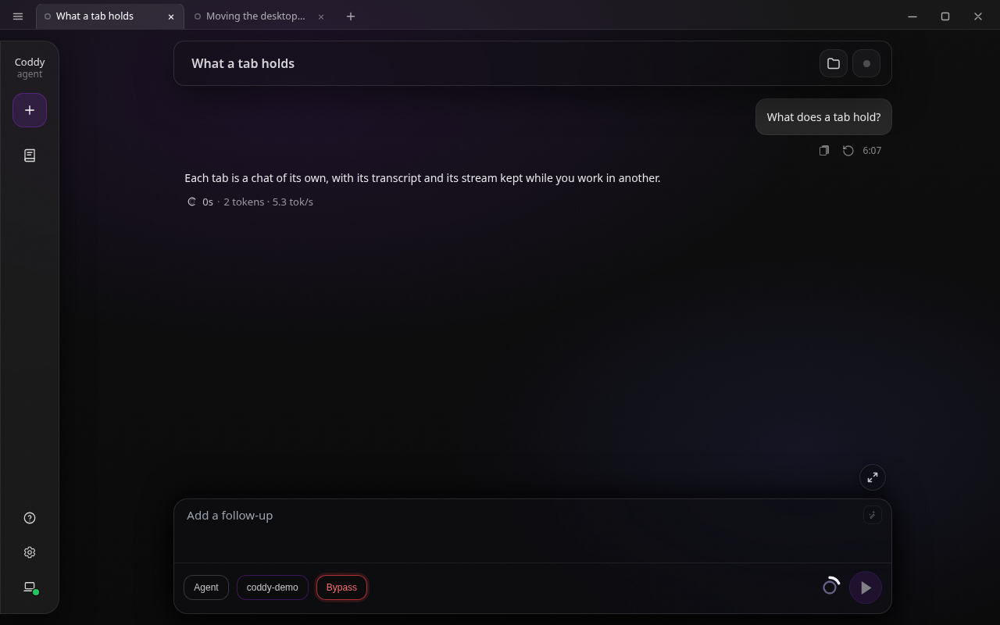
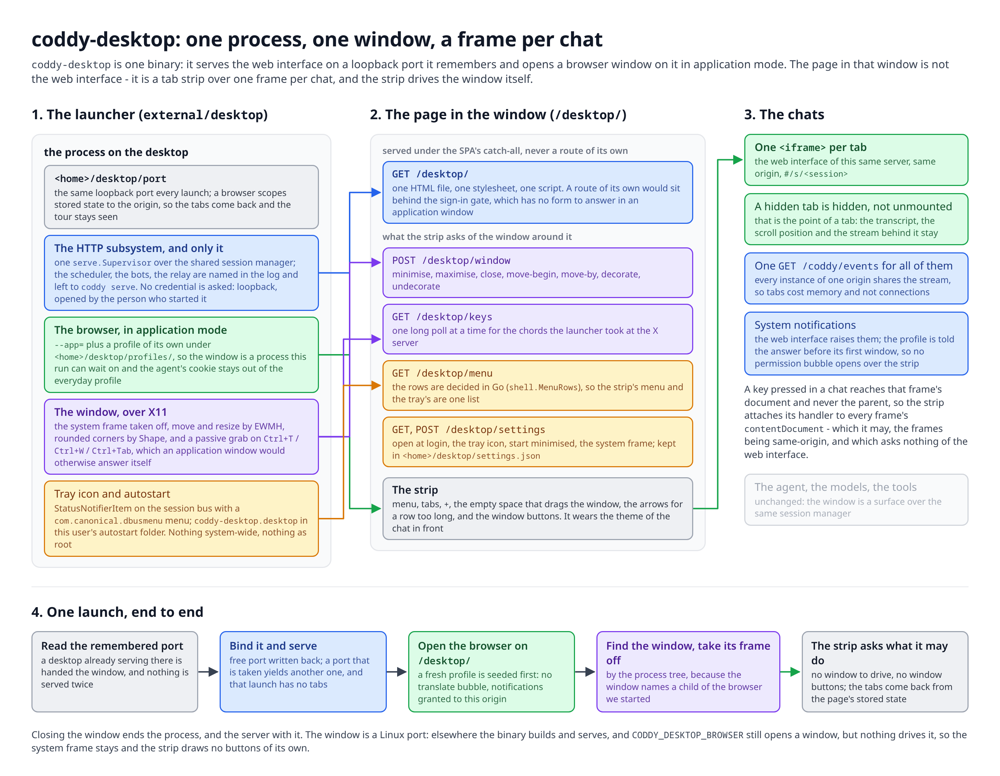
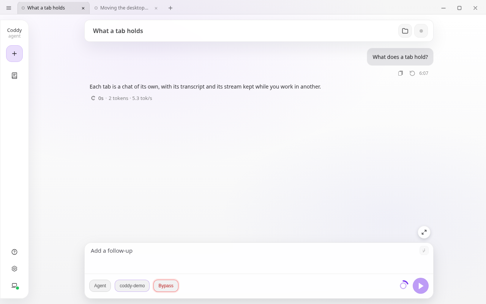
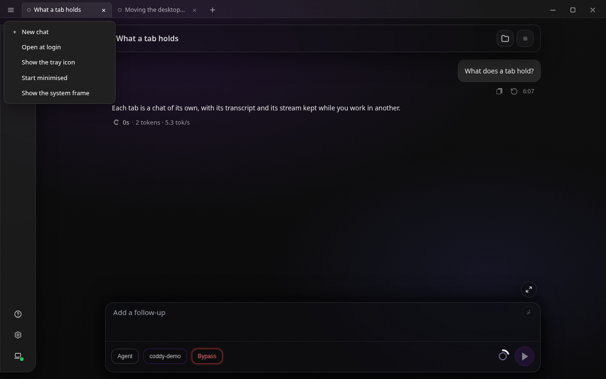

# Desktop window

`coddy-desktop` opens Coddy as an application on your own machine: a window with a strip of tabs,
one chat per tab, over the same web interface `coddy serve` serves. It is a separate binary from
`coddy`, built with the `desktop` tag, and the window itself is ported to Linux for now.



*Two chats as tabs: the one in front is named after its conversation, `+` opens another.*

## What it is

The window holds the web interface you already know. Every tab is that interface, loaded again, so
a chat behind a tab keeps its transcript, its scroll position and its stream of events while you
work in another one. The agent, the sessions and the configuration are the same: the window is a
client of an ordinary HTTP surface, started on a loopback port of this machine.

What the window adds over opening a browser:

- it starts as a program, from a launcher or a terminal, with no address to type;
- it holds several conversations side by side as tabs, and comes back to them after a restart;
- it is a window of its own, with no address bar, bookmarks or other tabs around the chat;
- it keeps the agent's session cookie out of the browser you read mail in.

How the parts fit together, from the launch to the chat in the frame:



*One process serves the web interface on a remembered loopback port and opens a browser window on
it; the page in that window is a tab strip over one frame per chat, and it drives the window
through routes of its own.*

## Getting it

The desktop binary is not in the release archives yet. Build it from a checkout:

```bash
make desktop        # builds build/coddy-desktop with tags: http ui desktop
./build/coddy-desktop
```

It needs a Chromium-family browser installed - Chrome, Chromium, Edge, Brave, Vivaldi or Yandex
Browser - which it starts in application mode. Firefox has no application mode and is not used.

### The Linux package

`coddy-desktop` is a package of its own, beside the agent's `coddy`: it carries the embedded web
interface, so it is several times the size and has no business on a server that only runs
`coddy serve`. The two install side by side and share no file.

```bash
make deb-desktop    # dist/coddy-desktop_<version>_linux_<arch>.deb
make rpm-desktop    # the same as an .rpm
```

Beyond the binary it installs the menu entry (`/usr/share/applications/coddy-desktop.desktop`) and
the icon it names, so Coddy appears in the application launcher and starts from there with no
terminal. Like the agent's package it enables nothing, creates no system account and writes nothing
under `/etc`; the window's state is the invoking user's `~/.coddy`, and **Open at login** writes
into that user's own autostart folder. A browser is a recommendation rather than a dependency -
any of the Chromium family does, and `CODDY_DESKTOP_BROWSER` names another.

## Running it

```
coddy-desktop [--window auto|browser|native] [--browser PATH] [--auth]
              [--config PATH] [--home DIR] [--cwd DIR] [--log-level LEVEL] [-t]
```

| Flag | What it does |
| --- | --- |
| `--window` | which window to open: `auto` (the default), `browser` for application mode, `native` for the window around the system WebView, which is not built in yet |
| `--browser` | the browser to open the window with, by name on `PATH` or by path. Also `CODDY_DESKTOP_BROWSER` |
| `--config`, `--home`, `--cwd` | as on `coddy serve`: the configuration file, the agent home, the workspace new chats open in |
| `--log-level` | `debug`, `info`, `warn` or `error`, overriding the configuration |
| `--auth` | ask for the credential the configuration carries. Without it the window asks for nothing (below) |
| `-t`, `--test-config` | check the configuration file and exit, starting nothing |

The window runs the web interface and nothing else. A configuration that also enables the Telegram
bot, the Pachca bot, the swarm relay, the scheduler, the exporter or the browser endpoint keeps
them as written; this process simply does not start them, says so on startup and leaves them to
`coddy serve`. Running them twice over one agent home does not divide the work: two bots on one
token make Telegram answer `409`, two schedulers fire every job twice, and a relay that cannot bind
its port would take the window down with it.

## Tabs

| Action | How |
| --- | --- |
| New tab | `+` after the tabs, or `Ctrl`+`T` |
| Close a tab | its `×`, a middle click on it, or `Ctrl`+`W` for the one in front |
| Switch | click a tab, or `Ctrl`+`1` ... `Ctrl`+`9` |
| Next, previous | `Ctrl`+`Tab` and `Ctrl`+`Shift`+`Tab`, which wrap at both ends |
| Walk a long row | the two arrows beside the window's own buttons, which appear once the tabs are wider than the bar |

The chords work while you are typing in a chat, and some of them take a detour to get there. A
browser window in application mode answers `Ctrl`+`T`, `Ctrl`+`W` and `Ctrl`+`Tab` itself - with a
new browser window, by closing the application, and by walking its own tabs - and no page can
cancel any of them. On an X11 session the launcher takes those keys at the X server, with a grab on
its own window, and hands them to the tab strip; `Ctrl`+`Tab` and `Ctrl`+`Shift`+`Tab` are two
grabs rather than one, because a grab matches the modifiers exactly. `Ctrl`+`1` ... `Ctrl`+`9` need
none of that, since an application window has no tabs of its own to switch to and gives the digits
to the page. `Alt` stands beside `Ctrl` for every chord, which is what a Wayland session - where a
window may not be grabbed - leaves you with for the taken ones.

A row longer than the bar scrolls, and the tab you switch to is always brought into sight, so the
chords stay usable however many chats are open.

A tab is named after the conversation behind it, which the window reads from the session list. A
chat that has not started yet is `New chat`.

Ahead of the name each tab carries the state of its chat, the same mark the History list uses:

| Mark | What it means |
| --- | --- |
| A filled dot, pulsing | the chat is working: a turn is running, or a background task is still in flight |
| A ring in the theme's accent | the chat is waiting for you, for a permission or an answer |
| A red dot | the last turn of that chat failed |
| A filled dot in the accent | the chat finished while you were in another tab |
| A hollow ring | the chat is finished |

The window keeps a tab: closing the last one opens an empty chat instead of leaving the window
blank. Closing the window is what ends the application, and the surface behind it stops with it.

Each tab is a full instance of the web interface, so memory grows with the number of tabs about as
it would with that many browser tabs. The event streams do not multiply: every instance of one
origin shares a single connection.

## The window itself

On Linux the window opens without the system frame, and the tab strip is its title bar. The strip
carries, from left to right: the menu of the desktop, the tabs, `+`, the empty space that drags the
window, the two arrows that walk a row too long for the bar, and minimise, maximise and close at the
right edge. The corners are rounded while the window floats and square while it fills the screen.

| Action | How |
| --- | --- |
| Move the window | drag the empty part of the strip |
| Maximise or restore | double-click the empty part of the strip, or the middle button at the right |
| Minimise, close | the buttons at the right edge |
| The desktop menu | the button at the left edge of the strip |

A window the window manager has pinned - maximised, or tiled against an edge with `Meta`+`Left` -
is let loose when you start dragging the strip, and put back under the pointer, the way dragging a
title bar works everywhere. The keyboard instructions of your desktop apply to this window as they
do to any other.

The strip wears the theme the chats are in. It reads the colours off the chat in front, so all nine
themes of the web interface reach the bar, the tabs and the state dots, and a theme changed in
**Settings** reaches the strip without a reload.



*The strip in the Light theme, the same window as above.*

## The desktop menu

The button at the left edge of the strip opens the window's own settings. They are the machine's,
not the page's, and live in `<home>/desktop/settings.json`, so they survive a launch that had to
take another port.



*The menu of the window, opened from the left edge of the strip.*

| Entry | What it does |
| --- | --- |
| **New chat** | the same as `+` |
| **Open at login** | writes `coddy-desktop.desktop` into this user's autostart folder (`$XDG_CONFIG_HOME/autostart`, else `~/.config/autostart`). Nothing is installed system-wide and nothing needs root |
| **Show the tray icon** | publishes Coddy's mark in the system tray as a StatusNotifierItem on the session bus. A click on it brings the window back from behind another window or from the taskbar |
| **Start minimised** | the next launch opens the window minimised, which is usually what a window opened at login wants |
| **Show the system frame** | gives the window back the title bar and borders your desktop draws. The strip then stops drawing minimise, maximise and close, since the frame carries them |

A switch moves only once the launcher has done the thing: a tray this session has no tray for, or
an autostart folder that cannot be written, leaves the switch where it was and says why on the row.

The tray icon carries the same menu. A right click on it opens the rows above, with two more on
top: **Show the window**, which brings it back from behind another window or from the taskbar, and
**Hide the window**, which puts it away again. The two menus are drawn from one list on the Go side
(`shell.MenuRows`), so a row added to the strip's menu appears on the icon as well; the icon speaks
`com.canonical.dbusmenu`, which is the menu protocol a StatusNotifierItem names and every current
tray draws. **New chat** picked from the icon brings the window back first, since a chat opened
behind a hidden window is one nobody asked for.

Where a window cannot be driven at all - a Wayland session, where a program may not move or
undecorate a window it does not own - the window keeps the system frame and the strip draws no
buttons of its own. Everything else is the same.

## Notifications

The window raises the system notifications the web interface raises. Turn them on in **Settings -
Appearance - Notifications**, and a chat that ends a turn, asks for a permission or asks a question
while no window of Coddy has your attention puts a notice on your desktop; clicking it brings that
chat up. The rules are the web interface's own, described under
[Notifications](web-ui.md#notifications).

What the window adds is that it does not ask. A fresh browser profile is told the answer before its
first window, so turning the switch on does not open the browser's permission bubble over the tab
strip. The grant names this window's address and nothing else, and it holds because the port does.
A launch that had to take another port gets a grant that no longer matches, and the browser asks
once.

## The port it remembers

The first launch takes a free loopback port and writes it to `<home>/desktop/port`; every later
launch serves on the same one. The port is what a browser scopes a page's stored state to, so
keeping it is what lets the window come back to the tabs you left open, and the first-run tour stay
seen.

Two consequences:

- if something else has taken that port, the launch takes another one and says so. That launch
  starts with no tabs, and the new port is what the next one uses;
- starting the application while a window is already open does not serve a second time. The second
  launch sees the desktop already running and asks it for a window.

The browser's profile for the window lives in `<home>/desktop/profiles/<browser>`, one per browser.
It is what makes the window a process of its own, and what keeps the agent's cookie out of your
everyday profile. It costs the disk a fresh browser profile costs, a few tens of megabytes.

## Signing in

The window asks for nothing. It binds loopback for the person who started the application, and a
sign-in form in a window they opened themselves proves nothing, so `coddy-desktop` serves without a
credential whatever the configuration carries - a bearer token, a sign-in account, both.

**The configuration on disk is untouched.** The same `config.yaml` still signs in a `coddy serve`
that is reachable from elsewhere, and the settings screen inside the window shows the real values,
so saving from there does not take the operator's account off disk.

Two things follow. Any program running on this machine can reach that port and drive the agent,
which is the same bargain `coddy serve` makes on loopback by default. And if you want the
credential back - a shared machine, a second user account - `--auth` asks for whatever the
configuration configures, and the sign-in form appears inside the window.

The window runs the web interface and nothing else, as above, and that too is a decision of this
process rather than an edit: the other subsystems are simply not among the surfaces it starts.

## Other platforms

The launcher, the tab strip and the port are plain Go and TypeScript and run anywhere, but the part
that finds and opens a browser is written for Linux. On macOS a browser is a bundle under
`/Applications` whose executable lives inside it, and on Windows a path under Program Files or
AppData that is usually found through the registry; a window on either wants a signed application
before the system opens it without a warning. Both are claimed once they are built and tested on
those machines.

The binary still builds there and `CODDY_DESKTOP_BROWSER` still opens a window:

```bash
CODDY_DESKTOP_BROWSER="/Applications/Google Chrome.app/Contents/MacOS/Google Chrome" coddy-desktop
```

Without it, the launch finds no window it can wait on, prints the address and serves until you stop
it, so the interface is still reachable in an ordinary browser.

## See also

- [Web UI](web-ui.md) - the interface the window holds
- [coddy serve and the daemon](../operate/serve.md) - the long-running process for everything else
- [Building from source](../contributing/build.md) - build tags and what each one carries
