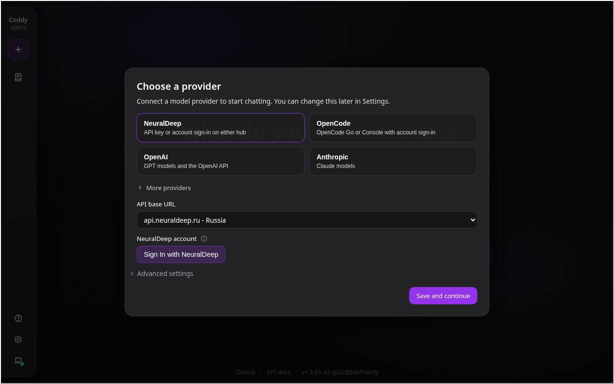
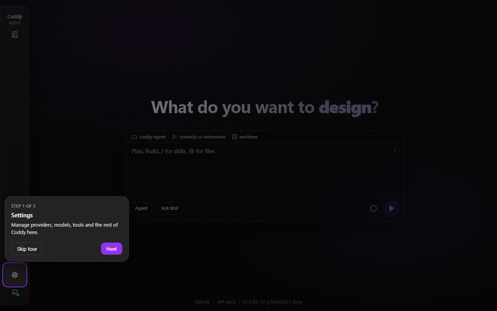

# UI design: foundations

[Design index](../../DESIGN.md)

## Design references

Store the design reference images under `docs/assets/` and link to the specific file when describing a pixel sensitive UI detail. Navbar parity with Cursor - style mockups lives in [`docs/assets/INDEX.md`](../../docs/assets/INDEX.md) (see Navbar section).

## Foundations

### Contract ownership and verification

- **One fact, one visual location.** A status, result, duration or action is shown in the surface that owns it and is not repeated in adjacent transcript rows, panels or labels unless accessibility needs an equivalent hidden name.
- **Measure browser geometry at the browser boundary.** A geometry-sensitive contract uses a live-browser check when jsdom cannot perform layout. Component and source-contract tests still own DOM semantics, but they do not substitute for measured geometry.
- **External products are references, not contracts.** A product may explain historical inspiration; only the behavior specified here is normative for Coddy.

### Stylesheet

The styles are SCSS. **`external/ui/src/styles.scss`** is the entry Vite compiles into **`styles.css`**, and it holds nothing but the order of the cascade: one **`@use`** per partial of **`external/ui/src/styles/`** that emits CSS. **`themes/`** has one palette per theme, **`_tokens.scss`** the tokens that are the same in every theme, **`_abstracts.scss`** the Sass helpers (**`mix-text()`**, the font stacks; no CSS of its own), and **`shell/`**, **`chat/`**, **`composer/`**, **`settings/`**, **`screens/`** and **`components/`** the rules of their surfaces.

- **Where a rule goes.** Into the partial of its surface. Sass emits a partial where the entry uses it, so a rule that overrides another of the same specificity goes into a partial listed after the one it overrides; the entry's order is the cascade, and the folders do not change it.
- **A theme file is a palette.** One rule, **`[data-theme="<id>"]`** (the dark theme's is **`:root, [data-theme="dark"]`**, which is what a token another theme leaves out falls back to). A size, a layer or a font that does not change between themes belongs in **`_tokens.scss`**. A component's light-only override stays with the component or in **`themes/_light-overrides.scss`**, never in the palette.
- **One height for a head.** Every window, panel and popover opens with a head of **`--coddy-panel-head-height`** (**58px**, its rule included): **`.sessions-head`** (History, the Scheduler, Settings, Tasks, the folder browser, the context and goal popovers), **`.files-header`** (Files, Edits), **`.docs-header`** and **`.swarm-header`**. A head keeps no padding above or below, so what stands in it is centred. A window opened over a panel shows both heads side by side, and a few pixels' difference reads as a line out of step. A window's head also keeps **`--coddy-panel-head-inline`** (**14px**) from the sides, whatever inset the page under it has, so its title and close control stand as far in as in any other window; a popover's head keeps the **12px** of its own content. The documentation's head on the stacked shell has a second row, the search, and its first row is an ordinary head of that height. **`panelHeadCss.test.ts`** and **`npm run check:files`** hold it.
- **A tooltip of the composer card.** The card's blur makes it a stacking context, under the plate joined to its top (**`.workspace-bar`**, **`z-index: 2`**), so a tip that opens upward from inside it went under the plate whatever its own **`z-index`**. While a tip is up the card comes over the plate (**`z-index: 3`**, **`tooltipTouchCss.test.ts`**, **`npm run check:files`**).
- **A tooltip and a touch.** A tooltip opens by **`:hover`** only inside **`@media (hover: hover)`**, and by focus only through **`:focus-visible`**. A touch leaves **`:hover`** on what it landed on, so a tip stayed up after a tap and came back when a panel over the control went away (on a phone the Tasks panel's close control lies right over the Tasks button), and a tap focuses its button. iOS also holds the click of a tap that reveals something by **`:hover`**. **`tooltipTouchCss.test.ts`** and the real touches of **`npm run check:files`** hold it.
- **A theme's accent.** Only the dark palette names its accent as a number. Everywhere else a frame, a ring or a glow takes **`var(--accent)`**, mixed with **`color-mix`** where it is translucent, and text on a strong accent ground takes **`--coddy-on-accent-fg`**, since a light accent (Nord, Rosé Pine) cannot carry white. Written as a number, the dark accent painted every other theme's focus rings and active items purple (**`themeCssContract.test.ts`**).
- **What holds it.** **`stylesModules.test.ts`**: the entry holds only **`@use`** rules, every partial is reached from it, the theme files are the themes of **`UI_THEME_IDS`** and none redeclares a shared token. **`stylesCompile.test.ts`** compiles the entry the way **`vite build`** does. A source-contract test reads the stylesheet as one text through **`stylesSource()`** (**`src/stylesSource.ts`**), or one surface through **`stylesPartial()`**.

### Color

| Token | Hex | Usage |
|-------|-----|-------|
| background | `#121212` | main canvas |
| nav rail | `#252525` | icon rail |
| session list | `#1E1E1E` | secondary column |
| accent | `#9333EA` | actions, pills, emphasis |
| text primary | `#FFFFFF` | default copy |
| text muted | `#9CA3AF` | captions, timestamps |
| user bubble | `#2D2D2D` | outgoing chat |

### Light and dark theme

- **Default:** dark (`data-theme="dark"` on **`<html>`**).
- **Persistence:** cookie **`coddy_ui_theme`** (`dark` | `light`), same lifetime pattern as **`coddy_nav_rail`**.
- **Bootstrap:** inline script in **`external/ui/src/index.html`** applies the cookie before first paint; **`main.tsx`** calls **`bootstrapUiThemeFromCookie()`** on load.
- **Toggle:** **Settings** drawer (**`#/settings`**) → **Appearance** tab → theme swatch grid (**`AppearanceThemePicker`**, **`data-testid="theme-swatch-<id>"`**). Theme selection applies immediately and is client-side only (no config save).
- **CSS:** semantic tokens on **`:root`** / **`[data-theme="dark"]`** (**`styles/themes/_dark.scss`**); **`[data-theme="light"]`** (**`_light.scss`** beside it, like every other theme) overrides **`--text`**, **`--bg`**, glass, canvas gradients, etc. Foreground tints use **`color-mix(in srgb, var(--text) …%, var(--coddy-blend-base))`** (**`transparent`** on dark, **`#ffffff`** on light) so text stays opaque and readable on each canvas. Hero headline gradient uses **`--coddy-hero-muted-mid`** / **`--coddy-hero-muted-end`** (no light-gray stops on a light background). The changing hero word follows the theme's **`--coddy-hero-accent`** in normal and simplified mode.
- **Grain:** the canvas glows span only a few dozen of a channel's 256 levels, and the browser's ordered dither shows them as rings on a high-contrast screen (issue #622); the glass panels blur that dither into bare one-level steps. CSS cannot change how the browser dithers, so **`--coddy-grain`** (a 64px tile of triangular noise, white or black pixels at an alpha of 0 to 3/255; **`none`** on the light theme) lies over the gradients of the **canvas layer** and over the tint of the title bar, the rail and the composer (**`html :is(.chat-header, .rail-pill, .composer-card)`**), which keep their **`backdrop-filter`**. It masks the rings and the steps; it does not remove them.
- **Simplified mode** (**`html[data-simple="on"]`**, **`theme/uiSimple.ts`**, the partial **`styles/_simple.scss`**, last in the cascade): a switch under the theme grid (**`SimpleModeSetting.tsx`**, **`data-testid="appearance-simple-switch"`**) for a machine the glass and the motion cost too much on, and it holds for every theme. The mode's name is the switch's own label and stands under no heading; what it turns off is in the (i) tip beside it (**`appearance.simple.hint`**), which the settings search reads too. Without a wallpaper the canvas is one colour (**`--coddy-canvas-gradient-bottom`**); a selected wallpaper keeps its fixed **`center / cover`** image and dimming. The panels are an opaque **`--coddy-simple-surface`** (the theme's text at 6% over the canvas, white on the light theme): with no blur behind a translucent header, the transcript would read through it. No soft shadow, text shadow, **`backdrop-filter`**, mask or transition remains, and no interface animation runs. An animation loses its duration, not its name, so a row that fades in from nothing still reaches its end, and a script's motion asks **`motionIsReduced()`**. What says something stays: the hard rings of a state (**`$kept-rings`**: a focused control, the theme picked, a search target, a session's dot, a chip's outline) and the gradients that draw a mark with hard stops (the half-filled circle of a task in progress) or a picture's transparency. **`simpleModeCss.test.ts`** fails on a new gradient until it says which of the two it is, and **`npm run check:simple`** reads the computed style of every element of six screens, in every theme at 1280, 800 and 390 px. **`npm run bench:simple`** measures what it saves (headless Chromium, 1280x800): composited in software, as on a machine with no working GPU, 20 to 31 frames per second become 60 and the browser's CPU time falls by 61 to 92%; on an Intel UHD 630 the frame rate stays near 60 either way, and the CPU time of a chat left alone falls by 86 to 92% and of a scroll by 29%. The choice is the cookie **`coddy_ui_simple`** (**`1`**, the theme cookie's flags; off clears it), which the inline script of **`index.html`** applies before the first paint; client-side only, no config save.
- **Wallpaper** (**Settings → Appearance**, below the simplified-mode switch and above the language picker, **`BackdropSettings`**): a compact gallery stays visible while the Appearance pane is shown. Its square upload icon opens the browser's file picker and sends the chosen file to the selected server. Uploading keeps the current background and dimming unchanged; with no background selected, it selects the uploaded picture. The server returns an existing file for identical bytes, even under another name, or adds a new file without overwriting a name collision. A stored browser-local picture is never uploaded on page load; only an explicit picker action uploads it. The square clear icon clears this browser's selection and restores the theme's background without deleting a server file. The gallery uses three columns on the desktop shell and two on narrower widths, with visible filename captions. Thumbnails load near the viewport through **`IntersectionObserver`**, or immediately when it is unavailable. A thumbnail's active border marks the selected picture, with no separate duplicate preview. Each thumbnail carries an unframed delete cross at the top right, a 30px control with a 40px hit area and no background or border. On a desktop it appears on tile hover or on the button's own keyboard focus (`:focus-visible`), not on the tile's focus, so a click that leaves the tile focused does not keep the cross showing once the pointer has left; on screens without hover it stays visible, so one tap reaches it. It opens **Delete "filename"?**, **Yes** / **No**, with **Yes** focused through **`ConfirmDialog`**'s **`initialFocus="confirm"`**. Only confirmation sends the deletion. A successful deletion clears this browser's background when it was that picture; deleting another picture leaves the background unchanged.
- **The canvas is one fixed layer** (**`html::before`**: **`position: fixed`**, **`inset: 0`**, **`z-index: -1`**, no pointer), carrying the theme's two glows over its top-to-bottom gradient and the grain over both; the root keeps **`background-color`** and paints nothing itself. Not the root's own background under **`background-attachment: fixed`**, which is the one thing that cannot be relied on here: **mobile WebKit ignores it**, and on the stacked shell the root's box is the whole document (**`html { height: auto }`**, so the document scrolls under the sticky chrome). Painted on the root, the canvas was therefore sized to the whole conversation on a phone - the glows, placed at a per cent of their box, left the screen entirely and the gradient stretched over the page, so the canvas read as one flat colour - and a chosen wallpaper showed one magnified fragment of itself, stretching further as the conversation grew. A fixed box is the viewport on every engine. The **simplified mode** clears the layer (**`html[data-simple="on"]::before`**), and its flat canvas colour on the root is then the whole background; a chosen wallpaper outranks that rule with the pair of selectors below. Held by **`grainCss.test.ts`**, **`wallpaperCss.test.ts`** and **`simpleModeCss.test.ts`**, in a real browser by **`npm run check:simple`** and by the wallpaper scenario of **`npm run check:webkit`**.
- **Wallpaper rendering and storage**: CSS displays **`--coddy-wallpaper`** on **`<html data-wallpaper="true">`** as a **`center / cover`** picture that preserves aspect ratio, fills the viewport and crops excess at the centre, under **`--coddy-canvas-gradient-bottom`** at **`--coddy-wallpaper-dim`** (cookie **`coddy_ui_wallpaper_dim`**, 0-90 %, 40 % by default). It **takes the canvas layer over** (**`html[data-wallpaper="true"]::before`**, above), so what it covers is the viewport on every engine and not the whole conversation: on a phone the picture used to show one magnified fragment of itself, stretching further as the conversation grew (reported on iOS Safari). The rule carries both selectors (**`[data-wallpaper]`** and **`[data-wallpaper][data-simple]`**) so it keeps its specificity over the rule with which the simplified mode clears that layer. Held by **`wallpaperCss.test.ts`** and, in a real mobile browser, by the wallpaper scenario of **`npm run check:webkit`**, which reads the pixels of the four corners and the centre on a phone's descriptor over a page several screens tall - the only place the defect shows, since no desktop window of any engine reproduces it. Simplified mode keeps the picture and its dimming while disabling glass, shadows and interface animation as before. Coddy imposes no file-size, dimension, pixel or frame limits. The browser stores a selected picture's bytes in IndexedDB (**`coddy-ui`** / **`backdrop`**) when available. It applies the selection after the transaction commits; a failed write shows an error and keeps the previous background and selection indication. A newer selection or an environment switch supersedes an older request. Without IndexedDB, the choice lasts only for the life of the page.
- **Wallpaper gallery API** (**`ui/theme/wallpaperGallery.ts`**): the selected environment supplies the gallery from **`${CODDY_HOME}/wallpapers`** (normally **`~/.coddy/wallpapers`**). On the first HTTP **`Serve`** startup with a configured home, before listening, **`wallpaper.EnsureDefaults`** claims **`${CODDY_HOME}/.wallpapers-initialized`** outside the gallery. If the gallery is absent it creates it with mode **`0700`** and exclusively copies the embedded **`dunes.png`**, **`hills.png`**, **`night.png`** and **`coddy-purple.png`** with mode **`0600`**; it selects none. An existing gallery, empty or not, is left untouched and the decision recorded. A regular marker prevents restoration even after files or the entire gallery are deleted. The marker is claimed before copying, so interruption may leave a partial pack that is not retried. Initialization failures are logged as warnings and do not stop the HTTP server. Listing a missing directory gives an empty gallery without creating it; an upload creates it when needed. The list contains regular files with recognized image headers, sorted by name with case-sensitive comparison, and has distinct loading, empty and failed states. **`GET /coddy/wallpapers/{name}`** streams the safely opened original without decoding pixels or first reading the whole file into memory. **`POST`** on that path uploads raw bytes with SHA-256 deduplication and returns the actual stored name; **`DELETE`** removes the named server file ([Wallpaper gallery](../../docs/reference/http-api.md#wallpaper-gallery)). Reads, uploads and deletions use the active environment's authentication, through a remote or a swarm relay too, with bearer credentials in headers, never in image URLs. No external picture service is contacted.

| Token (light) | Hex | Usage |
|---------------|-----|-------|
| background | `#F8F8FA` | main canvas |
| text primary | `#18181B` | default copy |
| text muted | `#52525B` | captions |
| glass panel | `rgba(255,255,255,0.9)` | composer, drawers (light frost, not dark tint) |

### Localization and language

- **Picker:** one native language select **under the wallpaper block**, which follows the simplified-mode switch under the theme swatch grid, in **Settings → Appearance** (**`AppearanceLanguagePicker`**, **`data-testid="appearance-language-select"`**). It renders **Auto** followed by every locale in **`UI_LOCALE_IDS`**; the current registry supplies **English** and **Русский**. The select fills the available settings width and remains usable on narrow shells. It lives inside `.appearance-sheet-body`, so it inherits the centered placeholder guard covered by `appearanceSettingsLayout.test.tsx`.
- **Persistence:** cookie **`coddy_ui_lang`** stores a registered locale id (currently `en` or `ru`), with the same lifetime/flags as **`coddy_ui_theme`** (path `/`, `SameSite=Lax`, `; Secure` on https, 1-year `Max-Age`). **Auto** stores no cookie and resolves from **`navigator.language`** on each load; the cookie is cleared when Auto is chosen. Purely client-side — no config save (matches the Appearance tab convention).
- **Bootstrap:** **`main.tsx`** calls **`initLocale(bootstrapUiLocaleFromUrlOrCookie())`** before React mounts; resolution order is **`?lang=<registered-id>`** (URL, also persisted to the cookie) > cookie > **`navigator.language`**. Sets **`document.documentElement.lang`**.
- **i18n engine:** **`external/ui/src/ui/i18n/`** — `translate(key, params)` / `t`, a locale store with `useSyncExternalStore` subscriptions, and **`I18nProvider`** + **`useT()`**. **`locales.ts`** is the single registry for supported locale ids, picker label keys, and dictionaries; **`main.tsx`** wraps the app and shared confirmation provider in **`I18nProvider`**. Dictionaries use dot-notation keys grouped by area. **`useT()` works without a provider** (falls back to `translate`), so components render in tests without wrapping; default-English values match the former hardcoded literals exactly so existing English-asserting tests keep passing.
- **Dictionary contract:** every registered dictionary must contain the same keys and interpolation tokens as the default locale. Add or change the key in every dictionary in the same patch; `messagesParity.test.ts` validates the contract and prevents a newly registered locale from silently drifting.
- **Counted copy:** anything that reads "N things" goes through `translatePlural` / `tp(key, count)`, not a `count === 1` ternary in the component. The dictionary stores one entry per CLDR category under `key.category` (`tasks.chip.running.one` / `.other` in English; `.one` / `.few` / `.many` / `.other` in Russian), the entry always receives `{count}`, and each locale supplies exactly the categories `Intl.PluralRules` says it can produce — the parity test derives the expected set from that, so Russian declensions cannot silently regress to a single form.
- **Russian wording:** the adjective for agent is **агентный** (never агентский), an agent a session spawns is a **субагент** (never сабагент), and a git worktree stays **worktree** in the Russian interface (never рабочее дерево: the composer's chip, its tooltips and the documentation all say the English word). This product contract is repeated in the paired Russian wording rule ([Cursor](../../.cursor/rules/russian-wording.mdc), [Claude Code](../../.claude/rules/russian-wording.md)); **`ruWording.test.ts`** reads every value of the Russian dictionary against it, since the parity test compares keys only.
- **Reactivity:** the controlled select value is driven by local `choice` state (cookie-derived), because picking **Auto** can resolve to the already-active locale (no locale-store notification); label translation re-renders via the locale store subscription.
- **Coverage:** Appearance + Settings surfaces are translated (Settings shell, sections, MCP, Skills, CodexAuth, ModelField/Picker, Combobox), the schema-driven settings fields are translated as well (labels and descriptions of providers, models, agent, tools, subagents, hooks, memory, compaction, scheduler, logger, gateways, sessions, and the Prompts tab's parts, resolved by section id and field path in `settings/schemaI18n.ts`, falling back to the schema's own text), and the conversation surfaces are translated too: nav rail, hero title, composer (modes, model picker, attachments, slash/@ menus, environment and folder modals), message rendering (thinking, tool calls, compaction, copy controls), permission and question prompts, plan document card, the session goal's chip, popover and transcript rows, History sidebar, scheduler drawer and job editor, background tasks panel, the env health banner, and the swarm screen with its topology graph. Shared destructive confirmations for drafts, chats, and scheduler jobs are translated as well.

### First-run onboarding and guided tour

- **Provider picker.** `onboarding/ProviderPickerDialog.tsx` is a modal panel at `z-index: 120`, **at most 600px** wide and 88vh tall, over `--coddy-overlay-scrim-bg` - 760px left the right half of every short row empty. Its preset cards form a two-column grid **at every width, the phone tier included**, with one fixed row height (`--onboarding-card-h`) so the window over them shows whole rows: the grid itself scrolls, **two rows open on a desktop and four on a phone** (`--onboarding-card-rows`), reached by the wheel or the bar, with `overscroll-behavior: contain` so the page under it stays put and the description clamped to two lines. The row below shows through the edge by `--onboarding-card-peek`, and both edges fade into the panel with a `mask-image` whose two widths, `--onboarding-fade-top` and `--onboarding-fade-bottom`, the dialog writes onto the node from what lies past each: the top one grows as the first rows go under it, the bottom one thins as the end nears, an edge with nothing beyond it is sharp, and a scroll renders nothing: two whole rows and a clean cut read as the whole catalog. A mask and not a dark shadow - a fixed black edge is a shadow on a dark theme and a dirty band on a light one, while a fade reveals whatever ground the theme has; the simplified mode clears it with every other mask, and `simpleModeCss.test.ts` lists the selector. The whole catalog is in the page in the order of `PROVIDER_PRESETS`, the dialog opens on the first of them, and the console's picker reads the same order from `internal/providerpreset`, which a Go test holds to this list. The panel uses the opaque `--coddy-tip-bg` rather than transparent glass so the hero and composer cannot bleed through. **One rhythm, set in one place**: the panel is a flex column with `gap: 16px` between its blocks, the form `gap: 12px` between its fields and a field `gap: 6px` between its label, its control and its hint; no block carries a margin of its own, which used to add to the gap. The actions row starts on the same left edge as the cards and the fields, not against the right edge where the one button sat alone across an empty line.
- **One credential at a time.** The form shows one way in: a preset with an account sign-in (`neuraldeep`, `opencode`, `devin`) puts that sign-in in the actions row **as the dialog's one primary action** and draws nothing of its own beside the fields; a modal shows one primary action at a time, and **Sign In with NeuralDeep** next to **Save and continue** made two buttons of equal weight with no sign that both were needed, in order. A key typed into the form takes the action back: the person brought their own credential and does not want the account flow, so the row returns to **Save and continue** until the field is cleared. The field publishes what its sign-in would do through its `action` prop, `hideAction` keeps it from drawing a second one, and `accountOnly` keeps a first-run dialog to the account line alone - the advisory notes and the **Sign Out** belong to the settings screen, where a row is tuned. While the sign-in runs the row shows the wait as a line of the dialog's own prose instead of a disabled button repeating the device block above; once the account is connected the row goes back to **Save and continue**, the device code and its link are cleared ("enter this code" beside "signed in" read as a contradiction), and the account line is what is left. A block borrowed from the settings screen is sized at this form's 13px, not the settings pane's 16px, which read as a heading and made the gap above it look larger than it is. A field with nothing left to show renders `null`, so an empty box does not take a row of the form's column. **Advanced settings** is a `CollapsibleFieldset` of the settings screen's own kind, its frame on the form's own edge and its fields inset from that frame rather than flush against it; it holds the proxy as a plain **Proxy URL** field (not `ProxySettingField`: the **Ignore system proxy** switch is tuning), the **API key** of a provider that signs in, and the **API base URL** where the preset opens on an endpoint of its own (NeuralDeep's hubs, OpenCode's gateways) - the OpenAI-compatible preset keeps that field in the form, because it has no endpoint at all and **Save** waits for one. There is **no model field, no Test connection and no Skip button**: **Save and continue** is the one action, `POST /coddy/providers/models` still supplies the catalog (a managed sign-in on connect, **Save** once when nothing has fetched one, which is the connection check the button used to be), the row starts on `startingModelId` - the preset's recommended model where the provider serves it, the first listed where it does not - and the backdrop is the way out. Saving merges the selected provider and model into the current document instead of replacing the other rows. Both dialogs are `React.lazy` chunks loaded only when shown, so first-run code does not inflate `app.js`.

- **Kimi in the picker and Settings.** Kimi offers subscription and Platform modes in global (`kimi.ai`, default) and China (`kimi.com`) regions. Subscription offers device sign-in and reports managed or CLI credential source; Platform uses a key. CLI credentials are read-only. The form carries the selected proxy and the returned `kimi_identity`; a completed login can require saving the row before it is connected.

- **Tour.** `GuidedTour.tsx` walks the order a first conversation happens in - the rail's new-chat button, History, Settings, the workspace chip, the composer, the model selector, Send - and runs after Save or a dismissal only while `coddy.tourSeen` is absent from localStorage. A spotlight follows the live anchor through resize and scroll, with a 320px coach mark at `z-index: 130`, step counter, Back, Next, Skip and Escape. Optional steps whose anchors are absent are filtered out. Settings → Appearance carries **Restart onboarding** (`settings-restart-onboarding`), which clears the flag and reopens the picker. Styles live in `styles/_onboarding.scss`.

### Frosted glass panels

Floating **composer** card, **History** drawer chrome, **skills** slash menu, **Mode**, and **Model** dropdowns share **`--coddy-glass-panel-*`**: tint plus **`backdrop-filter`** on that surface **only**, so frosting stays **inside** the panel outline. Dimming overlays behind History or the slash sheet use **`--coddy-overlay-scrim-bg`** (**no** fullscreen blur behind the overlay).

### Typography and spacing

- System stack: **`system-ui`**, `-apple-system`, **`Segoe UI`**, **`sans-serif`**
- Comfortable padding: **`12px`** grid, radius **`12px`** (pill buttons **`999px`**)
- Density tuned for dashboards: desktop layout (single navigation style + fluid chat). Sessions are a drawer overlay.

### Token usage HUD

The session tracks cumulative **`input` / `output` / `total`** counts from **`token_usage`** SSE updates. Counts update after each backend LLM pass, not per streamed token. Session totals are persisted and restored from stats. They are not the contents of the current context window and are never substituted for its size in the ring's tooltip.

**Unknown is not zero.** An update or restored total with **`usageKnown: false`** marks the session's cumulative counts unknown; subsequent known updates do not make an incomplete session total known again. An explicitly known zero remains a value. A missing **`usageKnown`** is treated as known for older servers and saved stats. In the console, **`external/cli/updates.go`** similarly marks the footer counters unknown and hides them for the session after an unknown update; an update without the field is counted for compatibility.

## Layout

Left-to-right zones:

1. **Nav rail**: **History** opens the session list overlay; **Scheduler** opens the cron jobs drawer (requires **`coddy serve`** built with **`http,scheduler`** and scheduler enabled); **Docs**, below the spacer and above **Settings**, opens the documentation reader (see **Documentation screen**). Background tasks are **not** in the rail: they belong to one chat, so their opener sits in that chat's header (see **Background tasks panel**). **Escape** closes whatever screen a rail item opened (see **Escape and the screens of the rail**). Brand opens a menu containing **Statistics**; the **+** button opens the empty start screen. **Brand is text only** (**Coddy** plus **agent**; a phone shows **Coddy** over **agent**, see **Phone layout**), **no** circle or logo mark before the label, even if a reference mockup shows one. Optional **narrow vs wide rail** (**icons only vs icons plus labels**) on viewports **`min-width: 1920px`**, persisted in **`coddy_nav_rail`** cookie (**`narrow`** default). **Brand** (the start screen's address; the **Statistics** item of its menu is a button that navigates in this tab), **History**, **Scheduler**, and **Settings** use real **`href`** fragment targets so **middle-click** or **Ctrl/Cmd-click** opens a **new tab** on the same origin for parallel chats. GitHub and API docs links are **not** in the rail — they appear only in the **start-screen footer** (see Repo links below).
2. **Session list**: **always a drawer overlay** with a dimming backdrop. It must **not** consume a second grid column or shrink the chat canvas (no inline sessions column beside the rail at any breakpoint). **Panel chrome title copy is History** (not "Chats"). There is **no** global hamburger that opens a separate app menu; the **stacked-lines control** in the wide rail header **only** collapses the rail to the narrow (icons-only) layout, matching the references. Each row is a real **`href`** to **`#/s/<sessionId>`** so **middle-click** opens that chat in a **new tab**.
3. **Chat canvas**: on **`min-width: 1200px`**, editable title and transcript share **`#messages`** with **`overflow-y: auto`**, and **`.chat-bottom`** is **`position: absolute`** with **`--coddy-chat-scrollbar-gutter`** padding so the composer does not cover the scrollbar track. **The column is the height of the window**: **`.main`** keeps no padding of its own there (**`styles/shell/_stacked.scss`**), so the scrollport and its scrollbar run from the window's top kerb to its bottom one and the transcript's text reaches both. The **14px** the column used to keep clear are kept by what stands inside it instead — **`.chat-scroll-sticky-head`** pads itself by them over the chat header, **`.chat-bottom`** by them under the composer's card — so the header, the card and the nav rail stand on exactly the lines they always did, and only text passing behind them reaches the edge. That bottom padding is also what **`ChatScreen`** measures for **`contentEndAboveBlockEnd`**, so a transcript parked at its end still keeps its two row gaps over the card (**`chat/chatColumnCss.test.ts`**). The vignette above the docked composer remains a local transcript shield; in the light theme it blends toward **`--coddy-canvas-gradient-bottom`** instead of using the dark-theme black tint. The sticky title uses **`.chat-title-column`** (**`max-width: 920px`**, centered) so the title bar matches the composer stripe. The pinned title region (**`.chat-scroll-sticky-head`**) carries no ground of its own: the title card inside it is glass (**`.chat-header`**, **`backdrop-filter`**), so transcript text scrolling **behind** the title is blurred rather than hidden, and the card reads as floating over the page rather than as a separate bar. On **`max-width: 1199px`** (phones, tablets, and smaller desktops), **`body`** scrolls (native scrollbar); **`.rail-column`** (top bar with brand and links) is **`position: fixed`** to the **viewport top** (**`.shell-main`** gets **`padding-top: var(--coddy-mobile-top-inset)`** so content clears it). The chat title row (**`.chat-scroll-sticky-head`**) is **`position: sticky`** with **`top: var(--coddy-mobile-title-sticky-top)`** (**`--coddy-mobile-top-inset` plus `--coddy-mobile-chat-stack-gap`**, same **12px** token as title **`padding-bottom`**) so spacing under the rail matches title-to-first-message rhythm. Only **`.rail-pill`** is frosted. In active chat, **`.chat-bottom`** is **`position: fixed`** to the viewport bottom so the composer stays on screen while **`chat-scroll-tail`** reserves space, **`ChatScreen`** uses **`window`** for stick-to-bottom, and the skills slash menu uses the same **`slash-menu--portal`** path as desktop (**`createPortal`**).

The right insights rail is removed for the current milestone.
