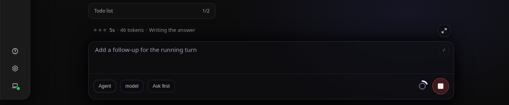

# UI design: transcript

[Design index](../../DESIGN.md)

## Components

### Repo links

Repo links appear as plain text links (**`GitHub | API docs | v1.2.36`**) in a fixed footer at the bottom of the **start screen** (hero / empty state only — not shown once a chat is active). GitHub (**`https://github.com/coddy-project/coddy-agent`**) and **API docs** (**`/docs/`**) both open in a **new tab** (`target="_blank" rel="noopener"`). The version of the server the page is talking to closes the line on the right, after the same **`|`** separator: **`GET /coddy/info`** through the environment, so on a remote or a node it is that server's; a release (**`X.Y.Z`**) reads **`vX.Y.Z`** and links to its release notes in a new tab, a build between releases is plain text, and without an answer the line keeps its two links. Implemented via **`chat/HeroFooter.tsx`** (**`.hero-footer`**, inside the `isEmpty` branch of `ChatScreen`) with `position: fixed; bottom: 16px` centered across the viewport; pinned by **`HeroFooter.test.tsx`**.

### Tool timeline

Captured via SSE (**`tool_call`**, **`tool_call_update`**). Rendered like **thinking** and **memory**: a **`thinking-row`** foldout with **chevron**, **tool name**, and **duration** (**`thinking-dur`** in the summary row alongside the label).

The expanded body uses the same tool-specific visual preview as the permission gate, followed by a separate **Result** panel when the tool returned output. It never repeats the approval actions. Most results stay raw monospace text. Known document and structured-result tools render their content in their own cards: `load_skill`, web search and fetch, the scheduler, and the structured cards below (every other built-in tool that answers in a known shape, and every tool of an MCP server). Terminal structured cards that fully express their result suppress redundant boilerplate: completed todo updates keep their saved plan snapshot, and a completed **`plan_exit`** card presents a theme-aware **Plan mode → Agent mode** transition with a semantic-success checkmark and the localized completion message instead of the raw `switched session to agent mode` string.

**A picture the call returned is seen, not folded.** A **`read`** of an image file hands the model the picture, and so does an MCP tool whose result carries an image block, a screenshot ([Images](../../docs/features/images.md)); the row previews it under the summary, an MCP call's card included, outside the **`details`**, so it shows with the row closed: **`.tool-images`** at the inset of the label (14px), 6px under the summary and with no margin of its own below, so the space after the pictures is the transcript's gap between rows (10px) as after any other row, one **`button.tool-image-card`** per picture with the size and the manner of a sent attachment card (128x96, radius 12px, the chip's border and fill, **`cursor: zoom-in`**), the thumbnail filling it with **`object-fit: cover`**, and a click opening the original in **`ImageLightbox`**. A picture without a thumbnail (a WebP, or one over 16 megapixels, which the server does not decode for a preview) fills its card with the original. The images load through **`useApiImageSrc`**, like an attachment's, so a remote environment or a relay shows them. Only a completed call has them; a failed call keeps its error and shows no card.

**The row names an action, not a function.** A tool id is translated through the **`tool.name.*`** dictionary entries (**`toolDisplayName`** in **`messages/toolDisplayName.ts`**): the English row reads **`running a command`** and the Russian one **`выполняю команду`**, both lowercase, both in the voice of the agent doing the work. An id with no entry - an MCP server's own tools - keeps its raw spelling rather than being flattened into something generic. **`read`** serves files and directories from one tool, so the directory wording (**`browsing a directory`** / **`просматриваю директорию`**) is used only when the arguments prove it: **`recursive`**, **`show_hidden`**, or a path ending in a separator. Beside the label, **`.tool-summary-target`** names the one thing the call acts on, through **`toolCallTargetText`**, and this row is the one place that names it - the live status line under the transcript never does. A **path** is spelt against the directory the work is happening in (**`relativeToolTarget`** in **`chat/toolTargetPath.ts`**, gated on **`toolCallTargetIsPath`**) whenever that is shorter. The roots are the session's own directory followed by the **worktrees** of its workspace (**`pathRoots`**, built in **`App.tsx`** from **`currentSessionCwd`** and **`workspaceCtx.worktrees`**), and the **deepest** root holding the file wins: work inside a worktree reads against **that worktree**, because the path to it is what every row of that work repeats. A command, a pattern, a url or a name is never rewritten, and the **`title`** attribute and the expanded card keep the path the call was given. **A read of part of a file names the lines** after the path, spelt the way a mention writes a range (**`toolCallTargetRange`**): **`path:120-180`** for **`offset`** 120 and **`limit`** 61 (the tool's offset is the first line, 1-based, and its limit a count of lines), **`path:1-40`** for a limit alone, **`path:240-`** for an offset that reads to the end of the file, and the path alone, as before, for the whole file and for a call whose offset or limit is not a whole number (the tool refuses it); one line is **`path:120-120`**, which a mention still reads as a range. Only **`read`** of a file takes it - a read the label already calls a directory listing (**`readsADirectory`**) has no lines, and the offset of **`coddy_docs_read`** or **`keep_result`** is not a line of a file. The target is then **`.tool-summary-target--ranged`**, an inline flex of **`.tool-summary-target-path`**, which takes the ellipsis, and **`.tool-summary-target-range`** (**`flex: none`**), so a long path never clips the lines away; the **`title`** is the full path with the range. **`toolCallTargetText`** stays the path alone, since the live status line reads it too. For a row with a separate target, label, target and duration share one line (**`.thinking-head`**), and the target is what gives way, clipped with an ellipsis and carrying the full value in its **`title`**. What trails the label - the target, the **(failed)** marker, the duration - is one group, **`.thinking-trail`**, and the head wraps (**`flex-wrap: wrap`**): the group stays on the label's line while that line has the room it needs and moves under the label as a whole when it does not. That room is the group's flex basis - **7em**, the duration and a readable start of the target, **11em** on a failed call (**`.thinking-trail--failed`**), which also carries the marker - capped at the group's own width (**`max-width: max-content`**), because the head is as wide as its content and a basis wider than a short group would wrap it under a label it fits beside; its minimum is zero, because the automatic one is the target's whole unwrapped text and would push the group under every label with a long command. The label never shrinks for the group, is at most the row's width and wraps inside it (**`max-width: 100%; overflow-wrap: anywhere`**) - an MCP tool names its server and its tool in a sentence, and the tool's name is one long identifier. The row used to be one unit that could not wrap, and that label made a phone's page scroll sideways; a first fix that let the target alone drop under the label left a one-pixel target on the label's line and the duration alone on the next (**`transcriptWrapCss.test.ts`**, live check **`npm run check:overflow`**, which fails on a target narrower than its first 24px and on a group split across lines). A targetless row uses **`.thinking-head--targetless`** as a block, with the label inline and the duration inline-block: the duration follows the last word of the full wrapped label when it fits, and wraps normally otherwise. A backgrounded **`run_command`** says so in the label itself (**`running a command in the background`** / **`выполняю команду в фоне`**, key **`tool.name.run_command_background`**, chosen from **`background: true`** in complete arguments - a payload still streaming in must not rename the row halfway) and the duration slot carries the task's clock instead of the call's meaningless **`0ms`** (see **Background task on a transcript row**).

**An ACP agent's call is a row like any other, named by its title.** A model of type **`acp`** is a whole agent whose tools are its own ([ACP agent as a model](../../docs/features/acp-provider.md)); its calls arrive as **`tool_call`** with **`_meta.coddy.agentTool`** and, after a reload, as the **`agent_tools`** of the assistant message, placed before the message's text (**`agentToolItems`** in **`chat/transcriptFromMessages.ts`**). The title already names what the call works on (**`read notes.txt`**, **`Run go test ./...`**), so such a row reads no target out of its input (**`agentTool`** on **`ToolCallMessage`**); everything else - the input, the output and its first lines, More, the duration - is the ordinary row's.

**Nothing to preview is not an empty object.** A call that takes no arguments renders the shared preview bar alone - the action label, the status mark the todo rows use, and **Done** / **Running…** / **Failed** / **Cancelled** as its meta - instead of a code panel containing **`{}`**. It is the same chrome as the plan cards minus their list, so the plan tools and the no-argument calls read as one family.

**A shell command is input, not body text.** **`run_command`** / **`ssh_run_command`** use the **`shell`** preview kind: the command sits in an inset rounded block inside the card behind an accent **`$`** prompt, and the control that copies it sits on that same line, in the block's last column. The card header above it never carries a second copy control. For a local call that header is the interpreter the server actually runs (**`/usr/bin/bash`**, **`cmd.exe`**), published as **`shell`** on **`GET /coddy/workspace/context`** and held in the process-wide **`chat/hostShell.ts`** store the way the locale is held; a server that reports none, and a remote **`ssh_run_command`** whose interpreter lives on somebody else's host, keep the generic label.

**Output carries no label, and a failure is said once.** The returned body attaches directly under the call, with no **Result** header and no divider - the preview viewport drops its closing edge when a result follows, so the two panels are one surface: it is the only thing there, and naming it was chrome. One surface means **one** gap at the seam: a command block already carries its own **10px** inset inside the card, so the output under it drops its top padding (**`.coddy-tool-call-body--connected-result > .permission-preview:has(.permission-preview-shell) + .tool-call-result-card .tool-call-result-content`**); previews whose body runs edge to edge, a diff or a code panel, keep theirs. A call that **failed** says so on its summary row instead - **`.tool-failed-marker`** renders **(failed)** / **(ошибка)** in the theme's deletion red, between the target and the duration - so the failure is readable while the row is still collapsed.

**`load_skill`** returns Markdown. The summary row already names the skill, so the call renders no argument card; the body a **completed** call returns is a skill's markdown and renders through the Markdown component (**`.tool-call-result-content--markdown`**) in the prose font rather than the panel's monospace stack, with list indents tightened for the narrower card. A **failed** call returned an error rather than a skill and keeps the raw monospace panel.

**A web search is read as its hits, all of them.** **`websearch`** renders its answer as a Markdown list of links (**`webSearchResultMarkdown`** in **`chat/webToolResults.ts`**), each snippet on its own line under its link (a hard break, not a run-on after it), closed by the tool's **`hint`**. The row's preview is the first 19 lines of the output and the engine report that leads the answer fills them - the cut usually lands on **`"results": [`** with not one hit whole, which is how the row came to print raw JSON behind a **More…** control. So **opening the row is the request for the results**: the first **`toggle`** to open fetches the saved answer once (**`GET /coddy/sessions/{id}/tool-calls/{toolCallId}`**), a muted **Loading…** line (**`.tool-result-loading`**) stands in meanwhile, and the whole list renders at its natural height with **no More / Less** and no capped viewport. A closed row costs no request; only a failed fetch brings back the ordinary **More…** to try again. The **header carries every parameter of the search** - the query, **`page N`** and **`max N`** with the tool's defaults filled in (page 1, 15 rows, capped at 25) and **`site …`** when one was named - and the first line of the body (**`.web-search-engines`**, **`webSearchReport`**) says how each engine answered: **`bing: 10`** for one that answered, **`brave: blocked (http 429)`** in the failure colour for one that did not. The report is read out of the preview as well as the full answer, since it is whole even where no hit is.

**A scheduler call is read as what happened to which job.** The **`coddy_scheduler_*`** tools take a **`job_id`** and answer with a line of JSON, and the row printed both as they were - **`{"job_id": "ai-news-digest"}`** over **`{"job_id":"ai-news-digest","paused":false}`**. They render **`SchedulerToolCard`** (**`messages/SchedulerToolCard.tsx`**, model in **`chat/schedulerToolDisplay.ts`**) instead of the argument preview and the result panel: the preview bar with the plan rows' status mark, the job id (**`old → new`** for a rename) and, as its meta, **what happened** - **`resumed`** / **`снято с паузы`**, **`run started`** / **`запуск принят`**, **`was not running`** for a Stop of an idle job, **`created`**, **`updated`**, **`deleted`**, **`paused`**, **`replaced`**. A create, replace or patch lists under the bar the fields it set; **`job_get`** lists the job - description, the cron with its reading (**`0 8 * * * · At 08:00, every day`**), state, next run (UTC), mode, model, folder - and its instruction as Markdown in an inset panel; **`jobs_list`** is one row per job (id, description, schedule, state) with the count as meta; **`job_runs`** one row per run (local start, status, duration). The reading tools fetch the whole answer when the row opens, as a search does. The row names the job beside the label (**`toolCallTargetText`** reads **`job_id`** for every scheduler tool). A failed call keeps its error as raw text. **Every scheduler tool has a **`tool.name.*`** entry in every dictionary** - **`coddy_scheduler_job_resume`** shipped without one and the row read the raw id; **`TestEverySchedulerToolIsNamedInTheWebUI`** (**`external/scheduler/tools/names_ui_test.go`**) now holds the registry to the dictionaries.

**A structured card reads the tool's own answer.** **`switch_model`**, **`http_request`**, the **`background_*`** tools, **`preview_server`**, **`coddy_docs_search`** / **`coddy_docs_read`**, **`plan_list`** / **`plan_read`** / **`plan_write`**, **`session_describe`**, the **`config_*`** tools, **`keep_result`**, **`compact_context`**, the **`coddy_memory_*`** tools and every tool an MCP server serves (**`server__tool`**) render **`StructuredToolCard`** (**`messages/StructuredToolCard.tsx`**) instead of the argument preview and the raw result panel. The Go tools write their answers for the model; **`chat/structuredToolDisplay.ts`** parses that text into small views, and its tests hold each parser to the exact text the Go formatter produces - a card tested on a format no tool writes passes and then prints raw text in every real session. Anything a parser does not recognise is shown as the text it is, inside the same card, so a change of format on either side loses nothing. The card is the scheduler card's frame: the bar (**`.permission-preview-bar`**) names what the call is about, the body (**`.scheduler-tool-body`**) holds labelled fields (**`.scheduler-tool-fields`**) and rows (**`.scheduler-tool-rows`**). Text the tool returned as it was - a log, a response body, a nested JSON value - is **`.structured-tool-output`**, the monospace voice of the raw panel, never the card's prose font; Markdown it returned (a plan, a documentation section, a memory note) is **`.structured-tool-document`**, an inset in the prose font. What was asked and what came back are set apart by a rule (**`.structured-tool-answer`**) because both can be the same list of fields. A body with nothing in it is not drawn, so a call still waiting for its answer is the bar alone. A **failed** or **cancelled** call, and one whose arguments do not parse, keep the generic panels, where the error reads as written. A truncated answer caps the card's **body** (**`bodyClassName`** / **`bodyRef`** carry the **`tool-result-viewport`** classes), so the bar stays in view while the body scrolls.

- **`http_request`** - the bar is the method and the address the request really fetches: the **`query`** object appended the way the tool appends it (names sorted), the password of a userinfo hidden. Under it: the rationale, the request headers with credential-bearing ones (**`authorization`**, **`cookie`**, **`token`**, **`secret`**, **`password`**, **`api-key`**) shown as **`•••`** and an emptied one as removed, the kind of body with its file, its form fields (a credential-named value hidden) or its byte count, then the JSON (indented) or text payload itself in monospace, the proxy with its credentials hidden, **not verified** in the failure colour (**`.structured-tool-warning`**) when **`verify_tls`** is false, followed redirects, the timeout and **`output_file`**. Everything that changes where the request goes or what it trusts is on the card: the generic preview showed all of it as JSON, and a card that drops a skipped certificate check is a card that hides it. The response - status, headers masked the same way, the body in monospace, the tool's bracketed notes (**`followed redirects: …`**, **`body: saved …`**) as muted lines - sits under the rule.
- **`switch_model`** - the model, the reasoning level and how long it applies, read from the answer (what took effect), not from the arguments (what was asked); the sentence written for the model is not repeated.
- **Background tasks** - one row per task: id, the status through the Tasks panel's own labels (**`taskStatusLabel`**, so it is translated), label, address, the elapsed / estimate / exit detail and the pool's note, muted. **`background_output`** / **`background_wait`** add the output in monospace and say when it is still running or its start was dropped; **`background_reap`** lists what it killed by pid. **`preview_server`** is the address as a link (http and https only), the task and when the server stops; the lines telling the model to invite the user are not shown.
- **Documentation** - a search is one row per hit, the title a link into the reader (**`docsHrefFromCoddyLink`**, never Markdown built from the title: a title is text); a read is the section as a document, a link to it in the reader and its line range, with **Continues at line N** when the tool paged it.
- **Plans, session filing, configuration, memory** - a plan read shows its name and overview above the body (a preview cut inside a long frontmatter stays monospace text until **More…**), a plan write the plan it wrote (the plan card in the chat has the latest version, the transcript keeps each one), a plan list one row per plan with its update time; **`session_describe`** the title, the tags as chips and what changed; a **`config_*`** answer its JSON as fields, with the values the server redacted, in place of the arguments it repeats; a memory note as a document when it is a **`.md`** file or has Markdown's structure and as monospace text otherwise, a memory search one row per hit.
- **MCP** - the bar is the server, muted, and the tool as its server spells it (**`.structured-tool-mcp-server`**, **`.structured-tool-mcp-tool`**). The arguments are fields: text as text, numbers and booleans in monospace, a short list of scalars as chips, anything nested as indented JSON. The answer is read by its shape (**`resultNode`**): a JSON object as the same fields, other JSON indented, text with Markdown's own structure (a heading, a fence, a list - **`looksLikeMarkdown`**) as a document, anything else as monospace text. MCP servers answer the model in Markdown or JSON far more often than in plain text, and neither reads as its source. **Every value is the text the server wrote.** **`JSON.parse`** only validates: **`chat/jsonSource.ts`** reads the document into nodes that carry their own slice of it (**`parseJsonSource`**), a number, a boolean and nested JSON are shown as that slice and nested or top-level JSON is re-indented as text (**`indentJson`**, the layout of **`JSON.stringify(value, null, 2)`**, a document past 1 MiB shown as it came). Printed back from a parsed value, an id past 2^53 - a Discord or Twitter snowflake - came out rounded (**`12345678901234567891`** as **`12345678901234567000`**), an escape came out decoded and of two equal keys only the last survived; now a repeated key is a row per value and the JSON panels keep **`\u00e9`** as written. A text row shows the string its literal encodes. The arguments of every card that lists them as fields, and the JSON body of **`http_request`**, are read the same way.

**`question` is the record of an offer.** The row names the act (**`asking`** / **`спрашиваю`**, key **`messages.toolQuestionLabel`**) and carries no duration - nothing was running while the reader read it. Its body is the offer as the model made it: every question, each option behind the letter it was offered under (**`.question-tool-offer-row`**, the letter in the same **`.question-prompt-bubble`** the live card uses), and after them the free-answer slot unless the question set **`custom`** to **`false`** - carrying the words the reader typed into it, so an answer is read in the slot it was given in rather than named twice. The flag is on by default (issue #257), so arguments that do not name it get the slot, the record of an older question among them, empty. The letters the reader took are marked in the accent, each answer claiming one option. A line closes the block only when the letters cannot say it: nothing answered yet, or an answer with no slot of its own. This is the **only** place the offer survives - the answered card below the row keeps just the question and the answer - so an option the reader did not take is readable here and nowhere else.

**Copy controls are icons.** Every control that used to spell out **Copy** - the markdown code-block button, the tool preview and permission preview controls - is the clipboard glyph on the shared **`.md-copy`** chrome, with the word it replaced kept as the native **`title`** tooltip and the accessible name. A copy button laid over a scrolling block (a code block, a figure's source, the command of a background task) has **`z-index: 1`**: iOS Safari hit-tests a scrolling **`overflow: auto`** block above an earlier absolutely positioned sibling that has none, so the painted button never got the tap (**`codeCopyButtonCss.test.ts`**); the ones in a flex or grid row are static and overlap nothing.

**Copy works on a page served over plain HTTP.** A page opened at **`http://192.168.1.100:12345`** has no **`navigator.clipboard`** (browsers offer it only to a secure context), so every text copy control - code blocks, inline code and tool previews, formulas, message copy, the paths of the edits and Files windows, the shared file card's menu, **`@`** mentions, the copy button of Settings → System - goes through one helper, **`copyText`** (**`ui/clipboard.ts`**): the clipboard API where the page has it, else the page copies by itself inside the tap that asked, before any **`await`** (a browser accepts the copy command only while it handles the tap): it selects the text in a read-only text area at **16px** (no keyboard, no zoom) with **`setSelectionRange`**, which iOS needs since **`select()`** does not select there, runs **`execCommand("copy")`**, removes the area and gives the focus back. The helper answers whether the text reached the clipboard, and a control says **Copied** (or turns to the check mark) only on **true**; a copy that failed leaves the control as it was. No component calls the clipboard itself (**`ui/clipboard.test.ts`** reads the sources); the one exception is the picture menu, which writes pictures, and a page without the API offers **Save** only (**The picture menu**).

- Tool arguments arrive via `tool_call_update` status `in_progress` where `content[0].content.text` is raw JSON args.
- Tool result arrives via `tool_call_update` status `completed` or `failed` where `content[0].content.text` matches the HTTP user preview rules (**raw** text, **no Markdown**): the first **19** content lines, then a twentieth row that is only **`...`**, when the output is longer; **`_meta.coddy.toolResultPreview`** marks truncation. Outputs that are not truncated skip the fixed-height viewport and overflow toggle (natural-height grey mono panel). When truncated, the fixed-height panel shows the clipped preview with **no vertical scrollbar**. The shared **More…** button performs **GET `/coddy/sessions/{id}/tool-calls/{toolCallId}`** once, fills the same panel with the full saved body at the same max height, enables **overflow-y** scrolling, and turns into **Less**. **Less** restores the clipped preview without another request while the full text stays in memory for this session.

#### Tool card UI (bundled SPA, current)

Implementation lives in **`external/ui/src/ui/messages/ToolCallMessage.tsx`**.

- **Layout** - Outer **`thinking-row coddy-tool-call-row`**; **`details`** uses **`thinking-details coddy-tool-details`**. **`summary.thinking-summary`** with **`thinking-left`** ( **`aria-label="Tool summary"`** ): **`thinking-chevron`**, then the **`thinking-head`** (it wraps when the label leaves the group too little of its line) holding **`thinking-label`** (the catalogued action name, **`...`** suffix while **`pending`** / **`in_progress`** ), the optional **`tool-summary-target`**, and the **`tool-failed-marker`** a failed call adds, and **`thinking-dur`** - the last three inside **`thinking-trail`** when a target exists; without one, the label and duration flow inline (**finished** durations from **`meta.json`**, **live elapsed** while in flight when **`startedAtMs`** is set, placeholder **`-`** when unknown). Transcript stacking uses **`messages-inner` `gap`** like other **`thinking-row`** blocks (avoid tool-only asymmetric margins). Expanded **`thinking-body coddy-tool-call-body`** is transparent and contains the shared **`PermissionToolPreview`** without nested copy or approval actions, or the **`StructuredToolCard`** of a tool that has one (see **A structured card reads the tool's own answer**). A generic preview drops its header bar when the arguments name nothing for it. Generic returned output follows in **`tool-call-result-card`** as a bare **`pre.tool-result-pre`** body, joined to the preview above it without a header or a divider.
- **Duration format** - Every step duration on a transcript row - a tool call, a reasoning block, a memory pass, live or finished - goes through one formatter, **`formatStepDuration`** (**`messages/formatStepDuration.ts`**): **milliseconds only below three seconds** (**`846ms`**, **`2999ms`**), whole **seconds** up to a minute (**`32s`**), **minutes and two-digit seconds** up to an hour (**`1m 42s`**), **hours and two-digit minutes** beyond (**`1h 05m`**). A count like **`32749ms`** asks the reader to divide by a thousand and **`1.7m`** to multiply a fraction by sixty; neither is a reading. The live status line and the background task clock count whole seconds of their own and keep their formatters.
- **Viewport** - Truncated results ( **`resultWasTruncated`** from list / SSE) add **`tool-result-viewport tool-result-viewport--tall`**, clipped with **`tool-result-viewport--clip`** (capped at ~20 lines, **overflow-y** hidden) or scrollable with **`tool-result-viewport--scroll`** after **More…**. Large **`write`** / **`write_file`** code previews and **`apply_patch`** / **`edit`** diffs use the shared measured **`permission-preview-viewport`** cap (**190px**, **170px** on phones): the toggle appears only when the rendered body overflows, expansion scrolls inside the tool card, and **Less** returns the viewport to the top. Every other preview - a command block, a short argument card - is **`permission-preview-viewport--static`**: it has no toggle, so it is never capped, on a phone either. The phone rule is written **`.permission-preview-viewport:not(.permission-preview-viewport--static)`** because it comes after the modifier at the same specificity; written plainly it capped a long wrapped command at 170px, and with the overflow visible the command spilled over the output under it (**`permissionPreviewViewportCss.test.ts`**). Short results and previews follow content naturally without a fake tall box or toggle row.
- **Controls** - Result **More…** (**`data-testid="tool-result-more"`**) / **Less** (**`data-testid="tool-result-less"`**) and preview overflow controls reuse the shared left-aligned **`tool-overflow-toggle`** tab button, attached flush to the panel's bottom border. Phone layouts increase the button's minimum height to **36px** for a more comfortable touch target.
- **Full body** - The SPA obtains saved full strings only via **GET `/coddy/sessions/{sessionId}/tool-calls/{toolCallId}`**. **`App.tsx`** wires **`onFetchToolCallFull`** to that endpoint and merges JSON **`result`** into **`fullResultText`** plus full **`args`** into **`argsText`**. Restored **`apply_patch`**, **`write`** / **`write_file`**, and **`edit`** cards auto-fetch in any status when the 200-character list **`argsPreview`** is incomplete JSON, so their structured previews match live SSE cards after reload instead of rendering an empty **`+0 −0`** header. Reconciles via **`loadMessages`** keep already-complete args (**`pickRicherToolArgs`** in **`toolCallArgs.ts`**) instead of re-truncating them, and complete args re-arm the one-shot fetch so a later truncation recovers again. The preview overflow toggle re-measures on the enclosing **`details`** **`toggle`** event (collapsed foldouts measure zero while hidden).

- **Spawn agent arguments** - `spawn_agent` uses `SpawnAgentCard` inside the existing disclosure body instead of JSON when `agent` and `prompt` are available. The header pairs a small outlined robot icon in an accent-tinted tile with the agent name and optional description. A clock badge on the right labels the supplied positive `timeout_seconds` as `Timeout Ns`; it is separate from elapsed execution time in the disclosure summary and wraps below the identity on narrow widths. The prompt occupies an inset rounded panel, preserving line breaks and wrapping long words as plain text. **More…** exists only while the collapsed panel really cuts text off (**`scrollHeight`** over **`clientHeight`**, measured again on resize), and it hangs from the panel's lower edge **8px** in, past the **8px** corner, like the toggle under every tool box: flush left it covered that corner and the frame seemed to lose it. The card does not lead to the child's transcript: that is **Show transcript** on the task's card in the Tasks panel, and two routes side by side said the same thing twice. Both themes use semantic foreground and surface tokens. Results and their More / Less controls retain the standard tool behavior, with the result visually attached below the agent card. Truncated history arguments are fetched once per incomplete preview, including running calls; a later truncated reconciliation can fetch again. Unavailable or malformed arguments keep the readable argument fallback. Labels follow the active English/Russian UI locale.

Tool call history is persisted per session under `tool_calls/` so it can be restored after restart.

### Tool permission gate

**PermissionPromptSection** renders only for tool calls that actually require approval. Read-only calls do not get a placeholder card, status checkmark, or “runs without a permission prompt” message.

- The header contains one short action question and one technical tool-id badge. Do not repeat the raw tool name in the question or preview header.

### Question card

A waiting **`question_prompt`** (**`QuestionPromptSection.tsx`**) lists every question's options behind their letters and, after them, a row for an answer of the reader's own (**`.question-prompt-row--other`**, an input with the placeholder **Other…** / **Другое…**, testids **`question-other-<n>`** and **`question-other-multi-<n>`**), on single and multiple choice alike. The row follows the question's **`custom`** flag, which is on by default (issue #257): the options a model puts up often miss what the reader means, so only a question that sets **`custom`** to **`false`** - a confirmation whose answer must be one of its options - lists the options alone (**`offersOwnAnswer`** in **`chat/questionTypes.ts`**). A payload without the key offers the row, so a node of an older version, which leaves the key out for a question that never mentioned it, gets it too; the server reads a missing key as true and always writes it (**`acp.QuestionPrompt`**). In a multiple-choice question the typed text joins the options ticked beside it. The card's row (**`.message-row-question`**) is flush with the transcript column on both sides, like **`.message-row-permission`**: on a phone the card's edges meet the composer's under it, and the row chevron above stays in its own band. A padding on one side only set the card in from the left edge and not the right (**`questionPromptRowCss.test.ts`**). Tests: **`QuestionPromptSection.test.tsx`**, **`features/web_ui_question_own_answer.feature`**.

### Answered question card

An answered **`question_prompt`** (**`QuestionPromptSection.tsx`**, resolved branch) is a record of one exchange and states it once: the **Questions** head, the question, and under it what the reader said (**`.question-prompt-answered`**, reusing **`.question-prompt-resolved-q`** / **`-a`**). It is **not** a foldout - it carried a summary line on its head and the same two lines again inside a **`
`**, which put the same exchange on screen twice behind a control that revealed nothing new, three times counting the tool row above it. The options are not repeated here either; the tool row keeps the offer.
- Buttons keep the backend option labels and order: **Allow**, **Allow always**, optional **Always allow `<program>`**, **Reject**.
- The **Always allow `<program>`** option appears **only** for **run_command**, and only when the command is a single plain invocation (**`internal/permission.ProgramGrant`** refuses anything carrying shell metacharacters or a leading **`VAR=`** assignment). Its label names the exact allowlist entry that will be stored — **`curl`** for a bare program, **`git status`** for a multiplexer — so the operator approves the string that is actually saved. **Allow always** keeps its narrow exact-command meaning; the wider grant is never implied.
- Four buttons must still wrap cleanly at phone width: the row wraps rather than shrinking any button below its touch target.
- The preview uses the matching transcript **tool_call.argsText** when available; this preserves structured arguments when the ACP permission rationale contains only prose.
- **apply_patch** shows a color diff with old/new gutters, additions, deletions, hunk context, and the affected path. **edit** derives the same diff treatment from **oldString** and **newString**, retaining up to two unchanged lines on either side when present.
- **run_command**, **write**, **mkdir**, **touch**, **mv**, **rm**, and **rmdir** use compact operation-specific previews instead of raw **Arguments:** JSON. Unknown permission tools fall back to a monospace body, and a tool with no arguments to a bar naming the action and its state.
- The copy control is the clipboard icon (**`.md-copy`**, tooltip **Copy**). For a shell command it lives inside the command block next to the **`$`** prompt (**`data-testid="permission-prompt-copy"`**), not in the card header.
- Preview bodies have a collapsed height cap. **More…** appears only when DOM measurement confirms overflow; it keeps the same bounded viewport, enables internal vertical scrolling, and changes to **Less**. The shared tab button is left-aligned under the viewport and gets a taller touch target on phones. Short content has no toggle.

- **A background subagent's prompt** (**`SubagentPermissionCards`** in **`chat/SubagentPermissionCard.tsx`**) uses this same card once the turn that spawned the subagent has ended and no stream is left to carry the prompt. **`ChatScreen`** renders one per waiting task of the session at the **end of the transcript column**, after the last message, oldest question first: a running agent row with a usable **`pending_permission`** (**`isAwaitingPermission`**: the child **`sessionId`** and the **`toolCall.toolCallId`** present). The head names the subagent (*The subagent "writer" asks for permission*) in place of the action question; the preview is built by **`buildPermissionToolPreview`** after **`stripSubagentTitlePrefix`** drops the relay's **`[subagent <name>]`** prefix; the buttons are the offered options (never an "always" one). The answer goes to the **child** session through **`submitPermissionChoice`** (**`chat/permissionSubmit.ts`**, shared with **`PermissionPromptSection`**) and the task rows are re-read, as they are on every **`subagent_permission`** server event. Adjacent prompts use the transcript's **10px** gap. A newly waiting call follows the reader only while the chat is pinned to the bottom; polling an unchanged prompt and removing a settled prompt do not force a scroll. Reference capture: **`docs/assets/subagents/chat-subagent-permission-dark-1280.png`**.

Implementation: **external/ui/src/ui/chat/PermissionPromptSection.tsx**, **PermissionPromptPreview.tsx**, and **permissionToolPreview.ts**.

### Todo checklist under the transcript

While a session keeps a todo checklist (the **`coddy_todo_*`** tools, **`GET /coddy/sessions/{id}/plan`**), the newest end of the transcript shows the whole list, so the item the agent is on is never more than a glance away (**`messages/TodoChecklistMessage.tsx`**, rules in **`chat/todoChecklist.ts`**).

- **Place.** A tail row of **`MessageList`** (**`.message-row-todo`**, **`data-testid="todo-checklist"`**), after the newest row and, while generating, below the live status line, so the checklist is the last row before the composer. It stands on the transcript's own row gap and adds nothing to it, folded or expanded; the entrance and exit collapse that gap with the card. The **6px** it used to add put it further from the row above - usually the live line, or the line a finished turn leaves - than any two rows of the transcript stand apart, and that surplus read as the caption being pushed down onto the card. Like the live line it renders only while the transcript window reaches the newest message; it carries no **`data-row-id`**. On a desktop the row is as wide as its longest line (**`width: fit-content`**), no narrower than **`min(320px, 100%)`** and no wider than the other cards of the transcript (**`max-width: 720px`**), on the column's left edge; under the phone tier (**`max-width: 599px`**) it takes the whole column, as every card does there. Folded rows keep their width, so folding never changes the card's.
- **Card.** **`.todo-checklist`**: one quiet frame (a 1px border at 10% of the text colour, radius **12px**, a 2% wash), padding **4px 16px 8px** while expanded and **4px 16px 6px** while collapsed, inside the clip of the row (**`.todo-checklist-clip`**). Those **16px** over the card's own border put its marks on the vertical line of the folder icon on the plate over the composer and its items' text on the line of the folder's name, the live line's mark and numbers in the same two columns. Its head (**`button.todo-checklist-head`**, 12px, the muted text colour, the full text colour on hover) is the title **Todo list** / **Список задач** (**`todo.checklist.title`**) and the progress **2/4** at the right edge, with no chevron: the whole head is the fold control (**`aria-expanded`**, **`aria-controls`** naming the list). Under it **`ul.todo-checklist-list`**, a line per item (**`.todo-checklist-row`**, 13.5px, the content wrapping inside the row) with no rules between them. Each row leads with the status mark the todo tool rows use (**`.todo-tool-preview-mark--<status>`**: pending a rounded square in the accent, in progress a half-filled circle, completed a filled square with **✓** in **`--coddy-todo-completed`**, failed **×**, cancelled **−**), here at the **14px** of the plate's icons rather than the 17px of a tool row's preview - the card stands right over the plate, and two sizes of the same square read as a misprint - **6px** from its text, which is the plate's own gap; a completed or cancelled item's text is muted. The list's accessible name carries the count in words (**`todo.checklist.label`**, **Todo list, 2 of 4 done**), each row reads as **status: text** and the item in progress is **`aria-current="step"`**.
- **Folding.** A click on the head folds the list down to the items in progress (**`todoChecklistFocus`**: the items in progress and nothing else; with none, the head alone stays, its count saying how far the list got) and another click unfolds it. A header-only collapsed card centres its title and count vertically: the card and button padding together leave **10px** above and below the heading line inside the border. The choice is this browser's, for every chat (cookie **`coddy_todo_collapsed`**, **`chat/todoChecklistPrefs.ts`**); the list starts unfolded. A folded row stays in the DOM, **`aria-hidden`**, with **`.is-folded`**: its grid row closes to **`0fr`** and its padding and opacity to zero, so the rows around the ones in view move together instead of jumping.
- **The item in progress.** Every item in progress carries a still mark of its own: the accent ring with a dot in it (**`.todo-checklist .todo-tool-preview-mark--in_progress`**: an accent border, **`border-radius: 50%`**, a **`radial-gradient`** dot of 2.5px in the 14px mark), whether this tab sees a turn running or not. A spinning ring and a band running through the text drew the eye from the answer; the mark says which item the agent is on and stays still.
- **Motion.** Every change of state moves rather than jumps: the card comes in by opening its grid row from **`0fr`** while it fades in over **0.22s** (and takes the transcript's row gap the same way), a new row does the same (**`todo-checklist-row-in`**), both filling only **`backwards`** so the fades of a fold and an exit can run after them, a status changes the mark in place (its fill, border, radius and colour ease over **0.25s**, so a pending square rounds into the ring) while the new glyph pops in from a third of its size (**`.todo-checklist-glyph`**, keyed by the status), a muted text eases to its colour, and a card that stops showing stays for **240ms** (**`TODO_CHECKLIST_EXIT_MS`**) with the list it had, **`aria-hidden`** and **`inert`** (**`.is-leaving`**), closing its grid row to **`0fr`** and fading while it takes back the transcript's row gap, then goes; the card sits in **`.todo-checklist-clip`**, which has no padding or border, so the row closes to nothing and nothing jumps when it unmounts. Rows are keyed by their text (and which of equal texts they are), so an item added or removed above leaves the rows below the same rows. A switch to another chat never plays the exit of the list it left: the transcript stays mounted across chats, so the card forgets the list it holds when the session changes. The card's bottom padding eases over **0.22s** when folded, and the adjacent active line's top padding eases over **0.24s** when the card mounts or unmounts. All of this motion is in one **`@media (prefers-reduced-motion: no-preference)`** block; a reader who asked for less motion gets every state at once (**`todoChecklistCss.test.ts`** holds it).
- **When it shows** (**`todoChecklistShown`**, **`useTodoChecklistShown`**). While the list has an item **pending** or **in progress**, whether a turn runs or not. Once every item is closed (completed, failed or cancelled) only while the turn that closed it runs: that turn is still writing its answer. The server keeps a finished list until it is replaced or archived and sends it again at the start of every turn, so the transcript remembers whether the turn on screen saw the list with work left (**`nextTodoChecklistTurn`**: a turn starts and ends where **`generating`** flips, and also where a new prompt enters the transcript, since a queued follow-up runs inside the same admitted turn and **`generating`** never drops before it; the key is the count of turn-opening rows plus **`userMsgIndexBase`**, so a page loaded above changes nothing; another session starts over): a later turn that starts on a finished list does not show it, and an idle session shows nothing.
- **Where the list comes from.** Every transcript read carries it (**`todoPlan`** of **`GET /coddy/sessions/{id}/messages`**, absent when there is none), and the **`plan`** frames of a running turn move it (**`onTodoPlan`** of **`consumeComposerSse`**, the turn's own stream and the relay alike); a **`plan`** frame marked as a design plan (**`_meta["coddy.dev/planKind"]`**) is not the checklist and is ignored. **`App.tsx`** keeps one list per session; a read issued before a frame the tab applied moves nothing back (**`TodoPlanOrder`**), since the reads that follow an answered permission prompt run beside the turn.

*A collapsed checklist with no item in progress keeps equal space above and below its heading.*

### Shared file cards

A file the agent shared with **`share_file`** is a card (**`ArtifactCard`** in **`messages/ToolArtifactCards.tsx`**): under its tool row (**`.tool-artifacts`**) and inline in the answer that names it (**`.inline-artifacts`**), one card per file in a wrapping row with an **8px** gap.

- **Size.** **134x140px** with **12px** padding; on a phone (**`max-width: 599px`**) **`min(118px, calc(50vw - 28px))`** wide and **132px** tall, so two cards share a row. The file name is clamped to two lines at the foot of the card, the size (or **Download unavailable**) under it.
- **Badge and trigger, one set of numbers.** The extension badge (**`.inline-artifact-extension`**) sits in the top left corner, the actions trigger (**`.inline-artifact-menu-trigger`**) in the top right. Both are placed from the card's custom properties **`--artifact-badge-inset`** (10px), **`--artifact-badge-size`** (28px) and **`--artifact-trigger-size`** (28px, **32px** on a phone for the finger): the trigger's **`top`** and **`right`** are the badge's inset plus half the difference of the two sizes, so the trigger is level with the badge and mirrors it across the card at any size. A trigger with a **`top`** and a **`right`** of its own sat 6px above the badge and 7px nearer its edge.
- **The dots are an SVG.** Three circles centred in a 24 viewBox, in a grid box that centres them; never the text glyph **`⋮`**, whose ink sat wherever the platform's font put it (the chevron's history, *Chevron*).
- **Visibility.** The trigger is transparent until the card is under the pointer or holds the focus, while its menu is open, and always on a phone or any screen with **`hover: none`**, where nothing would ever show it.
- **The menu is portalled.** The card is **`overflow: hidden`** - it clips a thumbnail to its corners - and a menu inside it was cut off, so a click on the trigger drew nothing. The menu (**`.inline-artifact-menu`**, **`role="menu"`**) is rendered into **`document.body`**, **`position: fixed`**, and placed from the trigger's rectangle before the first paint by **`placeArtifactMenu`**: 6px under the trigger with their right edges together, above it when the window's foot leaves no room below, and never closer than 8px to an edge of the window - a card at a phone's left edge does not push it off the screen, and a window too short for either side holds it as low as it can. It is never taller than the window less 16px and scrolls its items past that (**`max-height: calc(100dvh - 16px)`**), so no item is ever out of reach. It follows the trigger while the page scrolls and closes once the trigger cannot be seen: out of the window, or under another layer at its centre (**`triggerShows`**, a hit test) - the transcript scrolls under the chat's sticky title and the docked composer without leaving the window, and a menu that only watched the window's edges stayed open over the composer (checked on every scroll and resize; when it closes this way with the focus inside, the focus goes back to the trigger); a second press of the trigger, a press anywhere else, **Escape** (through **`useEscapeCloses`**, the focus handed back to the trigger) and picking an item close it. It takes the focus on its first item that can be picked; the arrow keys, **Home** and **End** move between those, and **Tab** closes it and hands the focus to the trigger without stopping the key, so the focus moves on from the trigger's place in the page (**Shift+Tab** back from it), as the WAI-ARIA menu button does. A disabled item is dimmed. A right click on the card opens the same menu.
- **Opening.** A click on the card opens the file it was copied from in a tab of the Files window (**`openWorkspaceFile`** with the descriptor's **`relativePath`**), through **`.tool-artifact-open`**, a transparent button over the whole card under the trigger (**`z-index: 1`**, the trigger **2**), with an inset accent outline on keyboard focus; a picture's thumbnail is that button itself (**`.inline-artifact-image--open`**, the pointer cursor instead of the lightbox's zoom). The menu has no Open item: the card is how a file opens. Nothing opens the copy, and nothing asks the server's desktop: the old **Reveal on server** item is gone, since a server without a desktop could only answer it with a failure. The card opens only a source the listing says is **`present`** (**`sourceState`**; an older server that says nothing is let through and the window tells), and checks it once more on the click (**`checkWorkspaceEntry`** with **`fresh`**): a file deleted since the listing turns the card into a deleted one rather than opening a tab that finds nothing, and a request that failed leaves it to the window.
- **The menu.** **Mention in chat** (the path into the composer as an **`@`** mention; disabled for a source that is deleted or not in the workspace, the reason in its tooltip), **Copy** and **Download**, in that order, the way a desktop app nests the ways to copy. On a desktop **Copy** (**`.inline-artifact-menu-sub`**, a right-pointing **`Chevron`**, lit while its submenu shows) opens a submenu (**`.inline-artifact-menu--sub`**, the menu's own look, portalled to **`document.body`** as well) with **Absolute path**, **Relative path** and **File name**: under the pointer, on a click, and on **Enter**, **Space** or **→**, which put the focus on its first item. **`placeArtifactSubmenu`** stands it **2px** beside the menu's right edge with its first item level with Copy, on the menu's left when the window has no room on the right, inside the window either way. Another item of the menu puts it away, pointed at or focused, and a click on Copy only ever opens it (the pointer entering Copy has opened it already); **←** and the first **Escape** go back to Copy (the menu's one **`useEscapeCloses`**, whose close takes that step), the next Escape closes the menu, and a press outside both closes everything. On the stacked shell and on a touch-only device (**`isMobileShell`** or **`touchOnly`**) no pointer slides into a submenu: the menu is one list, the three ways to copy in a **`role="group"`** under a **Copy** heading (**`.inline-artifact-menu-label`**, 11px, muted) between two rules (**`.inline-artifact-menu-sep`**).
- **A deleted source** (**`sourceState: "deleted"`**, **`.tool-artifact-card--deleted`**): the badge's border and letters and the name step back to muted text, the name is struck through, a picture's thumbnail is greyed at **55%**, and the line under the name reads **File deleted** (**`.tool-artifact-meta--deleted`**, muted at weight 600, never the danger colour: nothing failed). Nothing opens it: there is no open button, a picture's thumbnail opens the copy in the lightbox, and **Mention in chat** is disabled with the reason in its tooltip; **Copy** and **Download** stay as they were, since the paths are known and the session's copy is still there. A source outside the chat's workspace (**`unavailable`**) keeps the card's look, opens no file either (a picture's thumbnail still opens its copy in the lightbox) and disables Mention with its own reason.
- **Failures.** A download that fails marks the card **Download unavailable** and disables Download: the copy is gone.
- **Spacing.** The inline row stands **12px** under the paragraph before it and **16px** over the paragraph after it. A row that ends the answer (**`:last-child`**) has no bottom margin: the answer ends with it.

Covered by **`artifactCubeCss.test.ts`** (the numbers, the shared properties, the fixed menu and its height, the spacing) and **`ToolArtifacts.test.tsx`** (portal, focus, keys, toggle, scroll, a covered trigger, placement, opening the source, a deleted and an unavailable source, the check on the click, the Copy submenu by pointer and keyboard, the one list of a phone); **`external/ui/scripts/artifact-card-check.mjs`** (**`npm run check:artifacts`**) measures the result in a real engine on desktops and emulated phones (**`docs/surfaces/web-ui.md`**, *Checking the shared file cards*).

### Transcript message types (technical)

Assistant messages are prose alone: no copy control and no time under them, finished or not. That row appeared as a turn ended and pushed what follows the answer - the todo checklist, the live line - down by its height. When an answer was written is the native **`title`** tooltip of the answer (**`.msg-assistant`**: the full calendar date, seconds and timezone offset). **User** copy and time sit **below** the grey bubble (outside the bubble contour), still **bottom-right** under that bubble. That row (**`.msg-user-foot`**) is inset from the bubble's right edge by the message card's horizontal padding (**`14px`** of **`padding-right`**, **`border-box`**), the mirror of the inset under system rows, so both action rows keep one margin from their bubble edge; covered by **`userFootCss.test.ts`**. **Copy message** is a **bare icon** (no filled tile on hover); hover uses **link-violet** tint like markdown anchors; the browser **`title`** tooltip shows **Copy message** after a short hover like other native hints. Raw persisted text is copied on click. Timestamps use **`created_at`** (RFC3339 UTC): under a user or system row the visible label is **local hour and minutes** only, and hovering shows full calendar date, seconds, and timezone offset in the native **`title`** tooltip; an answer has only that tooltip. Assistant prose uses the full transcript column width.

Follow-up prompts have **`.msg-user-stack--followup`** on the **`UserMessage`** root when **`userMsgIndex > 0`**. Their top padding is one **`var(--user-foot-gap)`**, **6px**: the footer of the prompt before it already stands between two bubbles, and padding as tall as that footer left **78px** of empty space between them. With the footer and the transcript row gap, consecutive text prompts stand **50px** apart on desktop and **52px** on the stacked shell, and **16px** and **18px** above a follow-up after an answer; attachments add their own space. The first logical prompt keeps its existing spacing, even when the transcript window starts at a later prompt. Reference: **`docs/assets/web-ui/user-message-controls-dark-1280.png`**.

The transcript UI is a flat list of message blocks (no nested threads). The runtime list lives in `external/ui/src/ui/chat/types.ts`.

Current block types:

- `user_message`
  - Raw user input text (**plain**, **`pre-wrap`**; no Markdown or transcript skill chips).
- `background_wake`
  - The first row of a turn a finished background task started. It renders as nothing (**Woken turn** above) and never as a user bubble, but opens the turn.
- `goal_turn`
  - The first row of a turn the session supervisor started for the goal: a kickoff, a continuation, a recovery, a resume or the wrap-up. It renders as a compact goal row (**Session goal** below), never as a user bubble, and opens the turn.
- `thinking`
  - Streaming model reasoning deltas (`delta.reasoning_content`, whichever field the provider sent the reasoning in) rendered as a disclosure row.
  - `thinking...` while in progress, `thinking` when completed.
  - **The body is rendered only while the row is open** (**`ThinkingMessage.tsx`**, **`onToggle`**). Every reasoning delta changes the content, and a closed row parsed its whole Markdown again for each one: on a long block that is steady work for the page with nothing on screen to show for it, on a slower machine enough to hold the transcript back until the block ends and then land it whole.
  - **A length nobody measured is not shown.** A completed block without **`durationMs`** - a model on **`stream: false`** that delivers reasoning and answer in one flush, or history persisted without **`reasoning_duration_ms`** - renders no **`.thinking-dur`** at all. It used to print a dash, which read as a failure, and then **`0ms`**, which read as a clock that had stopped.
  - **Summary row layout** - elapsed time stays immediately beside the **thinking** word, not pushed to the far right of the chat column. In **`ThinkingMessage.tsx`**, **`.thinking-dur`** nests inside **`.thinking-left`**; **`external/ui/src/styles/chat/_tool-rows.scss`** sets **`.thinking-left { gap: 0 5px; }`** between the label and the timer. Do not use **`justify-content: space-between`** on **`summary.thinking-summary`** for that spacing. Avoid a wide summary flex that sends the timer to the opposite edge of the transcript.
  - **The head keeps the prose inset on both sides** - **`.thinking-left`** carries the message card's horizontal padding (**14px**, **`.msg`**) left **and right**, the chevron standing in the band to the left. With the left one alone a label that wrapped ran to the very edge of the column while the answer beside it stopped 14px short, and on a phone, where the column is the page, the transcript read as wider on the right than on the left (**`transcriptWrapCss.test.ts`**).
  - **What the reasoning cost follows the duration** (**`.thinking-tokens`**, inside **`.thinking-left`**, the type of **`.thinking-dur`**, apart from it by the row's gap alone, no separator: `4s 312 tokens`): the short count the live status line uses (**`status.turnTokens`**, **`formatTurnTokens`**), the exact number in its **`title`**. Live it comes from **`reasoningTokens`** of the **`token_usage`** event that ends the model call, put on the reasoning row that call wrote and on no other (**`consumeComposerSse.ts`**); after a reload from **`reasoning_tokens`** of the assistant message. A provider that reports none (Anthropic, Devin) leaves the row without a count, never a zero.
  - **Reasoning the provider kept to itself** (a message with **`reasoning_tokens`** and no **`reasoning`**) is a row with its count and no text, built from the history (**`transcriptFromMessages.ts`**), so it appears whenever the transcript is read from the server: when the turn ends, or on a reload in the middle of it, where **`mergeTranscriptPreferLocalSuffix`** leaves such a server-only row out of the comparison and keeps the live tail after it; opened, its body says the provider did not return the text (**`.thinking-body--hidden`**). Such a row parts a continued answer the way a reasoning row with text does, and two of them in a row are never collapsed into one (**`dedupeAdjacentDuplicateThinkingCompleted`**).
  - Multiple `thinking` blocks can appear in one user turn. If the model resumes reasoning after tool calls, the UI starts a new `thinking` block and preserves ordering.
- `tool_call`
  - Tool execution timeline block (SSE `tool_call` and `tool_call_update`, enriched from `/coddy/sessions/{id}/tool-calls`).
  - Summary row matches **thinking** (**chevron**, **tool name**, **duration** beside the label). Expanded details reuse the permission card's structured tool preview without approval controls: diffs keep colored old/new gutters; filesystem and shell calls show paths, operation metadata, or commands instead of raw args JSON; **read**, **grep**, **glob**, and **print_tree** use the same compact language. Unknown tools retain a styled monospace fallback. Results are **raw plain text** in the muted **Result** section (**no Markdown**); when both preview and result exist, their touching borders and shared outer corners form one continuous execution card. When **`resultWasTruncated`** is false (output fits the preview cap), the result block grows with content only (no fixed tall viewport or overflow toggle). When truncated, the capped viewport and shared **More…** / **Less** button match the tool timeline above (REST fetch only on the first **More…**).
  - Duration label is computed from persisted `tool_calls/<id>/meta.json` `startedAt` and `finishedAt` when available, with live **`startedAtMs`** updates while **`in_progress`**.
- `assistant_message`
  - Assistant prose for a turn, split into **one or more** bubbles (a new bubble opens whenever text resumes after a `tool_call` / `thinking` — see **Ordering rules** below). Each is reconciled from **`GET /coddy/sessions/{id}/messages`** when streaming ends or after a refetch. After **Stop** mid-stream, that **`GET`** can lag the partial row already on screen; **`mergeTranscriptPreferLocalSuffix`** (see **Multi-session streaming and Stop** above) preserves visible text until the server catches up.

- `system_notice`
  - A UI-only row from the session's `uiLog` (never sent to the model), rendered by **`SystemNoticeMessage`** with the uppercase **SYSTEM** label, a monospace `pre-wrap` body, the copy control and the timestamp. The action row (**`.msg-system-foot`**) sits below the bordered card and is inset by the card's horizontal padding (**`14px`**), so its copy control starts at the same x as the one under an assistant row; covered by **`systemNoticeFootCss.test.ts`**. Two levels: **`error`** (a failed request or turn; red family, `role="alert"`, and a **refresh** control on the last row that re-runs the turn) and **`notice`** (information the operator should see once, such as a project hooks file held until approved, or a settings change the agent made itself with **`switch_model`** or a skill's frontmatter - a change the user made is on the composer's selectors and leaves no row; blue family via **`.msg-system-notice`** / **`.msg-system-stack-notice`** in both dark and light themes, `role="status"`, **no refresh control** even on the last row). Rows of any other level are dropped by the client rather than mis-rendered. A row sits at the end of the turn it is stamped with: the server stamps the number of user-role messages the history held, compaction summaries and background wakes included, and the client counts the same rows (**`chat/uiLogNotices.ts`**), so an error of a compacted session does not disappear when the saved transcript replaces the live turn; a row stamped past the end of the history is shown after the last message. Inside its turn a row stands at its own time: it goes before the first assistant message of that turn stored later than it (**`beforeMessageAt`**), so a provider failure the turn recovered from sits between the rows around the break instead of under the final answer, where it read as the answer having failed.

Ordering rules:

- The transcript renders in **arrival order** (pure array position), during streaming and after completion alike — the list is never re-sorted and tools are never grouped above the reply.
- `thinking` blocks appear wherever reasoning arrives in the stream.
- `tool_call` blocks appear where tool events arrive.
- The **live line stands under the transcript for the whole turn and always says what is happening**, in general words at least. It is rendered whenever the turn is running (**`generating`**), with no exception for streaming text and no silent state: under a reasoning row it reads **`Thinking…`** / **`Размышляю…`**, while the answer streams **`Writing the answer`** / **`Пишу ответ`**. It used to drop its text under a reasoning row and to vanish altogether once any segment of the turn carried **`streaming: true`** - which every segment written earlier in the turn keeps until the turn is reconciled - so a turn that went on to run tools or think again showed nothing moving at the foot of the column and read as stopped.
- A **tool row appears as soon as the model names the call**, not when the call is complete. Both streaming providers announce the name on its first delta (**`internal/llm/openai_stream.go`** on the tool-call delta that carries it, **`internal/llm/codex.go`** on **`response.output_item.added`**) through **`StreamChunk.ToolCallNamed`** - a channel of its own, because a call with no arguments yet must never be executed, forwarded to an API client or persisted - and the agent turns it into a **`pending`** row (**`internal/agent/react.go`**). Arguments can take seconds to stream, and without the early row the transcript stands still with nothing but a Stop button, which reads as a hang. The same id is announced again with the complete call, so the row updates rather than doubling.
- **Tool rows land in stream order, frames or not.** Tool updates are queued and flushed on an animation frame so a burst costs one render, while reasoning and text are applied at once. So the queue is flushed **before** a new reasoning row as well as before text - a reasoning block that followed queued tool rows used to land above them - and a timer (**`toolFlushFallbackMs`**, 250ms) lands the queue when no frame comes: a hidden tab, or a window the browser treats as occluded, gets no animation frames at all and held the rows back indefinitely.
- **Whitespace never opens a row.** A model calling several tools in one answer streams whitespace between the calls (the hermes tool parser behind vLLM passes **`"\n\n"`** through as content). Opened as a segment of its own, each run was an empty **`assistant_message`** - zero pixels tall, still taking the column's **10px** gap - so the live tool rows stood apart until a reload rebuilt the turn from **`messages.json`**, where the same whitespace is one tail of one message. **`consumeComposerSse.ts`** holds whitespace that would be the first thing in a segment until text follows and prepends it then; **`loadMessages`** skips a message whose content is only whitespace; and **`MessageList`** renders no row for one either way. Covered by **`consumeComposerSse.order.test.ts`** and **`MessageList.test.tsx`**.
- **Reasoning summary parts keep their boundary.** The Responses API sends one part per headed block, each opening with its own bold title; concatenated raw they run into a single paragraph where the markdown of one title swallows the next. **`codex.go`** inserts a blank line on **`response.reasoning_summary_part.added`**, in the stream as well as in the persisted text, so the live body and the reloaded one agree.
- Assistant text is **segmented**: text that resumes after a `tool_call` or `thinking` row opens a **new** `assistant_message` bubble, so prose interleaves with tools/thinking in the order the model emitted them (preamble → tool → follow-up → tool → …). During streaming this is enforced by **`consumeComposerSse.ts`**: new `tool_call` / `thinking` rows are appended at the **end** (not spliced above the reply) and mark the segment dirty; the next text delta drains the pending tool queue, then opens a fresh assistant segment (**`currentAssistantId`**), with **`lastAssistantId`** returned for the finalize/`syncAssistantFromServer` fill. This matches the chronological ordering **`loadMessages`** reconstructs from **`GET /coddy/sessions/{id}/messages`** on completion (which mints one assistant bubble per server message via **`stableAssistantItemId`**, the parts of a continued answer joined into one - next rule). The **live** stream and the **reloaded** transcript therefore show the **same** interleaving — there are not two different behaviors.
- **A continued answer is one bubble.** When the model's output limit cut an answer off and the model went on, the server stores two assistant messages and marks the first **`truncated`** (**`GET /coddy/sessions/{id}/messages`**). The live stream appends the continuation to the bubble it is drawing, and **`transcriptItemsFromMessages`** (**`chat/transcriptFromMessages.ts`**) joins a **`truncated`** row with the assistant row right behind it into that one bubble on a reload, with nothing between: the whitespace at the join is part of the text, so a word or a code fence cut in two reads whole; a step that came back with no text and no tool call between them does not part them (**`session.FollowsTruncated`** on the server). They stay two bubbles where the stream drew two: the continuation opened with thinking of its own, or a notice (a provider failure the turn recovered from) stands between them. An answer of its own a provider failure cut off is not **`truncated`** and keeps its bubble; a part of a continued answer a provider failure cut off is, since the step run again goes on from it. A page of a paged read never ends between the two parts, and the shared file cards of such an answer stand above its text. Covered by **`transcriptFromMessages.test.ts`**.

### Message editing (history rewind)

Editing a user message rewrites the conversation in place: the history is rewound to that message and the edited text is sent in the same session — no sibling session and no navigator.

- The user bubble's edit control (**`.msg-user-edit`**, **Edit message**) is a bare counterclockwise circular arrow in **`.msg-user-foot`**, with the same **`.msg-copy-icon-btn`** styling as Copy. The footer order is optional **Undo edit**, **Copy message**, **Edit message**, then the time. The edit control loads the message into the composer; history changes only when the edited message is sent.
- Sending the edit posts **`POST /coddy/sessions/{id}/rewind`** with the 0-based user-message index; the server truncates **`messages.json`** at that point, moves the **`tool_calls/`** entries and **`ui_log`** rows of the removed turns into the undo snapshot (**`rewind_undo/`**), and clears a stale pending permission.
- The draft and the editing state stay until the rewind lands: a failed request is a **`system_notice`** error row and nothing is lost.
- After a **200** the client drops the shadow transcript and the persisted permission prompts of the removed tail, reloads the kept prefix, and sends the edited text as the next turn.
- **`session_rewound`** on **`GET /coddy/events`** tells every other tab or surface holding the session to reload the same way.
- **An open edit is visible and can be left.** The edit control used to load the text into the composer and nothing else, so an operator who forgot about it sent a follow-up that silently rewound the conversation. Now the composer carries **`.composer-edit-banner`** above the card (the frosted panel of the queue rows, an accent border, a pencil glyph, **Editing message**, a one-line snippet of the message and the hint that sending rewinds to it, the cross where the queue's remove control sits); the send button is named **Send edit**; the edited bubble gets **`.msg-user-stack--editing`** (accent border and ring) and every row after it fades to 45% through **`.msg-user-stack--editing ~ *`**, which works because every row root is a direct child of **`.messages-inner`**. **Escape** in the field leaves the edit once no picker or popover claimed it, and leaving puts back the draft and attachments the edit control replaced (**`App.tsx`**, **`editingPrevDraftRef`**); so does sending the edit, once the rewind has landed.
- **A sent edit can be taken back.** While the messages response carries **`rewindUndo`**, the edited prompt's foot carries **Undo edit** (**`.msg-user-undo-edit`**, a counter-clockwise arrow, before Copy) and the banner slot shows **`.composer-edit-banner--done`**: one line, **Message edited.** and the note that file changes are not reverted side by side (the body is a wrapping row, baseline-aligned), then an **Undo** button and a cross that hides the banner for that edit only, both centred on that line (**`.composer-edit-banner--done > *`** overrides the top alignment the cross brings from the queue rows; a two-line body left Undo hanging between the lines, **`composerEditBannerCss.test.ts`**). On a phone the note wraps under the title and the controls stay centred on the block. An open edit wins the slot. Undo stops the edited turn first, then **`POST /coddy/sessions/{id}/rewind/undo`** restores the cut tail and the transcript is read again.

Functional contract and endpoints: **`docs/surfaces/web-ui.md`** (**Message editing and history rewind**).
